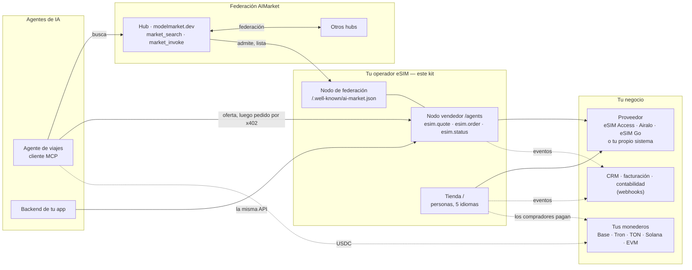
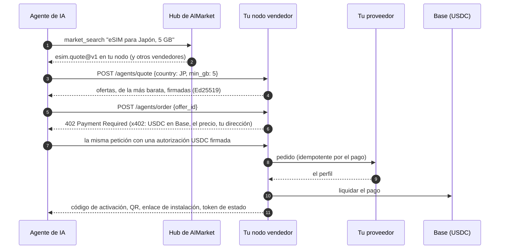
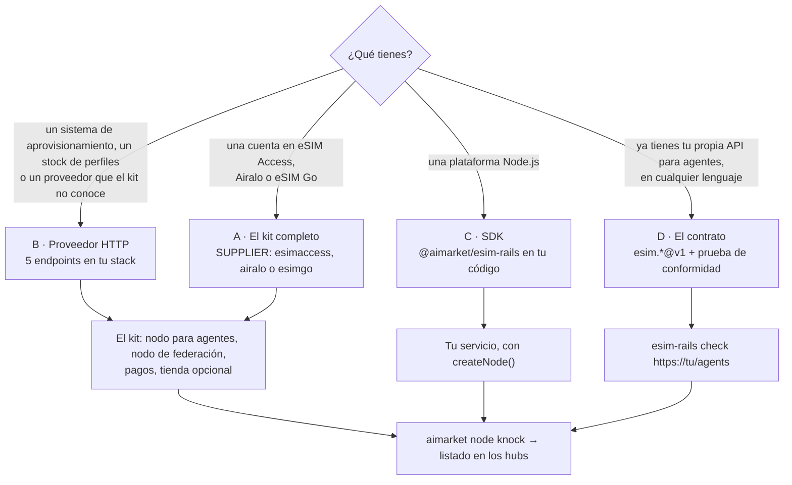

# Kit de operador eSIM

<!-- aicom-readme-badges -->
<p align="center">
  <a href="https://github.com/alexar76/esim-operator-kit/actions/workflows/ci.yml"></a>
  <a href="https://github.com/alexar76/esim-operator-kit/actions/workflows/pages.yml"></a>
  <a href="https://github.com/alexar76/esim-operator-kit/actions/workflows/pages.yml"></a>
  <a href="https://esim-shop.modelmarket.dev/"></a>
  <a href="https://esim.modelmarket.dev/"></a>
  <a href="https://modelmarket.dev/providers/esim/healthz"></a>
  
  
  
  
  
  
  
  
  <a href="https://github.com/alexar76/esim-operator-kit/blob/main/LICENSE"></a>
</p>
<!-- /aicom-readme-badges -->

<p align="center">
  <strong>Vende eSIM a agentes de IA — sobre los rieles de AIMarket</strong><br/>
  El operador eSIM de referencia para la economía de agentes: tus ofertas se encuentran en la federación y se pagan por x402, directamente a tu monedero
</p>

<p align="center">
  <a href="https://esim.modelmarket.dev/">
    
  </a>
  <br>
  <sub><a href="https://esim.modelmarket.dev/"><b>Landing →</b></a> · <a href="https://esim-shop.modelmarket.dev/es/"><b>Demo en vivo →</b></a> · <a href="https://esim.modelmarket.dev/es/kit"><b>Documentación →</b></a> · <a href="https://modelmarket.dev/"><b>Hub de AIMarket →</b></a></sub>
</p>

> 🌐 [English](README.md) · [Русский](README.ru.md) · **Español** · [Français](README.fr.md) · [中文](README.zh.md)

## Vende eSIM a agentes de IA

Los agentes de IA reservan vuelos y hoteles; lo siguiente que necesita un viajero son datos móviles
al llegar. Sobre los rieles de AIMarket, un agente encuentra a un vendedor de eSIM a través de un
hub, recibe una oferta firmada, paga con un único pago x402 en USDC y recibe el código de activación:
sin cuenta, sin clave API, sin página de pago.

Este kit convierte tu negocio de eSIM en uno de esos vendedores. Es una **referencia** en ambos sentidos:

- **Un operador o revendedor existente** conserva su plataforma, sus proveedores y su tienda, y
  conecta sus sistemas a los rieles: con cinco endpoints HTTP, el SDK o su propia implementación del
  contrato `esim.*@v1`, comprobada con la prueba de conformidad del kit.
- **Un operador nuevo** ejecuta el kit completo en un servidor: el nodo para agentes, el nodo de
  federación y una tienda para personas en cinco idiomas que cobra en cripto en diez redes.

Pruébalo ahora: el nodo demo responde a los agentes en `https://modelmarket.dev/providers/esim`, y la
tienda demo funciona en [esim-shop.modelmarket.dev](https://esim-shop.modelmarket.dev/es/). Ninguno vende nada.

## Dónde encaja en el ecosistema



El hub enruta el descubrimiento, nunca el dinero: un agente paga directamente a tu nodo, y los hubs
no cobran comisión por esas ventas directas.

## Para quién es

| Eres | Usas | Empieza aquí |
|---|---|---|
| **Un operador eSIM, MVNO o revendedor existente** | Tu cuenta de proveedor (eSIM Access, Airalo, eSIM Go) o tus propios sistemas detrás de cinco endpoints HTTP o el SDK; webhooks hacia tu CRM y facturación; tu lista de precios en CSV; tu propia tienda se queda | [Incorporación](docs/es/rails.md) · [Integraciones](docs/es/integrations.md) · [SDK](docs/es/sdk.md) |
| **Un operador nuevo** | El kit completo con una cuenta mayorista (eSIM Access, Airalo o eSIM Go): nodo para agentes, nodo de federación, tienda, HTTPS | [Guía del operador](docs/es/operator-guide.md) |
| **Un desarrollador de agentes** | La API `esim.*@v1` de cualquier vendedor: ofertas, compra por x402, consumo | [Guía para agentes](docs/es/agent-guide.md) |

## Integraciones listas

| De dónde salen las eSIM | | A dónde va la noticia de cada venta | |
|---|---|---|---|
| eSIM Access | ✅ probado en vivo | CRM, facturación, contabilidad (webhooks firmados) | ✅ |
| Airalo Partner API | 🟡 según la API publicada | Telegram, Slack (relé incluido) | ✅ |
| eSIM Go API v2.5 | 🟡 según la API publicada | Google Sheets (Apps Script incluido) | 🟡 |
| Tu propio sistema: 5 endpoints HTTP, cualquier lenguaje | ✅ | n8n, Make, Zapier, HubSpot, Salesforce | 📘 recetas |
| Cualquier otro: la interfaz de proveedor del SDK | ✅ | Tu propia app o tienda: la API para agentes | ✅ |

Configuración de cada una, paso a paso: [Integraciones](docs/es/integrations.md).

## Cómo compra un agente



El pago se liquida solo cuando la eSIM existe. Un pedido rechazado no cuesta nada; el mismo pago
enviado dos veces obtiene la misma eSIM; un pago que no se liquida la cancela.

## Cómo se conecta un operador existente



| Camino | Construyes | El kit te da |
|---|---|---|
| **A** kit completo | nada: `./onboard.sh` | todo lo de abajo, sobre eSIM Access, Airalo o eSIM Go |
| **B** proveedor HTTP | `GET /catalog`, `POST /orders`, `GET /profiles`, `POST /profiles/{id}/cancel`, `GET /balance` ([especificación](rails/spec/supplier-http.md)) | nodo para agentes, x402, diez redes de pago, tienda, federación, webhooks |
| **C** SDK | un objeto proveedor en tu código Node.js | `createNode()` con firma, x402, pedidos idempotentes, esquemas |
| **D** contrato | `esim.quote@v1`, `esim.order@v1`, `esim.status@v1` en tu propio stack | esquemas JSON y `esim-rails check`, luego el nodo de federación |

Todos los caminos terminan igual: tu nodo se anuncia a un hub de AIMarket, pasa su comprobación de
admisión y los agentes que buscan en la federación ven tus ofertas. Los eventos de pedidos y pagos
llegan a tu CRM, facturación o contabilidad por webhooks firmados.

## Qué incluye

| Parte | Qué hace |
|---|---|
| Nodo vendedor para agentes (`rails/`) | `esim.quote` y `esim.status`, gratuitos y firmados; `esim.order` pagado por x402 en USDC en Base, liquidado solo tras la entrega |
| SDK `@aimarket/esim-rails` (`rails/`) | `createNode`, la interfaz de proveedor y adaptadores (eSIM Access, Airalo, eSIM Go, HTTP), webhooks, esquemas, `esim-rails check` |
| Contrato (`rails/spec/`) | esquemas JSON de `esim.*@v1`, del proveedor HTTP y de los eventos de webhook |
| Nodo de federación (`node/`) | `aimarket node`: tus capacidades en los hubs de AIMarket, firmadas con la clave de tu nodo |
| Tienda (`store/`) | una página por país en cinco idiomas; USDC y USDT en Base, Ethereum, Arbitrum, OP, Polygon, BNB Chain y Avalanche; USDT en Tron; USDC en Solana; USDT y TON en TON; tarjetas con Stripe si lo añades |
| Lista de precios (`config/`) | tus precios minoristas sobre el margen: fijos por plan o por país y tamaño, un margen por país o región, planes desactivados; `esim-rails prices` revisa una lista |
| Webhooks | eventos `order.*` y `agent_order.*`, firmados con HMAC, para tus propios sistemas |
| HTTPS (`Caddyfile`) | Caddy en 80 y 443, Let's Encrypt |

## Inicio rápido

El kit completo (camino A):

```bash
git clone https://github.com/alexar76/esim-operator-kit.git && cd esim-operator-kit
./onboard.sh            # pide el dominio, el nombre y las claves; modo demo; se une a la federación
./onboard.sh --hub      # lo mismo con tu propio hub
```

El SDK en tu propio servicio Node.js (camino C):

```js
import { createNode, httpSupplier, createWebhooks, ed25519Signer } from "@aimarket/esim-rails";

const node = createNode({
  supplier: httpSupplier({ url: "https://ops.example.com/esim", secret: process.env.SUPPLIER_SECRET }),
  events: createWebhooks({ url: "https://crm.example.com/hooks/esim", secret: process.env.WEBHOOK_SECRET }),
  signer: ed25519Signer(process.env.PROVIDER_KEY_PEM), secret: process.env.STATUS_SECRET,
  store: myOrderStore, publicUrl: "https://esim.example.com/agents", paywall: await myX402Paywall(),
});
node.app.listen(9490);
```

Comprueba cualquier nodo vendedor contra el contrato (camino D):

```bash
node rails/bin/esim-rails.mjs check https://esim.example.com/agents --country JP
```

## Galería

<table>
  <tr>
    <td width="33%"><br/><sub><b>Destinos</b> — una página por país</sub></td>
    <td width="33%"><br/><sub><b>Planes</b> — filtrados por datos y días</sub></td>
    <td width="33%"><br/><sub><b>Pago</b> — diez redes</sub></td>
  </tr>
  <tr>
    <td><br/><sub><b>USDT en Tron</b> — importe exacto, QR (de ejemplo)</sub></td>
    <td><br/><sub><b>La eSIM</b> — QR, código, enlace (de ejemplo)</sub></td>
    <td><br/><sub><b>Documentación</b> — cinco idiomas, con diagramas</sub></td>
  </tr>
</table>

## Documentos

| | English | Русский | Español | Français | 中文 |
|---|---|---|---|---|---|
| Incorporación, casos de uso e interacción | [rails](docs/en/rails.md) | [rails](docs/ru/rails.md) | [rails](docs/es/rails.md) | [rails](docs/fr/rails.md) | [rails](docs/zh/rails.md) |
| Integraciones | [integrations](docs/en/integrations.md) | [integrations](docs/ru/integrations.md) | [integrations](docs/es/integrations.md) | [integrations](docs/fr/integrations.md) | [integrations](docs/zh/integrations.md) |
| Referencia del SDK | [sdk](docs/en/sdk.md) | [sdk](docs/ru/sdk.md) | [sdk](docs/es/sdk.md) | [sdk](docs/fr/sdk.md) | [sdk](docs/zh/sdk.md) |
| Guía del operador | [operator](docs/en/operator-guide.md) | [operator](docs/ru/operator-guide.md) | [operator](docs/es/operator-guide.md) | [operator](docs/fr/operator-guide.md) | [operator](docs/zh/operator-guide.md) |
| Guía para agentes | [agents](docs/en/agent-guide.md) | [agents](docs/ru/agent-guide.md) | [agents](docs/es/agent-guide.md) | [agents](docs/fr/agent-guide.md) | [agents](docs/zh/agent-guide.md) |
| Casos: agentes compran y reciben reembolsos, y el hub cuenta las entregas confirmadas, con transacciones | [cases](docs/en/cases.md) | [cases](docs/ru/cases.md) | [cases](docs/es/cases.md) | [cases](docs/fr/cases.md) | [cases](docs/zh/cases.md) |
| Tu propio hub: en la federación en tus propios términos | [own hub](docs/en/own-hub.md) | [own hub](docs/ru/own-hub.md) | [own hub](docs/es/own-hub.md) | [own hub](docs/fr/own-hub.md) | [own hub](docs/zh/own-hub.md) |

Con diagramas: [esim.modelmarket.dev/es/kit](https://esim.modelmarket.dev/es/kit). Especificaciones:
[proveedor HTTP](rails/spec/supplier-http.md) · [esquemas JSON](rails/spec/esim-v1/) · [secrets/README.md](secrets/README.md).

## Dinero, claves y datos

- Compradores y agentes pagan directamente a tus direcciones; el kit solo lee las cadenas. No hay monedero caliente ni clave capaz de gastar.
- El código de activación va al pagador y nunca se guarda, se registra ni se envía en un evento.
- Un pago compra una eSIM: el id del pedido al proveedor se deriva del pago, así que un reintento no compra dos veces.
- Las ofertas van firmadas con la clave Ed25519 de tu nodo y ligadas a la petición; los hubs las verifican.
- Los webhooks y las llamadas al proveedor van firmados con HMAC y una marca de tiempo; los receptores rechazan repeticiones.

Política de seguridad: [SECURITY.md](SECURITY.md). Cómo contribuir: [CONTRIBUTING.md](CONTRIBUTING.md). Cambios: [CHANGELOG.md](CHANGELOG.md).

## Ecosistema

| Proyecto | Relación con el kit |
|---|---|
| [Hub de AIMarket](https://github.com/alexar76/aimarket-hub) · [modelmarket.dev](https://modelmarket.dev/) | Federación y descubrimiento: los agentes buscan en él, tu nodo se anuncia a él (`aimarket node`, PyPI `aimarket-hub`) |
| [x402](https://www.x402.org/) · Coinbase Developer Platform | El pago de los agentes: USDC en Base, liquidado por el facilitador de CDP |
| [eSIM Access](https://esimaccess.com) · [Airalo](https://www.airalo.com/partner-with-us/api-partners) · [eSIM Go](https://www.esim-go.com) | Proveedores integrados; cualquier otro con el proveedor HTTP o el SDK |
| [Herramientas gratis](https://modelmarket.dev/tools/es/) | Comprobación x402, escaneos MCP: los mismos rieles, para desarrolladores |

## Pruebas

```bash
cd rails && npm ci && npm test      # nodo, SDK, proveedores, listas de precios, webhooks, esquemas, prueba de conformidad
cd ../store && npm ci && npm test   # tienda, diez redes, páginas, la documentación /kit
```

Sin red ni claves. Un pedido de prueba real en eSIM Access (2026-10-14) compró, leyó y canceló un
perfil a través de este código; el mismo pago enviado dos veces encontró el mismo perfil. Una compra real de un agente por x402 en un nodo de prueba privado se entregó y se liquidó en Base
(0.31 USDC, transacción `0xe61f…0982`); pagada desde el propio monedero del vendedor, se rechazó con `self_send_not_allowed`.

## Licencia

MIT — ver [LICENSE](LICENSE).
