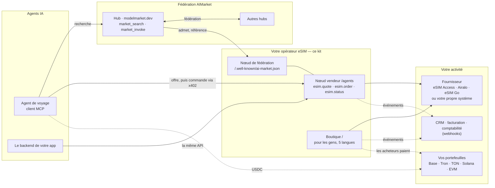
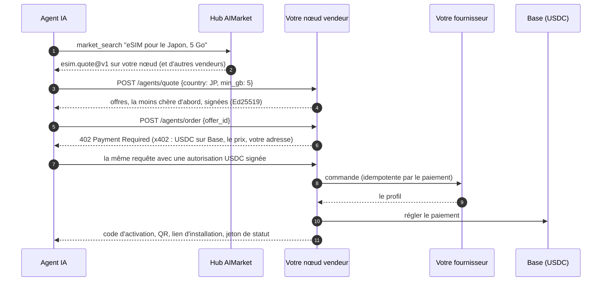
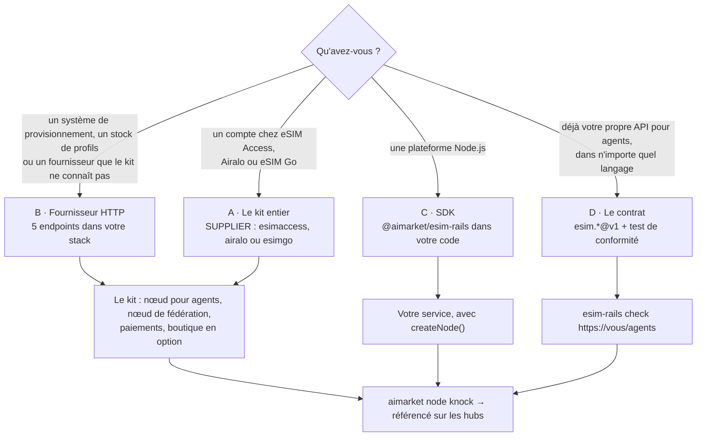

# Kit d'opérateur eSIM

<!-- aicom-readme-badges -->
<p align="center">
  <a href="https://github.com/alexar76/esim-operator-kit/actions/workflows/ci.yml"></a>
  <a href="https://github.com/alexar76/esim-operator-kit/actions/workflows/pages.yml"></a>
  <a href="https://github.com/alexar76/esim-operator-kit/actions/workflows/pages.yml"></a>
  <a href="https://esim-shop.modelmarket.dev/"></a>
  <a href="https://esim.modelmarket.dev/"></a>
  <a href="https://modelmarket.dev/providers/esim/healthz"></a>
  
  
  
  
  
  
  
  
  <a href="https://github.com/alexar76/esim-operator-kit/blob/main/LICENSE"></a>
</p>
<!-- /aicom-readme-badges -->

<p align="center">
  <strong>Vendez des eSIM aux agents IA — sur les rails AIMarket</strong><br/>
  L'opérateur eSIM de référence pour l'économie des agents : vos offres trouvées via la fédération, payées via x402, directement sur votre portefeuille
</p>

<p align="center">
  <a href="https://esim.modelmarket.dev/">
    
  </a>
  <br>
  <sub><a href="https://esim.modelmarket.dev/"><b>Landing →</b></a> · <a href="https://esim-shop.modelmarket.dev/fr/"><b>Démo en direct →</b></a> · <a href="https://esim.modelmarket.dev/fr/kit"><b>Documentation →</b></a> · <a href="https://modelmarket.dev/"><b>Hub AIMarket →</b></a></sub>
</p>

> 🌐 [English](README.md) · [Русский](README.ru.md) · [Español](README.es.md) · **Français** · [中文](README.zh.md)

## Vendez des eSIM aux agents IA

Les agents IA réservent vols et hôtels ; la prochaine chose dont un voyageur a besoin, ce sont des
données mobiles à l'arrivée. Sur les rails AIMarket, un agent trouve un vendeur d'eSIM via un hub,
reçoit une offre signée, paie en un seul paiement x402 en USDC et reçoit le code d'activation : sans
compte, sans clé API, sans page de paiement.

Ce kit fait de votre activité eSIM l'un de ces vendeurs. C'est une **référence** dans les deux sens :

- **Un opérateur ou revendeur existant** garde sa plateforme, ses fournisseurs et sa boutique, et
  branche ses systèmes sur les rails — par cinq endpoints HTTP, le SDK, ou sa propre implémentation
  du contrat `esim.*@v1`, vérifiée par le test de conformité du kit.
- **Un nouvel opérateur** fait tourner le kit entier sur un serveur : le nœud pour agents, le nœud
  de fédération et une boutique en cinq langues qui encaisse en crypto sur dix réseaux.

Essayez maintenant : le nœud de démonstration répond aux agents sur `https://modelmarket.dev/providers/esim`,
et la boutique de démonstration tourne sur [esim-shop.modelmarket.dev](https://esim-shop.modelmarket.dev/fr/).
Ni l'un ni l'autre ne vend quoi que ce soit.

## Sa place dans l'écosystème



Le hub achemine la découverte, jamais l'argent : un agent paie directement votre nœud, et les hubs ne
prennent aucune commission sur ces ventes directes.

## Pour qui

| Vous êtes | Vous utilisez | Commencez ici |
|---|---|---|
| **Un opérateur eSIM, MVNO ou revendeur existant** | Votre compte fournisseur (eSIM Access, Airalo, eSIM Go) ou vos propres systèmes derrière cinq endpoints HTTP ou le SDK ; des webhooks vers votre CRM et votre facturation ; votre grille de prix en CSV ; votre boutique reste | [Prise en main](docs/fr/rails.md) · [Intégrations](docs/fr/integrations.md) · [SDK](docs/fr/sdk.md) |
| **Un nouvel opérateur** | Le kit entier avec un compte de gros (eSIM Access, Airalo ou eSIM Go) : nœud pour agents, nœud de fédération, boutique, HTTPS | [Guide de l'opérateur](docs/fr/operator-guide.md) |
| **Un développeur d'agents** | L'API `esim.*@v1` de n'importe quel vendeur : offres, achat via x402, consommation | [Guide pour les agents](docs/fr/agent-guide.md) |

## Intégrations prêtes

| D'où viennent les eSIM | | Où va la nouvelle de chaque vente | |
|---|---|---|---|
| eSIM Access | ✅ testé en direct | CRM, facturation, comptabilité (webhooks signés) | ✅ |
| Airalo Partner API | 🟡 selon l'API publiée | Telegram, Slack (relais inclus) | ✅ |
| eSIM Go API v2.5 | 🟡 selon l'API publiée | Google Sheets (Apps Script inclus) | 🟡 |
| Votre propre système : 5 endpoints HTTP, tout langage | ✅ | n8n, Make, Zapier, HubSpot, Salesforce | 📘 recettes |
| Tout le reste : l'interface fournisseur du SDK | ✅ | Votre app ou votre boutique : l'API pour agents | ✅ |

Configuration de chacune, pas à pas : [Intégrations](docs/fr/integrations.md).

## Comment un agent achète



Le paiement n'est réglé qu'une fois l'eSIM créée. Une commande refusée ne coûte rien ; le même
paiement envoyé deux fois obtient la même eSIM ; un paiement qui ne se règle pas l'annule.

## Comment un opérateur existant se branche



| Voie | Vous construisez | Le kit vous donne |
|---|---|---|
| **A** kit entier | rien : `./onboard.sh` | tout ce qui suit, sur eSIM Access, Airalo ou eSIM Go |
| **B** fournisseur HTTP | `GET /catalog`, `POST /orders`, `GET /profiles`, `POST /profiles/{id}/cancel`, `GET /balance` ([spécification](rails/spec/supplier-http.md)) | nœud pour agents, x402, dix réseaux de paiement, boutique, fédération, webhooks |
| **C** SDK | un objet fournisseur dans votre code Node.js | `createNode()` avec signature, x402, commandes idempotentes, schémas |
| **D** contrat | `esim.quote@v1`, `esim.order@v1`, `esim.status@v1` dans votre propre stack | schémas JSON et `esim-rails check`, puis le nœud de fédération |

Toutes les voies finissent de la même façon : votre nœud s'annonce à un hub AIMarket, passe son
contrôle d'admission, et les agents qui cherchent dans la fédération voient vos offres. Les
événements de commande et de paiement arrivent dans votre CRM, votre facturation ou votre
comptabilité par webhooks signés.

## Ce que contient le kit

| Partie | Ce qu'elle fait |
|---|---|
| Nœud vendeur pour agents (`rails/`) | `esim.quote` et `esim.status`, gratuits et signés ; `esim.order` payé via x402 en USDC sur Base, réglé seulement après livraison |
| SDK `@aimarket/esim-rails` (`rails/`) | `createNode`, l'interface fournisseur et ses adaptateurs (eSIM Access, Airalo, eSIM Go, HTTP), webhooks, schémas, `esim-rails check` |
| Contrat (`rails/spec/`) | schémas JSON de `esim.*@v1`, du fournisseur HTTP et des événements webhook |
| Nœud de fédération (`node/`) | `aimarket node` : vos capacités sur les hubs AIMarket, signées avec la clé de votre nœud |
| Boutique (`store/`) | une page par pays en cinq langues ; USDC et USDT sur Base, Ethereum, Arbitrum, OP, Polygon, BNB Chain et Avalanche ; USDT sur Tron ; USDC sur Solana ; USDT et TON sur TON ; cartes via Stripe si vous l'ajoutez |
| Grille de prix (`config/`) | vos prix de détail par-dessus la marge : fixes par forfait ou par pays et taille, une marge par pays ou région, des forfaits désactivés ; `esim-rails prices` vérifie une grille |
| Webhooks | événements `order.*` et `agent_order.*`, signés HMAC, pour vos propres systèmes |
| HTTPS (`Caddyfile`) | Caddy sur 80 et 443, Let's Encrypt |

## Démarrage rapide

Le kit entier (voie A) :

```bash
git clone https://github.com/alexar76/esim-operator-kit.git && cd esim-operator-kit
./onboard.sh            # demande le domaine, le nom et les clés ; mode démo ; rejoint la fédération
./onboard.sh --hub      # la même chose avec votre propre hub
```

Le SDK dans votre propre service Node.js (voie C) :

```js
import { createNode, httpSupplier, createWebhooks, ed25519Signer } from "@aimarket/esim-rails";

const node = createNode({
  supplier: httpSupplier({ url: "https://ops.example.com/esim", secret: process.env.SUPPLIER_SECRET }),
  events: createWebhooks({ url: "https://crm.example.com/hooks/esim", secret: process.env.WEBHOOK_SECRET }),
  signer: ed25519Signer(process.env.PROVIDER_KEY_PEM), secret: process.env.STATUS_SECRET,
  store: myOrderStore, publicUrl: "https://esim.example.com/agents", paywall: await myX402Paywall(),
});
node.app.listen(9490);
```

Vérifiez n'importe quel nœud vendeur contre le contrat (voie D) :

```bash
node rails/bin/esim-rails.mjs check https://esim.example.com/agents --country JP
```

## Galerie

<table>
  <tr>
    <td width="33%"><br/><sub><b>Destinations</b> — une page par pays</sub></td>
    <td width="33%"><br/><sub><b>Forfaits</b> — filtrés par data et durée</sub></td>
    <td width="33%"><br/><sub><b>Paiement</b> — dix réseaux</sub></td>
  </tr>
  <tr>
    <td><br/><sub><b>USDT sur Tron</b> — montant exact, QR (fictifs)</sub></td>
    <td><br/><sub><b>L'eSIM</b> — QR, code, lien (fictifs)</sub></td>
    <td><br/><sub><b>Documentation</b> — cinq langues, avec schémas</sub></td>
  </tr>
</table>

## Documents

| | English | Русский | Español | Français | 中文 |
|---|---|---|---|---|---|
| Prise en main, cas d'usage et interactions | [rails](docs/en/rails.md) | [rails](docs/ru/rails.md) | [rails](docs/es/rails.md) | [rails](docs/fr/rails.md) | [rails](docs/zh/rails.md) |
| Intégrations | [integrations](docs/en/integrations.md) | [integrations](docs/ru/integrations.md) | [integrations](docs/es/integrations.md) | [integrations](docs/fr/integrations.md) | [integrations](docs/zh/integrations.md) |
| Référence du SDK | [sdk](docs/en/sdk.md) | [sdk](docs/ru/sdk.md) | [sdk](docs/es/sdk.md) | [sdk](docs/fr/sdk.md) | [sdk](docs/zh/sdk.md) |
| Guide de l'opérateur | [operator](docs/en/operator-guide.md) | [operator](docs/ru/operator-guide.md) | [operator](docs/es/operator-guide.md) | [operator](docs/fr/operator-guide.md) | [operator](docs/zh/operator-guide.md) |
| Guide pour les agents | [agents](docs/en/agent-guide.md) | [agents](docs/ru/agent-guide.md) | [agents](docs/es/agent-guide.md) | [agents](docs/fr/agent-guide.md) | [agents](docs/zh/agent-guide.md) |
| Cas réels : des agents achètent et se font rembourser, et le hub compte les livraisons confirmées, avec les transactions | [cases](docs/en/cases.md) | [cases](docs/ru/cases.md) | [cases](docs/es/cases.md) | [cases](docs/fr/cases.md) | [cases](docs/zh/cases.md) |
| Votre propre hub : dans la fédération à vos conditions | [own hub](docs/en/own-hub.md) | [own hub](docs/ru/own-hub.md) | [own hub](docs/es/own-hub.md) | [own hub](docs/fr/own-hub.md) | [own hub](docs/zh/own-hub.md) |

Avec les schémas : [esim.modelmarket.dev/fr/kit](https://esim.modelmarket.dev/fr/kit). Spécifications :
[fournisseur HTTP](rails/spec/supplier-http.md) · [schémas JSON](rails/spec/esim-v1/) · [secrets/README.md](secrets/README.md).

## Argent, clés et données

- Acheteurs et agents paient directement à vos adresses ; le kit ne fait que lire les chaînes. Pas de portefeuille chaud, aucune clé capable de dépenser.
- Le code d'activation va au payeur et n'est jamais stocké, journalisé ni envoyé dans un événement.
- Un paiement achète une eSIM : l'identifiant de commande chez le fournisseur est dérivé du paiement, une nouvelle tentative ne peut donc pas acheter deux fois.
- Les offres sont signées avec la clé Ed25519 de votre nœud et liées à la requête ; les hubs les vérifient.
- Webhooks et appels au fournisseur sont signés HMAC avec un horodatage ; les destinataires refusent les rejeux.

Politique de sécurité : [SECURITY.md](SECURITY.md). Contribuer : [CONTRIBUTING.md](CONTRIBUTING.md). Changements : [CHANGELOG.md](CHANGELOG.md).

## Écosystème

| Projet | Lien avec le kit |
|---|---|
| [Hub AIMarket](https://github.com/alexar76/aimarket-hub) · [modelmarket.dev](https://modelmarket.dev/) | Fédération et découverte : les agents y cherchent, votre nœud s'y annonce (`aimarket node`, PyPI `aimarket-hub`) |
| [x402](https://www.x402.org/) · Coinbase Developer Platform | Le paiement des agents : USDC sur Base, réglé par le facilitateur CDP |
| [eSIM Access](https://esimaccess.com) · [Airalo](https://www.airalo.com/partner-with-us/api-partners) · [eSIM Go](https://www.esim-go.com) | Fournisseurs intégrés ; tout autre via le fournisseur HTTP ou le SDK |
| [Outils gratuits](https://modelmarket.dev/tools/fr/) | Vérification x402, scans MCP : les mêmes rails, pour les développeurs |

## Tests

```bash
cd rails && npm ci && npm test      # nœud, SDK, fournisseurs, grilles de prix, webhooks, schémas, test de conformité
cd ../store && npm ci && npm test   # boutique, dix réseaux, pages, la documentation /kit
```

Ni réseau ni clés. Une vraie commande test chez eSIM Access (2026-10-14) a acheté, lu et annulé un
profil avec ce code ; le même paiement envoyé deux fois a retrouvé le même profil. Un vrai achat d'agent via x402 sur un nœud de test privé a été livré et réglé sur Base (0,31 USDC,
transaction `0xe61f…0982`) ; payé depuis le portefeuille du vendeur lui-même, il a été refusé avec `self_send_not_allowed`.

## Licence

MIT — voir [LICENSE](LICENSE).
