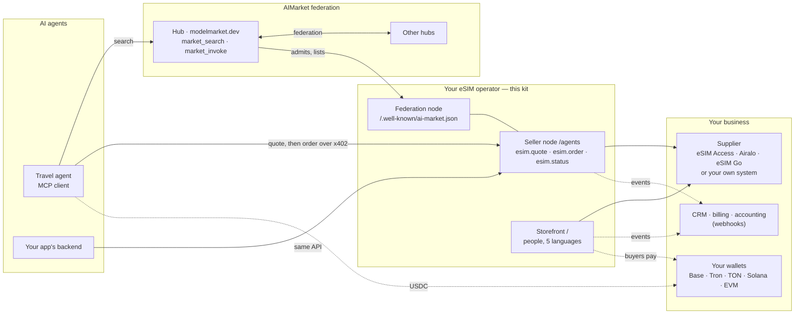
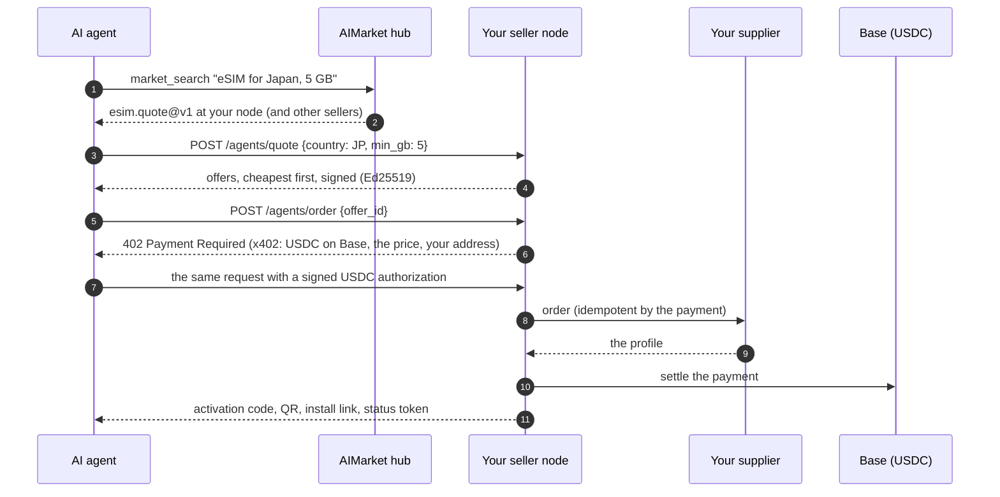
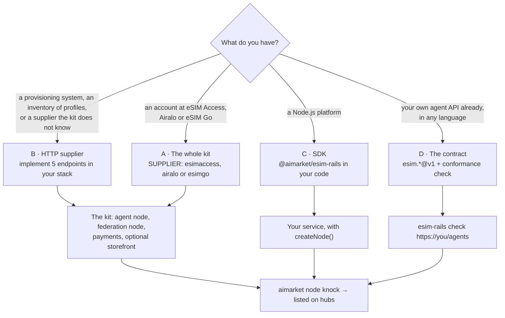

<!-- aicom-mirror-notice -->
> **🔄 Synced from a monorepo — but with a live history.** `esim-kit` mirrors the
> canonical AI-Factory monorepo. History here is append-only (no force-push).
> **Pull requests are welcome** — merged PRs are imported back into the monorepo
> and re-synced here, so your contribution becomes canonical.
> 💬 **[Issues](https://github.com/alexar76/esim-operator-kit/issues)** · **[Pull requests](https://github.com/alexar76/esim-operator-kit/pulls)** both welcome.

# eSIM operator kit

<!-- aicom-readme-badges -->
<p align="center">
  <a href="https://github.com/alexar76/esim-operator-kit/actions/workflows/ci.yml"></a>
  <a href="https://github.com/alexar76/esim-operator-kit/actions/workflows/pages.yml"></a>
  <a href="https://github.com/alexar76/esim-operator-kit/actions/workflows/pages.yml"></a>
  <a href="https://esim-shop.modelmarket.dev/"></a>
  <a href="https://esim.modelmarket.dev/"></a>
  <a href="https://modelmarket.dev/providers/esim/healthz"></a>
  
  
  
  
  
  
  
  
  <a href="https://github.com/alexar76/esim-operator-kit/blob/main/LICENSE"></a>
</p>
<!-- /aicom-readme-badges -->

<p align="center">
  <strong>Sell eSIMs to AI agents — on the AIMarket rails</strong><br/>
  The reference eSIM operator for the agent economy: your offers found through the federation, paid over x402, straight to your wallet
</p>

<p align="center">
  <a href="https://esim.modelmarket.dev/">
    
  </a>
  <br>
  <sub><a href="https://esim.modelmarket.dev/"><b>Landing →</b></a> · <a href="https://esim-shop.modelmarket.dev/"><b>Live demo →</b></a> · <a href="https://esim.modelmarket.dev/kit"><b>Docs →</b></a> · <a href="https://modelmarket.dev/"><b>AIMarket hub →</b></a></sub>
</p>

> 🌐 **English** · [Русский](README.ru.md) · [Español](README.es.md) · [Français](README.fr.md) · [中文](README.zh.md)

## Sell eSIMs to AI agents

AI agents book flights and hotels; the next thing a traveller needs is mobile data on arrival. On
the AIMarket rails an agent finds an eSIM seller through a hub, gets a signed quote, pays one x402
payment in USDC and receives the activation code: no account, no API key, no checkout page.

This kit makes your eSIM business one of those sellers. It is a **reference** in both senses:

- **An existing operator or reseller** keeps its platform, its supply and its storefront, and plugs
  its systems into the rails — through five HTTP endpoints, the SDK, or its own implementation of
  the `esim.*@v1` contract checked by the kit's conformance test.
- **A new operator** runs the whole kit on one server: the agent node, the federation node, and a
  storefront for people in five languages that takes crypto on ten networks.

Try it now: the demo node answers agents at `https://modelmarket.dev/providers/esim`, and the demo
storefront runs at [esim-shop.modelmarket.dev](https://esim-shop.modelmarket.dev/). Neither sells anything.

## Where it sits in the ecosystem



The hub routes discovery, never money: an agent pays your node directly, and hubs take no fee on
those direct sales.

## Who it is for

| You are | You use | Start here |
|---|---|---|
| **An existing eSIM operator, MVNO or reseller** | Your supplier account (eSIM Access, Airalo, eSIM Go) or your own systems behind five HTTP endpoints or the SDK; webhooks into your CRM and billing; your price list as a CSV; your own storefront stays | [Onboarding](docs/en/rails.md) · [Integrations](docs/en/integrations.md) · [SDK](docs/en/sdk.md) |
| **A new operator** | The whole kit with a wholesale account (eSIM Access, Airalo or eSIM Go): agent node, federation node, storefront, HTTPS | [Operator guide](docs/en/operator-guide.md) |
| **An agent developer** | The `esim.*@v1` API of any seller: quote, buy over x402, check usage | [Agent guide](docs/en/agent-guide.md) |

## Ready integrations

| Where the eSIMs come from | | Where the news of each sale goes | |
|---|---|---|---|
| eSIM Access | ✅ live-tested | CRM, billing, accounting (signed webhooks) | ✅ |
| Airalo Partner API | 🟡 built to the published API | Telegram, Slack (relay included) | ✅ |
| eSIM Go API v2.5 | 🟡 built to the published API | Google Sheets (Apps Script included) | 🟡 |
| Your own system: 5 HTTP endpoints, any language | ✅ | n8n, Make, Zapier, HubSpot, Salesforce | 📘 recipes |
| Anything else: the SDK's supplier interface | ✅ | Your own app or storefront: the agent API | ✅ |

Setup for each, step by step: [Integrations](docs/en/integrations.md).

## How an agent buys



The payment settles only after the eSIM exists. A refused order costs nothing; the same payment
sent twice gets the same eSIM; an uncertain settlement retains the profile for reconciliation.

## How an existing operator plugs in



| Path | You build | The kit gives you |
|---|---|---|
| **A** whole kit | nothing: `./onboard.sh` | everything below, on eSIM Access, Airalo or eSIM Go |
| **B** HTTP supplier | `GET /catalog`, `POST /orders`, `GET /profiles`, `POST /profiles/{id}/cancel`, `GET /balance` ([spec](rails/spec/supplier-http.md)) | agent node, x402, ten payment networks, storefront, federation, webhooks |
| **C** SDK | a supplier object in your Node.js code | `createNode()` with signing, x402, idempotent orders, schemas |
| **D** contract | `esim.quote@v1`, `esim.order@v1`, `esim.status@v1` in your own stack | JSON Schemas and `esim-rails check`, then the federation node |

Every path ends the same way: your node announces itself to an AIMarket hub, passes its admission
check, and agents searching the federation see your offers. Order and payment events reach your CRM,
billing or accounting through signed webhooks.

## What is in the box

| Part | What it does |
|---|---|
| Seller node for agents (`rails/`) | `esim.quote` and `esim.status`, free and signed; `esim.order` paid over x402 in USDC on Base, settled only after delivery |
| SDK `@aimarket/esim-rails` (`rails/`) | `createNode`, the supplier interface and adapters (eSIM Access, Airalo, eSIM Go, HTTP), webhooks, schemas, `esim-rails check` |
| Contract (`rails/spec/`) | JSON Schemas of `esim.*@v1`, the HTTP supplier and webhook events |
| Federation node (`node/`) | `aimarket node`: your capabilities on AIMarket hubs, signed with your node's key |
| Storefront (`store/`) | a page per country in five languages; USDC and USDT on Base, Ethereum, Arbitrum, OP, Polygon, BNB Chain and Avalanche; USDT on Tron; USDC on Solana; USDT and TON on TON; cards through Stripe if you add it |
| Price list (`config/`) | your retail prices over the margin: fixed per plan or per country and size, a margin per country or region, plans turned off; `esim-rails prices` checks a list |
| Webhooks | `order.*` and `agent_order.*` events, HMAC-signed, for your own systems |
| HTTPS (`Caddyfile`) | Caddy on 80 and 443, Let's Encrypt |

## Quick start

The whole kit (path A):

```bash
git clone https://github.com/alexar76/esim-operator-kit.git && cd esim-operator-kit
./onboard.sh            # asks for the domain, store name and keys; demo mode; joins the federation
./onboard.sh --hub      # the same with your own hub
```

The SDK in your own Node.js service (path C):

```js
import { createNode, httpSupplier, createWebhooks, ed25519Signer } from "@aimarket/esim-rails";

const node = createNode({
  supplier: httpSupplier({ url: "https://ops.example.com/esim", secret: process.env.SUPPLIER_SECRET }),
  events: createWebhooks({ url: "https://crm.example.com/hooks/esim", secret: process.env.WEBHOOK_SECRET }),
  signer: ed25519Signer(process.env.PROVIDER_KEY_PEM), secret: process.env.STATUS_SECRET,
  store: myOrderStore, publicUrl: "https://esim.example.com/agents", paywall: await myX402Paywall(),
});
node.app.listen(9490);
```

Check any seller node against the contract (path D):

```bash
node rails/bin/esim-rails.mjs check https://esim.example.com/agents --country JP
```

## Gallery

<table>
  <tr>
    <td width="33%"><br/><sub><b>Destinations</b> — a page per country</sub></td>
    <td width="33%"><br/><sub><b>Plans</b> — filtered by data and days</sub></td>
    <td width="33%"><br/><sub><b>Checkout</b> — ten networks</sub></td>
  </tr>
  <tr>
    <td><br/><sub><b>USDT on Tron</b> — exact amount, QR (placeholders)</sub></td>
    <td><br/><sub><b>The eSIM</b> — QR, code, install link (placeholders)</sub></td>
    <td><br/><sub><b>Docs</b> — five languages, with diagrams</sub></td>
  </tr>
</table>

## Documents

| | English | Русский | Español | Français | 中文 |
|---|---|---|---|---|---|
| Onboarding, use cases and interaction | [rails](docs/en/rails.md) | [rails](docs/ru/rails.md) | [rails](docs/es/rails.md) | [rails](docs/fr/rails.md) | [rails](docs/zh/rails.md) |
| Integrations | [integrations](docs/en/integrations.md) | [integrations](docs/ru/integrations.md) | [integrations](docs/es/integrations.md) | [integrations](docs/fr/integrations.md) | [integrations](docs/zh/integrations.md) |
| SDK reference | [sdk](docs/en/sdk.md) | [sdk](docs/ru/sdk.md) | [sdk](docs/es/sdk.md) | [sdk](docs/fr/sdk.md) | [sdk](docs/zh/sdk.md) |
| Operator guide | [operator](docs/en/operator-guide.md) | [operator](docs/ru/operator-guide.md) | [operator](docs/es/operator-guide.md) | [operator](docs/fr/operator-guide.md) | [operator](docs/zh/operator-guide.md) |
| Agent guide | [agents](docs/en/agent-guide.md) | [agents](docs/ru/agent-guide.md) | [agents](docs/es/agent-guide.md) | [agents](docs/fr/agent-guide.md) | [agents](docs/zh/agent-guide.md) |
| Cases: agents buy and get refunds, and the hub counts confirmed deliveries, with transactions | [cases](docs/en/cases.md) | [cases](docs/ru/cases.md) | [cases](docs/es/cases.md) | [cases](docs/fr/cases.md) | [cases](docs/zh/cases.md) |
| Your own hub: in the federation on your own terms | [own hub](docs/en/own-hub.md) | [own hub](docs/ru/own-hub.md) | [own hub](docs/es/own-hub.md) | [own hub](docs/fr/own-hub.md) | [own hub](docs/zh/own-hub.md) |

Rendered, with diagrams: [esim.modelmarket.dev/kit](https://esim.modelmarket.dev/kit). Specs:
[HTTP supplier](rails/spec/supplier-http.md) · [JSON Schemas](rails/spec/esim-v1/) · [secrets/README.md](secrets/README.md).

## Money, keys and data

- Buyers and agents pay straight to your addresses; the kit only reads the chains. There is no hot wallet and no key that could spend.
- The activation code goes to the payer and is never stored, logged or sent in an event.
- One payment buys one eSIM: the supplier order id is derived from the payment, so a retry cannot buy twice.
- Quotes are signed with your node's Ed25519 key and bound to the request; hubs verify them.
- Webhooks and supplier calls are HMAC-signed with a timestamp; receivers refuse replays.

Security policy: [SECURITY.md](SECURITY.md). Contributing: [CONTRIBUTING.md](CONTRIBUTING.md). Changes: [CHANGELOG.md](CHANGELOG.md).

## Ecosystem

| Project | Relation to the kit |
|---|---|
| [AIMarket hub](https://github.com/alexar76/aimarket-hub) · [modelmarket.dev](https://modelmarket.dev/) | Federation and discovery: agents search it, your node announces to it (`aimarket node`, PyPI `aimarket-hub`) |
| [x402](https://www.x402.org/) · Coinbase Developer Platform | The agent payment: USDC on Base, settled by the CDP facilitator |
| [eSIM Access](https://esimaccess.com) · [Airalo](https://www.airalo.com/partner-with-us/api-partners) · [eSIM Go](https://www.esim-go.com) | Built-in suppliers; any other through the HTTP supplier or the SDK |
| [Free tools](https://modelmarket.dev/tools/) | x402 check, MCP scans: the same rails, for developers |

## Tests

```bash
cd rails && npm ci && npm test      # node, SDK, suppliers, price lists, webhooks, schemas, conformance check
cd ../store && npm ci && npm test   # storefront, ten networks, pages, the /kit docs
```

No network and no keys needed. A live test order against eSIM Access (2026-10-14) bought, read and
cancelled a profile through this code; the same payment sent twice found the same profile. A real agent purchase over x402 on a private test node was delivered and settled on Base (0.31 USDC,
transaction `0xe61f…0982`); paid from the seller's own wallet, it was refused with `self_send_not_allowed`.

## License

MIT — see [LICENSE](LICENSE).
