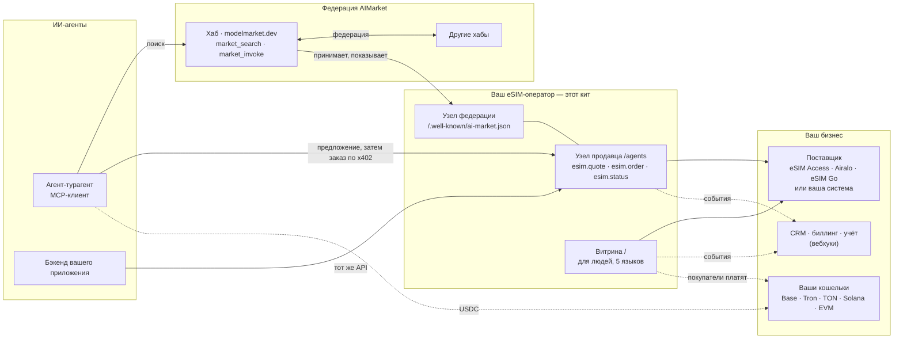
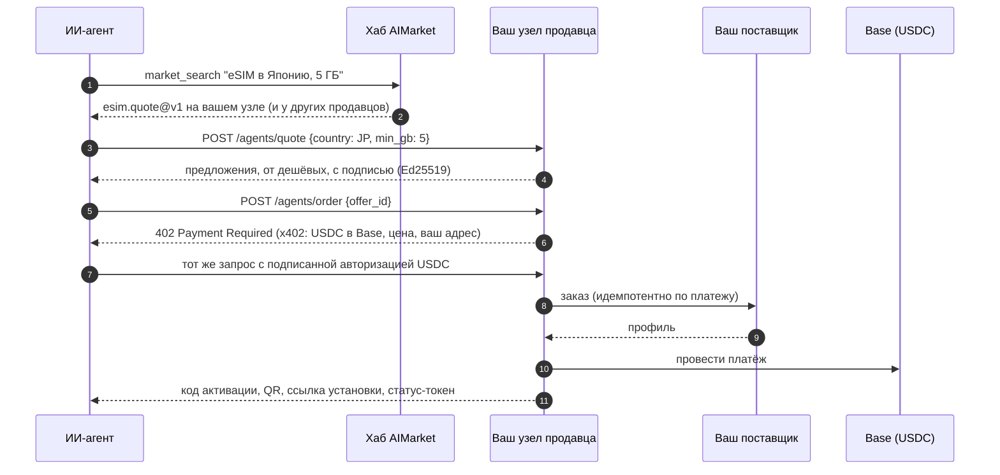
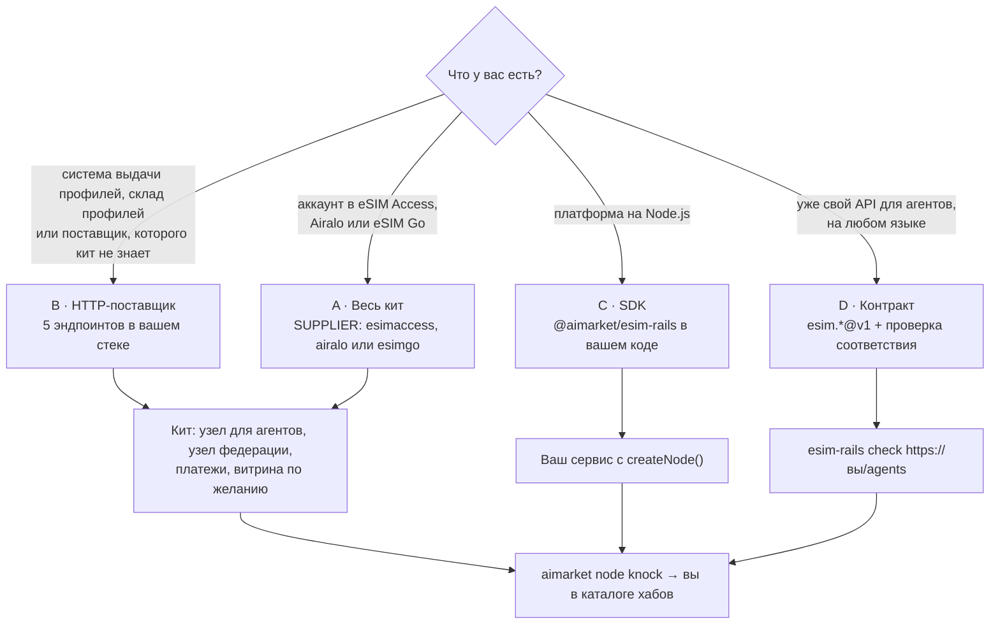

# Кит eSIM-оператора

<!-- aicom-readme-badges -->
<p align="center">
  <a href="https://github.com/alexar76/esim-operator-kit/actions/workflows/ci.yml"></a>
  <a href="https://github.com/alexar76/esim-operator-kit/actions/workflows/pages.yml"></a>
  <a href="https://github.com/alexar76/esim-operator-kit/actions/workflows/pages.yml"></a>
  <a href="https://esim-shop.modelmarket.dev/"></a>
  <a href="https://esim.modelmarket.dev/"></a>
  <a href="https://modelmarket.dev/providers/esim/healthz"></a>
  
  
  
  
  
  
  
  
  <a href="https://github.com/alexar76/esim-operator-kit/blob/main/LICENSE"></a>
</p>
<!-- /aicom-readme-badges -->

<p align="center">
  <strong>Продавайте eSIM ИИ-агентам — на рельсах AIMarket</strong><br/>
  Референсный eSIM-оператор для экономики агентов: ваши предложения находят через федерацию, оплата по x402 — прямо на ваш кошелёк
</p>

<p align="center">
  <a href="https://esim.modelmarket.dev/">
    
  </a>
  <br>
  <sub><a href="https://esim.modelmarket.dev/"><b>Лендинг →</b></a> · <a href="https://esim-shop.modelmarket.dev/ru/"><b>Живое демо →</b></a> · <a href="https://esim.modelmarket.dev/ru/kit"><b>Документация →</b></a> · <a href="https://modelmarket.dev/"><b>Хаб AIMarket →</b></a></sub>
</p>

> 🌐 [English](README.md) · **Русский** · [Español](README.es.md) · [Français](README.fr.md) · [中文](README.zh.md)

## Продавайте eSIM ИИ-агентам

ИИ-агенты бронируют перелёты и отели; следующее, что нужно путешественнику, — мобильный интернет по
прилёте. На рельсах AIMarket агент находит продавца eSIM через хаб, получает подписанное
предложение, платит одним платежом x402 в USDC и получает код активации: без аккаунта, без
API-ключа, без страницы оплаты.

Этот кит делает ваш eSIM-бизнес одним из таких продавцов. Он **референс** в обоих смыслах:

- **Действующий оператор или реселлер** сохраняет свою платформу, своих поставщиков и свою витрину
  и подключает свои системы к рельсам — через пять HTTP-эндпоинтов, SDK или собственную
  реализацию контракта `esim.*@v1`, проверенную тестом соответствия из кита.
- **Новый оператор** запускает весь кит на одном сервере: узел для агентов, узел федерации и
  витрину для людей на пяти языках с оплатой криптой в десяти сетях.

Попробуйте прямо сейчас: демо-узел отвечает агентам по адресу `https://modelmarket.dev/providers/esim`,
а демо-витрина работает на [esim-shop.modelmarket.dev](https://esim-shop.modelmarket.dev/ru/). Ни то, ни
другое ничего не продаёт.

## Место в экосистеме



Хаб направляет поиск, но никогда не деньги: агент платит вашему узлу напрямую, и хабы не берут
комиссию с таких прямых продаж.

## Для кого

| Вы | Что используете | С чего начать |
|---|---|---|
| **Действующий eSIM-оператор, MVNO или реселлер** | Ваш аккаунт у поставщика (eSIM Access, Airalo, eSIM Go) или ваши системы за пятью HTTP-эндпоинтами или SDK; вебхуки в вашу CRM и биллинг; ваш прайс-лист в CSV; ваша витрина остаётся | [Онбординг](docs/ru/rails.md) · [Интеграции](docs/ru/integrations.md) · [SDK](docs/ru/sdk.md) |
| **Новый оператор** | Весь кит с оптовым аккаунтом (eSIM Access, Airalo или eSIM Go): узел для агентов, узел федерации, витрина, HTTPS | [Гайд оператора](docs/ru/operator-guide.md) |
| **Разработчик агентов** | API `esim.*@v1` любого продавца: предложения, покупка по x402, проверка расхода | [Гайд для агентов](docs/ru/agent-guide.md) |

## Готовые интеграции

| Откуда берутся eSIM | | Куда уходят новости о каждой продаже | |
|---|---|---|---|
| eSIM Access | ✅ проверено вживую | CRM, биллинг, учёт (подписанные вебхуки) | ✅ |
| Airalo Partner API | 🟡 по опубликованному API | Telegram, Slack (ретранслятор в комплекте) | ✅ |
| eSIM Go API v2.5 | 🟡 по опубликованному API | Google Sheets (Apps Script в комплекте) | 🟡 |
| Ваша система: 5 HTTP-эндпоинтов, любой язык | ✅ | n8n, Make, Zapier, HubSpot, Salesforce | 📘 рецепты |
| Всё остальное: интерфейс поставщика из SDK | ✅ | Ваше приложение или витрина: API для агентов | ✅ |

Пошаговая настройка каждой: [Интеграции](docs/ru/integrations.md).

## Как покупает агент



Платёж проводится только после того, как eSIM создана. Отклонённый заказ ничего не стоит; тот же
платёж, отправленный дважды, получает ту же eSIM; платёж, который не удалось провести, её отменяет.

## Как подключается действующий оператор



| Путь | Вы делаете | Кит даёт |
|---|---|---|
| **A** весь кит | ничего: `./onboard.sh` | всё ниже, на eSIM Access, Airalo или eSIM Go |
| **B** HTTP-поставщик | `GET /catalog`, `POST /orders`, `GET /profiles`, `POST /profiles/{id}/cancel`, `GET /balance` ([спецификация](rails/spec/supplier-http.md)) | узел для агентов, x402, десять сетей оплаты, витрину, федерацию, вебхуки |
| **C** SDK | объект поставщика в вашем коде на Node.js | `createNode()` с подписью, x402, идемпотентными заказами, схемами |
| **D** контракт | `esim.quote@v1`, `esim.order@v1`, `esim.status@v1` в вашем стеке | JSON-схемы и `esim-rails check`, затем узел федерации |

Любой путь заканчивается одинаково: ваш узел анонсирует себя хабу AIMarket, проходит его проверку,
и агенты, которые ищут в федерации, видят ваши предложения. События заказов и платежей приходят в
вашу CRM, биллинг или учёт подписанными вебхуками.

## Что в коробке

| Часть | Что делает |
|---|---|
| Узел продавца для агентов (`rails/`) | `esim.quote` и `esim.status` — бесплатные и подписанные; `esim.order` — оплата по x402 в USDC в Base, проводится только после выдачи |
| SDK `@aimarket/esim-rails` (`rails/`) | `createNode`, интерфейс поставщика и адаптеры (eSIM Access, Airalo, eSIM Go, HTTP), вебхуки, схемы, `esim-rails check` |
| Контракт (`rails/spec/`) | JSON-схемы `esim.*@v1`, HTTP-поставщика и событий вебхуков |
| Узел федерации (`node/`) | `aimarket node`: ваши возможности на хабах AIMarket, подписанные ключом вашего узла |
| Витрина (`store/`) | страница на каждую страну на пяти языках; USDC и USDT в Base, Ethereum, Arbitrum, OP, Polygon, BNB Chain и Avalanche; USDT в Tron; USDC в Solana; USDT и TON в TON; карты через Stripe, если подключите |
| Прайс-лист (`config/`) | ваши розничные цены поверх наценки: фиксированные на тариф или на страну и объём, наценка по стране или региону, отключённые тарифы; `esim-rails prices` проверяет список |
| Вебхуки | события `order.*` и `agent_order.*` с HMAC-подписью для ваших систем |
| HTTPS (`Caddyfile`) | Caddy на 80 и 443, Let's Encrypt |

## Быстрый старт

Весь кит (путь A):

```bash
git clone https://github.com/alexar76/esim-operator-kit.git && cd esim-operator-kit
./onboard.sh            # спросит домен, название и ключи; демо-режим; вступит в федерацию
./onboard.sh --hub      # то же со своим хабом
```

SDK в вашем сервисе на Node.js (путь C):

```js
import { createNode, httpSupplier, createWebhooks, ed25519Signer } from "@aimarket/esim-rails";

const node = createNode({
  supplier: httpSupplier({ url: "https://ops.example.com/esim", secret: process.env.SUPPLIER_SECRET }),
  events: createWebhooks({ url: "https://crm.example.com/hooks/esim", secret: process.env.WEBHOOK_SECRET }),
  signer: ed25519Signer(process.env.PROVIDER_KEY_PEM), secret: process.env.STATUS_SECRET,
  store: myOrderStore, publicUrl: "https://esim.example.com/agents", paywall: await myX402Paywall(),
});
node.app.listen(9490);
```

Проверка любого узла продавца на соответствие контракту (путь D):

```bash
node rails/bin/esim-rails.mjs check https://esim.example.com/agents --country JP
```

## Галерея

<table>
  <tr>
    <td width="33%"><br/><sub><b>Направления</b> — страница на страну</sub></td>
    <td width="33%"><br/><sub><b>Тарифы</b> — фильтр по трафику и дням</sub></td>
    <td width="33%"><br/><sub><b>Оплата</b> — десять сетей</sub></td>
  </tr>
  <tr>
    <td><br/><sub><b>USDT в Tron</b> — точная сумма, QR (заглушки)</sub></td>
    <td><br/><sub><b>eSIM</b> — QR, код, ссылка установки (заглушки)</sub></td>
    <td><br/><sub><b>Документация</b> — пять языков, со схемами</sub></td>
  </tr>
</table>

## Документы

| | English | Русский | Español | Français | 中文 |
|---|---|---|---|---|---|
| Онбординг, сценарии и взаимодействие | [rails](docs/en/rails.md) | [rails](docs/ru/rails.md) | [rails](docs/es/rails.md) | [rails](docs/fr/rails.md) | [rails](docs/zh/rails.md) |
| Интеграции | [integrations](docs/en/integrations.md) | [integrations](docs/ru/integrations.md) | [integrations](docs/es/integrations.md) | [integrations](docs/fr/integrations.md) | [integrations](docs/zh/integrations.md) |
| Справочник SDK | [sdk](docs/en/sdk.md) | [sdk](docs/ru/sdk.md) | [sdk](docs/es/sdk.md) | [sdk](docs/fr/sdk.md) | [sdk](docs/zh/sdk.md) |
| Гайд оператора | [operator](docs/en/operator-guide.md) | [operator](docs/ru/operator-guide.md) | [operator](docs/es/operator-guide.md) | [operator](docs/fr/operator-guide.md) | [operator](docs/zh/operator-guide.md) |
| Гайд для агентов | [agents](docs/en/agent-guide.md) | [agents](docs/ru/agent-guide.md) | [agents](docs/es/agent-guide.md) | [agents](docs/fr/agent-guide.md) | [agents](docs/zh/agent-guide.md) |
| Кейсы: агенты покупают и получают возвраты, а хаб засчитывает подтверждённые доставки, с транзакциями | [cases](docs/en/cases.md) | [cases](docs/ru/cases.md) | [cases](docs/es/cases.md) | [cases](docs/fr/cases.md) | [cases](docs/zh/cases.md) |
| Свой хаб: в федерации на своих условиях | [own hub](docs/en/own-hub.md) | [own hub](docs/ru/own-hub.md) | [own hub](docs/es/own-hub.md) | [own hub](docs/fr/own-hub.md) | [own hub](docs/zh/own-hub.md) |

Со схемами: [esim.modelmarket.dev/ru/kit](https://esim.modelmarket.dev/ru/kit). Спецификации:
[HTTP-поставщик](rails/spec/supplier-http.md) · [JSON-схемы](rails/spec/esim-v1/) · [secrets/README.md](secrets/README.md).

## Деньги, ключи и данные

- Покупатели и агенты платят прямо на ваши адреса; кит только читает блокчейны. Нет горячего кошелька и нет ключа, которым можно что-то потратить.
- Код активации отдаётся плательщику и нигде не хранится, не пишется в логи и не уходит в события.
- Один платёж покупает одну eSIM: номер заказа у поставщика выводится из платежа, поэтому повтор не купит вторую.
- Предложения подписаны ключом Ed25519 вашего узла и привязаны к запросу; хабы это проверяют.
- Вебхуки и вызовы поставщика подписаны HMAC с отметкой времени; получатели отклоняют повторы.

Политика безопасности: [SECURITY.md](SECURITY.md). Как участвовать: [CONTRIBUTING.md](CONTRIBUTING.md). Изменения: [CHANGELOG.md](CHANGELOG.md).

## Экосистема

| Проект | Связь с китом |
|---|---|
| [Хаб AIMarket](https://github.com/alexar76/aimarket-hub) · [modelmarket.dev](https://modelmarket.dev/) | Федерация и поиск: агенты ищут в нём, ваш узел анонсирует себя ему (`aimarket node`, PyPI `aimarket-hub`) |
| [x402](https://www.x402.org/) · Coinbase Developer Platform | Оплата агентов: USDC в Base, проводит фасилитатор CDP |
| [eSIM Access](https://esimaccess.com) · [Airalo](https://www.airalo.com/partner-with-us/api-partners) · [eSIM Go](https://www.esim-go.com) | Встроенные поставщики; любой другой — через HTTP-поставщика или SDK |
| [Бесплатные инструменты](https://modelmarket.dev/tools/ru/) | Проверка x402, сканы MCP: те же рельсы для разработчиков |

## Тесты

```bash
cd rails && npm ci && npm test      # узел, SDK, поставщики, прайс-листы, вебхуки, схемы, проверка соответствия
cd ../store && npm ci && npm test   # витрина, десять сетей, страницы, документация /kit
```

Сеть и ключи не нужны. Живой тестовый заказ у eSIM Access (2026-10-14) купил, прочитал и отменил
профиль через этот код; один и тот же платёж, отправленный дважды, нашёл тот же профиль. Настоящая покупка агентом по x402 на закрытом тестовом узле выдана и проведена в Base (0.31 USDC,
транзакция `0xe61f…0982`); оплата с кошелька самого продавца отклонена с `self_send_not_allowed`.

## Лицензия

MIT — см. [LICENSE](LICENSE).
