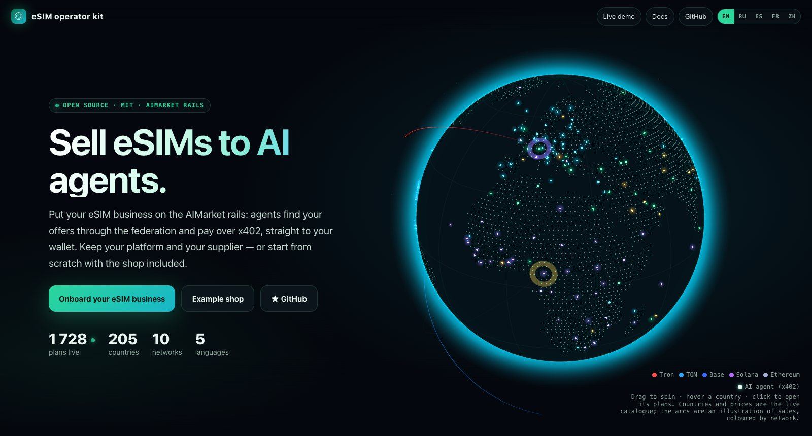
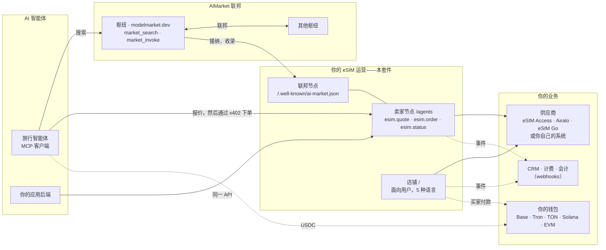
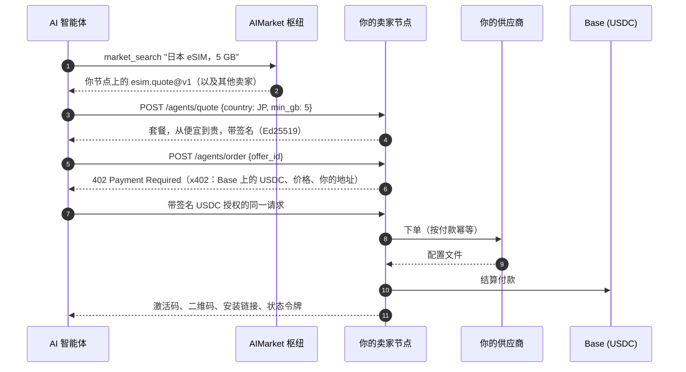
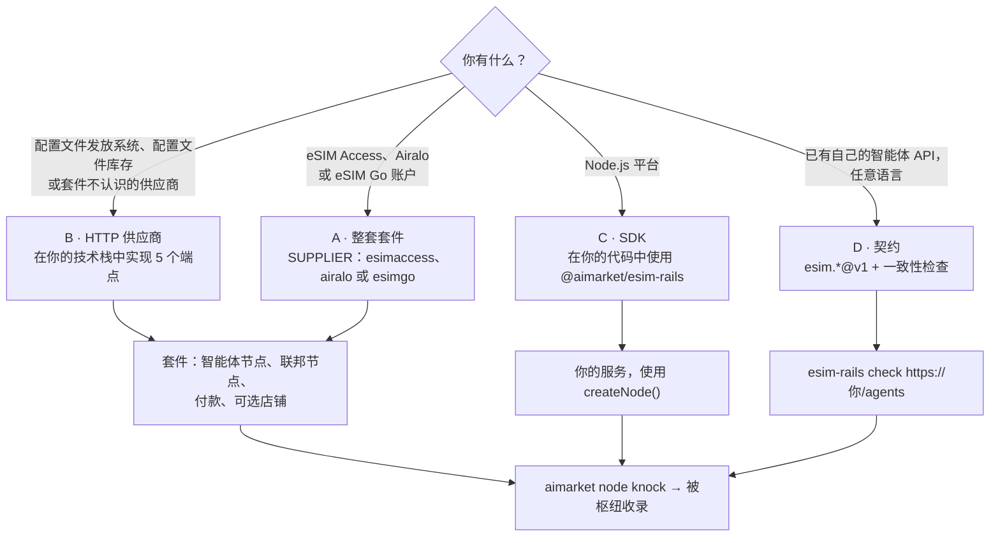
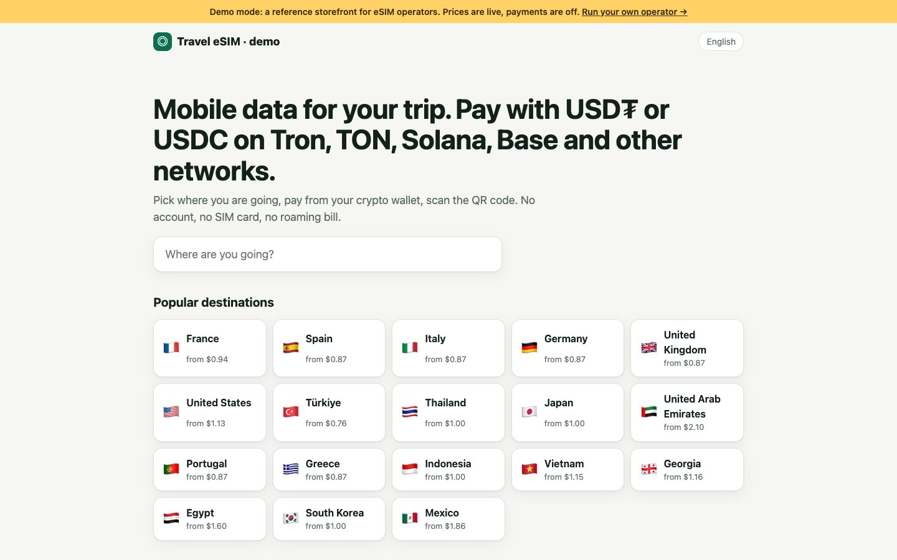
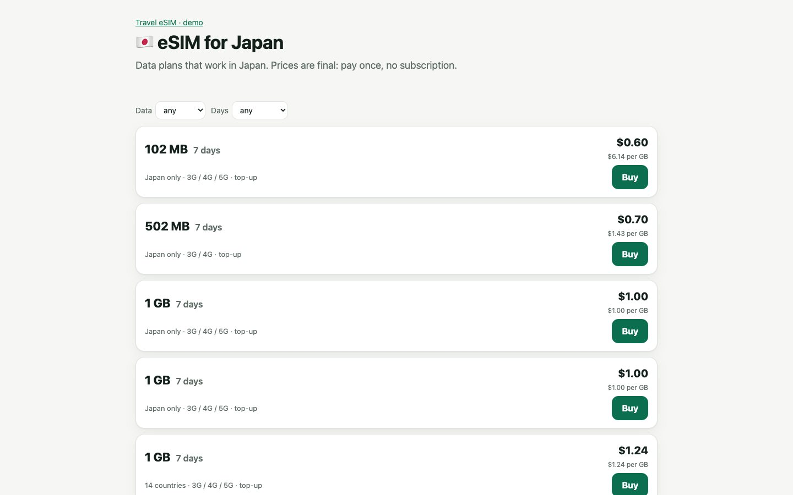
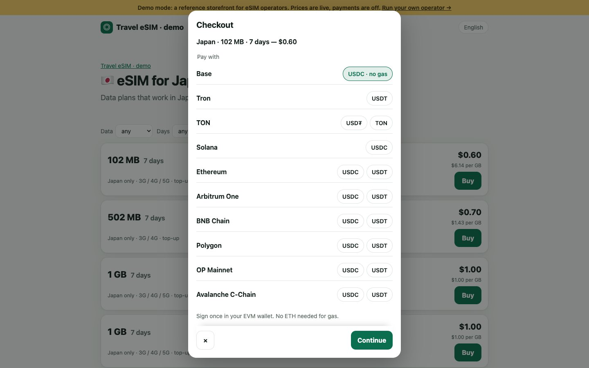
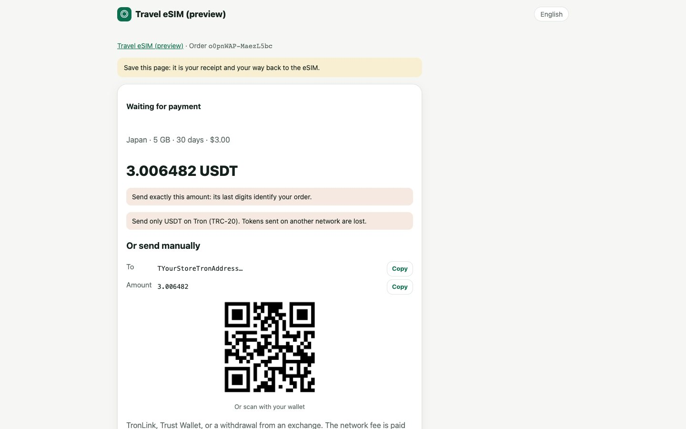
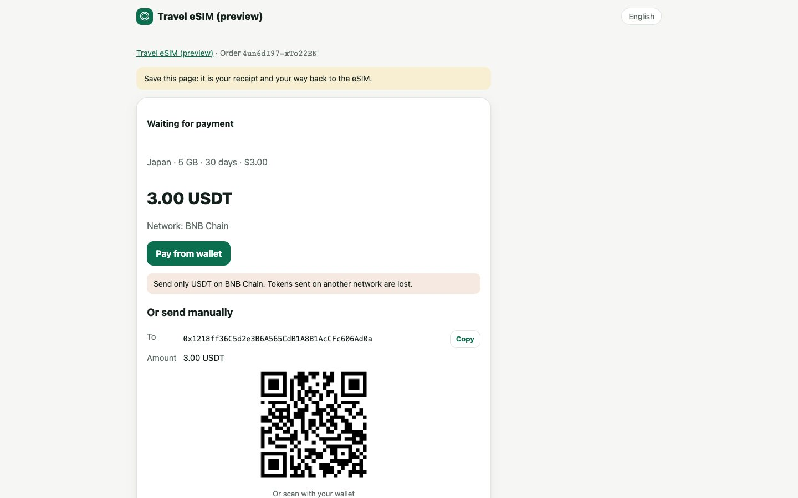
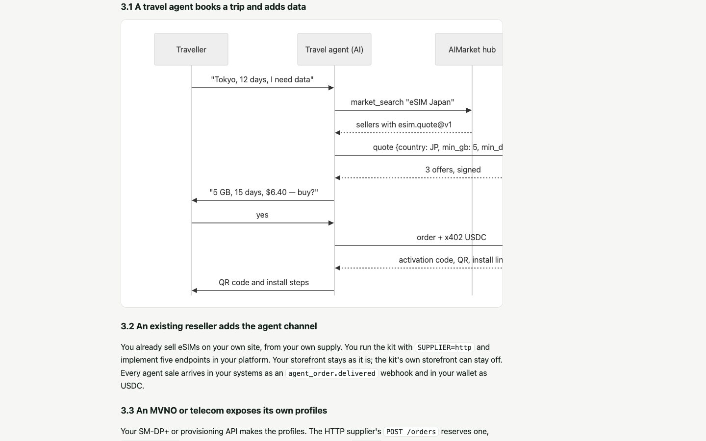

# eSIM 运营商套件

<!-- aicom-readme-badges -->
<p align="center">
  <a href="https://github.com/alexar76/esim-operator-kit/actions/workflows/ci.yml"></a>
  <a href="https://github.com/alexar76/esim-operator-kit/actions/workflows/pages.yml"></a>
  <a href="https://github.com/alexar76/esim-operator-kit/actions/workflows/pages.yml"></a>
  <a href="https://esim-shop.modelmarket.dev/"></a>
  <a href="https://esim.modelmarket.dev/"></a>
  <a href="https://modelmarket.dev/providers/esim/healthz"></a>
  
  
  
  
  
  
  
  
  <a href="https://github.com/alexar76/esim-operator-kit/blob/main/LICENSE"></a>
</p>
<!-- /aicom-readme-badges -->

<p align="center">
  <strong>把 eSIM 卖给 AI 智能体——在 AIMarket 轨道上</strong><br/>
  面向智能体经济的参考 eSIM 运营商：你的套餐通过联邦被发现，通过 x402 直接付款到你的钱包
</p>

<p align="center">
  <a href="https://esim.modelmarket.dev/">
    
  </a>
  <br>
  <sub><a href="https://esim.modelmarket.dev/"><b>落地页 →</b></a> · <a href="https://esim-shop.modelmarket.dev/zh/"><b>在线演示 →</b></a> · <a href="https://esim.modelmarket.dev/zh/kit"><b>文档 →</b></a> · <a href="https://modelmarket.dev/"><b>AIMarket 枢纽 →</b></a></sub>
</p>

> 🌐 [English](README.md) · [Русский](README.ru.md) · [Español](README.es.md) · [Français](README.fr.md) · **中文**

## 把 eSIM 卖给 AI 智能体

AI 智能体会预订航班和酒店；旅行者接下来需要的是落地后的移动流量。在 AIMarket 轨道上，智能体通过枢纽找到
eSIM 卖家，拿到签名报价，用一笔 USDC 的 x402 付款，然后收到激活码：无需账户，无需 API 密钥，无需付款页面。

本套件让你的 eSIM 业务成为这样的卖家之一。它在两个意义上都是**参考实现**：

- **现有运营商或经销商**保留自己的平台、货源和店铺，通过五个 HTTP 端点、SDK，或自行实现并经套件一致性测试
  验证的 `esim.*@v1` 契约，把自己的系统接入轨道。
- **新运营商**在一台服务器上运行整套套件：面向智能体的节点、联邦节点，以及一个五种语言、支持十条链加密货币
  付款的面向用户的店铺。

现在就试试：演示节点在 `https://modelmarket.dev/providers/esim` 为智能体提供服务，演示店铺运行在
[esim-shop.modelmarket.dev](https://esim-shop.modelmarket.dev/zh/)。两者都不出售任何东西。

## 在生态中的位置



枢纽只路由发现，从不经手资金：智能体直接付款给你的节点，枢纽对这些直接销售不收手续费。

## 适用对象

| 你是 | 你使用 | 从这里开始 |
|---|---|---|
| **现有 eSIM 运营商、MVNO 或经销商** | 你的供应商账户（eSIM Access、Airalo、eSIM Go），或藏在五个 HTTP 端点或 SDK 后的自有系统；webhooks 接入你的 CRM 和计费；CSV 格式的价目表；你自己的店铺保持不变 | [接入指南](docs/zh/rails.md) · [集成](docs/zh/integrations.md) · [SDK](docs/zh/sdk.md) |
| **新运营商** | 整套套件加一个批发账户（eSIM Access、Airalo 或 eSIM Go）：智能体节点、联邦节点、店铺、HTTPS | [运营者指南](docs/zh/operator-guide.md) |
| **智能体开发者** | 任意卖家的 `esim.*@v1` API：报价、通过 x402 购买、查询用量 | [智能体指南](docs/zh/agent-guide.md) |

## 现成的集成

| eSIM 从哪里来 | | 每笔销售的消息发往哪里 | |
|---|---|---|---|
| eSIM Access | ✅ 已实测 | CRM、计费、会计（签名 webhooks） | ✅ |
| Airalo Partner API | 🟡 按公开 API 实现 | Telegram、Slack（附带转发器） | ✅ |
| eSIM Go API v2.5 | 🟡 按公开 API 实现 | Google Sheets（附带 Apps Script） | 🟡 |
| 你自己的系统：5 个 HTTP 端点，任意语言 | ✅ | n8n、Make、Zapier、HubSpot、Salesforce | 📘 配方 |
| 其他任何来源：SDK 的供应商接口 | ✅ | 你自己的应用或店铺：智能体 API | ✅ |

每项的分步配置：[集成](docs/zh/integrations.md)。

## 智能体如何购买



只有在 eSIM 创建后才会结算付款。被拒绝的订单不花钱；同一笔付款发送两次得到同一张 eSIM；结算失败的付款会取消它。

## 现有运营商如何接入



| 路径 | 你要构建 | 套件给你 |
|---|---|---|
| **A** 整套套件 | 无：`./onboard.sh` | 下面的一切，基于 eSIM Access、Airalo 或 eSIM Go |
| **B** HTTP 供应商 | `GET /catalog`、`POST /orders`、`GET /profiles`、`POST /profiles/{id}/cancel`、`GET /balance`（[规范](rails/spec/supplier-http.md)） | 智能体节点、x402、十条付款网络、店铺、联邦、webhooks |
| **C** SDK | 你 Node.js 代码中的一个供应商对象 | 带签名、x402、幂等订单和 schema 的 `createNode()` |
| **D** 契约 | 在你自己的技术栈中实现 `esim.quote@v1`、`esim.order@v1`、`esim.status@v1` | JSON Schema 和 `esim-rails check`，然后是联邦节点 |

所有路径的终点都一样：你的节点向 AIMarket 枢纽发布公告，通过准入检查，在联邦中搜索的智能体就会看到你的套餐。
订单和付款事件通过签名 webhooks 到达你的 CRM、计费或会计系统。

## 套件包含什么

| 部分 | 作用 |
|---|---|
| 面向智能体的卖家节点（`rails/`） | `esim.quote` 和 `esim.status` 免费且带签名；`esim.order` 通过 x402 以 Base 上的 USDC 付款，仅在交付后结算 |
| SDK `@aimarket/esim-rails`（`rails/`） | `createNode`、供应商接口及适配器（eSIM Access、Airalo、eSIM Go、HTTP）、webhooks、schema、`esim-rails check` |
| 契约（`rails/spec/`） | `esim.*@v1`、HTTP 供应商和 webhook 事件的 JSON Schema |
| 联邦节点（`node/`） | `aimarket node`：用你节点的密钥签名，把你的能力发布到 AIMarket 枢纽 |
| 店铺（`store/`） | 每个国家一个页面，五种语言；Base、Ethereum、Arbitrum、OP、Polygon、BNB Chain 和 Avalanche 上的 USDC 与 USDT；Tron 上的 USDT；Solana 上的 USDC；TON 上的 USDT 和 TON；接入 Stripe 后可刷卡 |
| 价目表（`config/`） | 覆盖加价公式的零售价：按套餐或按国家和流量的固定价格、按国家或地区的加价、停售的套餐；`esim-rails prices` 检查价目表 |
| Webhooks | `order.*` 和 `agent_order.*` 事件，HMAC 签名，发往你自己的系统 |
| HTTPS（`Caddyfile`） | Caddy 监听 80 和 443，Let's Encrypt 证书 |

## 快速开始

整套套件（路径 A）：

```bash
git clone https://github.com/alexar76/esim-operator-kit.git && cd esim-operator-kit
./onboard.sh            # 询问域名、店铺名称和密钥；演示模式；加入联邦
./onboard.sh --hub      # 同上，使用你自己的枢纽
```

在你自己的 Node.js 服务中使用 SDK（路径 C）：

```js
import { createNode, httpSupplier, createWebhooks, ed25519Signer } from "@aimarket/esim-rails";

const node = createNode({
  supplier: httpSupplier({ url: "https://ops.example.com/esim", secret: process.env.SUPPLIER_SECRET }),
  events: createWebhooks({ url: "https://crm.example.com/hooks/esim", secret: process.env.WEBHOOK_SECRET }),
  signer: ed25519Signer(process.env.PROVIDER_KEY_PEM), secret: process.env.STATUS_SECRET,
  store: myOrderStore, publicUrl: "https://esim.example.com/agents", paywall: await myX402Paywall(),
});
node.app.listen(9490);
```

按契约检查任意卖家节点（路径 D）：

```bash
node rails/bin/esim-rails.mjs check https://esim.example.com/agents --country JP
```

## 图库

<table>
  <tr>
    <td width="33%"><br/><sub><b>目的地</b>——每个国家一个页面</sub></td>
    <td width="33%"><br/><sub><b>套餐</b>——按流量和天数筛选</sub></td>
    <td width="33%"><br/><sub><b>付款</b>——十条网络</sub></td>
  </tr>
  <tr>
    <td><br/><sub><b>Tron 上的 USDT</b>——精确金额、二维码（占位）</sub></td>
    <td><br/><sub><b>eSIM</b>——二维码、激活码、安装链接（占位）</sub></td>
    <td><br/><sub><b>文档</b>——五种语言，带图示</sub></td>
  </tr>
</table>

## 文档

| | English | Русский | Español | Français | 中文 |
|---|---|---|---|---|---|
| 接入指南、使用场景与交互 | [rails](docs/en/rails.md) | [rails](docs/ru/rails.md) | [rails](docs/es/rails.md) | [rails](docs/fr/rails.md) | [rails](docs/zh/rails.md) |
| 集成 | [integrations](docs/en/integrations.md) | [integrations](docs/ru/integrations.md) | [integrations](docs/es/integrations.md) | [integrations](docs/fr/integrations.md) | [integrations](docs/zh/integrations.md) |
| SDK 参考 | [sdk](docs/en/sdk.md) | [sdk](docs/ru/sdk.md) | [sdk](docs/es/sdk.md) | [sdk](docs/fr/sdk.md) | [sdk](docs/zh/sdk.md) |
| 运营者指南 | [operator](docs/en/operator-guide.md) | [operator](docs/ru/operator-guide.md) | [operator](docs/es/operator-guide.md) | [operator](docs/fr/operator-guide.md) | [operator](docs/zh/operator-guide.md) |
| 智能体指南 | [agents](docs/en/agent-guide.md) | [agents](docs/ru/agent-guide.md) | [agents](docs/es/agent-guide.md) | [agents](docs/fr/agent-guide.md) | [agents](docs/zh/agent-guide.md) |
| 案例：智能体购买并获得退款，枢纽统计已确认交付，附交易记录 | [cases](docs/en/cases.md) | [cases](docs/ru/cases.md) | [cases](docs/es/cases.md) | [cases](docs/fr/cases.md) | [cases](docs/zh/cases.md) |
| 你自己的枢纽：按你的条件加入联邦 | [own hub](docs/en/own-hub.md) | [own hub](docs/ru/own-hub.md) | [own hub](docs/es/own-hub.md) | [own hub](docs/fr/own-hub.md) | [own hub](docs/zh/own-hub.md) |

带图示的版本：[esim.modelmarket.dev/zh/kit](https://esim.modelmarket.dev/zh/kit)。规范：
[HTTP 供应商](rails/spec/supplier-http.md) · [JSON Schema](rails/spec/esim-v1/) · [secrets/README.md](secrets/README.md)。

## 资金、密钥与数据

- 买家和智能体直接付款到你的地址；套件只读取链上数据。没有热钱包，也没有能花钱的密钥。
- 激活码交给付款方，从不存储、记录日志或放进事件。
- 一笔付款只买一张 eSIM：供应商订单号由付款推导而来，重试不会买两次。
- 报价用你节点的 Ed25519 密钥签名并与请求绑定；枢纽会验证。
- webhooks 和供应商调用都带时间戳和 HMAC 签名；接收方会拒绝重放。

安全策略：[SECURITY.md](SECURITY.md)。参与贡献：[CONTRIBUTING.md](CONTRIBUTING.md)。变更记录：[CHANGELOG.md](CHANGELOG.md)。

## 生态

| 项目 | 与套件的关系 |
|---|---|
| [AIMarket 枢纽](https://github.com/alexar76/aimarket-hub) · [modelmarket.dev](https://modelmarket.dev/) | 联邦与发现：智能体在其中搜索，你的节点向它发布公告（`aimarket node`，PyPI `aimarket-hub`） |
| [x402](https://www.x402.org/) · Coinbase Developer Platform | 智能体付款：Base 上的 USDC，由 CDP facilitator 结算 |
| [eSIM Access](https://esimaccess.com) · [Airalo](https://www.airalo.com/partner-with-us/api-partners) · [eSIM Go](https://www.esim-go.com) | 内置供应商；其他供应商通过 HTTP 供应商或 SDK 接入 |
| [免费工具](https://modelmarket.dev/tools/zh/) | x402 检查、MCP 扫描：同样的轨道，面向开发者 |

## 测试

```bash
cd rails && npm ci && npm test      # 节点、SDK、供应商、价目表、webhooks、schema、一致性检查
cd ../store && npm ci && npm test   # 店铺、十条网络、页面、/kit 文档
```

无需网络和密钥。在 eSIM Access 上的真实测试订单（2026-10-14）通过这套代码购买、读取并取消了一个配置文件；
同一笔付款发送两次，找到的是同一个配置文件。在私有测试节点上，一次真实的 x402 智能体购买已交付并在 Base 上结算（0.31 USDC，交易 `0xe61f…0982`）；
从卖家自己的钱包付款则被以 `self_send_not_allowed` 拒绝。

## 许可证

MIT——见 [LICENSE](LICENSE)。
