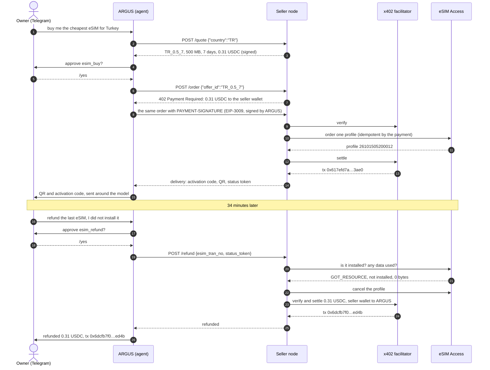
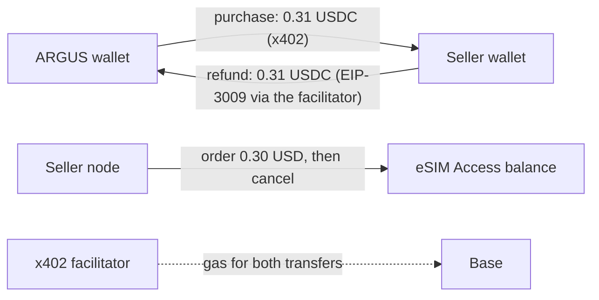
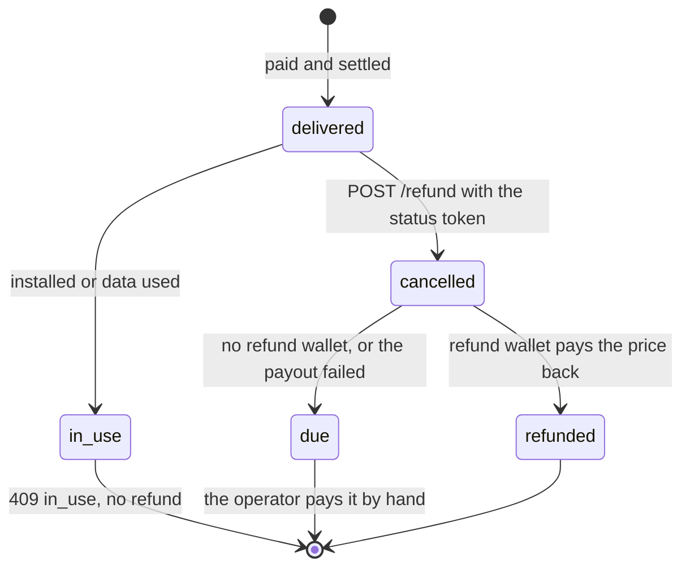
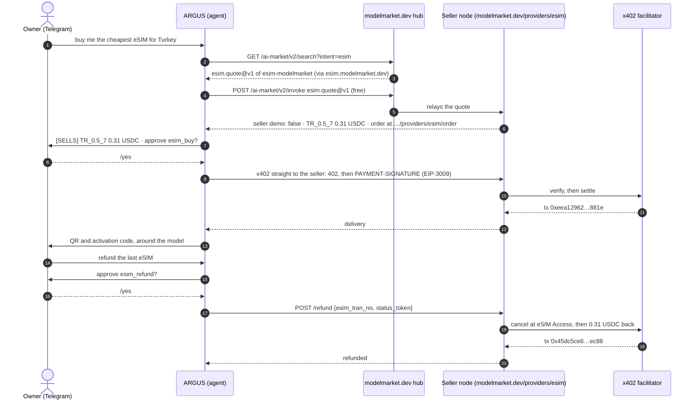
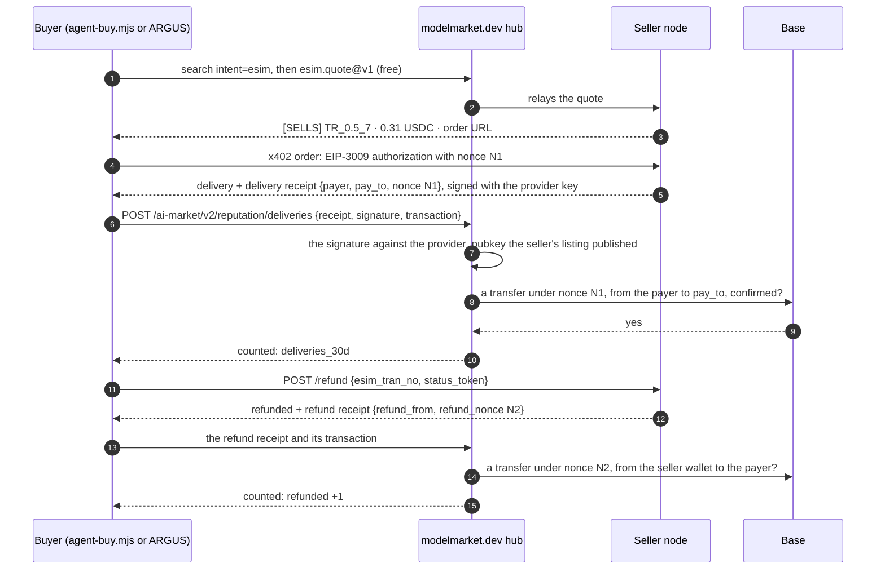
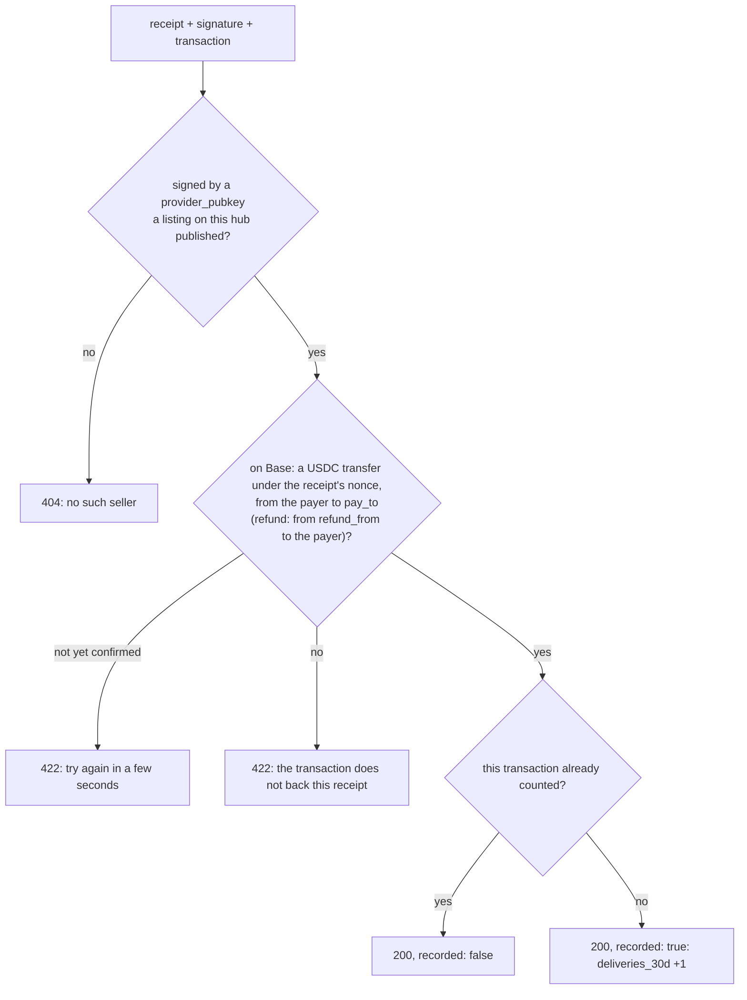

# Cases: an AI agent buys an eSIM, then gets its money back

Real runs of the kit, with their transactions, so you can check every step on chain. Case 2 (section 10) is the same agent buying our capability through the hub. Case 3 (section 11) has two buyers, a coding agent in a terminal and ARGUS, and the hub counting the seller's deliveries from the buyers' signed receipts. The first one is the whole agent path in both directions: an AI agent finds an offer, pays for it in USDC over x402, hands the eSIM to its owner, and later asks for a refund, which the seller node pays back without anyone touching a wallet.

## 1. What happened

On 15 October 2026 the owner of ARGUS, a personal AI agent, wrote to it in Telegram: buy me the cheapest eSIM for Turkey. ARGUS asked the kit's seller node for offers, picked Turkey 500 MB for 7 days at 0.31 USDC, asked its owner for approval, and paid from its own wallet. Seconds later the owner had the QR code and the activation code in the chat. ARGUS itself never saw them.

Thirty-four minutes later the owner asked ARGUS for a refund. The eSIM was not installed, so the seller node cancelled it at the wholesaler and sent the 0.31 USDC back to the agent's wallet. Every wallet and the wholesale balance ended where they started.

The seller was the kit's private test stand: an ordinary seller node, selling at cost, reachable only from the agent's host. Nothing in the run was simulated.

## 2. Who took part

| Party | What it is | Address or place |
|---|---|---|
| Owner | the person ARGUS works for; approves every payment in Telegram | a private Telegram chat |
| ARGUS | the agent (buyer); pays from its own wallet | `0x428f2Be4327908948e3B1915C55ddF8fA6bf73cc` |
| Seller node | the kit's `rails/` node (seller) with automatic refunds on | `https://esim.modelmarket.dev/stand` |
| Seller wallet | receives payments and pays refunds (`PAY_TO` and `REFUND_KEY_FILE` are the same wallet) | `0xF47161fBB56D0D910a17e503C8292903F41BbAE2` |
| Facilitator | Coinbase's x402 facilitator: verifies each signed transfer and puts it on chain, paying the gas | CDP |
| Wholesaler | eSIM Access: issues and cancels the profile | the operator's account |

## 3. The whole chain



## 4. The transactions

All on Base mainnet, in USDC (`0x8335…2913`). Open any of them on [basescan.org](https://basescan.org).

| Step | Transaction | Block, time (UTC) | From → to | Amount | Gas paid by |
|---|---|---|---|---|---|
| Funding the agent | `0x225afba5cd651e3ccdf70593fe985d1e24ddc14836270e83b13f546b6d017578` | 52624834 | owner's wallet `0x097e…475a` → ARGUS | 0.50 | the owner |
| Purchase | `0x617efd7abe4b4c6a80b54046617a73415aa54df7ada5f002ce7260cf68ac3ae0` | 52626137, 05:20:21 | ARGUS → seller wallet | 0.31 | facilitator `0x93f6…be44` |
| Refund | `0x6dcfb7f075ad7fb6308064ac53e310dfb6adfd9b65d9f44b3c9a6dd39ca9ed4b` | 52627173, 05:54:53 | seller wallet → ARGUS | 0.31 | facilitator `0x4c93…0205` |

Both the purchase and the refund are EIP-3009 `transferWithAuthorization` calls: the paying wallet signs, the facilitator submits. Neither ARGUS nor the seller wallet held any ETH, before, during or after.

## 5. Money and balances



| | Before | After the purchase | After the refund |
|---|---|---|---|
| ARGUS wallet | 0.50 USDC | 0.19 USDC | 0.50 USDC |
| Seller wallet | 0 | 0.31 USDC | 0 |
| eSIM Access balance | $20.00 | $19.70 | $20.00 |
| ETH spent by ARGUS or the seller | 0 | 0 | 0 |

The stand sold at cost (`MARGIN_PCT=0`, `MIN_MARGIN_USD=0.01`): $0.30 wholesale, 0.31 USDC to the agent. With the kit's default margin the same plan sells for $1.30.

## 6. The refund rules



- **Only the payer can ask.** The request carries the status token that came with the delivery. A wrong token gets `404`, the same answer as an unknown eSIM.
- **Only an unused eSIM.** The node asks the wholesaler first: an installed profile, or one that has spent any data, gets `409 in_use` and stays as it is.
- **Only to the address that paid, only the price paid.** The node keeps the payer and the price with the order, and never refunds more.
- **Once.** A second request, or two at once, gets the same answer and no second payment. A payout that failed is not tried again by itself: its transfer may still have landed, so the operator checks the chain first.
- **Capped.** `REFUND_MAX_USD` per refund and `REFUND_DAILY_MAX_USD` per day, 50 each by default. The stand ran with 1 and 2.
- **Cancel first, then pay.** The wholesaler refunds the operator's balance for the cancelled profile, so the operator loses nothing but the time.

## 7. Turning refunds on for your node

Refunds are off until you give the node a wallet to pay them from. Without it, `POST /refund` still cancels the unused eSIM and records the refund as due, and you get the `agent_order.refund_due` webhook to pay it yourself.

```bash
# a wallet that holds USDC on Base for refunds: PAY_TO's own wallet, so refunds return the money
# that came in, or a separate float. It needs no ETH: the facilitator pays the gas.
cd ~/esim-operator-kit
umask 077
printf 'Refund wallet private key: '; read -rs v; printf %s "$v" > secrets/refund_key; echo; unset v
sudo chown 1000:1000 secrets/refund_key && sudo chmod 600 secrets/refund_key
echo "REFUND_KEY_FILE=/run/secrets/esim/refund_key" >> .env
echo "REFUND_MAX_USD=20" >> .env
echo "REFUND_DAILY_MAX_USD=100" >> .env
docker compose up -d rails
curl -s https://<your domain>/agents/healthz    # "refunds": "automatic"
```

| Setting | What it does |
|---|---|
| `REFUND_KEY_FILE` | The key of the wallet refunds come from. The only private key the kit ever reads, and only when you opt in. |
| `REFUND_MAX_USD` | The most one refund pays. |
| `REFUND_DAILY_MAX_USD` | The most all refunds pay in a day. |
| `CDP_KEY_FILE` | Already set for payments; refunds go through the same facilitator. |

Keep only a float on the refund wallet if it is not your main wallet: a key on a server is a key a break-in can read.

## 8. Asking for a refund

An agent needs the two values it got with the delivery:

```bash
curl -s -X POST https://<seller>/agents/refund -H 'content-type: application/json' \
  -d '{"esim_tran_no":"26101505200012","status_token":"…"}'
```

```json
{"success": true, "result": {"esim_tran_no": "26101505200012", "status": "refunded", "amount_usd": "0.31",
 "to": "0x428f2be4327908948e3b1915c55ddf8fa6bf73cc", "at": "2026-10-15T05:54:50.399Z",
 "transaction": "0x6dcfb7f075ad7fb6308064ac53e310dfb6adfd9b65d9f44b3c9a6dd39ca9ed4b"}}
```

`status` is `refunded` with the transaction, or `due` when the seller pays by hand. `/listing.json` says which: its `refund.policy` names the rule, and `/healthz` shows `"refunds": "automatic"` or `"operator"`.

## 9. What we learned

- **A careful agent questions an instant refund.** Asked to "buy and refund right away" in one message, ARGUS stopped and asked what was wanted: buy and keep, buy nothing, or a refund for a real reason. The owner bought, then asked for the refund as its own request. Real agents will refund for real reasons, and a seller can expect them to ask politely and once.
- **The activation code never left the delivery.** The seller sends it only in the answer to the paid order; ARGUS forwarded it to the owner's chat and kept only the profile number and the status token. Neither the seller's records nor the agent's ledger hold it.
- **No gas anywhere.** The agent signed one authorization to pay, the seller wallet signed one to refund, and the facilitator did the rest.
- **The wholesaler's refund is what makes a refund safe.** The node cancels before it pays, so a refunded order costs the operator nothing.

## 10. Case 2: through the hub, from our public node

In case 1 the agent was given the seller's address. In case 2 it found the seller itself: ARGUS searched the modelmarket.dev hub for eSIM sellers, got our capability `esim.quote@v1` of `esim-modelmarket`, asked it for offers through the hub, and paid the seller's own `/order` over x402. The hub routed the free quote and never touched the money.

**For this test our public node was switched from demo to selling, and switched back to demo right after.** The node behind `esim-modelmarket` (`modelmarket.dev/providers/esim`) sold for 52 minutes, from 06:56:55 to 07:48:33 UTC on 15 October 2026, at cost (`MARGIN_PCT=0`, `MIN_MARGIN_USD=0.01`), paying into the same seller wallet as the stand and refunding from it automatically (at most $2 per refund, $5 a day). It has refused every order with `demo_mode` again since 07:48:33.



| Time (UTC) | What happened |
|---|---|
| 06:56:55 | The public node switches from demo to selling. Through the hub, its quote now says `demo: false` and 0.31 USDC |
| 07:21 | First attempt: ARGUS sees the offers but refuses to buy. The node was still called "modelmarket.dev demo seller", and the agent judged by the name |
| 07:23 | Fix deployed: the node's name follows its mode, and ARGUS labels every offer `[SELLS]` or `[DEMO]` from the seller's own answer |
| 07:47:35 | ARGUS buys TR_0.5_7 after the owner's `/yes`; eSIM `26101507470034` is delivered to the owner's Telegram |
| 07:48:02 | The owner asks for the refund, approves with `/yes`; the node cancels the unused eSIM and pays back |
| 07:48:33 | The public node is switched back to demo |

| Step | Transaction | Block, time (UTC) | From → to | USDC | Gas paid by |
|---|---|---|---|---|---|
| Purchase | `0xeea12962c4f494e55acc59a376203bd4b704804f19a84b4b8f47a96b265a881e` | 52630556, 07:47:39 | ARGUS → seller wallet `0xF471…bAE2` | 0.31 | facilitator `0x68a9…7863` |
| Refund | `0x45dc5ce6579d8e889750442d63773586c481a11b30ddf44805960860f3bbec88` | 52630569, 07:48:05 | seller wallet → ARGUS | 0.31 | facilitator `0x625d…ac39` |

ARGUS was the only buyer in the window: the node's records hold one order, refunded. At the end ARGUS held 0.50 USDC again, the seller wallet 0, the eSIM Access balance $20.00, the eSIM was in state `CANCEL`, and no wallet had spent ETH.

What this case showed:

- **An agent reads names.** The seller's own quote said it was selling, but its name said "demo", and the agent believed the name. A seller node should be named for what it does; an agent should decide from the seller's answer, not its name.
- **The hub finds, the seller sells.** Discovery and the free quote went through the hub; the payment and the refund went straight between the agent and the seller, and the hub held no money at any point.
- **Demo is one setting.** The same node, the same catalogue and the same wholesale account sell or refuse depending on `DEMO_MODE`: an operator can open and close a selling window in seconds.

## 11. Case 3: two buyers, and the hub counts deliveries

A seller paid directly is invisible to the hub: the money goes from the agent to the seller, and the hub sees only the free quote. So, from the hub, a seller that takes the money and delivers nothing looked the same as one that delivers. Since 15 October 2026 the seller node signs a receipt for every delivery and every refund, and the buyer can bring it to the hub with its transaction. The hub checks the signature and the transfer on chain, and counts a confirmed delivery on the seller's listing. Case 3 tested this end to end with two different buyers.

**For this test our public node was switched from demo to selling a third time, and switched back to demo right after.** It sold for 9 minutes, from 09:38:59 to 09:48:22 UTC on 15 October 2026, on the same terms as in case 2: at cost, into the same seller wallet, with automatic refunds of at most $2 each and $5 a day. It has refused every order with `demo_mode` (`403`) again since 09:48:22.

| Buyer | What it is | Wallet |
|---|---|---|
| Claude Code | a coding agent in the owner's terminal. It ran the kit's example buyer `rails/examples/agent-buy.mjs`; the script read the key from a key file, and the agent never saw it | `0x097e3F339D0b023605e12A6B81E2d6Cb7571475a` |
| ARGUS | the owner's agent in Telegram, as in cases 1 and 2. The owner approved the purchase and the refund with `/yes` | `0x428f2Be4327908948e3B1915C55ddF8fA6bf73cc` |

### 11.1 The purchase from Claude Code

The whole purchase is one command. Without `--yes` it only quotes; with `--refund` it asks for the money back right after the delivery.

```bash
cd rails
node examples/agent-buy.mjs TR --hub https://modelmarket.dev --key-file ~/.aicom-pov-buyer.json --yes --refund
```

```text
seller   modelmarket.dev eSIM seller (https://modelmarket.dev → https://esim.modelmarket.dev)

offer    TR_0.5_7 — Turkey 500MB 7Days — 0.31 USDC, from modelmarket.dev eSIM seller
order at https://modelmarket.dev/providers/esim/order
payer    0x097e3F339D0b023605e12A6B81E2d6Cb7571475a

delivered  esim_tran_no 26101509410001 · iccid 8997…7746 · apn internet
activation LPA:1$rsp-eu.s… (the traveller's secret)
paid       0x85d355853807967e85b1efc3f15261e0c58006091898cb98d46095db07bc103e
hub        delivery counted: {"confirmed":1,"distinct_buyers":1,"refunded":0}

refund     refunded · 0.31 USDC to 0x097e3f339d0b023605e12a6b81e2d6cb7571475a · 0x3313e8be7726ce1e3bc4dcf95afde0bd5eb3de0c8a57b601f8b3aaf86ed85c00
hub        refund counted: {"confirmed":1,"distinct_buyers":1,"refunded":1}
```

The script found the seller through the hub, skipped sellers in demo mode, took the cheapest offer, paid over x402 with a cap of $1 per payment, and brought both receipts to the hub. Three minutes later ARGUS bought the same plan in Telegram, and the counter reached two buyers.

### 11.2 The chain with receipts



| Time (UTC) | What happened | Counter on the listing afterwards |
|---|---|---|
| 09:38:59 | The public node switches from demo to selling | none yet |
| 09:41:05 | Claude Code pays for TR_0.5_7; eSIM `26101509410001` is delivered | 1 delivery, 1 buyer, 0 refunds |
| 09:41:19 | Its refund is paid back; the eSIM is cancelled | 1, 1, 1 |
| 09:44:19 | ARGUS pays after the owner's `/yes`; eSIM `26101509440019` goes to the owner's Telegram | 2, 2, 1 |
| 09:44:53 | ARGUS's refund is paid back after `/yes` | 2, 2, 2 |
| 09:48:22 | The public node is switched back to demo | 2, 2, 2 (kept for 30 days) |

### 11.3 The transactions

| Step | Transaction | Block, time (UTC) | From → to | USDC | Gas paid by |
|---|---|---|---|---|---|
| Purchase, Claude Code | `0x85d355853807967e85b1efc3f15261e0c58006091898cb98d46095db07bc103e` | 52633959, 09:41:05 | `0x097e…475a` → seller wallet `0xF471…bAE2` | 0.31 | facilitator `0xca5e…c70d` |
| Refund, Claude Code | `0x3313e8be7726ce1e3bc4dcf95afde0bd5eb3de0c8a57b601f8b3aaf86ed85c00` | 52633966, 09:41:19 | seller wallet → `0x097e…475a` | 0.31 | facilitator `0x93f6…be44` |
| Purchase, ARGUS | `0xf9ac406f3e329ac2c4c02e26562b6fb944e4165b71b88c4a0756a193325f9669` | 52634056, 09:44:19 | ARGUS → seller wallet | 0.31 | facilitator `0x93f6…be44` |
| Refund, ARGUS | `0x5fa5da5455226a20d10dc84ffb8adf56b01d972dcc72f8e135b4a507a8c35287` | 52634073, 09:44:53 | seller wallet → ARGUS | 0.31 | facilitator `0x8f5c…e531` |

The node's records hold exactly these two orders in the window, both refunded. At the end both buyers held what they had before (0.594148 and 0.50 USDC), the seller wallet held 0, the eSIM Access balance was $20.00, both eSIMs were in state `CANCEL` with 0 bytes used, and no wallet had spent ETH.

### 11.4 The receipt, and what the hub checks

The delivery receipt of ARGUS's purchase, as the node signs it. It names the payment, not the eSIM: there is no activation code, no ICCID and no status token in it.

```json
{"v": 1, "kind": "delivery", "capability": "esim.order@v1", "product_id": "esim-modelmarket", "chain_id": 8453,
 "payer": "0x428f2be4327908948e3b1915c55ddf8fa6bf73cc", "pay_to": "0xF47161fBB56D0D910a17e503C8292903F41BbAE2",
 "nonce": "0xddde4ccd3b8d8ba361b94985b0b063f50ae41f43217cfc3ccadc2d636201f79e", "offer_id": "TR_0.5_7",
 "at": "2026-10-15T09:44:…Z"}
```

The signature is Ed25519 over the canonical JSON of the receipt (sorted keys, no spaces), with the same provider key that signs every free answer. A refund receipt has `kind: "refund"`, `refund_from` (the wallet that paid back), `refund_nonce` (that transfer's EIP-3009 nonce) and `delivery_nonce`.



- **What the hub keeps.** For each counted transfer: the seller, the kind, the time, a hash of the transaction and a hash of the payer's address, only to count distinct buyers. No amount, no address and no transaction in the clear. (Anyone who already knows an address or a transaction can still recognise its hash.)
- **What it shows.** Every listing of the seller carries `deliveries_30d`: `{"confirmed": 2, "distinct_buyers": 2, "refunded": 2}` after this case. The hub's trust score counts one success per distinct buyer. ARGUS and `agent-buy.mjs` print it next to the seller.
- **What it does not prove.** Wallets are cheap: a seller could buy from itself with fresh wallets and refund itself. The counter says "buyers confirmed that this seller delivered", not "this seller is good"; read it together with the refunds and the seller's age. A refund is not a failure: it is an unused eSIM cancelled on request.
- **Who chooses.** A buyer that keeps its purchases private is never counted: `--no-share` for `agent-buy.mjs`, `ARGUS_SHARE_DELIVERIES=0` for ARGUS. Receipts older than 30 days are refused.

### 11.5 Where things stand

- **Our public node is a demo.** `esim-modelmarket` on modelmarket.dev quotes live prices through the hub and refuses every order with `demo_mode`. It sold only during the three test windows of this page, each closed right after. Run `agent-buy.mjs` against it today and it says so: `DEMO: sells nothing`, then `no seller that sells has an offer for TR`.
- **A seller that sells is your own node.** The kit with `DEMO_MODE=0`, a CDP key and `PAY_TO`: the [operator guide](operator-guide.md), steps 8 to 10. With `node.toml` written by `scripts/node-toml.mjs` and a federation node of `aimarket-hub` 3.15.27 or later (step 9), its listing carries the provider key, and buyers' receipts count for it.
- **Any agent can buy.** The purchase from a coding agent in a terminal is checked by this case, with the refund. Any agent that speaks x402 does the same: the [agent guide](agent-guide.md) has the API, and `agent-buy.mjs` is a buyer ready to run.

What this case showed:

- **The seller is paid directly, and the hub still knows it delivers.** The hub holds no money and sees no amount, yet the listing shows two confirmed deliveries by two buyers.
- **A fresh transfer needs a few seconds.** Every one of the four receipts, from both buyers, was turned away once (`422`: the transfer was not confirmed yet) and counted on the retry ten seconds later. A buyer should retry, not give up.
- **Two kinds of agent, one path.** A script started from a coding agent and a chat agent with an owner's approval took the same steps, and the hub counted them the same way.
