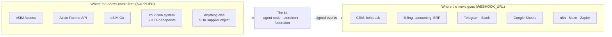
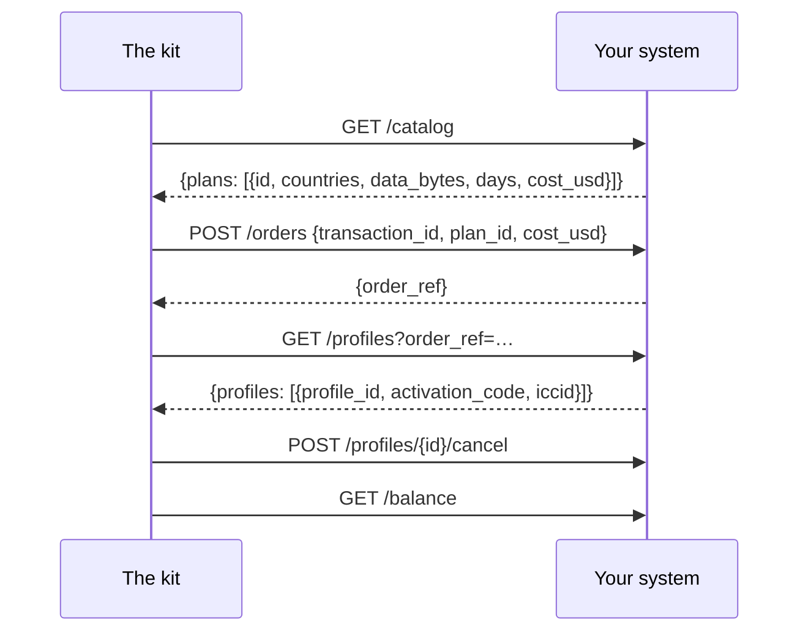
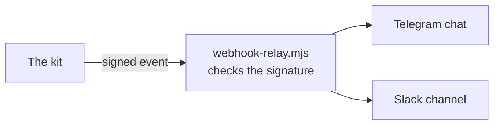

# Integrations

Ready connections between the kit and the systems an eSIM business already runs: where the eSIMs
come from, and where the news of every sale goes. Each entry says how far it has been tested.

Other documents: [overview](../../README.md) · [onboarding and use cases](rails.md) · [SDK reference](sdk.md) · [operator guide](operator-guide.md)

## 1. The map



| Integration | Kind | Setting | Status |
|---|---|---|---|
| eSIM Access | supplier | `SUPPLIER=esimaccess` | ✅ live: a real order was bought, read and cancelled on 2026-10-14 |
| Airalo Partner API | supplier | `SUPPLIER=airalo` | 🟡 built to Airalo's published API reference, tested against its documented answers; not yet run on a live Airalo account |
| eSIM Go (API v2.5) | supplier | `SUPPLIER=esimgo` | 🟡 built to eSIM Go's published API reference, tested against its documented answers; not yet run on a live account |
| Your own system | supplier | `SUPPLIER=http` | ✅ tested end to end against the reference backend in `rails/examples/operator-backend.mjs` |
| Anything else | supplier | the SDK's supplier interface | ✅ the interface the four above implement |
| CRM, billing, accounting | events | `WEBHOOK_URL` | ✅ signed, retried, tested |
| Telegram, Slack | events | `rails/examples/webhook-relay.mjs` | ✅ tested |
| Google Sheets | events | `rails/examples/google-sheets.gs` | 🟡 an Apps Script receiver, not tested in CI |
| n8n, Make, Zapier, HubSpot, Salesforce | events | their webhook trigger | 📘 a recipe below; nothing to install |

Before selling through a 🟡 integration, load your catalogue (`scripts/catalog.mjs`) and make one
test order you cancel (operator guide, section 10). Tell us what you find: an issue on GitHub makes
it ✅ for the next operator.

## 2. Suppliers

### 2.1 eSIM Access

The default. Put the AccessCode and SecretKey in `secrets/esimaccess_access_code` and
`secrets/esimaccess_secret_key`. The [operator guide](operator-guide.md) covers the account,
the $50 top-up and the test order.

- Orders are idempotent at eSIM Access itself (by `transactionId`).
- The order carries the cost it was quoted at; a plan whose price moved is refused, not charged.
- Unused profiles can be cancelled during a refund. An uncertain settlement is held for reconciliation, without automatic cancellation.

### 2.2 Airalo Partner API

You need an Airalo partner account and its client id and secret.

```bash
printf 'Client id: '; read -rs v; printf %s "$v" > secrets/airalo_client_id; echo
printf 'Client secret: '; read -rs v; printf %s "$v" > secrets/airalo_client_secret; echo
sudo chown 1000:1000 secrets/airalo_*
```

In `.env`:

```bash
SUPPLIER=airalo
AIRALO_CLIENT_ID_FILE=/run/secrets/esim/airalo_client_id
AIRALO_CLIENT_SECRET_FILE=/run/secrets/esim/airalo_client_secret
# AIRALO_BASE_URL=…   your sandbox URL from Airalo, while you test
```

What the adapter does: `POST /v2/token` once and keeps the token (Airalo allows three token
requests a minute); `GET /v2/packages` for the catalogue (fixed plans only: unlimited and top-up
packages are left out of v1; `net_price` is your cost); `POST /v2/orders` with the payment's
transaction id as the order description; `GET /v2/sims/{iccid}` and `/usage` for status;
`POST /v2/refund` during an unused-profile refund.

Know before you sell:

- **Airalo orders have no idempotency key.** The adapter remembers each order by its payment while the process runs, and the node stores the order reference before it fetches the profile. A restart in the seconds between the two can leave one paid order without its eSIM in the kit: find it in Airalo's console by the description (the transaction id).
- **Refunds are reviewed by Airalo** and credited as Airalo credit, not cash.
- **The balance is not checked** before an order: keep your Airalo account funded.

### 2.3 eSIM Go

You need an eSIM Go account and its API key (Account Settings → API Details).

```bash
printf 'API key: '; read -rs v; printf %s "$v" > secrets/esimgo_api_key; echo
sudo chown 1000:1000 secrets/esimgo_api_key
```

```bash
SUPPLIER=esimgo
ESIMGO_API_KEY_FILE=/run/secrets/esim/esimgo_api_key
```

What the adapter does: `GET /catalogue` page by page (`dataAmount` in MB, `price` in your
organisation's currency — it must be USD; unlimited bundles are left out of v1); `POST /orders` with
`assign: true`, which returns each eSIM's ICCID, SM-DP+ address and matching id; `GET /esims/{iccid}`
and `/bundles` for status and usage; `DELETE /esims/{iccid}/bundles/{name}?refundToBalance=true`
during an unused-profile refund.

Know before you sell:

- **No idempotency key** at eSIM Go either: the same protection and the same caveat as Airalo.
- **Refunds to balance are off by default** at eSIM Go: ask your account manager to enable them. Without that, a cancelled bundle is revoked without a refund.
- **The balance is not checked** before an order.

### 2.4 Your own system (HTTP)

For a provisioning platform, an SM-DP+ front end, a stock of profiles in a database, or a supplier
the kit does not know: implement five endpoints, in any language.



```bash
SUPPLIER=http
SUPPLIER_URL=https://ops.example.com/esim
SUPPLIER_SECRET_FILE=/run/secrets/esim/supplier_secret
```

Every request is signed (HMAC-SHA256 with a timestamp). The contract, with Python and Go code to
check the signature: [rails/spec/supplier-http.md](../../rails/spec/supplier-http.md). A working
reference to copy: [rails/examples/operator-backend.mjs](../../rails/examples/operator-backend.mjs).
Try it before you write a line:

```bash
cd rails && SUPPLIER_SECRET=$(openssl rand -hex 24) node examples/operator-backend.mjs 9600
```

### 2.5 Anything else (SDK)

A Node.js service can pass any object with `catalog`, `order`, `profiles`, `cancel` and `balance`
to `createNode()`. See the [SDK reference](sdk.md), section 2.

## 3. Your business systems

Every order that changes status is POSTed to `WEBHOOK_URL`, signed:

| Event | Your systems typically |
|---|---|
| `order.created` | open a lead or a draft invoice |
| `order.delivered` | book the sale: price, cost, method, payment reference |
| `order.refund_due` | open a refund task with the payer's address |
| `order.underpaid` | open a support task |
| `order.expired` | close the lead |
| `agent_order.delivered` | book an agent sale |
| `agent_order.settlement_pending` | payment outcome needs reconciliation; do not charge again |

```bash
WEBHOOK_URL=https://crm.example.com/hooks/esim
WEBHOOK_SECRET_FILE=/run/secrets/esim/webhook_secret      # 16+ characters, shared with the receiver
```

Payloads, headers and code to verify them: [SDK reference](sdk.md), section 5.

### 3.1 Telegram and Slack



1. Create a Telegram bot with @BotFather and note its token; add it to your team's chat and note the chat id. For Slack, create an incoming webhook.
2. Run the relay beside the kit:

```bash
cd rails && WEBHOOK_SECRET=… TELEGRAM_BOT_TOKEN=… TELEGRAM_CHAT_ID=… SLACK_WEBHOOK_URL=… node examples/webhook-relay.mjs 9700
```

3. In `.env`: `WEBHOOK_URL=http://127.0.0.1:9700/hooks/esim`, and the same secret in `secrets/webhook_secret`.

Each sale appears as a line: "✅ Delivered Qh3…: Japan 5GB 30Days — $6.40, cost $3.20".

### 3.2 Google Sheets

1. In a Google Sheet: Extensions → Apps Script; paste [rails/examples/google-sheets.gs](../../rails/examples/google-sheets.gs) and set its `TOKEN`.
2. Deploy as a web app (execute as you, access: anyone); copy the `/exec` URL.
3. `WEBHOOK_URL=<the /exec URL>?token=<TOKEN>`.

Every event becomes a row; a repeated event id is skipped. Apps Script cannot read request headers,
so the token in the URL, not the signature, keeps strangers out.

### 3.3 n8n, Make, Zapier

All three start a workflow from an incoming webhook:

1. Create a workflow with a webhook trigger (n8n: Webhook node, POST; Make: Custom webhook; Zapier: Webhooks by Zapier → Catch Hook) and copy its URL into `WEBHOOK_URL`.
2. In n8n, verify the signature in a Code node before anything else: recompute `v1=` + HMAC-SHA256(secret, `X-Kit-Timestamp` + "." + raw body) and compare with `X-Kit-Signature`.
3. Branch on `type`: `order.delivered` → your CRM or accounting step; `order.refund_due` → a task.

### 3.4 HubSpot, Salesforce, any CRM

Through n8n, Make or Zapier (above), or a small receiver of your own: on `order.created`, create a
deal with `order_id` as its external id; on `order.delivered`, move it to won with `price_usd`; on
`order.refund_due`, create a task. Dedupe by the event `id`.

## 4. Your own storefront or app

You do not need the kit's storefront. Your site or app can call your seller node like any agent:
`POST /agents/quote`, then `POST /agents/order` with an x402 payment — see the
[agent guide](agent-guide.md). Or keep your checkout and use the kit only for agents: run it with
your supplier, leave the storefront in demo mode, and announce the node to the federation.

## 5. Ask for an integration

Using a supplier or a system that is not here? Open an issue on
[GitHub](https://github.com/alexar76/esim-operator-kit/issues) with its API reference. A supplier
adapter is about two hundred lines against the interface in the [SDK reference](sdk.md).
