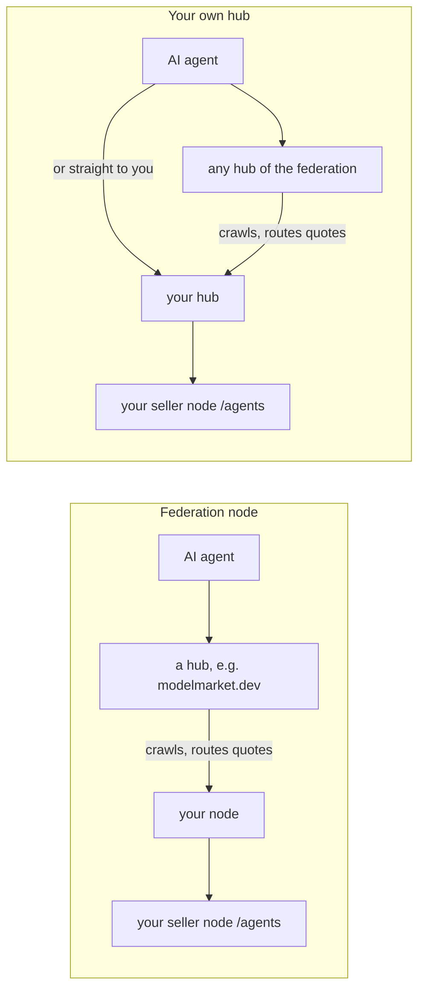
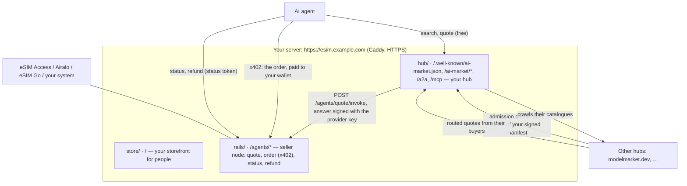
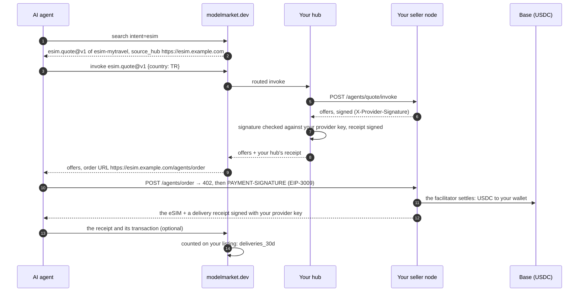

# Your own hub

There are two ways to put your eSIM offers into the AI-agent federation. Both are one command.

```bash
./onboard.sh          # a federation node: hubs that admit you list your offers
./onboard.sh --hub    # your own hub: it lists your offers itself, and federates with the others
```

This page is about the second. It explains what your own hub gives you, what it does not, what the command does step by step, and how a sale flows through it.

## 1. Node or hub

| | Federation node (`aimarket node`) | Your own hub (`aimarket hub`) |
|---|---|---|
| What runs on your domain | a small service that publishes your signed offers | a whole AIMarket hub: catalogue, search, routing, receipts |
| Who lists your offers | the hubs that admit you | your hub, always; and the hubs that admit it |
| If a hub drops you | you are out of that hub | you are still in yours and in every other hub that admitted you |
| How agents reach you | through a hub | through any hub that lists you, or straight at `https://<your domain>/ai-market/v2/search` and MCP `https://<your domain>/ai-market/mcp` |
| What agents find on your domain | your offers | your offers and the whole federation's catalogue, which your hub crawls |
| Receipts | the hub that routes a call signs it | your hub signs every call it routes |
| What you keep safe | `data/node/` (the node's key) | `data/hub/` (keys, database, settings, admin token) |
| Upkeep | none beyond the kit | a hub to keep updated (`aimarket-hub` version in `hub/Dockerfile`) |

Choose the node to start fast and change nothing on your side. Choose the hub when you want to be listed whatever any one hub decides, to give agents your own address for search and MCP, or to run a catalogue of your own. You can start with the node and move to the hub later: the command keeps your domain's identity (section 6).



## 2. What "guaranteed" means here

- **Your hub lists you, always.** Nobody else can take your offers out of it, and agents that know your domain reach them through it, by search, by MCP or by A2A.
- **No hub can force another hub to list it.** Every hub runs the same admission check on a newcomer and decides by itself (section 6). That is the federation's protection against fake hubs, and it applies to yours too.
- **You stop depending on one hub.** Knock on several. Each hub that admits you crawls your manifest and keeps you in its catalogue, and your hub reads the federation from its seed list from the first start. Losing one hub then costs you one door, not the federation.

## 3. The command

On the server, in the kit's folder:

```bash
./onboard.sh --hub
```

It asks only for what is missing: your domain, the store's name, the id of your offers, and the wholesaler's keys (typed in hidden, written to `secrets/`, never printed). Everything else it does by itself, and it is safe to run again. An abridged run:

```text
1. The server
  ✓ docker compose 2.29.7
2. Your settings (.env)
  ✓ esim.example.com · My Travel eSIM · esim-mytravel · demo mode (sells nothing yet)
  ✓ esim.example.com resolves to 203.0.113.10
3. Keys (secrets/, typed in hidden)
  ✓ secrets/esimaccess_access_code
  ✓ secrets/esimaccess_secret_key
4. Folders
  ✓ data/ and secrets/ belong to the containers' user (1000)
5. Store, seller node and HTTPS
  ✓ seller node: 1728 offers, 205 countries
6. Your own hub (aimarket hub)
  ✓ listed hub-hello/hub.ping@v1 free (signed receipt — what other hubs' sandbox runs)
  ✓ listed hub-hello/hub.hello@v1 at $0.004/call (local, executable, yours)
  ✓ listed esim-mytravel/esim.quote@v1 free → https://esim.example.com/agents/quote/invoke
  ✓ the hub lists esim.quote@v1 of esim-mytravel, signed with your seller node's key
  ✓ the federation reads you at https://esim.example.com/.well-known/ai-market.json
7. The admission check other hubs will run on you
  verdict: pass
8. Join the federation
  Knock on https://modelmarket.dev now? [Y/n]
```

`./onboard.sh --check` changes nothing and says what is ready. `--no-announce` skips the knock; `--announce` knocks without asking. If nginx already serves ports 80 and 443, the command offers to put the kit behind it, as the [operator guide](operator-guide.md) describes in "The short way".

## 4. What the command does

For anyone who wants to know, or to do it by hand. Steps 1 to 5 are the same as for the node and set up the store and the seller node ([operator guide](operator-guide.md), steps 4 to 7). Then:

**The hub's identity.** If the domain already ran a federation node, its key moves into the hub, so hubs that know your domain keep trusting it (section 6):

```bash
cp -p data/node/node_signing_key data/hub/hub_signing_key      # only if the hub has no key yet
```

**The hub, once.** `quickstart` saves the hub's settings in `data/hub/aimarket.env` (with a generated admin token), creates its signing keys (Ed25519 and post-quantum ML-DSA-65), and lists `hub.ping@v1`: free, it answers with a receipt signed by your hub, and it is what other hubs' admission sandbox runs. It also lists `hub.hello@v1`, a priced hello that shows a paid call works, and makes a buyer key with $0.05 of test credit on your hub; the command keeps that key off the screen.

```bash
docker compose --profile hub build hub
docker compose --profile hub run --rm hub quickstart --name "$STORE_NAME" --url "https://$DOMAIN"
```

**Your offers on it.** The hub calls your seller node for every quote and checks the node's signature on the answer, against the key it reads from the node:

```bash
PUB=$(curl -s "https://$DOMAIN/agents/healthz" | sed -n 's/.*"provider_pubkey":"\([^"]*\)".*/\1/p')
docker compose --profile hub run --rm hub add esim.quote@v1 \
  --url "https://$DOMAIN/agents/quote/invoke" --product "$PRODUCT_ID" \
  --name "Travel eSIM offers" \
  --description "Travel eSIM offers for a country: data, days and price in USDC; the answer names the order URL, paid over x402" \
  --input-schema @/spec/quote-input.schema.json --provider-pubkey "$PUB"
```

- `--product` must be your `PRODUCT_ID`. The node signs every answer over `{capability_id, product_id, input_sha256, result}`; with another product id the signature does not match and the hub answers `502 invalid provider response signature`.
- Only the quote goes through hubs. The order is paid over x402 at `https://<your domain>/agents/order`, which the quote names. Status and refund carry the buyer's status token, a secret: hubs refuse such a field in an input (`sensitive field name blocked in input: status_token`), and an agent calls them straight on your node, as the [agent guide](agent-guide.md) shows.

**The switch.** Caddy sends the federation's paths (`/.well-known/ai-market.json`, `/ai-market/*`, `/a2a`, `/mcp`, `/.well-known/agent-card.json`) to the hub instead of the node:

```bash
echo "FEDERATION_UPSTREAM=hub:9083" >> .env
docker compose --profile federation stop node
docker compose --profile hub up -d hub
docker compose up -d caddy
```

**The check.** `aimarket doctor` runs on your hub the admission check other hubs will run, from the outside, and says what to fix for each failed line:

```bash
docker compose --profile hub exec hub aimarket doctor
```

**The knock.** The hub you knock on runs that check itself in a sandbox, and lists you when it passes:

```bash
curl -s -X POST https://modelmarket.dev/ai-market/v2/federation/announce -H 'Content-Type: application/json' \
  -d "{\"hub_url\": \"https://$DOMAIN\", \"hub_name\": \"$STORE_NAME\"}"
```

The answer carries `assay_url`, where you read the verdict. Knock on as many hubs as you like, the same way.

## 5. How it fits together



A sale through the federation, from an agent that searched another hub:



The money never passes through a hub: the agent pays your wallet over x402, as with the node.

## 6. Admission, keys and moving from the node

```mermaid
stateDiagram-v2
    [*] --> pending: you knock (announce)
    pending --> checking: the hub's sandbox calls your free hub.ping@v1
    checking --> admitted: signed receipt, valid manifest and keys → pass
    checking --> pending: review or fail: the hub's operator decides
    admitted --> listed: the hub crawls your manifest
    listed --> listed: re-crawled; new offers appear by themselves
    listed --> rejected: your key changed (possible takeover)
    rejected --> listed: that hub's operator re-pins your new key
```



- **Your key is your identity.** A hub pins the key it first saw at your address and refuses another one later: to it, a new key looks like someone taking over your domain. Keep `data/hub/` (`hub_signing_key`, `hub_signing_key_mldsa`, `hub.db`, `aimarket.env`) in your backups; restore all of it together.
- **Moving from the node keeps the key.** `./onboard.sh --hub` copies `data/node/node_signing_key` to `data/hub/hub_signing_key` before the hub's first start, so the hubs that admitted your node go on listing your domain. The post-quantum key is new; hubs pin it the first time they see it.
- **Back to the node:** `./onboard.sh` (without `--hub`) gives the node the hub's key, writes `node.toml`, starts the node and points HTTPS back at it. Your hub's data stays in `data/hub/` for later.

## 7. Settings

| Setting | Where | What it does |
|---|---|---|
| `FEDERATION_UPSTREAM` | `.env` | `hub:9083` sends the federation's paths to your hub; empty for the node. Set by the command. |
| `HUB_DESCRIPTION` | `.env` | One sentence about your store, next to its name on other hubs, in directories and on the Alien Monitor (3.15.28 and later). |
| `PROXY` | `.env` | `caddy` (the kit's), `nginx` (yours, configured by the command) or `external` (yours, configured by you). Set by the command. |
| `AIMARKET_HUB_URL`, `AIMARKET_HUB_NAME` | `docker-compose.yml` | `https://<DOMAIN>` and `STORE_NAME`: your hub's address and name in every document it signs. |
| `AIMARKET_SUPPLY_REQUIRE_RESPONSE_SIG` | `docker-compose.yml` | `1`: every answer of your seller node must carry its signature. |
| `AIMARKET_TRUSTED_PROXIES` | `docker-compose.yml` | Caddy's networks: the hub sees each caller's real address for its rate limits. |
| `AIMARKET_ROUTING_FEE_BPS` | `data/hub/aimarket.env` | Your fee when your hub routes a sale of another hub's capability on its credits rail (1 % by default). Sales of your own eSIMs pay your wallet in full. |
| `AIMARKET_ORACLE_FAMILY_URL` | `data/hub/aimarket.env` | `off` (set by quickstart): your hub scores publishers itself and depends on no one. |
| `aimarket-hub` version | `hub/Dockerfile` | Update it with `docker compose --profile hub build --pull hub && docker compose --profile hub up -d hub`. |

The hub has many more settings (credits, other people's listings, payment channels): see [run your own hub](https://github.com/alexar76/aimarket-hub/blob/main/docs/operator-quickstart.md). None of them is needed to sell eSIMs.

## 8. Versions

- **3.15.27** (the kit's pin): sells. Your hub routes quotes and checks your node's signature. 3.15.26 refused an eSIM quote as "personal data", because a plan's size in bytes looks like an ID number to its filter.
- **3.15.28** publishes `HUB_DESCRIPTION` in your hub's signed well-known, and adds your seller key to its signed manifest, so the hubs that crawl you count your buyers' signed delivery receipts too (see [cases](cases.md), section 11). Until then they are counted by your own hub. Move the pin in `hub/Dockerfile` up when 3.15.28 is on PyPI.

## 9. Limits

- Admission is each hub's decision. modelmarket.dev admits automatically when the check passes; a hub without an automatic judge leaves you to its operator.
- A hub is a public service you run: keep it updated and backed up. Its admin token is in `data/hub/aimarket.env`.
- Buyer traffic across the federation is still small. The live counters are public: [verify.modelmarket.dev/demand.json](https://verify.modelmarket.dev/demand.json).
- On the [Alien Monitor](https://monitor.modelmarket.dev), a hub that sells eSIMs is drawn as an eSIM operator, like a node: your own sphere and card, read from `https://<your domain>/agents/healthz`.
