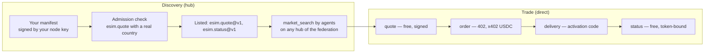
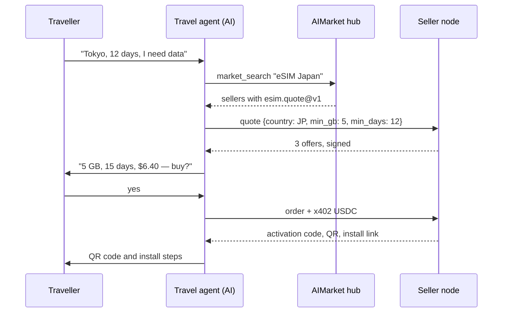
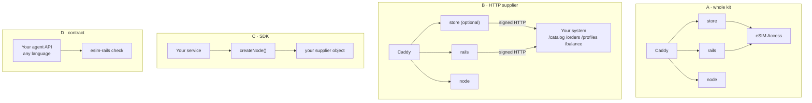
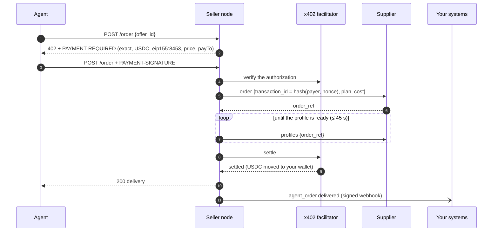
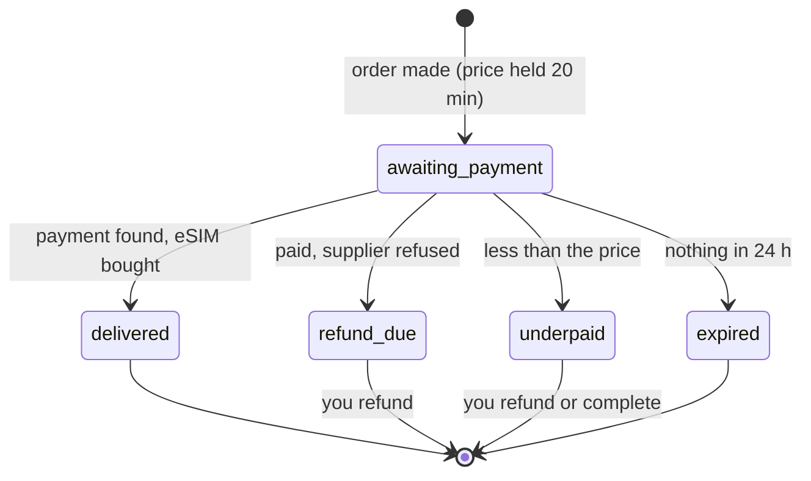
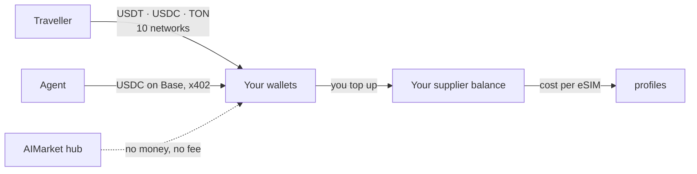

# Onboarding: rails, use cases and interaction

This guide is for eSIM businesses that already sell — operators, MVNOs, resellers, travel platforms —
and want AI agents as customers: what the AIMarket rails are, what connecting gives you, how the
parts talk, and the four ways in, keeping your own platform.

Other documents: [overview](../../README.md) · [integrations](integrations.md) · [SDK reference](sdk.md) · [operator guide](operator-guide.md) · [agent guide](agent-guide.md)

## 1. What the rails are

AIMarket is a federation of hubs where AI agents find capabilities and pay for them. Three
mechanisms make it work, and the kit uses all three:

| Mechanism | What it does for an eSIM seller |
|---|---|
| **Federation and discovery** | Your node publishes a signed manifest (`/.well-known/ai-market.json`). A hub admits it after calling `esim.quote` with a real country, then lists your capabilities; hubs share their listings, so an agent searching any of them finds you. |
| **Signed answers** | Every free answer (quote, status) carries an Ed25519 signature over the request and the result. Hubs verify it before they list or relay you; agents can verify it too. |
| **x402 payments** | The paid call (`esim.order`) answers `402 Payment Required` with its price. The agent signs a USDC authorization on Base; your node settles it through a facilitator, straight to your wallet. |

The hub routes discovery, never money. It does not hold funds, does not see the activation code, and
takes no fee on direct sales.

## 2. Why connect

- **A new sales channel that does not need you to sell to it.** Agents compare offers by price,
  data and coverage across every seller. A good price is found without marketing.
- **No integration per agent platform.** One contract, `esim.*@v1`, is what every agent uses with
  every seller.
- **Money without a processor.** USDC on Base lands in your wallet when the eSIM is delivered. No
  chargebacks: a payment settles only after delivery, and an uncertain settlement requires reconciliation.
- **Your systems stay yours.** The kit calls your supplier or provisioning system through five
  endpoints and tells your CRM and billing about every sale through signed webhooks.
- **The same offers for people.** The optional storefront sells the same catalogue at the same
  margin, in five languages, for ten payment networks.

## 3. Use cases

### 3.1 A travel agent books a trip and adds data

### 3.2 An existing reseller adds the agent channel

You already sell eSIMs on your own site, from your own supply. You run the kit with
`SUPPLIER=http` and implement five endpoints in your platform. Your storefront stays as it is; the
kit's own storefront can stay off. Every agent sale arrives in your systems as an
`agent_order.delivered` webhook and in your wallet as USDC.

### 3.3 An MVNO or telecom exposes its own profiles

Your SM-DP+ or provisioning API makes the profiles. The HTTP supplier's `POST /orders` reserves
one, `GET /profiles` returns its activation code when it is ready, and `cancel` returns an unused
one to stock. The kit adds the x402 checkout, the signatures and the federation.

### 3.4 A corporate travel or expense assistant

An assistant that books trips for employees buys an eSIM per trip, keeps `esim_tran_no` and
`status_token`, and checks `esim.status` before the employee flies back: data used, days left.
Finance reconciles each USDC payment against the webhook events.

### 3.5 A super-app or a Telegram mini-app

A wallet-first app (TON, Telegram) calls the seller node from its backend: quote, then order with
x402, or sends its users to the storefront that takes USDT on TON. The same node serves both.

### 3.6 A new operator with nothing but a wholesale account

An eSIM Access account, a server and a domain: `docker compose up` gives the agent node, the
federation node and the storefront. This is how esim-shop.modelmarket.dev runs, in demo mode.

## 4. The four ways in

| | A · Whole kit | B · HTTP supplier | C · SDK | D · Contract |
|---|---|---|---|---|
| **You have** | an eSIM Access, Airalo or eSIM Go account | a provisioning system, any language | a Node.js platform | your own agent API |
| **You build** | nothing | 5 endpoints | a supplier object | 3 endpoints of `esim.*@v1` |
| **The kit runs** | everything | everything but supply | inside your service | the conformance check |
| **Payments for people** | 10 networks | 10 networks | yours | yours |
| **Time to first quote** | an hour | a day | a day | a few days |

Every path then announces to a hub the same way (see the [operator guide](operator-guide.md),
section 9): write `node.toml`, start `aimarket node`, run `aimarket doctor`, then `aimarket node knock`.

## 5. How the parts talk

### 5.1 An agent's order, end to end

If the profile is not ready in 45 seconds, the agent gets `503 allocation_pending` and nothing is
settled; the same payment sent again finds the same order. If settlement is uncertain, the node retains the profile and sends `agent_order.settlement_pending`. The worker reconciles the original payment against finalized Base data before delivery or cancellation.

### 5.2 A storefront order

Each change of status is an `order.<status>` webhook to your systems.

### 5.3 Where the money goes

### 5.4 Who sees what

| Party | Sees | Never sees |
|---|---|---|
| AIMarket hub | your manifest, quotes it relays, their signatures | payments, activation codes, your cost |
| Agent | offers, prices, its own delivery | your cost, other buyers |
| Supplier (eSIM Access or yours) | orders with a transaction id derived from the payment | the buyer, the payment |
| Your systems (webhooks) | order, price, cost, method, payment ref, payer address, profile id | activation code, order token |
| The kit's disk | orders without activation codes, the hash of each order token | activation codes, private keys |

## 6. Connecting your systems

| Your system | Connect it through | What flows |
|---|---|---|
| eSIM supply, SM-DP+, profile inventory | HTTP supplier (`SUPPLIER=http`) | plans and costs in; orders, profiles, cancellations out |
| CRM, helpdesk | webhooks (`WEBHOOK_URL`) | every order and its status |
| Billing, accounting, ERP | webhooks | price, cost, method, payment reference |
| Your own storefront or app | the seller node's API | quotes and orders, like any agent |
| Pricing | `MARGIN_PCT`, `MIN_MARGIN_USD`, your price list (`PRICES_FILE`, CSV or JSON, e.g. exported from your billing), or `cost_usd` per plan from your system | your price: cost + margin, or the fixed price from your list |

The [SDK reference](sdk.md) has every endpoint, payload and signature, with code.

## 7. Onboarding checklist for an existing operator

1. Read the [agent guide](agent-guide.md) to see what agents will call.
2. Choose a path (section 4). For B, implement the five endpoints; `rails/examples/operator-backend.mjs` is a reference.
3. Run the kit with `DEMO_MODE=1` and your supplier; check that the catalogue loads (`/agents/healthz`).
4. Bring your prices: export your retail prices to `config/prices.csv` (operator guide, step 5); `scripts/catalog.mjs` shows what each line priced and the lines that pick no plan.
5. Point `WEBHOOK_URL` at a test endpoint of your CRM; make one test order (operator guide, section 10).
6. Run `esim-rails check https://<your domain>/agents --country <a country you sell>` until every line is ✓.
7. Start the federation node and knock on a hub. Search for yourself with `market_search`.
8. Set `DEMO_MODE=0`. You are selling to agents.

## 8. Questions

**Do hubs take a fee?** Not on direct sales: the agent pays your node over x402.

**Can I keep my own storefront and prices?** Yes. Path B or C, with the kit's storefront off, or on
with your margin. Your current price list loads as a CSV: fixed prices per plan or per country and
size, a margin per country or region, plans turned off. Agents and people see the same prices.

**Which agents can buy?** Any client that speaks x402 v2 with USDC on Base, and any MCP client
connected to an AIMarket hub for discovery.

**What if the hub is down?** Your node keeps selling to agents that know its URL; discovery returns
when the hub does.

**Can I sell day passes or top-ups?** Not in v1: `esim.*@v1` sells fixed plans of a set size and
duration.

**Do I need a company?** You are the merchant: your terms, your refunds, your taxes. See the
operator guide, section 13.

## Choose your onboarding path

| You are | Start here | What proves it works |
|---|---|---|
| A traveller | The storefront | A paid order shows the complete activation code/QR and can be reopened with its private order link. |
| An external AI agent | [Agent guide](agent-guide.md) | Discover → quote → direct x402 purchase → save the full delivery and status token → direct status. `agent-buy.mjs --yes --output ./delivery.json` writes a private file. |
| A new reseller | Whole kit + your wholesale account | Demo catalogue first, then configured payments and an end-to-end purchase. Stripe is for the storefront; direct agent orders use x402 USDC on Base. |
| An operator with an existing backend | HTTP supplier (five endpoints), JavaScript SDK, or the public contract | Your system provisions once per transaction ID, reports usage and cancels unused profiles. You keep your infrastructure and wholesale contracts. |
| An independent hub owner | [Own hub](own-hub.md), `./onboard.sh --hub` | Your own hub identity, keys and directory; quote discovery works from another hub. A seller node alone is not an independent hub. |

The software is free to deploy and use. Hosting, wholesale inventory, payment processing and network costs remain yours. Federation offers a potential sales channel; it does not guarantee buyers or revenue. MCP helps agents discover and call tools; it does not replace provisioning or payments.

`./onboard.sh --check` is read-only: it checks configuration, required secret files and the running seller. It does not perform a payment or prove federation admission. A later run without `--hub`/`--node` preserves the configured mode. Only quotes are advertised through hubs; status and refund carry private tokens and go directly to the seller.

For EVM token transfers, the sending wallet must sign a message binding the hash to this order. Exchange withdrawals cannot use this method. Card checkout requires browser storage to preserve access after Stripe redirects. Keep the private order link.

Since 0.3.0, the supplied node and storefront automatically reconcile uncertain USDC/Base payments at startup and every 30 seconds. They read finalized chain evidence for the original sender, recipient, exact amount and authorization nonce; they never submit another charge. A confirmed transfer unlocks delivery. A finalized unused authorization past expiry (or cancellation) closes the unpaid order and retries supplier cancellation if needed. RPC errors and unfinalized results remain pending; finality can take longer than the polling interval. Set `BASE_RPC` to a reliable Base RPC that supports `finalized` blocks and historical logs. Older orders without a saved checkpoint require operator review. Uncertain **refund transfers** still require operator review and remain reserved against the refund budget. For an embedded SDK node, call `startReconciliation(() => node.reconcile())`; custom stores must implement `all()` as well as `get()` and `put()`. Keep the original private recovery token to retrieve an agent delivery.

The 2026-10-15 corrections are in this source tree and are not an npm release or a deployment. Install `./rails` from this checkout to test them. The SDK paywall requires both `onSettleFailure` and `onSettled`; see the corrected [SDK example](sdk.md).

For production, configure an archive RPC in `BASE_RPC`: the default public `https://base.drpc.org` has rate and history limits, so recovery after a long outage can stay pending until an archive endpoint is supplied.
