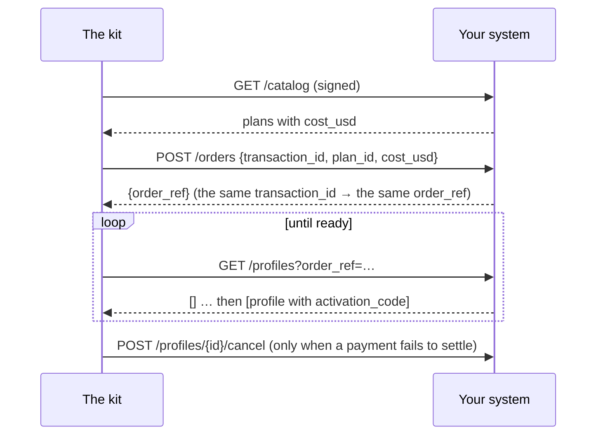

# SDK reference

Everything an existing eSIM operator needs to put its systems on the AIMarket rails: the packages,
the supplier interface, the HTTP supplier for systems in any language, the seller node, webhooks,
the `esim.*@v1` contract and the conformance check.

Other documents: [overview](../../README.md) · [onboarding](rails.md) · [integrations](integrations.md) · [operator guide](operator-guide.md) · [agent guide](agent-guide.md)

## 1. Packages

| Package | What | Install |
|---|---|---|
| `@aimarket/esim-rails` | The SDK: seller node, suppliers, webhooks, schemas, `esim-rails check` | `npm i @aimarket/esim-rails` once published; until then `npm i ./rails` from a clone of this repository |
| `aimarket-hub` (PyPI) | `aimarket node`: the federation node that lists you on hubs | `pip install aimarket-hub==3.15.26`, or the kit's `node/` image |
| JSON Schemas | The contract, for any language | `rails/spec/esim-v1/*.schema.json` |
| Docker images | storefront, seller node, federation node | built by `docker compose up --build` |

Node.js 20 or newer. The SDK is ESM.

```js
import {
  createNode, ed25519Signer, buildPaywall, fileStore,          // the seller node
  httpSupplier, esimAccessSupplier, airaloSupplier, esimGoSupplier, createEsimAccessClient,   // suppliers
  createWebhooks, verifyWebhook,                                // your systems
  validate, checkSeller,                                        // the contract
  pricingFromEnv, parsePriceList, priceFor,                     // your prices
} from "@aimarket/esim-rails";
```

## 2. The supplier interface

A supplier is where the eSIMs come from. The storefront and the seller node talk to it through five
methods only.

| Method | Returns | Rules |
|---|---|---|
| `catalog()` | `Plan[]` | the plans you sell, at your cost |
| `order({ transactionId, planId, costUsd })` | `{ orderRef }` | idempotent by `transactionId`; refuse when `costUsd` is no longer your cost |
| `profiles({ orderRef })` or `profiles({ profileId })` | `Profile[]` | `[]` while the profile is being made |
| `cancel({ profileId })` | `true` | unused profiles only |
| `balance()` | `{ usd }` or `null` | `null` when there is no balance to watch |

```text
Plan     { id, name, countries: ["FR", …], kind?: "country" | "region" | "global", data_bytes, days,
           speed?, networks?, top_up?, unused_valid_days?, cost_usd }
Profile  { profileId, orderRef, activationCode, iccid?, qrCodeUrl?, installUrl?, apn?, expires?,
           state?, installed?, dataUsedBytes?, dataTotalBytes?, activated? }
```

Throw `SupplierError(code, message, { retryable })`: `retryable: true` means "not now" (an outage, a
rate limit); otherwise "no" (an unknown plan, a changed price, an empty balance). A "no" is never
charged to the buyer.

A supplier in your own code:

```js
import { SupplierError } from "@aimarket/esim-rails";

export const mySupplier = {
  async catalog() {
    return (await db.plans.active()).map((p) => ({
      id: p.sku, name: p.title, countries: p.countries, kind: p.region ? "region" : "country",
      data_bytes: p.gb * 1024 ** 3, days: p.days, cost_usd: p.cost }));
  },
  async order({ transactionId, planId, costUsd }) {
    const plan = await db.plans.get(planId);
    if (!plan || plan.cost !== costUsd) throw new SupplierError("price_changed", "the plan changed");
    const o = await db.orders.upsertByTransaction(transactionId, planId);   // the same id, the same order
    return { orderRef: o.id };
  },
  async profiles({ orderRef, profileId }) {
    const rows = orderRef ? await smdp.profilesOfOrder(orderRef) : [await smdp.profile(profileId)].filter(Boolean);
    return rows.map((r) => ({ profileId: r.id, orderRef: r.order, activationCode: r.lpa, iccid: r.iccid, state: r.state }));
  },
  async cancel({ profileId }) { await smdp.release(profileId); return true; },
  async balance() { return null; },                                       // your own stock: nothing to watch
};
```

Built in: `esimAccessSupplier(createEsimAccessClient({ accessCode, secretKey }))`, `airaloSupplier({ clientId, clientSecret })`,
`esimGoSupplier({ apiKey })` and `httpSupplier({ url, secret })` — setup and caveats in [integrations](integrations.md).

## 3. The HTTP supplier: your system, any language

Run the kit with `SUPPLIER=http`, `SUPPLIER_URL` and `SUPPLIER_SECRET_FILE`, and implement five
endpoints in your system. The full contract is in [rails/spec/supplier-http.md](../../rails/spec/supplier-http.md).

| Method and path | Body | Answer |
|---|---|---|
| `GET /catalog` | — | `{"plans": [Plan]}` |
| `POST /orders` | `{"transaction_id", "plan_id", "cost_usd"}` | `{"order_ref"}` |
| `GET /profiles?order_ref=…` or `?profile_id=…` | — | `{"profiles": [Profile]}` (snake_case) |
| `POST /profiles/{profile_id}/cancel` | `{}` | `{"cancelled": true}` |
| `GET /balance` | — | `{"usd": 250.0}`, or 404 |

Every request carries `X-Kit-Timestamp` and `X-Kit-Signature: v1=<hex HMAC-SHA256(secret,
timestamp + "." + METHOD + " " + path + "." + body)>`. Refuse a bad signature and anything older
than five minutes.



A minimal Python receiver (Flask), the two endpoints that matter most:

```python
import hashlib, hmac, json, time
from flask import Flask, request, jsonify, abort

SECRET = open("/run/secrets/kit_supplier").read().strip().encode()
app = Flask(__name__)

@app.before_request
def signed():
    ts, sig = request.headers.get("X-Kit-Timestamp", "0"), request.headers.get("X-Kit-Signature", "")
    path = request.full_path.rstrip("?")
    msg = f"{ts}.{request.method} {path}.".encode() + request.get_data()
    want = "v1=" + hmac.new(SECRET, msg, hashlib.sha256).hexdigest()
    if abs(time.time() * 1000 - int(ts)) > 300_000 or not hmac.compare_digest(want, sig):
        abort(401)

@app.get("/catalog")
def catalog():
    return jsonify(plans=[{"id": p.sku, "name": p.title, "countries": p.countries, "kind": "country",
                           "data_bytes": p.bytes, "days": p.days, "cost_usd": float(p.cost)} for p in active_plans()])

@app.post("/orders")
def orders():
    body = request.get_json()
    plan = find_plan(body["plan_id"])
    if plan is None or float(plan.cost) != body["cost_usd"]:
        return jsonify(error="price_changed"), 409
    order = upsert_order(body["transaction_id"], plan)          # idempotent by transaction_id
    return jsonify(order_ref=order.ref)
```

The JavaScript reference with all five endpoints: [rails/examples/operator-backend.mjs](../../rails/examples/operator-backend.mjs).

## 4. The seller node

```js
const node = createNode({
  supplier,                         // a supplier (section 2) or an eSIM Access client
  store: fileStore("/data/orders.json", fs),     // or your own {get, put}: order records, never codes
  secret: statusSecret,             // 16+ characters: the key of the buyers' status tokens
  signer: ed25519Signer(pem),       // your node's identity: signs every free answer
  publicUrl: "https://esim.example.com/agents",
  paywall,                          // buildPaywall(...) below, or null to quote without selling
  events,                           // createWebhooks(...) or { emit() {} }
  pricing: pricingFromEnv(process.env),   // MARGIN_PCT, MIN_MARGIN_USD and PRICES_FILE; or your own object, below
  sellerName: "My eSIM", productId: "esim-mine", demo: false,
});
const paywall = await buildPaywall({
  cdpKeyFile: "/run/secrets/cdp_api_key.json", payTo: "0xYourBaseAddress", publicUrl: "https://esim.example.com/agents",
  priceOf: (offerId) => node.priceOf(offerId), onSettleFailure: (p) => node.settleFailed(p),
});
node.app.listen(9490);
```

Routes: `POST /quote` and `POST /status` (also `/quote/invoke`, `/status/invoke` for hubs), `POST /order`
(x402), `GET /listing.json`, `GET /healthz`. The free routes answer any web page (CORS); the order
does not.

**Prices.** `pricing` is `{ marginPct, minMarginUsd, rules }`. The rules come from a price list: `parsePriceList(text)` reads CSV or JSON (columns in the [operator guide](operator-guide.md), step 5) and throws `PriceListError` with the line number. `priceFor(plan, pricing)` says what a plan sells for and which rule priced it; a rule with `off` leaves the plan out of the offers. Without rules every plan is priced by the formula, 100 % and $1.00 when unset.

**Refunds.** `POST /refund` with `{esim_tran_no, status_token}` cancels an unused eSIM (not installed, no data used; else `409 in_use`) and pays the order's price back to the paying address, once. `createNode({ refunder })` takes `await buildRefunder({ keyFile, cdpKeyFile, maxUsd, dailyMaxUsd })`: it signs an EIP-3009 transfer from the refund wallet and the facilitator settles it. Without a refunder the answer is `status: "due"`. The [cases](cases.md) page has a real refund with its transactions.

**Receipts.** A delivered order also answers with `receipt` and `receipt_signature`, and a refund paid back answers with its own: what a buyer can bring to a hub as evidence that the seller delivered. `receipt` is `{v: 1, kind, capability: "esim.order@v1", product_id, chain_id: 8453, …}`. With `kind: "delivery"` it adds `payer`, `pay_to`, `nonce` (the payment's EIP-3009 nonce), `offer_id` and `at`; with `kind: "refund"`, `payer`, `refund_from`, `refund_nonce`, `delivery_nonce` and `at`. The signature is Ed25519, base64, over `canonicalJson(receipt)`, made by the node's `signer`: the key that `/healthz` and `/listing.json` show and `node.toml` publishes as `provider_pubkey`. No receipt holds a secret of the eSIM. A refund recorded as `due` has none: there is no transfer to show yet. The hub's side is in the [cases](cases.md), section 11.4.

## 5. Webhooks

Set `WEBHOOK_URL` and `WEBHOOK_SECRET_FILE` (16+ characters), or pass `createWebhooks({ url, secret })`.

| Event | When |
|---|---|
| `order.created` | a buyer started a storefront order |
| `order.delivered` | paid and delivered |
| `order.refund_due` | paid, but the supplier refused: refund the payer |
| `order.underpaid` | a payment below the price arrived |
| `order.expired` | nothing arrived within 24 hours |
| `order.awaiting_payment` | a signed payment failed to settle; the order is open again |
| `agent_order.delivered` | an agent's order was delivered |
| `agent_order.cancelled` | an agent's payment failed to settle; the eSIM was cancelled |
| `agent_order.refunded` | an agent's unused eSIM was cancelled and the price paid back (`transaction`) |
| `agent_order.refund_due` | an agent's unused eSIM was cancelled; pay the price back to `to` yourself |

```http
POST /hooks/esim HTTP/1.1
Content-Type: application/json
X-Kit-Event: order.delivered
X-Kit-Timestamp: 1765432100000
X-Kit-Signature: v1=5d41402abc4b2a76b9719d911017c592…

{"id": "3f1c…", "type": "order.delivered", "created_at": "2026-10-14T10:46:24.000Z",
 "data": {"order_id": "Qh3…", "status": "delivered", "offer_id": "JP_5_30", "offer_name": "Japan 5GB 30Days",
          "price_usd": "6.40", "cost_usd": 3.2, "method": "tron",
          "payment": {"ref": "tron:…", "payer": "T…", "units": "6400042"}, "esim_tran_no": "26101410460022",
          "error": null, "created_at": "2026-10-14T10:45:58.000Z"}}
```

The signature covers `timestamp + "." + body`. Delivery is at least once (three tries over about
half a minute): dedupe by `id`. An event never carries an activation code, a QR link or an order token.

```js
import { verifyWebhook } from "@aimarket/esim-rails";
app.post("/hooks/esim", express.text({ type: "*/*" }), (req, res) => {
  const ok = verifyWebhook({ secret, timestamp: req.get("x-kit-timestamp"), signature: req.get("x-kit-signature"), body: req.body });
  if (!ok) return res.sendStatus(401);
  crm.record(JSON.parse(req.body));
  res.sendStatus(204);
});
```

```python
def kit_event_ok(secret: bytes, timestamp: str, signature: str, body: bytes) -> bool:
    want = "v1=" + hmac.new(secret, timestamp.encode() + b"." + body, hashlib.sha256).hexdigest()
    return abs(time.time() * 1000 - int(timestamp)) < 300_000 and hmac.compare_digest(want, signature)
```

## 6. The contract: esim.*@v1

| Capability | Input schema | Result schema |
|---|---|---|
| `esim.quote@v1` | `quote-input` | `quote-result` (with `offer`) |
| `esim.order@v1` | `{offer_id}` + x402 | `delivery` |
| `esim.status@v1` | `status-input` | `status-result` |

Schemas: [rails/spec/esim-v1](../../rails/spec/esim-v1/). Free answers are `{"success": true, "result": …}`
with `X-Provider-Signature`: Ed25519, base64, over the canonical JSON of
`{capability_id, product_id, input_sha256, result}` (sorted keys, no spaces, non-ASCII as is;
`input_sha256` is the hex SHA-256 of the canonical input). The order answers `402` with an x402 v2
`PAYMENT-REQUIRED` header: scheme `exact`, network `eip155:8453`, USDC, the offer's price in 6
decimals, your address.

Validate in your own tests: `import { validate } from "@aimarket/esim-rails"; validate("offer", o)`
returns `[]` or the list of problems.

## 7. The conformance check

Point it at any seller node, the kit's or one you wrote:

```bash
npx esim-rails check https://esim.example.com/agents --country JP
```

What it printed for the demo node:

```text
✓ listing.json — esim.quote@v1, esim.status@v1; order at https://modelmarket.dev/providers/esim/order
✓ esim.quote@v1 answer — 5 offers for JP, all valid
✓ cheapest first
✓ signature — Ed25519 over the request-bound canonical, key from listing.json
✓ bad input is a 400
✓ unknown eSIM is a 404 not_found
✓ unknown offer is a 400 before any price
⚠ x402 terms — a demo node: it sells nothing (demo_mode)
✓ CORS on the free routes

Conforms to esim.*@v1.
```

It calls only free routes and asks the order for its price; it never pays.

## 8. Environment

| Variable | Service | |
|---|---|---|
| `SUPPLIER` | store, rails | `esimaccess` (default), `airalo`, `esimgo` or `http` |
| `AIRALO_CLIENT_ID_FILE`, `AIRALO_CLIENT_SECRET_FILE`, `AIRALO_BASE_URL` | store, rails | Airalo Partner API |
| `ESIMGO_API_KEY_FILE`, `ESIMGO_BASE_URL` | store, rails | eSIM Go |
| `ESIMACCESS_ACCESS_CODE_FILE`, `ESIMACCESS_SECRET_KEY_FILE` | store, rails | eSIM Access keys |
| `SUPPLIER_URL`, `SUPPLIER_SECRET_FILE` | store, rails | your system, for `SUPPLIER=http` |
| `WEBHOOK_URL`, `WEBHOOK_SECRET_FILE` | store, rails | events for your systems; off when unset |
| `MARGIN_PCT`, `MIN_MARGIN_USD` | store, rails | price = cost + margin |
| `PRICES_FILE` | store, rails | your price list over the formula, CSV or JSON; a list that does not read stops the start |
| `CATALOG_SNAPSHOT` | rails | the last catalogue, served when the supplier does not answer: up to six hours when selling, without limit in demo mode (default `/data/catalog-snapshot.json`; the store keeps its own in `DATA_DIR`) |
| `REFUND_KEY_FILE` | rails | optional: the key of the wallet refunds are paid from, in USDC through the facilitator (no ETH needed); without it refunds are recorded as due |
| `REFUND_MAX_USD`, `REFUND_DAILY_MAX_USD` | rails | caps on one refund and on a day's refunds (50 each) |
| `PAY_TO_EVM`, `CDP_KEY_FILE` | rails | where agents pay, and the facilitator key |
| `PAY_TO_EVM`, `PAY_TO_TON`, `PAY_TO_TRON`, `PAY_TO_SOLANA`, `EVM_CHAINS` | store | where people pay |
| `DEMO_MODE` | store, rails | `1`: quotes and pages, no sales |
| `PUBLIC_URL`, `PRODUCT_ID`, `SELLER_NAME` / `STORE_NAME` | both | your identity |

## 9. Versioning

`esim.*@v1` only grows: new optional fields may appear, existing ones keep their meaning. A change
that breaks a client becomes `esim.*@v2`, listed beside v1. The SDK follows semver; the HTTP supplier
contract is version 1.
