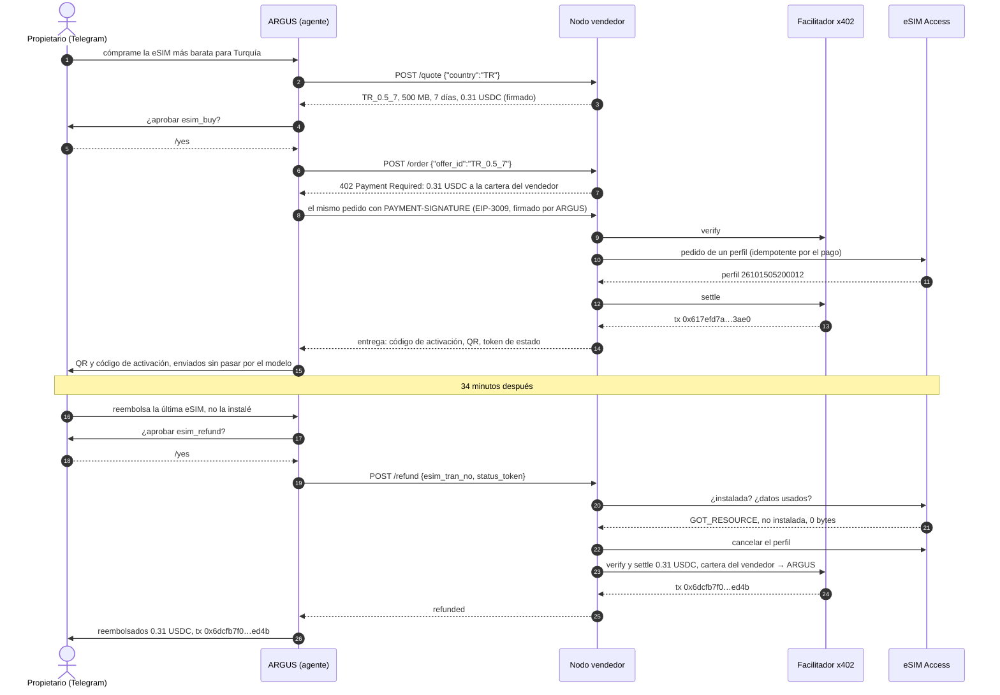
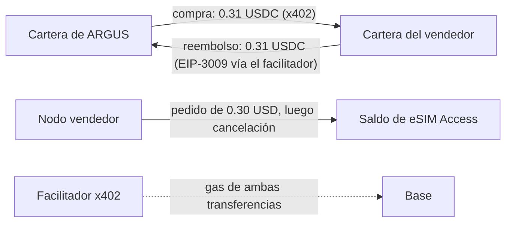
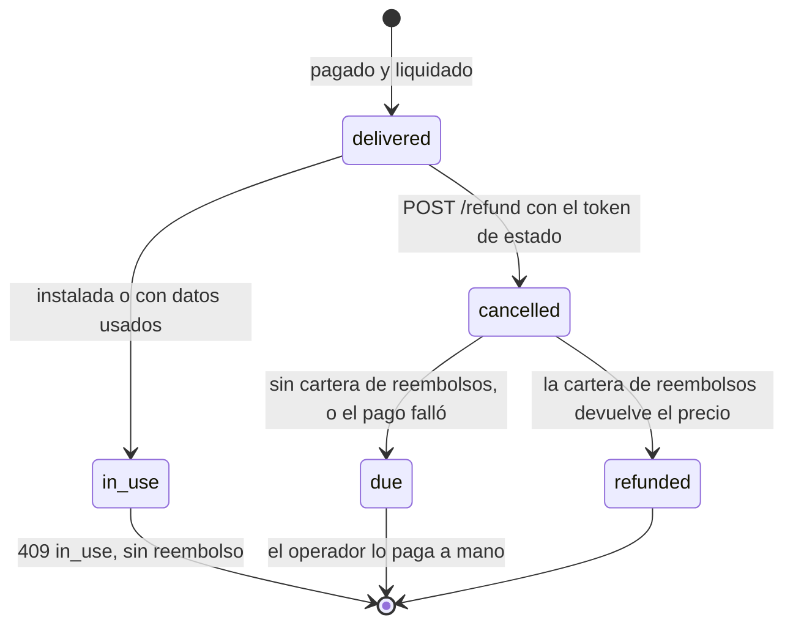
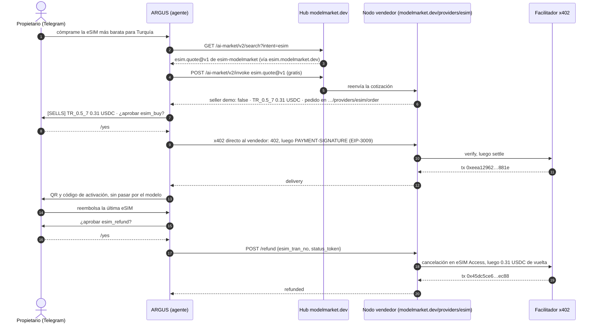
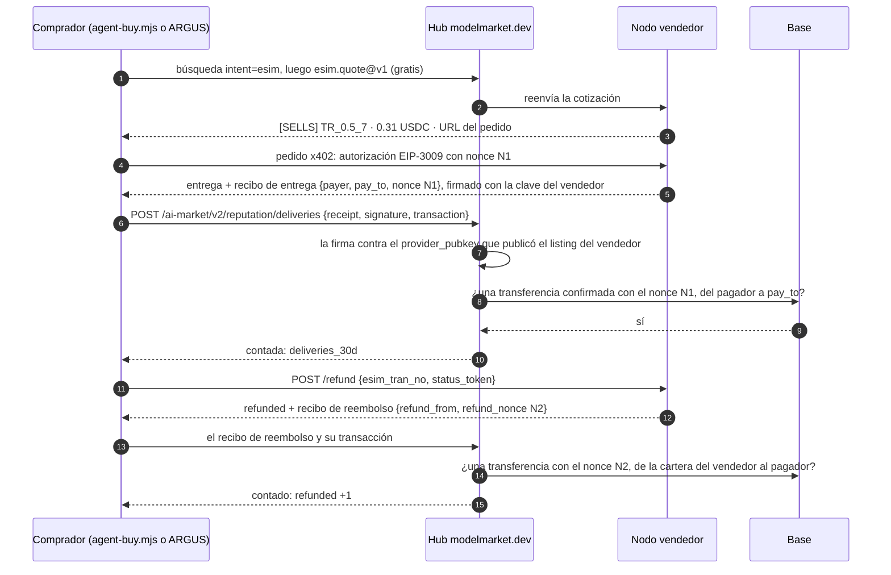
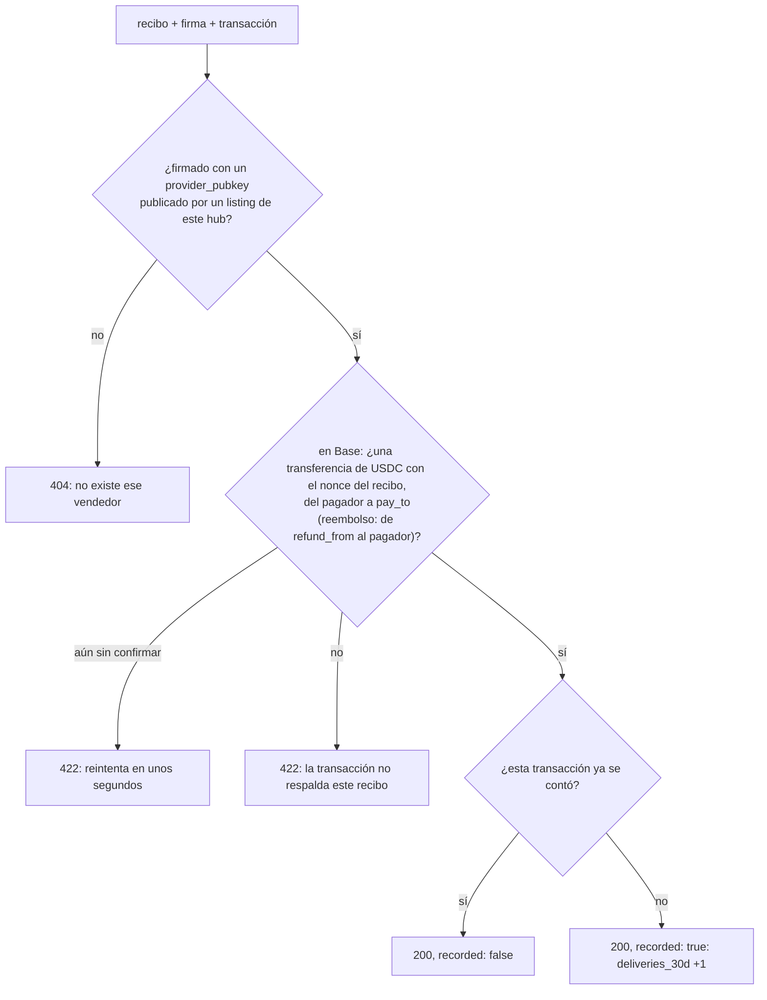

# Casos: un agente de IA compra una eSIM y luego recupera su dinero

Ejecuciones reales del kit, con sus transacciones, para que puedas comprobar cada paso on-chain. El caso 2 (sección 10) es el mismo agente comprando nuestra capacidad a través del hub. El caso 3 (sección 11) tiene dos compradores, un agente de programación en una terminal y ARGUS, y el hub contando las entregas del vendedor a partir de los recibos firmados de los compradores. El primero es el camino completo del agente en ambos sentidos: un agente de IA encuentra una oferta, la paga en USDC por x402, entrega la eSIM a su propietario y más tarde pide un reembolso, que el nodo vendedor devuelve sin que nadie toque una cartera (wallet).

## 1. Qué pasó

El 15 de octubre de 2026 el propietario de ARGUS, un agente de IA personal, le escribió en Telegram: cómprame la eSIM más barata para Turquía. ARGUS pidió ofertas al nodo vendedor del kit, eligió Turquía 500 MB por 7 días a 0.31 USDC, pidió la aprobación de su propietario y pagó desde su propia cartera. Segundos después el propietario tenía en el chat el código QR y el código de activación. ARGUS nunca los vio.

Treinta y cuatro minutos después el propietario pidió a ARGUS un reembolso. La eSIM no estaba instalada, así que el nodo vendedor la canceló en el mayorista y devolvió los 0.31 USDC a la cartera del agente. Todas las carteras y el saldo mayorista terminaron como empezaron.

El vendedor fue el banco de pruebas privado del kit: un nodo vendedor normal, que vende a precio de coste y solo es accesible desde el host del agente. Nada de la ejecución fue simulado.

## 2. Quién participó

| Parte | Qué es | Dirección o lugar |
|---|---|---|
| Propietario | la persona para la que trabaja ARGUS; aprueba cada pago en Telegram | un chat privado de Telegram |
| ARGUS | el agente (comprador); paga desde su propia cartera | `0x428f2Be4327908948e3B1915C55ddF8fA6bf73cc` |
| Nodo vendedor | el nodo `rails/` del kit (vendedor) con reembolsos automáticos | `https://esim.modelmarket.dev/stand` |
| Cartera del vendedor | recibe los pagos y paga los reembolsos (`PAY_TO` y `REFUND_KEY_FILE` son la misma cartera) | `0xF47161fBB56D0D910a17e503C8292903F41BbAE2` |
| Facilitador | el facilitador x402 de Coinbase: verifica cada transferencia firmada y la pone on-chain, pagando el gas | CDP |
| Mayorista | eSIM Access: emite y cancela el perfil | la cuenta del operador |

## 3. La cadena completa



## 4. Las transacciones

Todas en Base mainnet, en USDC (`0x8335…2913`). Ábrelas en [basescan.org](https://basescan.org).

| Paso | Transacción | Bloque, hora (UTC) | De → a | Importe | Gas pagado por |
|---|---|---|---|---|---|
| Fondos para el agente | `0x225afba5cd651e3ccdf70593fe985d1e24ddc14836270e83b13f546b6d017578` | 52624834 | cartera del propietario `0x097e…475a` → ARGUS | 0.50 | el propietario |
| Compra | `0x617efd7abe4b4c6a80b54046617a73415aa54df7ada5f002ce7260cf68ac3ae0` | 52626137, 05:20:21 | ARGUS → cartera del vendedor | 0.31 | facilitador `0x93f6…be44` |
| Reembolso | `0x6dcfb7f075ad7fb6308064ac53e310dfb6adfd9b65d9f44b3c9a6dd39ca9ed4b` | 52627173, 05:54:53 | cartera del vendedor → ARGUS | 0.31 | facilitador `0x4c93…0205` |

La compra y el reembolso son llamadas EIP-3009 `transferWithAuthorization`: la cartera que paga firma y el facilitador envía. Ni ARGUS ni la cartera del vendedor tuvieron ETH, ni antes, ni durante, ni después.

## 5. Dinero y saldos



| | Antes | Tras la compra | Tras el reembolso |
|---|---|---|---|
| Cartera de ARGUS | 0.50 USDC | 0.19 USDC | 0.50 USDC |
| Cartera del vendedor | 0 | 0.31 USDC | 0 |
| Saldo de eSIM Access | $20.00 | $19.70 | $20.00 |
| ETH gastado por ARGUS o el vendedor | 0 | 0 | 0 |

El banco de pruebas vendía a coste (`MARGIN_PCT=0`, `MIN_MARGIN_USD=0.01`): $0.30 al por mayor, 0.31 USDC para el agente. Con el margen por defecto del kit, el mismo plan cuesta $1.30.

## 6. Las reglas del reembolso



- **Solo puede pedirlo quien pagó.** La petición lleva el token de estado que llegó con la entrega. Un token incorrecto recibe `404`, igual que una eSIM desconocida.
- **Solo una eSIM sin usar.** El nodo pregunta antes al mayorista: un perfil instalado, o que haya gastado algún dato, recibe `409 in_use` y queda como está.
- **Solo a la dirección que pagó, solo el precio pagado.** El nodo guarda el pagador y el precio con el pedido, y nunca devuelve más.
- **Una vez.** Una segunda petición, o dos a la vez, reciben la misma respuesta sin un segundo pago. Un pago que falló no se reintenta solo: su transferencia puede haber llegado, así que el operador revisa la cadena primero.
- **Con límites.** `REFUND_MAX_USD` por reembolso y `REFUND_DAILY_MAX_USD` por día, 50 cada uno por defecto. El banco de pruebas usó 1 y 2.
- **Primero cancelar, luego pagar.** El mayorista devuelve al operador el perfil cancelado, así que el operador no pierde nada salvo el tiempo.

## 7. Activar los reembolsos en tu nodo

Los reembolsos están apagados hasta que das al nodo una cartera desde la que pagarlos. Sin ella, `POST /refund` igualmente cancela la eSIM sin usar y registra el reembolso como pendiente, y recibes el webhook `agent_order.refund_due` para pagarlo tú.

```bash
# una cartera con USDC en Base para reembolsos: la propia cartera de PAY_TO, así los reembolsos devuelven
# el dinero que entró, o una reserva aparte. No necesita ETH: el facilitador paga el gas.
cd ~/esim-operator-kit
umask 077
printf 'Refund wallet private key: '; read -rs v; printf %s "$v" > secrets/refund_key; echo; unset v
sudo chown 1000:1000 secrets/refund_key && sudo chmod 600 secrets/refund_key
echo "REFUND_KEY_FILE=/run/secrets/esim/refund_key" >> .env
echo "REFUND_MAX_USD=20" >> .env
echo "REFUND_DAILY_MAX_USD=100" >> .env
docker compose up -d rails
curl -s https://<your domain>/agents/healthz    # "refunds": "automatic"
```

| Ajuste | Qué hace |
|---|---|
| `REFUND_KEY_FILE` | La clave de la cartera desde la que se pagan los reembolsos. La única clave privada que el kit lee, y solo si tú lo activas. |
| `REFUND_MAX_USD` | Lo máximo que paga un reembolso. |
| `REFUND_DAILY_MAX_USD` | Lo máximo que pagan todos los reembolsos en un día. |
| `CDP_KEY_FILE` | Ya está para los pagos; los reembolsos van por el mismo facilitador. |

Si la cartera de reembolsos no es tu cartera principal, deja en ella solo una reserva: una clave en un servidor es una clave que una intrusión puede leer.

## 8. Pedir un reembolso

El agente necesita los dos valores que recibió con la entrega:

```bash
curl -s -X POST https://<seller>/agents/refund -H 'content-type: application/json' \
  -d '{"esim_tran_no":"26101505200012","status_token":"…"}'
```

```json
{"success": true, "result": {"esim_tran_no": "26101505200012", "status": "refunded", "amount_usd": "0.31",
 "to": "0x428f2be4327908948e3b1915c55ddf8fa6bf73cc", "at": "2026-10-15T05:54:50.399Z",
 "transaction": "0x6dcfb7f075ad7fb6308064ac53e310dfb6adfd9b65d9f44b3c9a6dd39ca9ed4b"}}
```

`status` es `refunded` con la transacción, o `due` cuando el vendedor paga a mano. `/listing.json` dice cuál: su `refund.policy` nombra la regla, y `/healthz` muestra `"refunds": "automatic"` u `"operator"`.

## 9. Qué aprendimos

- **Un agente prudente duda de un reembolso inmediato.** Cuando se le pidió «compra y reembolsa enseguida» en un solo mensaje, ARGUS se detuvo y preguntó qué se quería: comprar y quedársela, no comprar nada o un reembolso por un motivo real. El propietario compró y luego pidió el reembolso como una petición aparte. Los agentes reales reembolsarán por motivos reales, y un vendedor puede esperar que lo pidan con educación y una sola vez.
- **El código de activación nunca salió de la entrega.** El vendedor lo envía solo en la respuesta al pedido pagado; ARGUS lo reenvió al chat del propietario y guardó solo el número de perfil y el token de estado. Ni los registros del vendedor ni el registro del agente lo guardan.
- **Nada de gas.** El agente firmó una autorización para pagar, la cartera del vendedor una para reembolsar, y el facilitador hizo el resto.
- **El reembolso del mayorista es lo que hace seguro el reembolso.** El nodo cancela antes de pagar, así que un pedido reembolsado no le cuesta nada al operador.

## 10. Caso 2: a través del hub, de nuestro nodo público

En el caso 1 al agente se le dio la dirección del vendedor. En el caso 2 encontró al vendedor por sí mismo: ARGUS buscó vendedores de eSIM en el hub modelmarket.dev, obtuvo nuestra capacidad `esim.quote@v1` de `esim-modelmarket`, le pidió ofertas a través del hub y pagó por x402 en el `/order` del propio vendedor. El hub enrutó la cotización gratuita y nunca tocó el dinero.

**Para esta prueba nuestro nodo público pasó de demo a vender, y volvió a demo justo después.** El nodo detrás de `esim-modelmarket` (`modelmarket.dev/providers/esim`) vendió durante 52 minutos, de 06:56:55 a 07:48:33 UTC del 15 de octubre de 2026, a coste (`MARGIN_PCT=0`, `MIN_MARGIN_USD=0.01`), cobrando en la misma cartera del vendedor que el banco de pruebas y reembolsando desde ella automáticamente (como mucho $2 por reembolso y $5 al día). Desde las 07:48:33 vuelve a rechazar cada pedido con `demo_mode`.



| Hora (UTC) | Qué pasó |
|---|---|
| 06:56:55 | El nodo público pasa de demo a vender. A través del hub, su cotización dice ahora `demo: false` y 0.31 USDC |
| 07:21 | Primer intento: ARGUS ve las ofertas pero se niega a comprar. El nodo seguía llamándose «modelmarket.dev demo seller», y el agente juzgó por el nombre |
| 07:23 | Arreglo desplegado: el nombre del nodo sigue a su modo, y ARGUS etiqueta cada oferta `[SELLS]` o `[DEMO]` según la respuesta del propio vendedor |
| 07:47:35 | ARGUS compra TR_0.5_7 tras el `/yes` del propietario; la eSIM `26101507470034` llega al Telegram del propietario |
| 07:48:02 | El propietario pide el reembolso y lo aprueba con `/yes`; el nodo cancela la eSIM sin usar y devuelve el dinero |
| 07:48:33 | El nodo público vuelve a demo |

| Paso | Transacción | Bloque, hora (UTC) | De → a | USDC | Gas pagado por |
|---|---|---|---|---|---|
| Compra | `0xeea12962c4f494e55acc59a376203bd4b704804f19a84b4b8f47a96b265a881e` | 52630556, 07:47:39 | ARGUS → cartera del vendedor `0xF471…bAE2` | 0.31 | facilitador `0x68a9…7863` |
| Reembolso | `0x45dc5ce6579d8e889750442d63773586c481a11b30ddf44805960860f3bbec88` | 52630569, 07:48:05 | cartera del vendedor → ARGUS | 0.31 | facilitador `0x625d…ac39` |

ARGUS fue el único comprador de la ventana: los registros del nodo tienen un pedido, reembolsado. Al final ARGUS volvía a tener 0.50 USDC, la cartera del vendedor 0, el saldo de eSIM Access $20.00, la eSIM estaba en estado `CANCEL` y ninguna cartera gastó ETH.

Qué mostró este caso:

- **Un agente lee los nombres.** La cotización del vendedor decía que vendía, pero su nombre decía «demo», y el agente creyó al nombre. Un nodo vendedor debe llamarse por lo que hace; un agente debe decidir por la respuesta del vendedor, no por su nombre.
- **El hub encuentra, el vendedor vende.** El descubrimiento y la cotización gratuita pasaron por el hub; el pago y el reembolso fueron directamente entre el agente y el vendedor, y el hub no tuvo dinero en ningún momento.
- **Demo es un ajuste.** El mismo nodo, el mismo catálogo y la misma cuenta mayorista venden o rechazan según `DEMO_MODE`: un operador abre y cierra una ventana de venta en segundos.

## 11. Caso 3: dos compradores, y el hub cuenta las entregas

Un vendedor al que se paga directamente es invisible para el hub: el dinero va del agente al vendedor, y el hub solo ve la cotización gratuita. Así que, desde el hub, un vendedor que cobra y no entrega nada se veía igual que uno que entrega. Desde el 15 de octubre de 2026 el nodo vendedor firma un recibo por cada entrega y cada reembolso, y el comprador puede llevarlo al hub junto con su transacción. El hub comprueba la firma y la transferencia on-chain, y cuenta una entrega confirmada en el listing del vendedor. El caso 3 lo probó de punta a punta con dos compradores distintos.

**Para esta prueba nuestro nodo público pasó de demo a vender por tercera vez, y volvió a demo justo después.** Vendió durante 9 minutos, de 09:38:59 a 09:48:22 UTC del 15 de octubre de 2026, en las mismas condiciones que en el caso 2: a coste, en la misma cartera del vendedor, con reembolsos automáticos de como mucho $2 cada uno y $5 al día. Desde las 09:48:22 vuelve a rechazar cada pedido con `demo_mode` (`403`).

| Comprador | Qué es | Cartera |
|---|---|---|
| Claude Code | un agente de programación en la terminal del propietario. Ejecutó el comprador de ejemplo del kit `rails/examples/agent-buy.mjs`; el script leyó la clave de un archivo, y el agente nunca la vio | `0x097e3F339D0b023605e12A6B81E2d6Cb7571475a` |
| ARGUS | el agente del propietario en Telegram, como en los casos 1 y 2. El propietario aprobó la compra y el reembolso con `/yes` | `0x428f2Be4327908948e3B1915C55ddF8fA6bf73cc` |

### 11.1 La compra desde Claude Code

Toda la compra es un comando. Sin `--yes` solo cotiza; con `--refund` pide el dinero de vuelta justo después de la entrega.

```bash
cd rails
node examples/agent-buy.mjs TR --hub https://modelmarket.dev --key-file ~/.aicom-pov-buyer.json --yes --refund
```

```text
seller   modelmarket.dev eSIM seller (https://modelmarket.dev → https://esim.modelmarket.dev)

offer    TR_0.5_7 — Turkey 500MB 7Days — 0.31 USDC, from modelmarket.dev eSIM seller
order at https://modelmarket.dev/providers/esim/order
payer    0x097e3F339D0b023605e12A6B81E2d6Cb7571475a

delivered  esim_tran_no 26101509410001 · iccid 8997…7746 · apn internet
activation LPA:1$rsp-eu.s… (the traveller's secret)
paid       0x85d355853807967e85b1efc3f15261e0c58006091898cb98d46095db07bc103e
hub        delivery counted: {"confirmed":1,"distinct_buyers":1,"refunded":0}

refund     refunded · 0.31 USDC to 0x097e3f339d0b023605e12a6b81e2d6cb7571475a · 0x3313e8be7726ce1e3bc4dcf95afde0bd5eb3de0c8a57b601f8b3aaf86ed85c00
hub        refund counted: {"confirmed":1,"distinct_buyers":1,"refunded":1}
```

El script encontró al vendedor a través del hub, se saltó a los vendedores en modo demo, tomó la oferta más barata, pagó por x402 con un tope de $1 por pago y llevó ambos recibos al hub. Tres minutos después ARGUS compró el mismo plan en Telegram, y el contador llegó a dos compradores.

### 11.2 La cadena con recibos



| Hora (UTC) | Qué pasó | Contador del listing después |
|---|---|---|
| 09:38:59 | El nodo público pasa de demo a vender | todavía nada |
| 09:41:05 | Claude Code paga TR_0.5_7; se entrega la eSIM `26101509410001` | 1 entrega, 1 comprador, 0 reembolsos |
| 09:41:19 | Se devuelve su dinero; la eSIM se cancela | 1, 1, 1 |
| 09:44:19 | ARGUS paga tras el `/yes` del propietario; la eSIM `26101509440019` va al Telegram del propietario | 2, 2, 1 |
| 09:44:53 | El reembolso de ARGUS se paga tras `/yes` | 2, 2, 2 |
| 09:48:22 | El nodo público vuelve a demo | 2, 2, 2 (se guarda 30 días) |

### 11.3 Las transacciones

| Paso | Transacción | Bloque, hora (UTC) | De → a | USDC | Gas pagado por |
|---|---|---|---|---|---|
| Compra, Claude Code | `0x85d355853807967e85b1efc3f15261e0c58006091898cb98d46095db07bc103e` | 52633959, 09:41:05 | `0x097e…475a` → cartera del vendedor `0xF471…bAE2` | 0.31 | facilitador `0xca5e…c70d` |
| Reembolso, Claude Code | `0x3313e8be7726ce1e3bc4dcf95afde0bd5eb3de0c8a57b601f8b3aaf86ed85c00` | 52633966, 09:41:19 | cartera del vendedor → `0x097e…475a` | 0.31 | facilitador `0x93f6…be44` |
| Compra, ARGUS | `0xf9ac406f3e329ac2c4c02e26562b6fb944e4165b71b88c4a0756a193325f9669` | 52634056, 09:44:19 | ARGUS → cartera del vendedor | 0.31 | facilitador `0x93f6…be44` |
| Reembolso, ARGUS | `0x5fa5da5455226a20d10dc84ffb8adf56b01d972dcc72f8e135b4a507a8c35287` | 52634073, 09:44:53 | cartera del vendedor → ARGUS | 0.31 | facilitador `0x8f5c…e531` |

Los registros del nodo tienen exactamente estos dos pedidos en la ventana, ambos reembolsados. Al final los dos compradores tenían lo mismo que antes (0.594148 y 0.50 USDC), la cartera del vendedor 0, el saldo de eSIM Access $20.00, las dos eSIM estaban en estado `CANCEL` con 0 bytes usados y ninguna cartera gastó ETH.

### 11.4 El recibo, y qué comprueba el hub

El recibo de entrega de la compra de ARGUS, tal como lo firma el nodo. Nombra el pago, no la eSIM: no lleva código de activación, ni ICCID, ni token de estado.

```json
{"v": 1, "kind": "delivery", "capability": "esim.order@v1", "product_id": "esim-modelmarket", "chain_id": 8453,
 "payer": "0x428f2be4327908948e3b1915c55ddf8fa6bf73cc", "pay_to": "0xF47161fBB56D0D910a17e503C8292903F41BbAE2",
 "nonce": "0xddde4ccd3b8d8ba361b94985b0b063f50ae41f43217cfc3ccadc2d636201f79e", "offer_id": "TR_0.5_7",
 "at": "2026-10-15T09:44:…Z"}
```

La firma es Ed25519 sobre el JSON canónico del recibo (claves ordenadas, sin espacios), con la misma clave del vendedor que firma cada respuesta gratuita. Un recibo de reembolso lleva `kind: "refund"`, `refund_from` (la cartera que devolvió el dinero), `refund_nonce` (el nonce EIP-3009 de esa transferencia) y `delivery_nonce`.



- **Qué guarda el hub.** Por cada transferencia contada: el vendedor, el tipo, la hora, un hash de la transacción y un hash de la dirección del pagador, solo para contar compradores distintos. Ningún importe, ninguna dirección y ninguna transacción en claro. (Quien ya conozca una dirección o una transacción aún puede reconocer su hash.)
- **Qué muestra.** Cada listing del vendedor lleva `deliveries_30d`: `{"confirmed": 2, "distinct_buyers": 2, "refunded": 2}` tras este caso. La puntuación de confianza del hub cuenta un éxito por cada comprador distinto. ARGUS y `agent-buy.mjs` lo muestran junto al vendedor.
- **Qué no demuestra.** Las carteras no cuestan nada: un vendedor podría comprarse a sí mismo con carteras nuevas y reembolsarse. El contador dice «los compradores confirmaron que este vendedor entregó», no «este vendedor es bueno»; léelo junto con los reembolsos y la antigüedad del vendedor. Un reembolso no es un fallo: es una eSIM sin usar cancelada a petición.
- **Quién elige.** Un comprador que mantiene sus compras en privado nunca se cuenta: `--no-share` en `agent-buy.mjs`, `ARGUS_SHARE_DELIVERIES=0` en ARGUS. Los recibos de más de 30 días se rechazan.

### 11.5 Dónde estamos

- **Nuestro nodo público es una demo.** `esim-modelmarket` en modelmarket.dev cotiza precios reales a través del hub y rechaza cada pedido con `demo_mode`. Solo vendió durante las tres ventanas de prueba de esta página, cada una cerrada justo después. Ejecuta hoy `agent-buy.mjs` contra él y lo dirá: `DEMO: sells nothing`, y luego `no seller that sells has an offer for TR`.
- **Un vendedor que vende es tu propio nodo.** El kit con `DEMO_MODE=0`, una clave CDP y `PAY_TO`: la [guía del operador](operator-guide.md), pasos 8 a 10. Con `node.toml` escrito por `scripts/node-toml.mjs` y un nodo de federación con `aimarket-hub` 3.15.27 o posterior (paso 9), su listing lleva la clave del vendedor, y los recibos de los compradores cuentan para él.
- **Cualquier agente puede comprar.** La compra desde un agente de programación en una terminal está comprobada por este caso, con el reembolso. Cualquier agente que hable x402 hace lo mismo: la [guía para agentes](agent-guide.md) tiene la API, y `agent-buy.mjs` es un comprador listo para ejecutar.

Qué mostró este caso:

- **Al vendedor se le paga directamente, y aun así el hub sabe que entrega.** El hub no tiene dinero ni ve importes, y sin embargo el listing muestra dos entregas confirmadas por dos compradores.
- **Una transferencia reciente necesita unos segundos.** Cada uno de los cuatro recibos, de ambos compradores, fue rechazado una vez (`422`: la transferencia aún no estaba confirmada) y contado al reintentar diez segundos después. Un comprador debe reintentar, no rendirse.
- **Dos tipos de agente, un mismo camino.** Un script lanzado desde un agente de programación y un agente de chat con la aprobación de su propietario dieron los mismos pasos, y el hub los contó igual.
