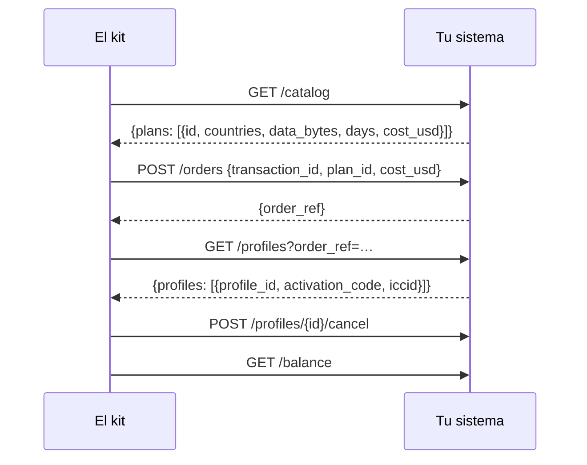
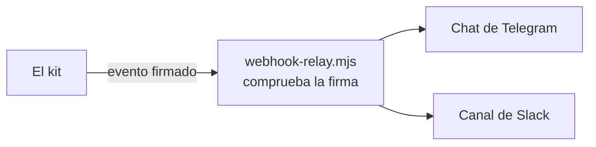

# Integraciones

Conexiones listas entre el kit y los sistemas que un negocio de eSIM ya tiene: de dónde salen las
eSIM y a dónde va la noticia de cada venta. Cada entrada dice hasta dónde se ha probado.

Otros documentos: [resumen](../../README.es.md) · [incorporación y casos de uso](rails.md) · [referencia del SDK](sdk.md) · [guía del operador](operator-guide.md)

## 1. El mapa

```mermaid
flowchart LR
  subgraph supply["De dónde salen las eSIM (SUPPLIER)"]
    EA["eSIM Access"]
    AI["Airalo Partner API"]
    EG["eSIM Go"]
    HT["Tu propio sistema<br/>5 endpoints HTTP"]
    SDK["Cualquier otro<br/>objeto proveedor del SDK"]
  end
  K["El kit<br/>nodo para agentes · tienda · federación"]
  subgraph business["A dónde van las noticias (WEBHOOK_URL)"]
    CRM["CRM, helpdesk"]
    BILL["Facturación, contabilidad, ERP"]
    TG["Telegram · Slack"]
    SH["Google Sheets"]
    AUTO["n8n · Make · Zapier"]
  end
  supply --> K
  K -->|"eventos firmados"| business
```



| Integración | Tipo | Ajuste | Estado |
|---|---|---|---|
| eSIM Access | proveedor | `SUPPLIER=esimaccess` | ✅ en vivo: un pedido real se compró, leyó y canceló el 2026-10-14 |
| Airalo Partner API | proveedor | `SUPPLIER=airalo` | 🟡 hecho según la referencia publicada de la API de Airalo, probado con sus respuestas documentadas; aún no ejecutado en una cuenta real de Airalo |
| eSIM Go (API v2.5) | proveedor | `SUPPLIER=esimgo` | 🟡 hecho según la referencia publicada de la API de eSIM Go, probado con sus respuestas documentadas; aún no ejecutado en una cuenta real |
| Tu propio sistema | proveedor | `SUPPLIER=http` | ✅ probado de principio a fin con el backend de referencia `rails/examples/operator-backend.mjs` |
| Cualquier otro | proveedor | la interfaz de proveedor del SDK | ✅ la interfaz que implementan los cuatro de arriba |
| CRM, facturación, contabilidad | eventos | `WEBHOOK_URL` | ✅ firmado, con reintentos, probado |
| Telegram, Slack | eventos | `rails/examples/webhook-relay.mjs` | ✅ probado |
| Google Sheets | eventos | `rails/examples/google-sheets.gs` | 🟡 un receptor en Apps Script, sin pruebas en CI |
| n8n, Make, Zapier, HubSpot, Salesforce | eventos | su disparador de webhook | 📘 una receta abajo; nada que instalar |

Antes de vender con una integración 🟡, carga tu catálogo (`scripts/catalog.mjs`) y haz un pedido de
prueba que canceles (guía del operador, sección 10). Cuéntanos lo que encuentres: un issue en GitHub
la convierte en ✅ para el siguiente operador.

## 2. Proveedores

### 2.1 eSIM Access

El predeterminado. Pon el AccessCode y la SecretKey en `secrets/esimaccess_access_code` y
`secrets/esimaccess_secret_key`. La [guía del operador](operator-guide.md) cubre la cuenta, la
recarga de $50 y el pedido de prueba.

- Los pedidos son idempotentes en el propio eSIM Access (por `transactionId`).
- El pedido lleva el coste con el que se ofertó; un plan cuyo precio cambió se rechaza, no se cobra.
- Los perfiles sin usar se pueden cancelar durante un reembolso. Un pago incierto requiere conciliación, sin cancelación automática.

### 2.2 Airalo Partner API

Necesitas una cuenta de socio de Airalo y su client id y secret.

```bash
printf 'Client id: '; read -rs v; printf %s "$v" > secrets/airalo_client_id; echo
printf 'Client secret: '; read -rs v; printf %s "$v" > secrets/airalo_client_secret; echo
sudo chown 1000:1000 secrets/airalo_*
```

En `.env`:

```bash
SUPPLIER=airalo
AIRALO_CLIENT_ID_FILE=/run/secrets/esim/airalo_client_id
AIRALO_CLIENT_SECRET_FILE=/run/secrets/esim/airalo_client_secret
# AIRALO_BASE_URL=…   la URL de tu sandbox de Airalo, mientras pruebas
```

Qué hace el adaptador: `POST /v2/token` una vez y guarda el token (Airalo permite tres peticiones de
token por minuto); `GET /v2/packages` para el catálogo (solo planes fijos: los paquetes ilimitados y
las recargas quedan fuera de v1; `net_price` es tu coste); `POST /v2/orders` con el id de transacción
del pago como descripción del pedido; `GET /v2/sims/{iccid}` y `/usage` para el estado;
`POST /v2/refund` durante el reembolso de un perfil sin usar.

Antes de vender:

- **Los pedidos de Airalo no tienen clave de idempotencia.** El adaptador recuerda cada pedido por su pago mientras el proceso vive, y el nodo guarda la referencia del pedido antes de pedir el perfil. Un reinicio en los segundos entre ambos puede dejar un pedido pagado sin su eSIM en el kit: encuéntralo en la consola de Airalo por la descripción (el id de transacción).
- **Airalo revisa los reembolsos** y los abona como crédito de Airalo, no en efectivo.
- **El saldo no se comprueba** antes de un pedido: mantén tu cuenta de Airalo con fondos.

### 2.3 eSIM Go

Necesitas una cuenta de eSIM Go y su clave API (Account Settings → API Details).

```bash
printf 'API key: '; read -rs v; printf %s "$v" > secrets/esimgo_api_key; echo
sudo chown 1000:1000 secrets/esimgo_api_key
```

```bash
SUPPLIER=esimgo
ESIMGO_API_KEY_FILE=/run/secrets/esim/esimgo_api_key
```

Qué hace el adaptador: `GET /catalogue` página a página (`dataAmount` en MB, `price` en la moneda de
tu organización, que debe ser USD; los paquetes ilimitados quedan fuera de v1); `POST /orders` con
`assign: true`, que devuelve el ICCID, la dirección SM-DP+ y el matching id de cada eSIM;
`GET /esims/{iccid}` y `/bundles` para estado y consumo;
`DELETE /esims/{iccid}/bundles/{name}?refundToBalance=true` durante el reembolso de un perfil sin usar.

Antes de vender:

- **Tampoco hay clave de idempotencia** en eSIM Go: la misma protección y la misma advertencia que con Airalo.
- **Los reembolsos al saldo están desactivados por defecto** en eSIM Go: pide a tu gestor de cuenta que los active. Sin eso, un paquete cancelado se revoca sin reembolso.
- **El saldo no se comprueba** antes de un pedido.

### 2.4 Tu propio sistema (HTTP)

Para una plataforma de aprovisionamiento, un front-end de SM-DP+, un stock de perfiles en una base de
datos o un proveedor que el kit no conoce: implementa cinco endpoints, en cualquier lenguaje.



```bash
SUPPLIER=http
SUPPLIER_URL=https://ops.example.com/esim
SUPPLIER_SECRET_FILE=/run/secrets/esim/supplier_secret
```

Cada petición va firmada (HMAC-SHA256 con marca de tiempo). El contrato, con código en Python y Go
para comprobar la firma: [rails/spec/supplier-http.md](../../rails/spec/supplier-http.md). Una
referencia que funciona y puedes copiar: [rails/examples/operator-backend.mjs](../../rails/examples/operator-backend.mjs).
Pruébala antes de escribir una línea:

```bash
cd rails && SUPPLIER_SECRET=$(openssl rand -hex 24) node examples/operator-backend.mjs 9600
```

### 2.5 Cualquier otro (SDK)

Un servicio Node.js puede pasar a `createNode()` cualquier objeto con `catalog`, `order`,
`profiles`, `cancel` y `balance`. Mira la [referencia del SDK](sdk.md), sección 2.

## 3. Tus sistemas de negocio

Cada pedido que cambia de estado se envía por POST a `WEBHOOK_URL`, firmado:

| Evento | Lo que suelen hacer tus sistemas |
|---|---|
| `order.created` | abrir un lead o un borrador de factura |
| `order.delivered` | registrar la venta: precio, coste, método, referencia del pago |
| `order.refund_due` | abrir una tarea de reembolso con la dirección del pagador |
| `order.underpaid` | abrir una tarea de soporte |
| `order.expired` | cerrar el lead |
| `agent_order.delivered` | registrar una venta a un agente |
| `agent_order.settlement_pending` | el pago requiere conciliación; no cobres de nuevo |

```bash
WEBHOOK_URL=https://crm.example.com/hooks/esim
WEBHOOK_SECRET_FILE=/run/secrets/esim/webhook_secret      # 16+ caracteres, compartido con el receptor
```

Cuerpos, cabeceras y código para verificarlos: [referencia del SDK](sdk.md), sección 5.

### 3.1 Telegram y Slack



1. Crea un bot de Telegram con @BotFather y anota su token; añádelo al chat de tu equipo y anota el id del chat. Para Slack, crea un incoming webhook.
2. Ejecuta el relé junto al kit:

```bash
cd rails && WEBHOOK_SECRET=… TELEGRAM_BOT_TOKEN=… TELEGRAM_CHAT_ID=… SLACK_WEBHOOK_URL=… node examples/webhook-relay.mjs 9700
```

3. En `.env`: `WEBHOOK_URL=http://127.0.0.1:9700/hooks/esim`, y el mismo secreto en `secrets/webhook_secret`.

Cada venta aparece como una línea: «✅ Delivered Qh3…: Japan 5GB 30Days — $6.40, cost $3.20».

### 3.2 Google Sheets

1. En una hoja de Google: Extensiones → Apps Script; pega [rails/examples/google-sheets.gs](../../rails/examples/google-sheets.gs) y define su `TOKEN`.
2. Impleméntalo como aplicación web (ejecutar como tú, acceso: cualquiera); copia la URL `/exec`.
3. `WEBHOOK_URL=<la URL /exec>?token=<TOKEN>`.

Cada evento se convierte en una fila; un id de evento repetido se omite. Apps Script no puede leer
las cabeceras de la petición, así que lo que deja fuera a los extraños es el token de la URL, no la firma.

### 3.3 n8n, Make, Zapier

Los tres inician un flujo con un webhook entrante:

1. Crea un flujo con disparador de webhook (n8n: nodo Webhook, POST; Make: Custom webhook; Zapier: Webhooks by Zapier → Catch Hook) y copia su URL en `WEBHOOK_URL`.
2. En n8n, verifica la firma en un nodo Code antes que nada: recalcula `v1=` + HMAC-SHA256(secret, `X-Kit-Timestamp` + "." + cuerpo bruto) y compáralo con `X-Kit-Signature`.
3. Ramifica según `type`: `order.delivered` → el paso de tu CRM o contabilidad; `order.refund_due` → una tarea.

### 3.4 HubSpot, Salesforce, cualquier CRM

Mediante n8n, Make o Zapier (arriba), o un pequeño receptor propio: en `order.created`, crea un
negocio con `order_id` como id externo; en `order.delivered`, márcalo como ganado con `price_usd`; en
`order.refund_due`, crea una tarea. Elimina duplicados por el `id` del evento.

## 4. Tu propia tienda o app

No necesitas la tienda del kit. Tu sitio o app puede llamar a tu nodo vendedor como cualquier
agente: `POST /agents/quote`, luego `POST /agents/order` con un pago x402 — mira la
[guía para agentes](agent-guide.md). O mantén tu pago y usa el kit solo para agentes: ejecútalo con
tu proveedor, deja la tienda en modo demo y anuncia el nodo a la federación.

## 5. Pide una integración

¿Usas un proveedor o un sistema que no está aquí? Abre un issue en
[GitHub](https://github.com/alexar76/esim-operator-kit/issues) con su referencia de API. Un adaptador
de proveedor son unas doscientas líneas sobre la interfaz de la [referencia del SDK](sdk.md).
