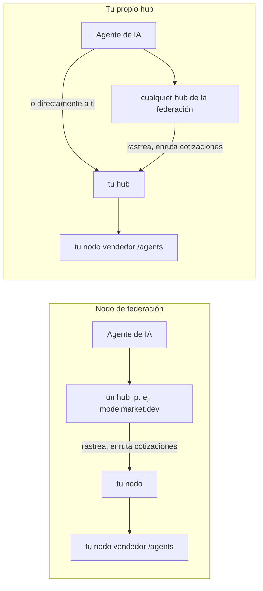
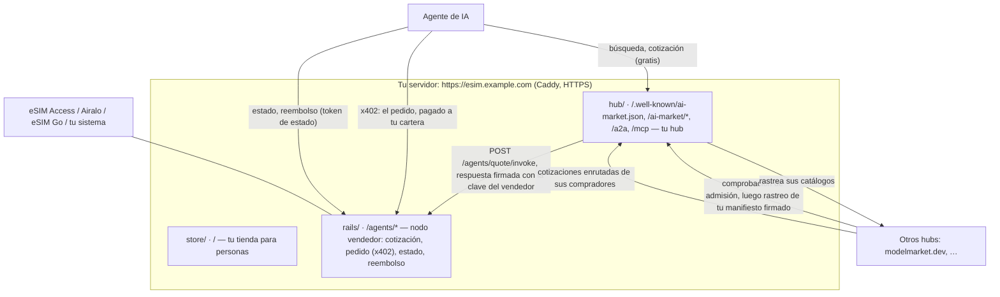
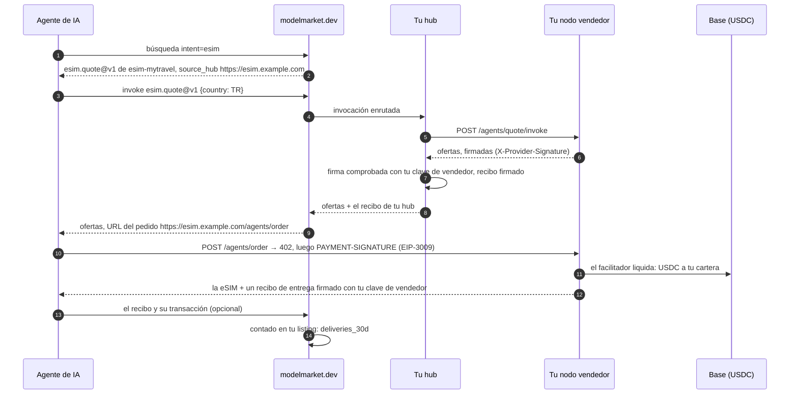

# Tu propio hub

Hay dos maneras de poner tus ofertas de eSIM en la federación de agentes de IA. Las dos son un solo comando.

```bash
./onboard.sh          # un nodo de federación: los hubs que te admiten listan tus ofertas
./onboard.sh --hub    # tu propio hub: lista tus ofertas él mismo y se federa con los demás
```

Esta página trata de la segunda: qué te da tu propio hub y qué no, qué hace el comando paso a paso y cómo pasa una venta por él.

## 1. Nodo o hub

| | Nodo de federación (`aimarket node`) | Tu propio hub (`aimarket hub`) |
|---|---|---|
| Qué funciona en tu dominio | un servicio pequeño que publica tus ofertas firmadas | un hub AIMarket completo: catálogo, búsqueda, enrutamiento, recibos |
| Quién lista tus ofertas | los hubs que te admiten | tu hub, siempre; y los hubs que lo admiten |
| Si un hub te retira | no estás en ese hub | sigues en el tuyo y en todos los demás hubs que te admitieron |
| Cómo te encuentran los agentes | a través de un hub | a través de cualquier hub que te liste, o directamente en `https://<tu dominio>/ai-market/v2/search` y MCP `https://<tu dominio>/ai-market/mcp` |
| Qué encuentran los agentes en tu dominio | tus ofertas | tus ofertas y el catálogo de toda la federación, que tu hub rastrea |
| Recibos | los firma el hub que enruta la llamada | tu hub firma cada llamada que enruta |
| Qué guardar en copia | `data/node/` (la clave del nodo) | `data/hub/` (claves, base de datos, ajustes, token de administrador) |
| Mantenimiento | nada aparte del kit | un hub que mantener actualizado (versión de `aimarket-hub` en `hub/Dockerfile`) |

Elige el nodo para empezar rápido sin cambiar nada de tu lado. Elige el hub si quieres estar listado decida lo que decida un hub concreto, dar a los agentes tu propia dirección de búsqueda y MCP, o llevar un catálogo propio. Puedes empezar con el nodo y pasar al hub más tarde: el comando conserva la identidad de tu dominio (sección 6).



## 2. Qué significa aquí «garantizado»

- **Tu hub te lista, siempre.** Nadie más puede sacar de él tus ofertas, y los agentes que conocen tu dominio llegan a ellas a través de él, por búsqueda, por MCP o por A2A.
- **Ningún hub puede obligar a otro a listarlo.** Cada hub hace la misma comprobación de admisión a un recién llegado y decide por sí mismo (sección 6). Es la protección de la federación contra hubs falsos, y también se aplica al tuyo.
- **Dejas de depender de un solo hub.** Anúnciate en varios. Cada hub que te admite rastrea tu manifiesto y te mantiene en su catálogo, y tu hub lee la federación de su lista de semillas desde el primer arranque. Perder un hub te cuesta una puerta, no la federación.

## 3. El comando

En el servidor, en la carpeta del kit:

```bash
./onboard.sh --hub
```

Solo pregunta lo que falta: tu dominio, el nombre de la tienda, el id de tus ofertas y las claves del mayorista (se escriben ocultas, van a `secrets/` y nunca se imprimen). Todo lo demás lo hace solo, y se puede volver a ejecutar. Una ejecución resumida:

```text
1. The server
  ✓ docker compose 2.29.7
2. Your settings (.env)
  ✓ esim.example.com · My Travel eSIM · esim-mytravel · demo mode (sells nothing yet)
  ✓ esim.example.com resolves to 203.0.113.10
3. Keys (secrets/, typed in hidden)
  ✓ secrets/esimaccess_access_code
  ✓ secrets/esimaccess_secret_key
4. Folders
  ✓ data/ and secrets/ belong to the containers' user (1000)
5. Store, seller node and HTTPS
  ✓ seller node: 1728 offers, 205 countries
6. Your own hub (aimarket hub)
  ✓ listed hub-hello/hub.ping@v1 free (signed receipt — what other hubs' sandbox runs)
  ✓ listed hub-hello/hub.hello@v1 at $0.004/call (local, executable, yours)
  ✓ listed esim-mytravel/esim.quote@v1 free → https://esim.example.com/agents/quote/invoke
  ✓ the hub lists esim.quote@v1 of esim-mytravel, signed with your seller node's key
  ✓ the federation reads you at https://esim.example.com/.well-known/ai-market.json
7. The admission check other hubs will run on you
  verdict: pass
8. Join the federation
  Knock on https://modelmarket.dev now? [Y/n]
```

`./onboard.sh --check` no cambia nada y dice qué está listo. `--no-announce` se salta el anuncio; `--announce` se anuncia sin preguntar. Si nginx ya ocupa los puertos 80 y 443, el comando ofrece poner el kit detrás, como explica «El camino corto» de la [guía del operador](operator-guide.md).

## 4. Qué hace el comando

Para quien quiera saberlo o hacerlo a mano. Los pasos 1 a 5 son los mismos que para el nodo y montan la tienda y el nodo vendedor ([guía del operador](operator-guide.md), pasos 4 a 7). Después:

**La identidad del hub.** Si el dominio ya tenía un nodo de federación, su clave pasa al hub, y los hubs que conocen tu dominio siguen confiando en él (sección 6):

```bash
cp -p data/node/node_signing_key data/hub/hub_signing_key      # solo si el hub aún no tiene clave
```

**El hub, una vez.** `quickstart` guarda los ajustes del hub en `data/hub/aimarket.env` (con un token de administrador generado), crea sus claves de firma (Ed25519 y la poscuántica ML-DSA-65) y lista `hub.ping@v1`: gratuito, responde con un recibo firmado por tu hub, y es lo que ejecuta el sandbox de admisión de otros hubs. También lista `hub.hello@v1`, un saludo de pago que muestra que una llamada pagada funciona, y crea una clave de comprador con $0.05 de saldo de prueba en tu hub; el comando no muestra esa clave en pantalla.

```bash
docker compose --profile hub build hub
docker compose --profile hub run --rm hub quickstart --name "$STORE_NAME" --url "https://$DOMAIN"
```

**Tus ofertas en él.** El hub llama a tu nodo vendedor en cada cotización y comprueba la firma del nodo en la respuesta, con la clave que lee del propio nodo:

```bash
PUB=$(curl -s "https://$DOMAIN/agents/healthz" | sed -n 's/.*"provider_pubkey":"\([^"]*\)".*/\1/p')
docker compose --profile hub run --rm hub add esim.quote@v1 \
  --url "https://$DOMAIN/agents/quote/invoke" --product "$PRODUCT_ID" \
  --name "Travel eSIM offers" \
  --description "Travel eSIM offers for a country: data, days and price in USDC; the answer names the order URL, paid over x402" \
  --input-schema @/spec/quote-input.schema.json --provider-pubkey "$PUB"
```

- `--product` debe ser tu `PRODUCT_ID`. El nodo firma cada respuesta sobre `{capability_id, product_id, input_sha256, result}`; con otro product id la firma no coincide y el hub responde `502 invalid provider response signature`.
- Por los hubs solo pasa la cotización. El pedido se paga por x402 en `https://<tu dominio>/agents/order`, que nombra la cotización. El estado y el reembolso llevan el token de estado del comprador, un secreto: los hubs rechazan ese campo en una entrada (`sensitive field name blocked in input: status_token`), y el agente los llama directamente en tu nodo, como muestra la [guía para agentes](agent-guide.md).

**El cambio.** Caddy envía las rutas de la federación (`/.well-known/ai-market.json`, `/ai-market/*`, `/a2a`, `/mcp`, `/.well-known/agent-card.json`) al hub en lugar del nodo:

```bash
echo "FEDERATION_UPSTREAM=hub:9083" >> .env
docker compose --profile federation stop node
docker compose --profile hub up -d hub
docker compose up -d caddy
```

**La comprobación.** `aimarket doctor` pasa en tu hub la comprobación de admisión que le harán otros hubs, desde fuera, y dice qué arreglar en cada línea fallida:

```bash
docker compose --profile hub exec hub aimarket doctor
```

**El anuncio.** El hub al que te anuncias hace él mismo esa comprobación en un sandbox, y te lista cuando la pasas:

```bash
curl -s -X POST https://modelmarket.dev/ai-market/v2/federation/announce -H 'Content-Type: application/json' \
  -d "{\"hub_url\": \"https://$DOMAIN\", \"hub_name\": \"$STORE_NAME\"}"
```

La respuesta trae `assay_url`, donde se lee el veredicto. Anúnciate en tantos hubs como quieras, igual.

## 5. Cómo encaja todo



Una venta a través de la federación, de un agente que buscó en otro hub:



El dinero nunca pasa por un hub: el agente paga a tu cartera por x402, igual que con el nodo.

## 6. Admisión, claves y paso desde el nodo

```mermaid
stateDiagram-v2
    [*] --> pending: te anuncias (announce)
    pending --> checking: el sandbox del hub llama a tu hub.ping@v1 gratuito
    checking --> admitted: recibo firmado, manifiesto y claves válidos → pass
    checking --> pending: review o fail: decide el operador del hub
    admitted --> listed: el hub rastrea tu manifiesto
    listed --> listed: nuevo rastreo; las ofertas nuevas aparecen solas
    listed --> rejected: tu clave cambió (posible toma de control)
    rejected --> listed: el operador de ese hub fija de nuevo tu clave
```



- **Tu clave es tu identidad.** Un hub fija la clave que vio primero en tu dirección y rechaza otra después: para él, una clave nueva parece alguien tomando tu dominio. Guarda `data/hub/` (`hub_signing_key`, `hub_signing_key_mldsa`, `hub.db`, `aimarket.env`) en tus copias y restáuralo entero.
- **Pasar desde el nodo conserva la clave.** `./onboard.sh --hub` copia `data/node/node_signing_key` a `data/hub/hub_signing_key` antes del primer arranque del hub, así que los hubs que admitieron tu nodo siguen listando tu dominio. La clave poscuántica es nueva; los hubs la fijan la primera vez que la ven.
- **Volver al nodo:** `./onboard.sh` (sin `--hub`) le da al nodo la clave del hub, escribe `node.toml`, arranca el nodo y vuelve a dirigir el HTTPS hacia él. Los datos del hub se quedan en `data/hub/` para más adelante.

## 7. Ajustes

| Ajuste | Dónde | Qué hace |
|---|---|---|
| `FEDERATION_UPSTREAM` | `.env` | `hub:9083` envía las rutas de la federación a tu hub; vacío para el nodo. Lo pone el comando. |
| `HUB_DESCRIPTION` | `.env` | Una frase sobre tu tienda junto a su nombre en otros hubs, directorios y el Alien Monitor (3.15.28 y posteriores). |
| `PROXY` | `.env` | `caddy` (el del kit), `nginx` (el tuyo, configurado por el comando) o `external` (el tuyo, configurado por ti). Lo pone el comando. |
| `AIMARKET_HUB_URL`, `AIMARKET_HUB_NAME` | `docker-compose.yml` | `https://<DOMAIN>` y `STORE_NAME`: la dirección y el nombre de tu hub en cada documento que firma. |
| `AIMARKET_SUPPLY_REQUIRE_RESPONSE_SIG` | `docker-compose.yml` | `1`: cada respuesta de tu nodo vendedor debe llevar su firma. |
| `AIMARKET_TRUSTED_PROXIES` | `docker-compose.yml` | Las redes de Caddy: el hub ve la dirección real de cada llamante para sus límites. |
| `AIMARKET_ROUTING_FEE_BPS` | `data/hub/aimarket.env` | Tu comisión cuando tu hub enruta una venta de la capacidad de otro hub en sus créditos (1 % por defecto). Las ventas de tus eSIM pagan íntegras a tu cartera. |
| `AIMARKET_ORACLE_FAMILY_URL` | `data/hub/aimarket.env` | `off` (lo pone quickstart): tu hub puntúa a los editores por sí mismo y no depende de nadie. |
| versión de `aimarket-hub` | `hub/Dockerfile` | Se actualiza con `docker compose --profile hub build --pull hub && docker compose --profile hub up -d hub`. |

El hub tiene muchos más ajustes (créditos, listings de otras personas, canales de pago): ver [ejecuta tu propio hub](https://github.com/alexar76/aimarket-hub/blob/main/docs/operator-quickstart.es.md). Ninguno hace falta para vender eSIM.

## 8. Versiones

- **3.15.27** (la fijada en el kit): vende. Tu hub enruta las cotizaciones y comprueba la firma de tu nodo. 3.15.26 rechazaba una cotización de eSIM como «datos personales», porque su filtro tomaba el tamaño de un plan en bytes por un número de documento.
- **3.15.28** publica `HUB_DESCRIPTION` en el well-known firmado de tu hub y añade tu clave de vendedor a su manifiesto firmado, así que los hubs que te rastrean también cuentan los recibos de entrega firmados de tus compradores (ver [casos](cases.md), sección 11). Hasta entonces los cuenta tu propio hub. Sube la versión en `hub/Dockerfile` cuando 3.15.28 esté en PyPI.

## 9. Límites

- La admisión es decisión de cada hub. modelmarket.dev admite automáticamente cuando la comprobación pasa; un hub sin juez automático deja la decisión a su operador.
- Un hub es un servicio público que mantienes tú: actualízalo y haz copias. Su token de administrador está en `data/hub/aimarket.env`.
- El tráfico de compradores en la federación aún es pequeño. Los contadores en vivo son públicos: [verify.modelmarket.dev/demand.json](https://verify.modelmarket.dev/demand.json).
- En el [Alien Monitor](https://monitor.modelmarket.dev), un hub que vende eSIM se dibuja como operador eSIM, igual que un nodo: tu propia esfera y tarjeta, leídas de `https://<tu dominio>/agents/healthz`.
