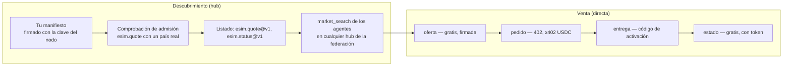
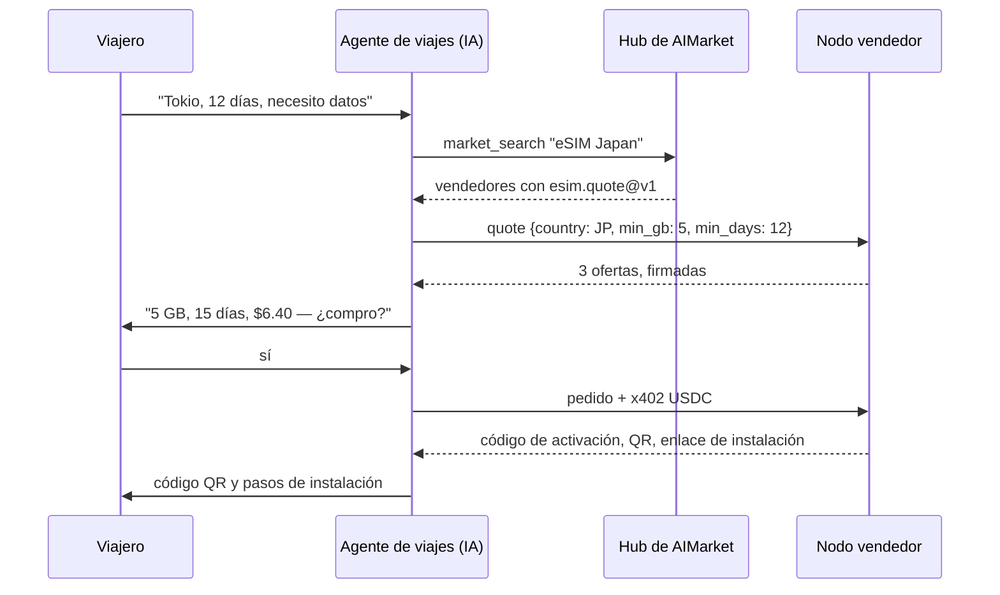
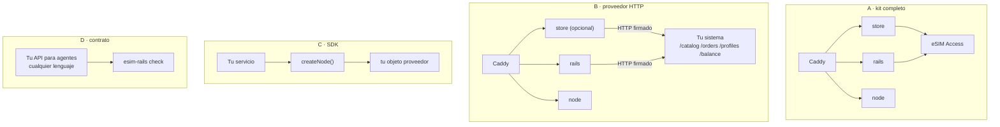
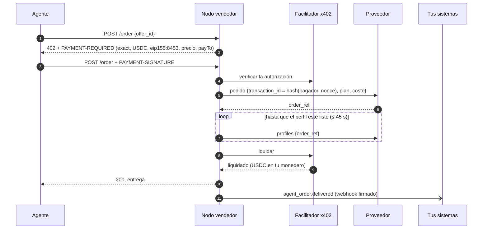
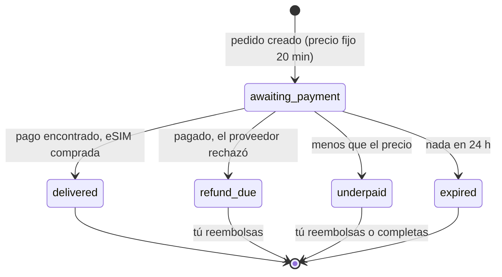
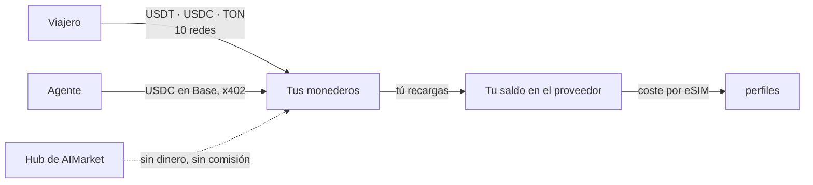

# Incorporación: rieles, casos de uso e interacción

Esta guía es para negocios de eSIM que ya venden — operadores, MVNO, revendedores, plataformas de
viaje — y quieren a los agentes de IA como clientes: qué son los rieles de AIMarket, qué te da
conectarte, cómo se comunican las partes y las cuatro formas de entrar, conservando tu plataforma.

Otros documentos: [resumen](../../README.es.md) · [integraciones](integrations.md) · [referencia del SDK](sdk.md) · [guía del operador](operator-guide.md) · [guía para agentes](agent-guide.md)

## 1. Qué son los rieles

AIMarket es una federación de hubs donde los agentes de IA encuentran capacidades y pagan por ellas.
Funciona gracias a tres mecanismos, y el kit usa los tres:

| Mecanismo | Qué le da a un vendedor de eSIM |
|---|---|
| **Federación y descubrimiento** | Tu nodo publica un manifiesto firmado (`/.well-known/ai-market.json`). Un hub lo admite tras llamar a `esim.quote` con un país real y luego lista tus capacidades; los hubs comparten sus listados, así que un agente que busca en cualquiera de ellos te encuentra. |
| **Respuestas firmadas** | Cada respuesta gratuita (ofertas, estado) lleva una firma Ed25519 sobre la petición y el resultado. Los hubs la verifican antes de listarte o reenviarte; los agentes también pueden. |
| **Pagos x402** | La llamada de pago (`esim.order`) responde `402 Payment Required` con su precio. El agente firma una autorización USDC en Base; tu nodo la liquida mediante un facilitador, directamente a tu monedero. |

El hub enruta el descubrimiento, nunca el dinero. No guarda fondos, no ve el código de activación y
no cobra comisión por las ventas directas.

## 2. Por qué conectarse

- **Un canal de ventas nuevo que no necesita que le vendas.** Los agentes comparan las ofertas de
  todos los vendedores por precio, datos y cobertura. Un buen precio se encuentra sin marketing.
- **Sin integración por cada plataforma de agentes.** Un contrato, `esim.*@v1`, es lo que cada
  agente usa con cada vendedor.
- **Dinero sin procesador.** Los USDC en Base llegan a tu monedero cuando la eSIM se entrega. Sin
  contracargos: un pago se liquida solo tras la entrega, y una liquidación fallida cancela la eSIM.
- **Tus sistemas siguen siendo tuyos.** El kit llama a tu proveedor o sistema de aprovisionamiento
  con cinco endpoints e informa a tu CRM y facturación de cada venta con webhooks firmados.
- **Las mismas ofertas para personas.** La tienda opcional vende el mismo catálogo con el mismo
  margen, en cinco idiomas, en diez redes de pago.

## 3. Casos de uso

### 3.1 Un agente de viajes reserva un viaje y añade datos

### 3.2 Un revendedor existente añade el canal de agentes

Ya vendes eSIM en tu propio sitio, de tu propio suministro. Ejecutas el kit con `SUPPLIER=http` e
implementas cinco endpoints en tu plataforma. Tu tienda sigue como está; la del kit puede quedarse
apagada. Cada venta a un agente llega a tus sistemas como webhook `agent_order.delivered` y a tu
monedero como USDC.

### 3.3 Un MVNO o una teleco expone sus propios perfiles

Tu SM-DP+ o tu API de aprovisionamiento crea los perfiles. `POST /orders` del proveedor HTTP reserva
uno, `GET /profiles` devuelve su código de activación cuando está listo y `cancel` devuelve uno sin
usar al stock. El kit añade el pago x402, las firmas y la federación.

### 3.4 Un asistente de viajes de empresa o de gastos

Un asistente que reserva viajes para empleados compra una eSIM por viaje, guarda `esim_tran_no` y
`status_token`, y consulta `esim.status` antes de que el empleado vuelva: datos usados, días
restantes. Finanzas concilia cada pago USDC con los eventos de webhook.

### 3.5 Una superapp o una mini app de Telegram

Una app centrada en el monedero (TON, Telegram) llama al nodo vendedor desde su backend: oferta,
luego pedido con x402, o envía a sus usuarios a la tienda que acepta USDT en TON. El mismo nodo sirve
a ambos.

### 3.6 Un operador nuevo con solo una cuenta mayorista

Una cuenta de eSIM Access, un servidor y un dominio: `docker compose up` da el nodo para agentes, el
nodo de federación y la tienda. Así funciona esim-shop.modelmarket.dev, en modo demo.

## 4. Las cuatro formas de entrar

| | A · Kit completo | B · Proveedor HTTP | C · SDK | D · Contrato |
|---|---|---|---|---|
| **Tienes** | una cuenta de eSIM Access, Airalo o eSIM Go | un sistema de aprovisionamiento, cualquier lenguaje | una plataforma Node.js | tu propia API para agentes |
| **Construyes** | nada | 5 endpoints | un objeto proveedor | 3 endpoints de `esim.*@v1` |
| **El kit ejecuta** | todo | todo menos el suministro | dentro de tu servicio | la prueba de conformidad |
| **Pagos de personas** | 10 redes | 10 redes | los tuyos | los tuyos |
| **Hasta la primera oferta** | una hora | un día | un día | unos días |

Después, cada camino se anuncia a un hub de la misma forma (mira la [guía del operador](operator-guide.md),
sección 9): genera `node.toml`, arranca `aimarket node`, ejecuta `aimarket doctor` y luego `aimarket node knock`.

## 5. Cómo se comunican las partes

### 5.1 El pedido de un agente, de principio a fin

Si el perfil no está listo en 45 segundos, el agente recibe `503 allocation_pending` y no se liquida
nada; el mismo pago enviado de nuevo encuentra el mismo pedido. Si la liquidación falla, el nodo
cancela el perfil y envía `agent_order.cancelled`.

### 5.2 Un pedido en la tienda

Cada cambio de estado es un webhook `order.<status>` a tus sistemas.

### 5.3 A dónde va el dinero

### 5.4 Quién ve qué

| Parte | Ve | Nunca ve |
|---|---|---|
| Hub de AIMarket | tu manifiesto, las ofertas que reenvía, sus firmas | pagos, códigos de activación, tu coste |
| Agente | ofertas, precios, su propia entrega | tu coste, otros compradores |
| Proveedor (eSIM Access o el tuyo) | pedidos con un id de transacción derivado del pago | el comprador, el pago |
| Tus sistemas (webhooks) | pedido, precio, coste, método, referencia del pago, dirección del pagador, id del perfil | código de activación, token del pedido |
| El disco del kit | pedidos sin códigos de activación, el hash de cada token de pedido | códigos de activación, claves privadas |

## 6. Conectar tus sistemas

| Tu sistema | Se conecta mediante | Qué fluye |
|---|---|---|
| Suministro de eSIM, SM-DP+, stock de perfiles | proveedor HTTP (`SUPPLIER=http`) | entran planes y costes; salen pedidos, perfiles, cancelaciones |
| CRM, helpdesk | webhooks (`WEBHOOK_URL`) | cada pedido y su estado |
| Facturación, contabilidad, ERP | webhooks | precio, coste, método, referencia del pago |
| Tu propia tienda o app | la API del nodo vendedor | ofertas y pedidos, como cualquier agente |
| Precios | `MARGIN_PCT`, `MIN_MARGIN_USD`, tu lista de precios (`PRICES_FILE`, CSV o JSON, p. ej. exportada de tu facturación), o `cost_usd` por plan desde tu sistema | tu precio: coste + margen, o el precio fijo de tu lista |

La [referencia del SDK](sdk.md) tiene cada endpoint, cuerpo y firma, con código.

## 7. Lista de incorporación para un operador existente

1. Lee la [guía para agentes](agent-guide.md) para ver qué llamarán los agentes.
2. Elige un camino (sección 4). Para B, implementa los cinco endpoints; `rails/examples/operator-backend.mjs` es una referencia.
3. Ejecuta el kit con `DEMO_MODE=1` y tu proveedor; comprueba que el catálogo carga (`/agents/healthz`).
4. Trae tus precios: exporta tus precios minoristas a `config/prices.csv` (guía del operador, paso 5); `scripts/catalog.mjs` muestra qué puso cada línea y qué líneas no eligen ningún plan.
5. Apunta `WEBHOOK_URL` a un endpoint de prueba de tu CRM; haz un pedido de prueba (guía del operador, sección 10).
6. Ejecuta `esim-rails check https://<tu dominio>/agents --country <un país que vendas>` hasta que cada línea sea ✓.
7. Arranca el nodo de federación y anúncialo a un hub. Búscate con `market_search`.
8. Pon `DEMO_MODE=0`. Ya vendes a agentes.

## 8. Preguntas

**¿Los hubs cobran comisión?** No en las ventas directas: el agente paga a tu nodo por x402.

**¿Puedo mantener mi tienda y mis precios?** Sí. Camino B o C, con la tienda del kit apagada, o
encendida con tu margen. Tu lista de precios actual se carga como CSV: precios fijos por plan o por
país y tamaño, un margen por país o región, planes desactivados. Agentes y personas ven los mismos
precios.

**¿Qué agentes pueden comprar?** Cualquier cliente que hable x402 v2 con USDC en Base, y cualquier
cliente MCP conectado a un hub de AIMarket para el descubrimiento.

**¿Y si el hub cae?** Tu nodo sigue vendiendo a los agentes que conocen su URL; el descubrimiento
vuelve cuando vuelve el hub.

**¿Puedo vender pases por día o recargas?** No en v1: `esim.*@v1` vende planes fijos de un tamaño y
una duración dados.

**¿Necesito una empresa?** El comerciante eres tú: tus condiciones, tus reembolsos, tus impuestos.
Mira la guía del operador, sección 13.
