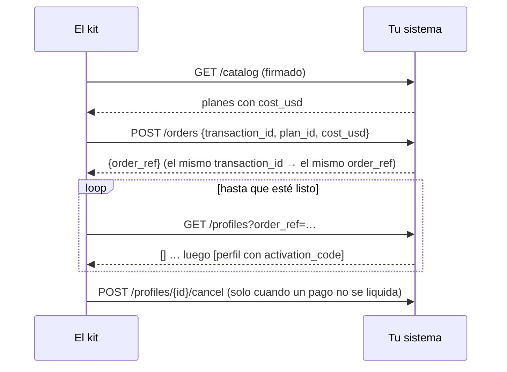

# Referencia del SDK

Todo lo que un operador de eSIM existente necesita para poner sus sistemas sobre los rieles de AIMarket:
los paquetes, la interfaz de proveedor, el proveedor HTTP para sistemas en cualquier lenguaje, el nodo
vendedor, los webhooks, el contrato `esim.*@v1` y la prueba de conformidad.

Otros documentos: [resumen](../../README.es.md) · [incorporación](rails.md) · [integraciones](integrations.md) · [guía del operador](operator-guide.md) · [guía para agentes](agent-guide.md)

## 1. Paquetes

| Paquete | Qué es | Instalación |
|---|---|---|
| `@aimarket/esim-rails` | El SDK: nodo vendedor, proveedores, webhooks, esquemas, `esim-rails check` | `npm i @aimarket/esim-rails` cuando se publique; mientras tanto `npm i ./rails` desde un clon de este repositorio |
| `aimarket-hub` (PyPI) | `aimarket node`: el nodo de federación que te lista en los hubs | `pip install aimarket-hub==3.15.26`, o la imagen `node/` del kit |
| Esquemas JSON | El contrato, para cualquier lenguaje | `rails/spec/esim-v1/*.schema.json` |
| Imágenes Docker | tienda, nodo vendedor, nodo de federación | construidas por `docker compose up --build` |

Node.js 20 o posterior. El SDK es ESM.

```js
import {
  createNode, ed25519Signer, buildPaywall, fileStore,          // the seller node
  httpSupplier, esimAccessSupplier, airaloSupplier, esimGoSupplier, createEsimAccessClient,   // suppliers
  createWebhooks, verifyWebhook,                                // your systems
  validate, checkSeller,                                        // the contract
  pricingFromEnv, parsePriceList, priceFor,                     // your prices
} from "@aimarket/esim-rails";
```

## 2. La interfaz de proveedor

Un proveedor es de donde salen las eSIM. La tienda y el nodo vendedor hablan con él solo mediante
cinco métodos.

| Método | Devuelve | Reglas |
|---|---|---|
| `catalog()` | `Plan[]` | los planes que vendes, a tu coste |
| `order({ transactionId, planId, costUsd })` | `{ orderRef }` | idempotente por `transactionId`; rechaza cuando `costUsd` ya no es tu coste |
| `profiles({ orderRef })` o `profiles({ profileId })` | `Profile[]` | `[]` mientras se crea el perfil |
| `cancel({ profileId })` | `true` | solo perfiles sin usar |
| `balance()` | `{ usd }` o `null` | `null` cuando no hay saldo que vigilar |

```text
Plan     { id, name, countries: ["FR", …], kind?: "country" | "region" | "global", data_bytes, days,
           speed?, networks?, top_up?, unused_valid_days?, cost_usd }
Profile  { profileId, orderRef, activationCode, iccid?, qrCodeUrl?, installUrl?, apn?, expires?,
           state?, installed?, dataUsedBytes?, dataTotalBytes?, activated? }
```

Lanza `SupplierError(code, message, { retryable })`: `retryable: true` significa «ahora no» (una
caída, un límite de peticiones); si no, «no» (un plan desconocido, un precio cambiado, un saldo vacío).
Un «no» nunca se cobra al comprador.

Un proveedor en tu propio código:

```js
import { SupplierError } from "@aimarket/esim-rails";

export const mySupplier = {
  async catalog() {
    return (await db.plans.active()).map((p) => ({
      id: p.sku, name: p.title, countries: p.countries, kind: p.region ? "region" : "country",
      data_bytes: p.gb * 1024 ** 3, days: p.days, cost_usd: p.cost }));
  },
  async order({ transactionId, planId, costUsd }) {
    const plan = await db.plans.get(planId);
    if (!plan || plan.cost !== costUsd) throw new SupplierError("price_changed", "the plan changed");
    const o = await db.orders.upsertByTransaction(transactionId, planId);   // the same id, the same order
    return { orderRef: o.id };
  },
  async profiles({ orderRef, profileId }) {
    const rows = orderRef ? await smdp.profilesOfOrder(orderRef) : [await smdp.profile(profileId)].filter(Boolean);
    return rows.map((r) => ({ profileId: r.id, orderRef: r.order, activationCode: r.lpa, iccid: r.iccid, state: r.state }));
  },
  async cancel({ profileId }) { await smdp.release(profileId); return true; },
  async balance() { return null; },                                       // your own stock: nothing to watch
};
```

Incluidos: `esimAccessSupplier(createEsimAccessClient({ accessCode, secretKey }))`, `airaloSupplier({ clientId, clientSecret })`,
`esimGoSupplier({ apiKey })` y `httpSupplier({ url, secret })` — configuración y advertencias en [integraciones](integrations.md).

## 3. El proveedor HTTP: tu sistema, cualquier lenguaje

Ejecuta el kit con `SUPPLIER=http`, `SUPPLIER_URL` y `SUPPLIER_SECRET_FILE`, e implementa cinco
endpoints en tu sistema. El contrato completo está en [rails/spec/supplier-http.md](../../rails/spec/supplier-http.md).

| Método y ruta | Cuerpo | Respuesta |
|---|---|---|
| `GET /catalog` | — | `{"plans": [Plan]}` |
| `POST /orders` | `{"transaction_id", "plan_id", "cost_usd"}` | `{"order_ref"}` |
| `GET /profiles?order_ref=…` o `?profile_id=…` | — | `{"profiles": [Profile]}` (snake_case) |
| `POST /profiles/{profile_id}/cancel` | `{}` | `{"cancelled": true}` |
| `GET /balance` | — | `{"usd": 250.0}`, o 404 |

Cada petición lleva `X-Kit-Timestamp` y `X-Kit-Signature: v1=<hex HMAC-SHA256(secret,
timestamp + "." + METHOD + " " + path + "." + body)>`. Rechaza una firma incorrecta y todo lo que
tenga más de cinco minutos.



Un receptor mínimo en Python (Flask), los dos endpoints que más importan:

```python
import hashlib, hmac, json, time
from flask import Flask, request, jsonify, abort

SECRET = open("/run/secrets/kit_supplier").read().strip().encode()
app = Flask(__name__)

@app.before_request
def signed():
    ts, sig = request.headers.get("X-Kit-Timestamp", "0"), request.headers.get("X-Kit-Signature", "")
    path = request.full_path.rstrip("?")
    msg = f"{ts}.{request.method} {path}.".encode() + request.get_data()
    want = "v1=" + hmac.new(SECRET, msg, hashlib.sha256).hexdigest()
    if abs(time.time() * 1000 - int(ts)) > 300_000 or not hmac.compare_digest(want, sig):
        abort(401)

@app.get("/catalog")
def catalog():
    return jsonify(plans=[{"id": p.sku, "name": p.title, "countries": p.countries, "kind": "country",
                           "data_bytes": p.bytes, "days": p.days, "cost_usd": float(p.cost)} for p in active_plans()])

@app.post("/orders")
def orders():
    body = request.get_json()
    plan = find_plan(body["plan_id"])
    if plan is None or float(plan.cost) != body["cost_usd"]:
        return jsonify(error="price_changed"), 409
    order = upsert_order(body["transaction_id"], plan)          # idempotent by transaction_id
    return jsonify(order_ref=order.ref)
```

La referencia en JavaScript con los cinco endpoints: [rails/examples/operator-backend.mjs](../../rails/examples/operator-backend.mjs).

## 4. El nodo vendedor

```js
const node = createNode({
  supplier,                         // a supplier (section 2) or an eSIM Access client
  store: fileStore("/data/orders.json", fs),     // or your own {get, put}: order records, never codes
  secret: statusSecret,             // 16+ characters: the key of the buyers' status tokens
  signer: ed25519Signer(pem),       // your node's identity: signs every free answer
  publicUrl: "https://esim.example.com/agents",
  paywall,                          // buildPaywall(...) below, or null to quote without selling
  events,                           // createWebhooks(...) or { emit() {} }
  pricing: pricingFromEnv(process.env),   // MARGIN_PCT, MIN_MARGIN_USD and PRICES_FILE; or your own object, below
  sellerName: "My eSIM", productId: "esim-mine", demo: false,
});
const paywall = await buildPaywall({
  cdpKeyFile: "/run/secrets/cdp_api_key.json", payTo: "0xYourBaseAddress", publicUrl: "https://esim.example.com/agents",
  priceOf: (offerId) => node.priceOf(offerId), onSettleFailure: (p) => node.settleFailed(p),
});
node.app.listen(9490);
```

Rutas: `POST /quote` y `POST /status` (también `/quote/invoke`, `/status/invoke` para los hubs), `POST /order`
(x402), `GET /listing.json`, `GET /healthz`. Las rutas gratuitas responden a cualquier página web (CORS);
el pedido no.

**Precios.** `pricing` es `{ marginPct, minMarginUsd, rules }`. Las reglas salen de una lista de precios: `parsePriceList(text)` lee CSV o JSON (las columnas, en la [guía del operador](operator-guide.md), paso 5) y lanza `PriceListError` con el número de línea. `priceFor(plan, pricing)` dice a cuánto se vende un plan y qué regla le puso precio; una regla con `off` deja el plan fuera de las ofertas. Sin reglas, todo plan se calcula con la fórmula, 100 % y $1.00 por defecto.

**Reembolsos.** `POST /refund` con `{esim_tran_no, status_token}` cancela una eSIM sin usar (no instalada, sin datos usados; si no, `409 in_use`) y devuelve una vez el precio del pedido a la dirección que pagó. `createNode({ refunder })` acepta `await buildRefunder({ keyFile, cdpKeyFile, maxUsd, dailyMaxUsd })`: firma una transferencia EIP-3009 desde la cartera de reembolsos y el facilitador la liquida. Sin refunder la respuesta es `status: "due"`. La página de [casos](cases.md) tiene un reembolso real con sus transacciones.

**Recibos.** Un pedido entregado responde además con `receipt` y `receipt_signature`, y un reembolso pagado responde con el suyo: lo que un comprador puede llevar a un hub como prueba de que el vendedor entregó. `receipt` es `{v: 1, kind, capability: "esim.order@v1", product_id, chain_id: 8453, …}`. Con `kind: "delivery"` añade `payer`, `pay_to`, `nonce` (el nonce EIP-3009 del pago), `offer_id` y `at`; con `kind: "refund"`, `payer`, `refund_from`, `refund_nonce`, `delivery_nonce` y `at`. La firma es Ed25519, base64, sobre `canonicalJson(receipt)`, hecha por el `signer` del nodo: la clave que muestran `/healthz` y `/listing.json` y que `node.toml` publica como `provider_pubkey`. Ningún recibo lleva un secreto de la eSIM. Un reembolso registrado como `due` no tiene recibo: todavía no hay transferencia que mostrar. El lado del hub está en los [casos](cases.md), sección 11.4.

## 5. Webhooks

Define `WEBHOOK_URL` y `WEBHOOK_SECRET_FILE` (16+ caracteres), o pasa `createWebhooks({ url, secret })`.

| Evento | Cuándo |
|---|---|
| `order.created` | un comprador empezó un pedido en la tienda |
| `order.delivered` | pagado y entregado |
| `order.refund_due` | pagado, pero el proveedor rechazó: reembolsa al pagador |
| `order.underpaid` | llegó un pago inferior al precio |
| `order.expired` | no llegó nada en 24 horas |
| `order.awaiting_payment` | un pago firmado no se liquidó; el pedido vuelve a estar abierto |
| `agent_order.delivered` | se entregó el pedido de un agente |
| `agent_order.cancelled` | el pago de un agente no se liquidó; la eSIM se canceló |
| `agent_order.refunded` | la eSIM sin usar de un agente se canceló y se devolvió el precio (`transaction`) |
| `agent_order.refund_due` | la eSIM sin usar de un agente se canceló; devuelve tú el precio a `to` |

```http
POST /hooks/esim HTTP/1.1
Content-Type: application/json
X-Kit-Event: order.delivered
X-Kit-Timestamp: 1765432100000
X-Kit-Signature: v1=5d41402abc4b2a76b9719d911017c592…

{"id": "3f1c…", "type": "order.delivered", "created_at": "2026-10-14T10:46:24.000Z",
 "data": {"order_id": "Qh3…", "status": "delivered", "offer_id": "JP_5_30", "offer_name": "Japan 5GB 30Days",
          "price_usd": "6.40", "cost_usd": 3.2, "method": "tron",
          "payment": {"ref": "tron:…", "payer": "T…", "units": "6400042"}, "esim_tran_no": "26101410460022",
          "error": null, "created_at": "2026-10-14T10:45:58.000Z"}}
```

La firma cubre `timestamp + "." + body`. La entrega es al menos una vez (tres intentos en medio
minuto aproximadamente): elimina duplicados por `id`. Un evento nunca lleva un código de activación,
un enlace QR ni un token de pedido.

```js
import { verifyWebhook } from "@aimarket/esim-rails";
app.post("/hooks/esim", express.text({ type: "*/*" }), (req, res) => {
  const ok = verifyWebhook({ secret, timestamp: req.get("x-kit-timestamp"), signature: req.get("x-kit-signature"), body: req.body });
  if (!ok) return res.sendStatus(401);
  crm.record(JSON.parse(req.body));
  res.sendStatus(204);
});
```

```python
def kit_event_ok(secret: bytes, timestamp: str, signature: str, body: bytes) -> bool:
    want = "v1=" + hmac.new(secret, timestamp.encode() + b"." + body, hashlib.sha256).hexdigest()
    return abs(time.time() * 1000 - int(timestamp)) < 300_000 and hmac.compare_digest(want, signature)
```

## 6. El contrato: esim.*@v1

| Capacidad | Esquema de entrada | Esquema de resultado |
|---|---|---|
| `esim.quote@v1` | `quote-input` | `quote-result` (con `offer`) |
| `esim.order@v1` | `{offer_id}` + x402 | `delivery` |
| `esim.status@v1` | `status-input` | `status-result` |

Esquemas: [rails/spec/esim-v1](../../rails/spec/esim-v1/). Las respuestas gratuitas son `{"success": true, "result": …}`
con `X-Provider-Signature`: Ed25519, base64, sobre el JSON canónico de
`{capability_id, product_id, input_sha256, result}` (claves ordenadas, sin espacios, no ASCII tal cual;
`input_sha256` es el SHA-256 en hex de la entrada canónica). El pedido responde `402` con una cabecera
x402 v2 `PAYMENT-REQUIRED`: esquema `exact`, red `eip155:8453`, USDC, el precio de la oferta con 6
decimales, tu dirección.

Valida en tus propias pruebas: `import { validate } from "@aimarket/esim-rails"; validate("offer", o)`
devuelve `[]` o la lista de problemas.

## 7. La prueba de conformidad

Apúntala a cualquier nodo vendedor, el del kit o uno que hayas escrito:

```bash
npx esim-rails check https://esim.example.com/agents --country JP
```

Lo que imprimió para el nodo demo:

```text
✓ listing.json — esim.quote@v1, esim.status@v1; order at https://modelmarket.dev/providers/esim/order
✓ esim.quote@v1 answer — 5 offers for JP, all valid
✓ cheapest first
✓ signature — Ed25519 over the request-bound canonical, key from listing.json
✓ bad input is a 400
✓ unknown eSIM is a 404 not_found
✓ unknown offer is a 400 before any price
⚠ x402 terms — a demo node: it sells nothing (demo_mode)
✓ CORS on the free routes

Conforms to esim.*@v1.
```

Solo llama a rutas gratuitas y pregunta al pedido su precio; nunca paga.

## 8. Entorno

| Variable | Servicio | |
|---|---|---|
| `SUPPLIER` | store, rails | `esimaccess` (por defecto), `airalo`, `esimgo` o `http` |
| `AIRALO_CLIENT_ID_FILE`, `AIRALO_CLIENT_SECRET_FILE`, `AIRALO_BASE_URL` | store, rails | Airalo Partner API |
| `ESIMGO_API_KEY_FILE`, `ESIMGO_BASE_URL` | store, rails | eSIM Go |
| `ESIMACCESS_ACCESS_CODE_FILE`, `ESIMACCESS_SECRET_KEY_FILE` | store, rails | claves de eSIM Access |
| `SUPPLIER_URL`, `SUPPLIER_SECRET_FILE` | store, rails | tu sistema, para `SUPPLIER=http` |
| `WEBHOOK_URL`, `WEBHOOK_SECRET_FILE` | store, rails | eventos para tus sistemas; desactivados si no se definen |
| `MARGIN_PCT`, `MIN_MARGIN_USD` | store, rails | precio = coste + margen |
| `PRICES_FILE` | store, rails | tu lista de precios sobre la fórmula, CSV o JSON; una lista que no se lee detiene el arranque |
| `CATALOG_SNAPSHOT` | rails | el último catálogo, que se sirve cuando el proveedor no responde: hasta seis horas al vender, sin límite en modo demo (por defecto `/data/catalog-snapshot.json`; la tienda guarda el suyo en `DATA_DIR`) |
| `REFUND_KEY_FILE` | rails | opcional: la clave de la cartera desde la que se pagan los reembolsos, en USDC a través del facilitador (sin ETH); sin ella los reembolsos quedan pendientes |
| `REFUND_MAX_USD`, `REFUND_DAILY_MAX_USD` | rails | límites de un reembolso y de los reembolsos de un día (50 cada uno) |
| `PAY_TO_EVM`, `CDP_KEY_FILE` | rails | dónde pagan los agentes, y la clave del facilitador |
| `PAY_TO_EVM`, `PAY_TO_TON`, `PAY_TO_TRON`, `PAY_TO_SOLANA`, `EVM_CHAINS` | store | dónde pagan las personas |
| `DEMO_MODE` | store, rails | `1`: ofertas y páginas, sin ventas |
| `PUBLIC_URL`, `PRODUCT_ID`, `SELLER_NAME` / `STORE_NAME` | ambos | tu identidad |

## 9. Versiones

`esim.*@v1` solo crece: pueden aparecer campos opcionales nuevos, los existentes conservan su
significado. Un cambio que rompa a un cliente pasa a ser `esim.*@v2`, publicado junto a v1. El SDK
sigue semver; el contrato del proveedor HTTP es la versión 1.
