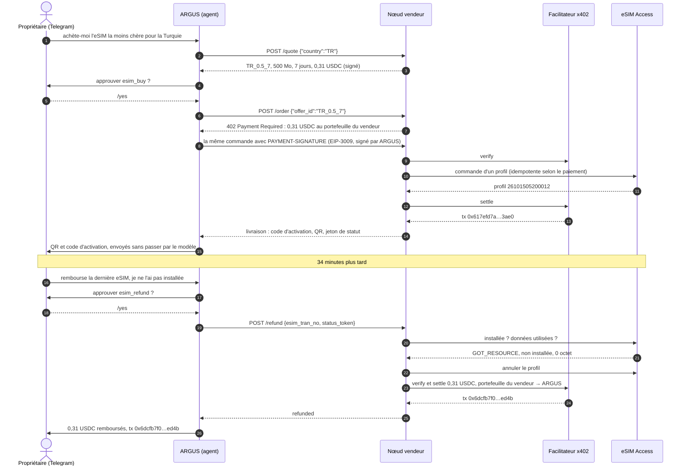
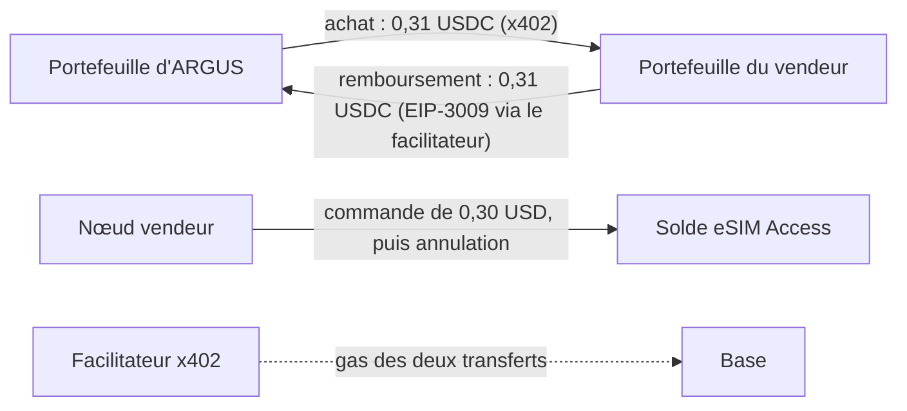
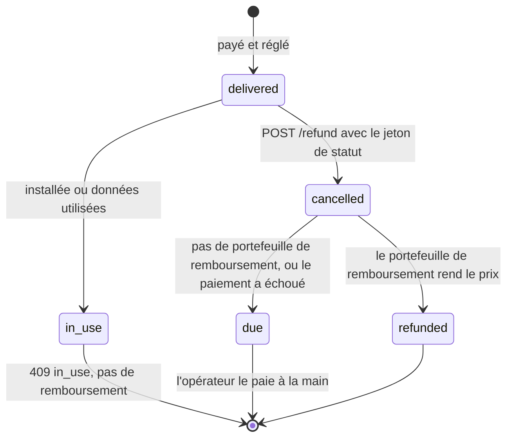
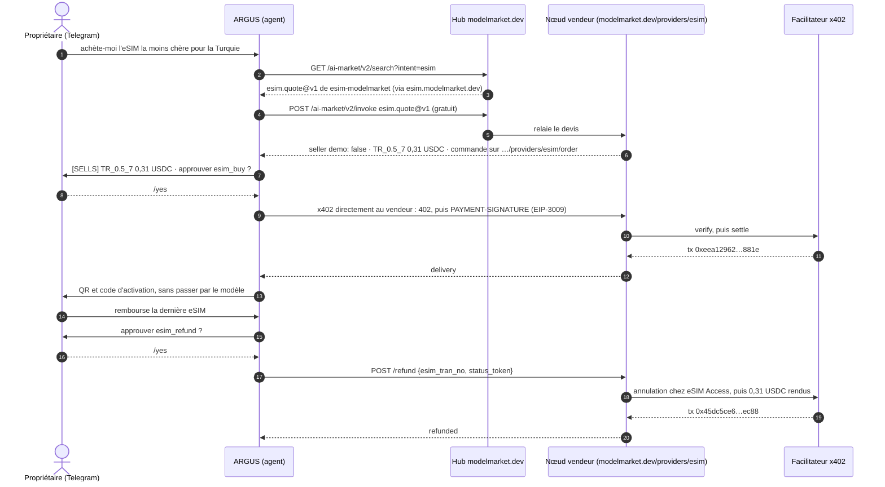
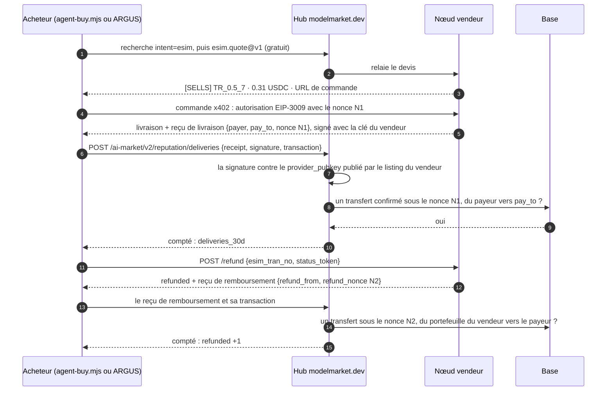
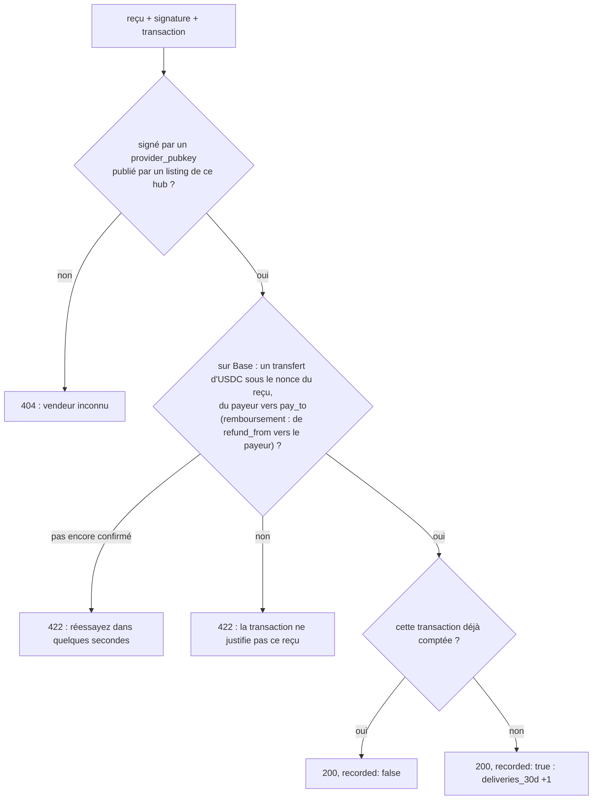

# Cas réels : un agent IA achète une eSIM, puis récupère son argent

Des exécutions réelles du kit, avec leurs transactions, pour que vous puissiez vérifier chaque étape on-chain. Le cas 2 (section 10) montre le même agent achetant notre capacité via le hub. Le cas 3 (section 11) a deux acheteurs, un agent de programmation dans un terminal et ARGUS, et le hub qui compte les livraisons du vendeur à partir des reçus signés des acheteurs. Le premier cas est le parcours complet de l'agent dans les deux sens : un agent IA trouve une offre, la paie en USDC via x402, remet l'eSIM à son propriétaire, puis demande un remboursement, que le nœud vendeur rembourse sans que personne ne touche à un portefeuille (wallet).

## 1. Ce qui s'est passé

Le 15 octobre 2026, le propriétaire d'ARGUS, un agent IA personnel, lui a écrit sur Telegram : achète-moi l'eSIM la moins chère pour la Turquie. ARGUS a demandé des offres au nœud vendeur du kit, a choisi Turquie 500 Mo pour 7 jours à 0,31 USDC, a demandé l'approbation de son propriétaire et a payé depuis son propre portefeuille. Quelques secondes plus tard, le propriétaire avait dans la conversation le QR code et le code d'activation. ARGUS lui-même ne les a jamais vus.

Trente-quatre minutes plus tard, le propriétaire a demandé à ARGUS un remboursement. L'eSIM n'était pas installée : le nœud vendeur l'a donc annulée chez le grossiste et a renvoyé les 0,31 USDC au portefeuille de l'agent. Tous les portefeuilles et le solde de gros sont revenus à leur point de départ.

Le vendeur était le banc d'essai privé du kit : un nœud vendeur ordinaire, qui vend à prix coûtant et n'est joignable que depuis l'hôte de l'agent. Rien n'a été simulé.

## 2. Qui a participé

| Partie | Ce que c'est | Adresse ou lieu |
|---|---|---|
| Propriétaire | la personne pour qui travaille ARGUS ; il approuve chaque paiement sur Telegram | une conversation Telegram privée |
| ARGUS | l'agent (acheteur) ; il paie depuis son propre portefeuille | `0x428f2Be4327908948e3B1915C55ddF8fA6bf73cc` |
| Nœud vendeur | le nœud `rails/` du kit (vendeur), remboursements automatiques activés | `https://esim.modelmarket.dev/stand` |
| Portefeuille du vendeur | reçoit les paiements et paie les remboursements (`PAY_TO` et `REFUND_KEY_FILE` désignent le même portefeuille) | `0xF47161fBB56D0D910a17e503C8292903F41BbAE2` |
| Facilitateur | le facilitateur x402 de Coinbase : il vérifie chaque transfert signé et le met on-chain en payant le gas | CDP |
| Grossiste | eSIM Access : émet et annule le profil | le compte de l'opérateur |

## 3. La chaîne complète



## 4. Les transactions

Toutes sur Base mainnet, en USDC (`0x8335…2913`). Ouvrez-les sur [basescan.org](https://basescan.org).

| Étape | Transaction | Bloc, heure (UTC) | De → à | Montant | Gas payé par |
|---|---|---|---|---|---|
| Approvisionnement de l'agent | `0x225afba5cd651e3ccdf70593fe985d1e24ddc14836270e83b13f546b6d017578` | 52624834 | portefeuille du propriétaire `0x097e…475a` → ARGUS | 0,50 | le propriétaire |
| Achat | `0x617efd7abe4b4c6a80b54046617a73415aa54df7ada5f002ce7260cf68ac3ae0` | 52626137, 05:20:21 | ARGUS → portefeuille du vendeur | 0,31 | facilitateur `0x93f6…be44` |
| Remboursement | `0x6dcfb7f075ad7fb6308064ac53e310dfb6adfd9b65d9f44b3c9a6dd39ca9ed4b` | 52627173, 05:54:53 | portefeuille du vendeur → ARGUS | 0,31 | facilitateur `0x4c93…0205` |

L'achat comme le remboursement sont des appels EIP-3009 `transferWithAuthorization` : le portefeuille qui paie signe, le facilitateur soumet. Ni ARGUS ni le portefeuille du vendeur n'ont détenu d'ETH, avant, pendant ou après.

## 5. Argent et soldes



| | Avant | Après l'achat | Après le remboursement |
|---|---|---|---|
| Portefeuille d'ARGUS | 0,50 USDC | 0,19 USDC | 0,50 USDC |
| Portefeuille du vendeur | 0 | 0,31 USDC | 0 |
| Solde eSIM Access | 20,00 $ | 19,70 $ | 20,00 $ |
| ETH dépensé par ARGUS ou le vendeur | 0 | 0 | 0 |

Le banc d'essai vendait à prix coûtant (`MARGIN_PCT=0`, `MIN_MARGIN_USD=0.01`) : 0,30 $ en gros, 0,31 USDC pour l'agent. Avec la marge par défaut du kit, le même forfait coûte 1,30 $.

## 6. Les règles du remboursement



- **Seul le payeur peut le demander.** La demande porte le jeton de statut reçu avec la livraison. Un mauvais jeton reçoit `404`, comme une eSIM inconnue.
- **Seulement une eSIM inutilisée.** Le nœud interroge d'abord le grossiste : un profil installé, ou qui a consommé la moindre donnée, reçoit `409 in_use` et reste tel quel.
- **Seulement à l'adresse qui a payé, seulement le prix payé.** Le nœud conserve le payeur et le prix avec la commande, et ne rembourse jamais davantage.
- **Une seule fois.** Une deuxième demande, ou deux simultanées, reçoivent la même réponse et aucun second paiement. Un paiement qui a échoué n'est pas relancé tout seul : son transfert a pu aboutir, l'opérateur vérifie donc d'abord la chaîne.
- **Plafonné.** `REFUND_MAX_USD` par remboursement et `REFUND_DAILY_MAX_USD` par jour, 50 chacun par défaut. Le banc d'essai tournait avec 1 et 2.
- **D'abord annuler, ensuite payer.** Le grossiste rembourse à l'opérateur le profil annulé : l'opérateur ne perd que du temps.

## 7. Activer les remboursements sur votre nœud

Les remboursements sont désactivés tant que vous ne donnez pas au nœud un portefeuille d'où les payer. Sans lui, `POST /refund` annule quand même l'eSIM inutilisée et enregistre le remboursement comme dû, et vous recevez le webhook `agent_order.refund_due` pour le payer vous-même.

```bash
# un portefeuille avec des USDC sur Base pour les remboursements : celui de PAY_TO, pour rendre l'argent
# reçu, ou une réserve séparée. Pas besoin d'ETH : le facilitateur paie le gas.
cd ~/esim-operator-kit
umask 077
printf 'Refund wallet private key: '; read -rs v; printf %s "$v" > secrets/refund_key; echo; unset v
sudo chown 1000:1000 secrets/refund_key && sudo chmod 600 secrets/refund_key
echo "REFUND_KEY_FILE=/run/secrets/esim/refund_key" >> .env
echo "REFUND_MAX_USD=20" >> .env
echo "REFUND_DAILY_MAX_USD=100" >> .env
docker compose up -d rails
curl -s https://<your domain>/agents/healthz    # "refunds": "automatic"
```

| Paramètre | Ce qu'il fait |
|---|---|
| `REFUND_KEY_FILE` | La clé du portefeuille d'où partent les remboursements. La seule clé privée que le kit lise jamais, et seulement si vous l'activez. |
| `REFUND_MAX_USD` | Le maximum d'un remboursement. |
| `REFUND_DAILY_MAX_USD` | Le maximum de tous les remboursements sur une journée. |
| `CDP_KEY_FILE` | Déjà défini pour les paiements ; les remboursements passent par le même facilitateur. |

Si le portefeuille de remboursement n'est pas votre portefeuille principal, n'y gardez qu'une réserve : une clé sur un serveur est une clé qu'une intrusion peut lire.

## 8. Demander un remboursement

L'agent a besoin des deux valeurs reçues avec la livraison :

```bash
curl -s -X POST https://<seller>/agents/refund -H 'content-type: application/json' \
  -d '{"esim_tran_no":"26101505200012","status_token":"…"}'
```

```json
{"success": true, "result": {"esim_tran_no": "26101505200012", "status": "refunded", "amount_usd": "0.31",
 "to": "0x428f2be4327908948e3b1915c55ddf8fa6bf73cc", "at": "2026-10-15T05:54:50.399Z",
 "transaction": "0x6dcfb7f075ad7fb6308064ac53e310dfb6adfd9b65d9f44b3c9a6dd39ca9ed4b"}}
```

`status` vaut `refunded` avec la transaction, ou `due` quand le vendeur paie à la main. `/listing.json` indique lequel : son `refund.policy` décrit la règle, et `/healthz` affiche `"refunds": "automatic"` ou `"operator"`.

## 9. Ce que nous avons appris

- **Un agent prudent s'interroge sur un remboursement immédiat.** À la demande « achète et rembourse tout de suite » en un seul message, ARGUS s'est arrêté et a demandé ce qui était voulu : acheter et garder, ne rien acheter, ou un remboursement pour une vraie raison. Le propriétaire a acheté, puis a demandé le remboursement dans une demande à part. De vrais agents rembourseront pour de vraies raisons, et un vendeur peut s'attendre à ce qu'ils le demandent poliment et une seule fois.
- **Le code d'activation n'a jamais quitté la livraison.** Le vendeur ne l'envoie que dans la réponse à la commande payée ; ARGUS l'a transmis à la conversation du propriétaire et n'a gardé que le numéro de profil et le jeton de statut. Ni les registres du vendeur ni le journal de l'agent ne le conservent.
- **Aucun gas nulle part.** L'agent a signé une autorisation pour payer, le portefeuille du vendeur une pour rembourser, et le facilitateur a fait le reste.
- **C'est le remboursement du grossiste qui rend le remboursement sûr.** Le nœud annule avant de payer : une commande remboursée ne coûte rien à l'opérateur.

## 10. Cas 2 : via le hub, auprès de notre nœud public

Dans le cas 1, on avait donné à l'agent l'adresse du vendeur. Dans le cas 2, il a trouvé le vendeur lui-même : ARGUS a cherché des vendeurs d'eSIM sur le hub modelmarket.dev, a obtenu notre capacité `esim.quote@v1` de `esim-modelmarket`, lui a demandé des offres via le hub et a payé via x402 sur le `/order` du vendeur lui-même. Le hub a acheminé le devis gratuit et n'a jamais touché l'argent.

**Pour ce test, notre nœud public est passé de la démo à la vente, puis est revenu en démo juste après.** Le nœud derrière `esim-modelmarket` (`modelmarket.dev/providers/esim`) a vendu pendant 52 minutes, de 06:56:55 à 07:48:33 UTC le 15 octobre 2026, à prix coûtant (`MARGIN_PCT=0`, `MIN_MARGIN_USD=0.01`), encaissant sur le même portefeuille vendeur que le banc d'essai et remboursant depuis celui-ci automatiquement (au plus 2 $ par remboursement et 5 $ par jour). Depuis 07:48:33, il refuse de nouveau chaque commande avec `demo_mode`.



| Heure (UTC) | Ce qui s'est passé |
|---|---|
| 06:56:55 | Le nœud public passe de la démo à la vente. Via le hub, son devis indique désormais `demo: false` et 0,31 USDC |
| 07:21 | Première tentative : ARGUS voit les offres mais refuse d'acheter. Le nœud s'appelait encore « modelmarket.dev demo seller », et l'agent s'est fié au nom |
| 07:23 | Correctif déployé : le nom du nœud suit son mode, et ARGUS étiquette chaque offre `[SELLS]` ou `[DEMO]` d'après la réponse du vendeur lui-même |
| 07:47:35 | ARGUS achète TR_0.5_7 après le `/yes` du propriétaire ; l'eSIM `26101507470034` arrive sur le Telegram du propriétaire |
| 07:48:02 | Le propriétaire demande le remboursement et l'approuve avec `/yes` ; le nœud annule l'eSIM inutilisée et rembourse |
| 07:48:33 | Le nœud public revient en démo |

| Étape | Transaction | Bloc, heure (UTC) | De → à | USDC | Gas payé par |
|---|---|---|---|---|---|
| Achat | `0xeea12962c4f494e55acc59a376203bd4b704804f19a84b4b8f47a96b265a881e` | 52630556, 07:47:39 | ARGUS → portefeuille du vendeur `0xF471…bAE2` | 0,31 | facilitateur `0x68a9…7863` |
| Remboursement | `0x45dc5ce6579d8e889750442d63773586c481a11b30ddf44805960860f3bbec88` | 52630569, 07:48:05 | portefeuille du vendeur → ARGUS | 0,31 | facilitateur `0x625d…ac39` |

ARGUS a été le seul acheteur de la fenêtre : les registres du nœud contiennent une commande, remboursée. À la fin, ARGUS détenait de nouveau 0,50 USDC, le portefeuille du vendeur 0, le solde eSIM Access 20,00 $, l'eSIM était à l'état `CANCEL`, et aucun portefeuille n'avait dépensé d'ETH.

Ce que ce cas a montré :

- **Un agent lit les noms.** Le devis du vendeur disait qu'il vendait, mais son nom disait « demo », et l'agent a cru le nom. Un nœud vendeur doit être nommé d'après ce qu'il fait ; un agent doit décider d'après la réponse du vendeur, pas d'après son nom.
- **Le hub trouve, le vendeur vend.** La découverte et le devis gratuit sont passés par le hub ; le paiement et le remboursement sont allés directement de l'agent au vendeur, et le hub n'a détenu d'argent à aucun moment.
- **La démo est un réglage.** Le même nœud, le même catalogue et le même compte de gros vendent ou refusent selon `DEMO_MODE` : un opérateur ouvre et ferme une fenêtre de vente en quelques secondes.

## 11. Cas 3 : deux acheteurs, et le hub compte les livraisons

Un vendeur payé directement est invisible pour le hub : l'argent va de l'agent au vendeur, et le hub ne voit que le devis gratuit. Vu du hub, un vendeur qui encaisse sans rien livrer ressemblait donc à un vendeur qui livre. Depuis le 15 octobre 2026, le nœud vendeur signe un reçu pour chaque livraison et chaque remboursement, et l'acheteur peut l'apporter au hub avec sa transaction. Le hub vérifie la signature et le transfert on-chain, et compte une livraison confirmée sur le listing du vendeur. Le cas 3 l'a testé de bout en bout avec deux acheteurs différents.

**Pour ce test, notre nœud public est passé de la démo à la vente une troisième fois, puis est revenu en démo juste après.** Il a vendu pendant 9 minutes, de 09:38:59 à 09:48:22 UTC le 15 octobre 2026, aux mêmes conditions que dans le cas 2 : à prix coûtant, sur le même portefeuille vendeur, avec des remboursements automatiques d'au plus 2 $ chacun et 5 $ par jour. Depuis 09:48:22, il refuse de nouveau chaque commande avec `demo_mode` (`403`).

| Acheteur | Ce que c'est | Portefeuille |
|---|---|---|
| Claude Code | un agent de programmation dans le terminal du propriétaire. Il a lancé l'acheteur d'exemple du kit `rails/examples/agent-buy.mjs` ; le script a lu la clé dans un fichier, et l'agent ne l'a jamais vue | `0x097e3F339D0b023605e12A6B81E2d6Cb7571475a` |
| ARGUS | l'agent du propriétaire dans Telegram, comme dans les cas 1 et 2. Le propriétaire a approuvé l'achat et le remboursement avec `/yes` | `0x428f2Be4327908948e3B1915C55ddF8fA6bf73cc` |

### 11.1 L'achat depuis Claude Code

Tout l'achat tient en une commande. Sans `--yes`, elle ne fait que demander un devis ; avec `--refund`, elle redemande l'argent juste après la livraison.

```bash
cd rails
node examples/agent-buy.mjs TR --hub https://modelmarket.dev --key-file ~/.aicom-pov-buyer.json --yes --refund
```

```text
seller   modelmarket.dev eSIM seller (https://modelmarket.dev → https://esim.modelmarket.dev)

offer    TR_0.5_7 — Turkey 500MB 7Days — 0.31 USDC, from modelmarket.dev eSIM seller
order at https://modelmarket.dev/providers/esim/order
payer    0x097e3F339D0b023605e12A6B81E2d6Cb7571475a

delivered  esim_tran_no 26101509410001 · iccid 8997…7746 · apn internet
activation LPA:1$rsp-eu.s… (the traveller's secret)
paid       0x85d355853807967e85b1efc3f15261e0c58006091898cb98d46095db07bc103e
hub        delivery counted: {"confirmed":1,"distinct_buyers":1,"refunded":0}

refund     refunded · 0.31 USDC to 0x097e3f339d0b023605e12a6b81e2d6cb7571475a · 0x3313e8be7726ce1e3bc4dcf95afde0bd5eb3de0c8a57b601f8b3aaf86ed85c00
hub        refund counted: {"confirmed":1,"distinct_buyers":1,"refunded":1}
```

Le script a trouvé le vendeur via le hub, ignoré les vendeurs en mode démo, pris l'offre la moins chère, payé via x402 avec un plafond de 1 $ par paiement, et apporté les deux reçus au hub. Trois minutes plus tard, ARGUS a acheté le même forfait dans Telegram, et le compteur est arrivé à deux acheteurs.

### 11.2 La chaîne avec les reçus



| Heure (UTC) | Ce qui s'est passé | Compteur du listing ensuite |
|---|---|---|
| 09:38:59 | Le nœud public passe de la démo à la vente | rien encore |
| 09:41:05 | Claude Code paie TR_0.5_7 ; l'eSIM `26101509410001` est livrée | 1 livraison, 1 acheteur, 0 remboursement |
| 09:41:19 | Son remboursement est payé ; l'eSIM est annulée | 1, 1, 1 |
| 09:44:19 | ARGUS paie après le `/yes` du propriétaire ; l'eSIM `26101509440019` part dans le Telegram du propriétaire | 2, 2, 1 |
| 09:44:53 | Le remboursement d'ARGUS est payé après `/yes` | 2, 2, 2 |
| 09:48:22 | Le nœud public revient en démo | 2, 2, 2 (conservé 30 jours) |

### 11.3 Les transactions

| Étape | Transaction | Bloc, heure (UTC) | De → à | USDC | Gas payé par |
|---|---|---|---|---|---|
| Achat, Claude Code | `0x85d355853807967e85b1efc3f15261e0c58006091898cb98d46095db07bc103e` | 52633959, 09:41:05 | `0x097e…475a` → portefeuille du vendeur `0xF471…bAE2` | 0,31 | facilitateur `0xca5e…c70d` |
| Remboursement, Claude Code | `0x3313e8be7726ce1e3bc4dcf95afde0bd5eb3de0c8a57b601f8b3aaf86ed85c00` | 52633966, 09:41:19 | portefeuille du vendeur → `0x097e…475a` | 0,31 | facilitateur `0x93f6…be44` |
| Achat, ARGUS | `0xf9ac406f3e329ac2c4c02e26562b6fb944e4165b71b88c4a0756a193325f9669` | 52634056, 09:44:19 | ARGUS → portefeuille du vendeur | 0,31 | facilitateur `0x93f6…be44` |
| Remboursement, ARGUS | `0x5fa5da5455226a20d10dc84ffb8adf56b01d972dcc72f8e135b4a507a8c35287` | 52634073, 09:44:53 | portefeuille du vendeur → ARGUS | 0,31 | facilitateur `0x8f5c…e531` |

Les registres du nœud contiennent exactement ces deux commandes dans la fenêtre, toutes deux remboursées. À la fin, les deux acheteurs détenaient ce qu'ils avaient avant (0,594148 et 0,50 USDC), le portefeuille du vendeur 0, le solde eSIM Access 20,00 $, les deux eSIM étaient à l'état `CANCEL` avec 0 octet consommé, et aucun portefeuille n'avait dépensé d'ETH.

### 11.4 Le reçu, et ce que vérifie le hub

Le reçu de livraison de l'achat d'ARGUS, tel que le nœud le signe. Il nomme le paiement, pas l'eSIM : ni code d'activation, ni ICCID, ni jeton de statut.

```json
{"v": 1, "kind": "delivery", "capability": "esim.order@v1", "product_id": "esim-modelmarket", "chain_id": 8453,
 "payer": "0x428f2be4327908948e3b1915c55ddf8fa6bf73cc", "pay_to": "0xF47161fBB56D0D910a17e503C8292903F41BbAE2",
 "nonce": "0xddde4ccd3b8d8ba361b94985b0b063f50ae41f43217cfc3ccadc2d636201f79e", "offer_id": "TR_0.5_7",
 "at": "2026-10-15T09:44:…Z"}
```

La signature est une signature Ed25519 sur le JSON canonique du reçu (clés triées, sans espaces), avec la même clé du vendeur qui signe chaque réponse gratuite. Un reçu de remboursement porte `kind: "refund"`, `refund_from` (le portefeuille qui a remboursé), `refund_nonce` (le nonce EIP-3009 de ce transfert) et `delivery_nonce`.



- **Ce que garde le hub.** Pour chaque transfert compté : le vendeur, le type, l'heure, un hachage de la transaction et un hachage de l'adresse du payeur, uniquement pour compter les acheteurs distincts. Aucun montant, aucune adresse et aucune transaction en clair. (Quelqu'un qui connaît déjà une adresse ou une transaction peut tout de même reconnaître son hachage.)
- **Ce qu'il affiche.** Chaque listing du vendeur porte `deliveries_30d` : `{"confirmed": 2, "distinct_buyers": 2, "refunded": 2}` après ce cas. Le score de confiance du hub compte un succès par acheteur distinct. ARGUS et `agent-buy.mjs` l'affichent à côté du vendeur.
- **Ce que cela ne prouve pas.** Les portefeuilles ne coûtent rien : un vendeur pourrait s'acheter à lui-même avec de nouveaux portefeuilles et se rembourser. Le compteur dit « des acheteurs ont confirmé que ce vendeur a livré », pas « ce vendeur est bon » ; lisez-le avec les remboursements et l'ancienneté du vendeur. Un remboursement n'est pas un échec : c'est une eSIM inutilisée annulée sur demande.
- **Qui choisit.** Un acheteur qui garde ses achats privés n'est jamais compté : `--no-share` pour `agent-buy.mjs`, `ARGUS_SHARE_DELIVERIES=0` pour ARGUS. Les reçus de plus de 30 jours sont refusés.

### 11.5 Où nous en sommes

- **Notre nœud public est une démo.** `esim-modelmarket` sur modelmarket.dev donne des prix réels via le hub et refuse chaque commande avec `demo_mode`. Il n'a vendu que pendant les trois fenêtres de test de cette page, chacune refermée juste après. Lancez `agent-buy.mjs` contre lui aujourd'hui et il le dit : `DEMO: sells nothing`, puis `no seller that sells has an offer for TR`.
- **Un vendeur qui vend, c'est votre propre nœud.** Le kit avec `DEMO_MODE=0`, une clé CDP et `PAY_TO` : le [guide de l'opérateur](operator-guide.md), étapes 8 à 10. Avec un `node.toml` écrit par `scripts/node-toml.mjs` et un nœud de fédération en `aimarket-hub` 3.15.27 ou plus récent (étape 9), son listing porte la clé du vendeur, et les reçus des acheteurs comptent pour lui.
- **N'importe quel agent peut acheter.** L'achat depuis un agent de programmation dans un terminal est vérifié par ce cas, remboursement compris. Tout agent qui parle x402 fait de même : le [guide des agents](agent-guide.md) décrit l'API, et `agent-buy.mjs` est un acheteur prêt à lancer.

Ce que ce cas a montré :

- **Le vendeur est payé directement, et le hub sait quand même qu'il livre.** Le hub ne détient pas d'argent et ne voit aucun montant, et pourtant le listing montre deux livraisons confirmées par deux acheteurs.
- **Un transfert récent a besoin de quelques secondes.** Chacun des quatre reçus, des deux acheteurs, a été refusé une fois (`422` : le transfert n'était pas encore confirmé) puis compté au nouvel essai dix secondes plus tard. Un acheteur doit réessayer, pas abandonner.
- **Deux sortes d'agents, un même chemin.** Un script lancé depuis un agent de programmation et un agent de chat avec l'approbation de son propriétaire ont suivi les mêmes étapes, et le hub les a comptés de la même façon.
