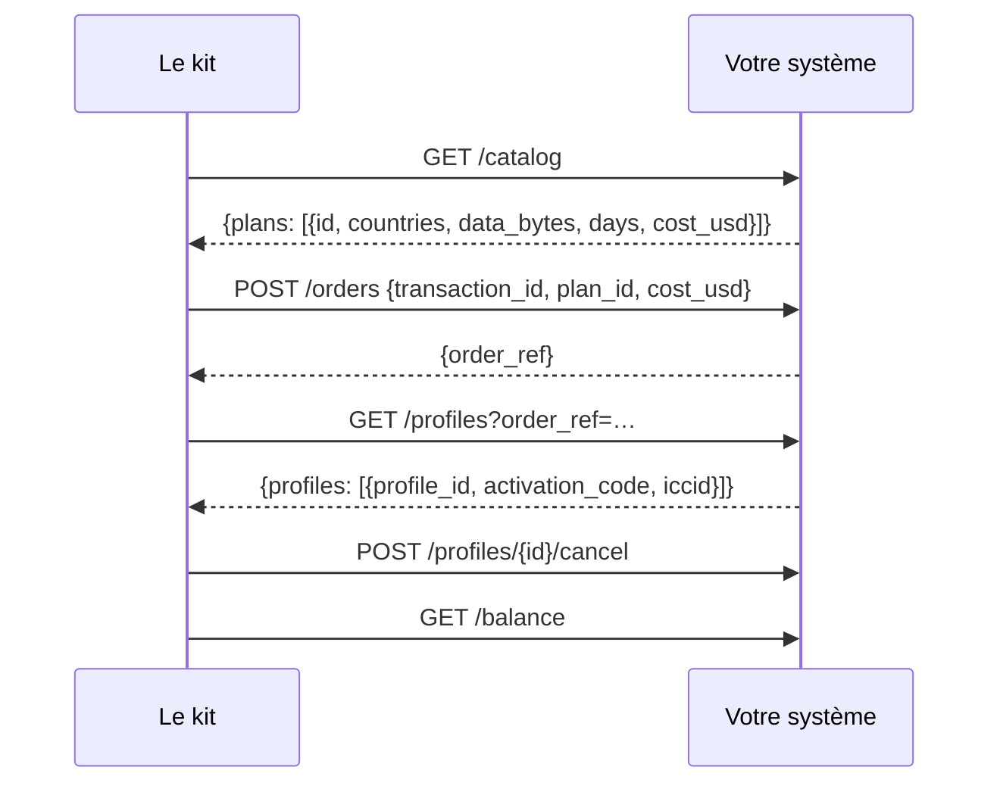
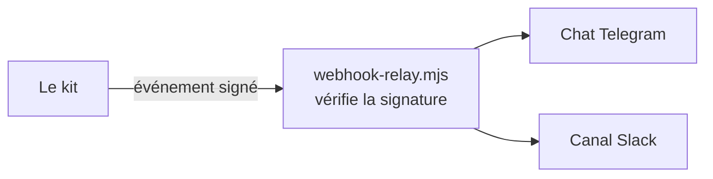

# Intégrations

Des raccordements prêts entre le kit et les systèmes qu'une entreprise eSIM a déjà : d'où viennent
les eSIM, et où va la nouvelle de chaque vente. Chaque entrée indique jusqu'où elle a été testée.

Autres documents : [présentation](../../README.fr.md) · [prise en main et cas d'usage](rails.md) · [référence du SDK](sdk.md) · [guide de l'opérateur](operator-guide.md)

## 1. La carte

```mermaid
flowchart LR
  subgraph supply["D'où viennent les eSIM (SUPPLIER)"]
    EA["eSIM Access"]
    AI["Airalo Partner API"]
    EG["eSIM Go"]
    HT["Votre propre système<br/>5 endpoints HTTP"]
    SDK["Tout le reste<br/>objet fournisseur du SDK"]
  end
  K["Le kit<br/>nœud pour agents · boutique · fédération"]
  subgraph business["Où vont les nouvelles (WEBHOOK_URL)"]
    CRM["CRM, support"]
    BILL["Facturation, comptabilité, ERP"]
    TG["Telegram · Slack"]
    SH["Google Sheets"]
    AUTO["n8n · Make · Zapier"]
  end
  supply --> K
  K -->|"événements signés"| business
```



| Intégration | Type | Réglage | Statut |
|---|---|---|---|
| eSIM Access | fournisseur | `SUPPLIER=esimaccess` | ✅ en direct : une vraie commande achetée, lue et annulée le 2026-10-14 |
| Airalo Partner API | fournisseur | `SUPPLIER=airalo` | 🟡 construit d'après la référence publiée de l'API Airalo, testé sur ses réponses documentées ; pas encore lancé sur un vrai compte Airalo |
| eSIM Go (API v2.5) | fournisseur | `SUPPLIER=esimgo` | 🟡 construit d'après la référence publiée de l'API eSIM Go, testé sur ses réponses documentées ; pas encore lancé sur un vrai compte |
| Votre propre système | fournisseur | `SUPPLIER=http` | ✅ testé de bout en bout avec le backend de référence `rails/examples/operator-backend.mjs` |
| Tout le reste | fournisseur | l'interface fournisseur du SDK | ✅ l'interface que les quatre ci-dessus implémentent |
| CRM, facturation, comptabilité | événements | `WEBHOOK_URL` | ✅ signé, réessayé, testé |
| Telegram, Slack | événements | `rails/examples/webhook-relay.mjs` | ✅ testé |
| Google Sheets | événements | `rails/examples/google-sheets.gs` | 🟡 un récepteur Apps Script, non testé en CI |
| n8n, Make, Zapier, HubSpot, Salesforce | événements | leur déclencheur webhook | 📘 une recette plus bas ; rien à installer |

Avant de vendre via une intégration 🟡, chargez votre catalogue (`scripts/catalog.mjs`) et faites une
commande test que vous annulez (guide de l'opérateur, section 10). Dites-nous ce que vous trouvez :
une issue sur GitHub la fait passer en ✅ pour l'opérateur suivant.

## 2. Fournisseurs

### 2.1 eSIM Access

Par défaut. Mettez l'AccessCode et la SecretKey dans `secrets/esimaccess_access_code` et
`secrets/esimaccess_secret_key`. Le [guide de l'opérateur](operator-guide.md) couvre le compte, la
recharge de 50 $ et la commande test.

- Les commandes sont idempotentes chez eSIM Access lui-même (par `transactionId`).
- La commande porte le coût auquel l'offre a été faite ; un forfait dont le prix a bougé est refusé, pas facturé.
- Les profils inutilisés sont annulés et remboursés sur votre solde automatiquement quand un paiement ne se règle pas.

### 2.2 Airalo Partner API

Il vous faut un compte partenaire Airalo, son client id et son secret.

```bash
printf 'Client id: '; read -rs v; printf %s "$v" > secrets/airalo_client_id; echo
printf 'Client secret: '; read -rs v; printf %s "$v" > secrets/airalo_client_secret; echo
sudo chown 1000:1000 secrets/airalo_*
```

Dans `.env` :

```bash
SUPPLIER=airalo
AIRALO_CLIENT_ID_FILE=/run/secrets/esim/airalo_client_id
AIRALO_CLIENT_SECRET_FILE=/run/secrets/esim/airalo_client_secret
# AIRALO_BASE_URL=…   l'URL de votre bac à sable Airalo, pendant les tests
```

Ce que fait l'adaptateur : `POST /v2/token` une fois, puis il garde le jeton (Airalo autorise trois
demandes de jeton par minute) ; `GET /v2/packages` pour le catalogue (forfaits fixes uniquement : les
forfaits illimités et les recharges ne sont pas en v1 ; `net_price` est votre coût) ; `POST /v2/orders`
avec l'id de transaction du paiement en description de commande ; `GET /v2/sims/{iccid}` et `/usage`
pour le statut ; `POST /v2/refund` quand un paiement ne se règle pas.

À savoir avant de vendre :

- **Les commandes Airalo n'ont pas de clé d'idempotence.** L'adaptateur retient chaque commande par son paiement tant que le processus tourne, et le nœud enregistre la référence de commande avant de demander le profil. Un redémarrage dans les secondes qui les séparent peut laisser une commande payée sans son eSIM dans le kit : retrouvez-la dans la console Airalo par sa description (l'id de transaction).
- **Les remboursements sont examinés par Airalo** et crédités en crédit Airalo, pas en argent.
- **Le solde n'est pas vérifié** avant une commande : gardez votre compte Airalo approvisionné.

### 2.3 eSIM Go

Il vous faut un compte eSIM Go et sa clé API (Account Settings → API Details).

```bash
printf 'API key: '; read -rs v; printf %s "$v" > secrets/esimgo_api_key; echo
sudo chown 1000:1000 secrets/esimgo_api_key
```

```bash
SUPPLIER=esimgo
ESIMGO_API_KEY_FILE=/run/secrets/esim/esimgo_api_key
```

Ce que fait l'adaptateur : `GET /catalogue` page par page (`dataAmount` en Mo, `price` dans la devise
de votre organisation — elle doit être l'USD ; les forfaits illimités ne sont pas en v1) ;
`POST /orders` avec `assign: true`, qui renvoie pour chaque eSIM l'ICCID, l'adresse SM-DP+ et le
matching id ; `GET /esims/{iccid}` et `/bundles` pour le statut et la consommation ;
`DELETE /esims/{iccid}/bundles/{name}?refundToBalance=true` quand un paiement ne se règle pas.

À savoir avant de vendre :

- **Pas de clé d'idempotence** chez eSIM Go non plus : la même protection et la même réserve qu'avec Airalo.
- **Les remboursements sur le solde sont désactivés par défaut** chez eSIM Go : demandez à votre gestionnaire de compte de les activer. Sans cela, un forfait annulé est révoqué sans remboursement.
- **Le solde n'est pas vérifié** avant une commande.

### 2.4 Votre propre système (HTTP)

Pour une plateforme de provisionnement, une façade SM-DP+, un stock de profils en base de données ou
un fournisseur que le kit ne connaît pas : implémentez cinq endpoints, dans n'importe quel langage.



```bash
SUPPLIER=http
SUPPLIER_URL=https://ops.example.com/esim
SUPPLIER_SECRET_FILE=/run/secrets/esim/supplier_secret
```

Chaque requête est signée (HMAC-SHA256 avec horodatage). Le contrat, avec du code Python et Go pour
vérifier la signature : [rails/spec/supplier-http.md](../../rails/spec/supplier-http.md). Une
référence fonctionnelle à copier : [rails/examples/operator-backend.mjs](../../rails/examples/operator-backend.mjs).
Essayez-la avant d'écrire une ligne :

```bash
cd rails && SUPPLIER_SECRET=$(openssl rand -hex 24) node examples/operator-backend.mjs 9600
```

### 2.5 Tout le reste (SDK)

Un service Node.js peut passer à `createNode()` n'importe quel objet doté de `catalog`, `order`,
`profiles`, `cancel` et `balance`. Voir la [référence du SDK](sdk.md), section 2.

## 3. Vos systèmes métier

Chaque commande qui change de statut est envoyée en POST à `WEBHOOK_URL`, signée :

| Événement | Ce que font généralement vos systèmes |
|---|---|
| `order.created` | ouvrir un prospect ou un brouillon de facture |
| `order.delivered` | enregistrer la vente : prix, coût, moyen, référence du paiement |
| `order.refund_due` | ouvrir une tâche de remboursement avec l'adresse du payeur |
| `order.underpaid` | ouvrir une tâche de support |
| `order.expired` | clore le prospect |
| `agent_order.delivered` | enregistrer une vente à un agent |
| `agent_order.cancelled` | noter une vente à un agent annulée |

```bash
WEBHOOK_URL=https://crm.example.com/hooks/esim
WEBHOOK_SECRET_FILE=/run/secrets/esim/webhook_secret      # 16+ caractères, partagé avec le récepteur
```

Corps, en-têtes et code pour les vérifier : [référence du SDK](sdk.md), section 5.

### 3.1 Telegram et Slack



1. Créez un bot Telegram avec @BotFather et notez son jeton ; ajoutez-le au chat de votre équipe et notez l'id du chat. Pour Slack, créez un incoming webhook.
2. Lancez le relais à côté du kit :

```bash
cd rails && WEBHOOK_SECRET=… TELEGRAM_BOT_TOKEN=… TELEGRAM_CHAT_ID=… SLACK_WEBHOOK_URL=… node examples/webhook-relay.mjs 9700
```

3. Dans `.env` : `WEBHOOK_URL=http://127.0.0.1:9700/hooks/esim`, et le même secret dans `secrets/webhook_secret`.

Chaque vente apparaît en une ligne : « ✅ Delivered Qh3… : Japan 5GB 30Days — $6.40, cost $3.20 ».

### 3.2 Google Sheets

1. Dans une feuille Google : Extensions → Apps Script ; collez [rails/examples/google-sheets.gs](../../rails/examples/google-sheets.gs) et définissez son `TOKEN`.
2. Déployez-le en application web (exécution en votre nom, accès : tout le monde) ; copiez l'URL `/exec`.
3. `WEBHOOK_URL=<l'URL /exec>?token=<TOKEN>`.

Chaque événement devient une ligne ; un id d'événement déjà vu est ignoré. Apps Script ne peut pas
lire les en-têtes de la requête : c'est donc le jeton dans l'URL, et non la signature, qui tient les
inconnus à l'écart.

### 3.3 n8n, Make, Zapier

Les trois lancent un scénario sur un webhook entrant :

1. Créez un scénario avec un déclencheur webhook (n8n : nœud Webhook, POST ; Make : Custom webhook ; Zapier : Webhooks by Zapier → Catch Hook) et copiez son URL dans `WEBHOOK_URL`.
2. Dans n8n, vérifiez d'abord la signature dans un nœud Code : recalculez `v1=` + HMAC-SHA256(secret, `X-Kit-Timestamp` + "." + corps brut) et comparez avec `X-Kit-Signature`.
3. Bifurquez selon `type` : `order.delivered` → l'étape de votre CRM ou de votre comptabilité ; `order.refund_due` → une tâche.

### 3.4 HubSpot, Salesforce, n'importe quel CRM

Via n8n, Make ou Zapier (ci-dessus), ou un petit récepteur à vous : sur `order.created`, créez une
affaire avec `order_id` comme id externe ; sur `order.delivered`, passez-la en gagnée avec
`price_usd` ; sur `order.refund_due`, créez une tâche. Dédoublonnez par l'`id` de l'événement.

## 4. Votre propre boutique ou app

La boutique du kit n'est pas obligatoire. Votre site ou votre app peut appeler votre nœud vendeur
comme n'importe quel agent : `POST /agents/quote`, puis `POST /agents/order` avec un paiement x402 —
voir le [guide pour les agents](agent-guide.md). Ou gardez votre paiement et n'utilisez le kit que
pour les agents : lancez-le avec votre fournisseur, laissez la boutique en mode démo, et annoncez le
nœud à la fédération.

## 5. Demander une intégration

Vous utilisez un fournisseur ou un système absent d'ici ? Ouvrez une issue sur
[GitHub](https://github.com/alexar76/esim-operator-kit/issues) avec sa référence d'API. Un adaptateur
de fournisseur représente environ deux cents lignes sur l'interface de la [référence du SDK](sdk.md).
