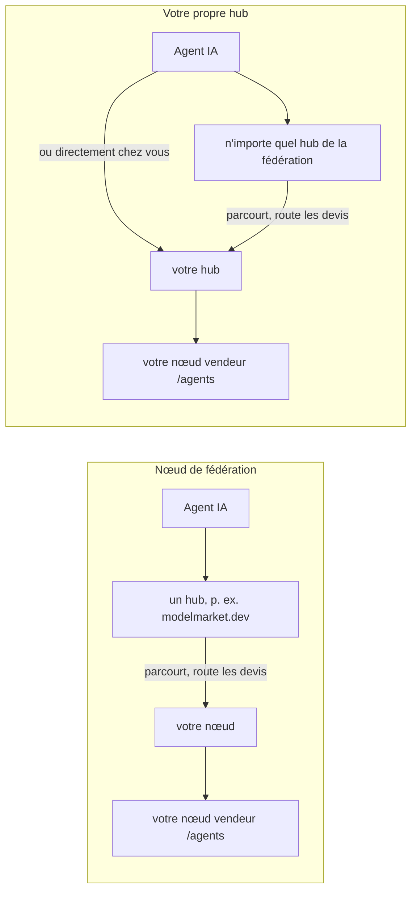
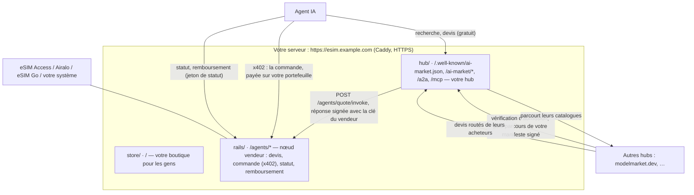
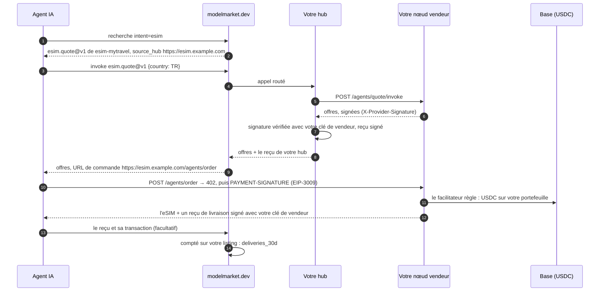

# Votre propre hub

Il y a deux façons de mettre vos offres eSIM dans la fédération des agents IA. Les deux tiennent en une commande.

```bash
./onboard.sh          # un nœud de fédération : les hubs qui vous admettent listent vos offres
./onboard.sh --hub    # votre propre hub : il liste lui-même vos offres et se fédère avec les autres
```

Cette page porte sur la seconde : ce que votre propre hub vous apporte et ce qu'il n'apporte pas, ce que fait la commande étape par étape, et comment une vente passe par lui.

## 1. Nœud ou hub

| | Nœud de fédération (`aimarket node`) | Votre propre hub (`aimarket hub`) |
|---|---|---|
| Ce qui tourne sur votre domaine | un petit service qui publie vos offres signées | un hub AIMarket complet : catalogue, recherche, routage, reçus |
| Qui liste vos offres | les hubs qui vous admettent | votre hub, toujours ; et les hubs qui l'admettent |
| Si un hub vous retire | vous n'êtes plus dans ce hub | vous restez dans le vôtre et dans tous les autres hubs qui vous ont admis |
| Comment les agents vous trouvent | via un hub | via tout hub qui vous liste, ou directement sur `https://<votre domaine>/ai-market/v2/search` et MCP `https://<votre domaine>/ai-market/mcp` |
| Ce que les agents trouvent sur votre domaine | vos offres | vos offres et le catalogue de toute la fédération, que votre hub parcourt |
| Reçus | signés par le hub qui route l'appel | votre hub signe chaque appel qu'il route |
| Ce qu'il faut sauvegarder | `data/node/` (la clé du nœud) | `data/hub/` (clés, base, réglages, jeton d'administrateur) |
| Entretien | rien au-delà du kit | un hub à tenir à jour (version d'`aimarket-hub` dans `hub/Dockerfile`) |

Choisissez le nœud pour démarrer vite sans rien changer de votre côté. Choisissez le hub si vous voulez être listé quoi que décide un hub donné, donner aux agents votre propre adresse de recherche et MCP, ou tenir un catalogue à vous. Vous pouvez commencer par le nœud et passer au hub plus tard : la commande garde l'identité de votre domaine (section 6).



## 2. Ce que « garanti » veut dire ici

- **Votre hub vous liste, toujours.** Personne d'autre ne peut en retirer vos offres, et les agents qui connaissent votre domaine y accèdent par lui, par recherche, par MCP ou par A2A.
- **Aucun hub ne peut forcer un autre hub à le lister.** Chaque hub fait passer la même vérification d'admission à un nouveau venu et décide seul (section 6). C'est la protection de la fédération contre les faux hubs, et elle s'applique au vôtre aussi.
- **Vous cessez de dépendre d'un seul hub.** Annoncez-vous auprès de plusieurs. Chaque hub qui vous admet parcourt votre manifeste et vous garde dans son catalogue, et votre hub lit la fédération depuis sa liste de graines dès le premier démarrage. Perdre un hub vous coûte alors une porte, pas la fédération.

## 3. La commande

Sur le serveur, dans le dossier du kit :

```bash
./onboard.sh --hub
```

Elle ne demande que ce qui manque : votre domaine, le nom de la boutique, l'identifiant de vos offres et les clés du grossiste (saisies masquées, écrites dans `secrets/`, jamais affichées). Elle fait tout le reste elle-même, et on peut la relancer. Une exécution abrégée :

```text
1. The server
  ✓ docker compose 2.29.7
2. Your settings (.env)
  ✓ esim.example.com · My Travel eSIM · esim-mytravel · demo mode (sells nothing yet)
  ✓ esim.example.com resolves to 203.0.113.10
3. Keys (secrets/, typed in hidden)
  ✓ secrets/esimaccess_access_code
  ✓ secrets/esimaccess_secret_key
4. Folders
  ✓ data/ and secrets/ belong to the containers' user (1000)
5. Store, seller node and HTTPS
  ✓ seller node: 1728 offers, 205 countries
6. Your own hub (aimarket hub)
  ✓ listed hub-hello/hub.ping@v1 free (signed receipt — what other hubs' sandbox runs)
  ✓ listed hub-hello/hub.hello@v1 at $0.004/call (local, executable, yours)
  ✓ listed esim-mytravel/esim.quote@v1 free → https://esim.example.com/agents/quote/invoke
  ✓ the hub lists esim.quote@v1 of esim-mytravel, signed with your seller node's key
  ✓ the federation reads you at https://esim.example.com/.well-known/ai-market.json
7. The admission check other hubs will run on you
  verdict: pass
8. Join the federation
  Knock on https://modelmarket.dev now? [Y/n]
```

`./onboard.sh --check` ne change rien et dit ce qui est prêt. `--no-announce` saute l'annonce ; `--announce` s'annonce sans demander. Si nginx occupe déjà les ports 80 et 443, la commande propose de placer le kit derrière, comme l'explique « Le chemin court » du [guide de l'opérateur](operator-guide.md).

## 4. Ce que fait la commande

Pour qui veut savoir, ou le faire à la main. Les étapes 1 à 5 sont les mêmes que pour le nœud et installent la boutique et le nœud vendeur ([guide de l'opérateur](operator-guide.md), étapes 4 à 7). Ensuite :

**L'identité du hub.** Si le domaine faisait déjà tourner un nœud de fédération, sa clé passe dans le hub, et les hubs qui connaissent votre domaine continuent de lui faire confiance (section 6) :

```bash
cp -p data/node/node_signing_key data/hub/hub_signing_key      # seulement si le hub n'a pas encore de clé
```

**Le hub, une fois.** `quickstart` enregistre les réglages du hub dans `data/hub/aimarket.env` (avec un jeton d'administrateur généré), crée ses clés de signature (Ed25519 et la post-quantique ML-DSA-65) et liste `hub.ping@v1` : gratuit, il répond par un reçu signé par votre hub, et c'est ce qu'exécute le bac à sable d'admission des autres hubs. Il liste aussi `hub.hello@v1`, un bonjour payant qui montre qu'un appel payé fonctionne, et crée une clé d'acheteur avec 0,05 $ de crédit de test sur votre hub ; la commande n'affiche pas cette clé.

```bash
docker compose --profile hub build hub
docker compose --profile hub run --rm hub quickstart --name "$STORE_NAME" --url "https://$DOMAIN"
```

**Vos offres dessus.** Le hub appelle votre nœud vendeur à chaque devis et vérifie la signature du nœud sur la réponse, avec la clé qu'il lit sur le nœud lui-même :

```bash
PUB=$(curl -s "https://$DOMAIN/agents/healthz" | sed -n 's/.*"provider_pubkey":"\([^"]*\)".*/\1/p')
docker compose --profile hub run --rm hub add esim.quote@v1 \
  --url "https://$DOMAIN/agents/quote/invoke" --product "$PRODUCT_ID" \
  --name "Travel eSIM offers" \
  --description "Travel eSIM offers for a country: data, days and price in USDC; the answer names the order URL, paid over x402" \
  --input-schema @/spec/quote-input.schema.json --provider-pubkey "$PUB"
```

- `--product` doit être votre `PRODUCT_ID`. Le nœud signe chaque réponse sur `{capability_id, product_id, input_sha256, result}` ; avec un autre product id la signature ne correspond pas et le hub répond `502 invalid provider response signature`.
- Seul le devis passe par les hubs. La commande se paie via x402 sur `https://<votre domaine>/agents/order`, que le devis indique. Le statut et le remboursement portent le jeton de statut de l'acheteur, un secret : les hubs refusent ce champ dans une entrée (`sensitive field name blocked in input: status_token`), et l'agent les appelle directement sur votre nœud, comme le montre le [guide pour les agents](agent-guide.md).

**La bascule.** Caddy envoie les chemins de la fédération (`/.well-known/ai-market.json`, `/ai-market/*`, `/a2a`, `/mcp`, `/.well-known/agent-card.json`) au hub au lieu du nœud :

```bash
echo "FEDERATION_UPSTREAM=hub:9083" >> .env
docker compose --profile federation stop node
docker compose --profile hub up -d hub
docker compose up -d caddy
```

**La vérification.** `aimarket doctor` fait passer à votre hub la vérification d'admission que les autres hubs feront, depuis l'extérieur, et dit quoi corriger pour chaque ligne en échec :

```bash
docker compose --profile hub exec hub aimarket doctor
```

**L'annonce.** Le hub auprès duquel vous vous annoncez fait lui-même cette vérification dans un bac à sable, et vous liste quand elle passe :

```bash
curl -s -X POST https://modelmarket.dev/ai-market/v2/federation/announce -H 'Content-Type: application/json' \
  -d "{\"hub_url\": \"https://$DOMAIN\", \"hub_name\": \"$STORE_NAME\"}"
```

La réponse porte `assay_url`, où se lit le verdict. Annoncez-vous auprès d'autant de hubs que vous voulez, de la même manière.

## 5. Comment tout s'assemble



Une vente via la fédération, par un agent qui a cherché sur un autre hub :



L'argent ne passe jamais par un hub : l'agent paie votre portefeuille via x402, comme avec le nœud.

## 6. Admission, clés et passage depuis le nœud

```mermaid
stateDiagram-v2
    [*] --> pending: vous vous annoncez (announce)
    pending --> checking: le bac à sable du hub appelle votre hub.ping@v1 gratuit
    checking --> admitted: reçu signé, manifeste et clés valides → pass
    checking --> pending: review ou fail : l'opérateur du hub décide
    admitted --> listed: le hub parcourt votre manifeste
    listed --> listed: nouveau parcours ; les nouvelles offres apparaissent seules
    listed --> rejected: votre clé a changé (prise de contrôle possible)
    rejected --> listed: l'opérateur de ce hub épingle votre nouvelle clé
```



- **Votre clé est votre identité.** Un hub épingle la clé qu'il a vue en premier à votre adresse et en refuse une autre ensuite : pour lui, une nouvelle clé ressemble à quelqu'un qui s'empare de votre domaine. Gardez `data/hub/` (`hub_signing_key`, `hub_signing_key_mldsa`, `hub.db`, `aimarket.env`) dans vos sauvegardes et restaurez-le en entier.
- **Passer du nœud au hub garde la clé.** `./onboard.sh --hub` copie `data/node/node_signing_key` vers `data/hub/hub_signing_key` avant le premier démarrage du hub, si bien que les hubs qui ont admis votre nœud continuent de lister votre domaine. La clé post-quantique est nouvelle ; les hubs l'épinglent la première fois qu'ils la voient.
- **Revenir au nœud :** `./onboard.sh` (sans `--hub`) donne au nœud la clé du hub, écrit `node.toml`, démarre le nœud et y redirige le HTTPS. Les données du hub restent dans `data/hub/` pour plus tard.

## 7. Réglages

| Réglage | Où | Ce qu'il fait |
|---|---|---|
| `FEDERATION_UPSTREAM` | `.env` | `hub:9083` envoie les chemins de la fédération à votre hub ; vide pour le nœud. Réglé par la commande. |
| `HUB_DESCRIPTION` | `.env` | Une phrase sur votre boutique à côté de son nom sur les autres hubs, dans les annuaires et sur l'Alien Monitor (3.15.28 et plus). |
| `PROXY` | `.env` | `caddy` (celui du kit), `nginx` (le vôtre, configuré par la commande) ou `external` (le vôtre, configuré par vous). Réglé par la commande. |
| `AIMARKET_HUB_URL`, `AIMARKET_HUB_NAME` | `docker-compose.yml` | `https://<DOMAIN>` et `STORE_NAME` : l'adresse et le nom de votre hub dans chaque document qu'il signe. |
| `AIMARKET_SUPPLY_REQUIRE_RESPONSE_SIG` | `docker-compose.yml` | `1` : chaque réponse de votre nœud vendeur doit porter sa signature. |
| `AIMARKET_TRUSTED_PROXIES` | `docker-compose.yml` | Les réseaux de Caddy : le hub voit l'adresse réelle de chaque appelant pour ses limites. |
| `AIMARKET_ROUTING_FEE_BPS` | `data/hub/aimarket.env` | Votre commission quand votre hub route la vente de la capacité d'un autre hub sur ses crédits (1 % par défaut). Les ventes de vos eSIM paient votre portefeuille en entier. |
| `AIMARKET_ORACLE_FAMILY_URL` | `data/hub/aimarket.env` | `off` (réglé par quickstart) : votre hub note lui-même les éditeurs et ne dépend de personne. |
| version d'`aimarket-hub` | `hub/Dockerfile` | Mise à jour : `docker compose --profile hub build --pull hub && docker compose --profile hub up -d hub`. |

Le hub a bien d'autres réglages (crédits, listings d'autres personnes, canaux de paiement) : voir [faire tourner votre propre hub](https://github.com/alexar76/aimarket-hub/blob/main/docs/operator-quickstart.fr.md). Aucun n'est nécessaire pour vendre des eSIM.

## 8. Versions

- **3.15.27** (celle du kit) : vend. Votre hub route les devis et vérifie la signature de votre nœud. 3.15.26 refusait un devis eSIM comme « données personnelles », car son filtre prenait la taille d'un forfait en octets pour un numéro de document.
- **3.15.28** publie `HUB_DESCRIPTION` dans le well-known signé de votre hub et ajoute votre clé de vendeur à son manifeste signé : les hubs qui vous parcourent comptent alors aussi les reçus de livraison signés de vos acheteurs (voir les [cas réels](cases.md), section 11). D'ici là, c'est votre propre hub qui les compte. Montez la version dans `hub/Dockerfile` quand 3.15.28 sera sur PyPI.

## 9. Limites

- L'admission est la décision de chaque hub. modelmarket.dev admet automatiquement quand la vérification passe ; un hub sans juge automatique laisse la décision à son opérateur.
- Un hub est un service public que vous faites tourner : tenez-le à jour et sauvegardé. Son jeton d'administrateur est dans `data/hub/aimarket.env`.
- Le trafic d'acheteurs dans la fédération est encore faible. Les compteurs en direct sont publics : [verify.modelmarket.dev/demand.json](https://verify.modelmarket.dev/demand.json).
- Sur l'[Alien Monitor](https://monitor.modelmarket.dev), un hub qui vend des eSIM est dessiné comme un opérateur eSIM, comme un nœud : votre propre sphère et votre carte, lues sur `https://<votre domaine>/agents/healthz`.
