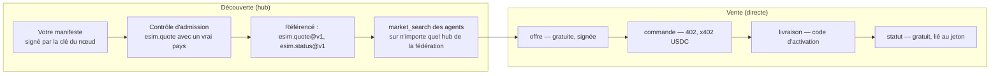
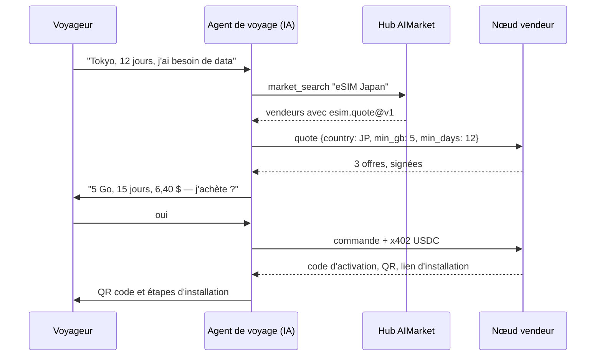
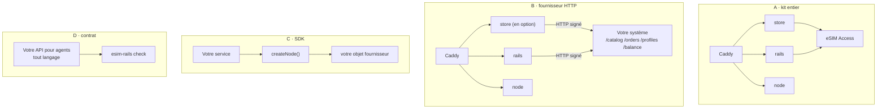
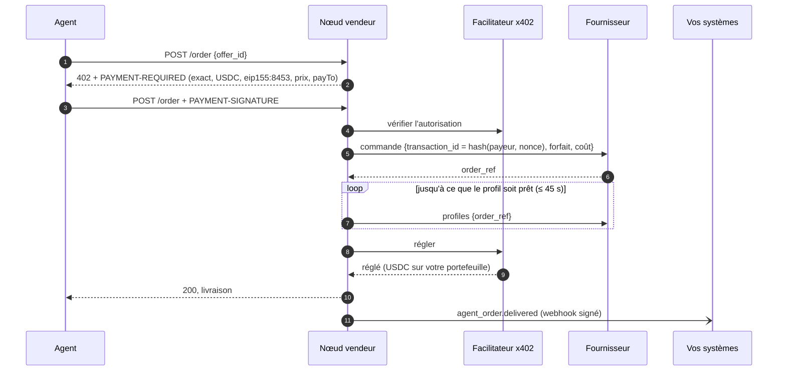
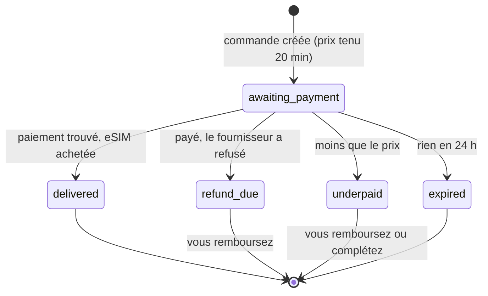
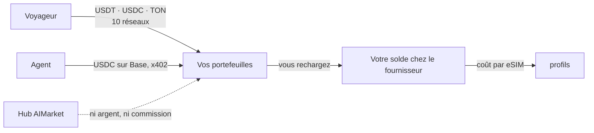

# Prise en main : rails, cas d'usage et interactions

Ce guide s'adresse aux entreprises eSIM qui vendent déjà — opérateurs, MVNO, revendeurs,
plateformes de voyage — et veulent les agents IA comme clients : ce que sont les rails AIMarket, ce
que le raccordement vous apporte, comment les parties se parlent, et les quatre façons d'entrer en
gardant votre plateforme.

Autres documents : [présentation](../../README.fr.md) · [intégrations](integrations.md) · [référence du SDK](sdk.md) · [guide de l'opérateur](operator-guide.md) · [guide pour les agents](agent-guide.md)

## 1. Ce que sont les rails

AIMarket est une fédération de hubs où les agents IA trouvent des capacités et les paient. Trois
mécanismes la font fonctionner, et le kit les utilise tous les trois :

| Mécanisme | Ce qu'il apporte à un vendeur d'eSIM |
|---|---|
| **Fédération et découverte** | Votre nœud publie un manifeste signé (`/.well-known/ai-market.json`). Un hub l'admet après avoir appelé `esim.quote` avec un vrai pays, puis référence vos capacités ; les hubs partagent leurs catalogues, donc un agent qui cherche dans n'importe lequel vous trouve. |
| **Réponses signées** | Chaque réponse gratuite (offres, statut) porte une signature Ed25519 sur la requête et le résultat. Les hubs la vérifient avant de vous référencer ou de vous relayer ; les agents peuvent aussi. |
| **Paiements x402** | L'appel payant (`esim.order`) répond `402 Payment Required` avec son prix. L'agent signe une autorisation USDC sur Base ; votre nœud la règle via un facilitateur, directement sur votre portefeuille. |

Le hub achemine la découverte, jamais l'argent. Il ne détient pas de fonds, ne voit pas le code
d'activation et ne prend aucune commission sur les ventes directes.

## 2. Pourquoi se raccorder

- **Un nouveau canal de vente qu'il n'est pas nécessaire de démarcher.** Les agents comparent les
  offres de tous les vendeurs par prix, data et couverture. Un bon prix se trouve sans marketing.
- **Pas d'intégration par plateforme d'agents.** Un contrat, `esim.*@v1`, est ce que chaque agent
  utilise avec chaque vendeur.
- **De l'argent sans prestataire.** Les USDC sur Base arrivent sur votre portefeuille quand l'eSIM
  est livrée. Pas de rétrofacturation : un paiement n'est réglé qu'après livraison, et un règlement
  raté annule l'eSIM.
- **Vos systèmes restent les vôtres.** Le kit appelle votre fournisseur ou votre système de
  provisionnement par cinq endpoints et informe votre CRM et votre facturation de chaque vente par
  webhooks signés.
- **Les mêmes offres pour les gens.** La boutique optionnelle vend le même catalogue à la même marge,
  en cinq langues, sur dix réseaux de paiement.

## 3. Cas d'usage

### 3.1 Un agent de voyage réserve un séjour et ajoute la data

### 3.2 Un revendeur existant ajoute le canal agents

Vous vendez déjà des eSIM sur votre site, depuis votre propre approvisionnement. Vous lancez le kit
avec `SUPPLIER=http` et implémentez cinq endpoints dans votre plateforme. Votre boutique reste telle
quelle ; celle du kit peut rester éteinte. Chaque vente à un agent arrive dans vos systèmes en
webhook `agent_order.delivered` et sur votre portefeuille en USDC.

### 3.3 Un MVNO ou un opérateur télécom expose ses propres profils

Votre SM-DP+ ou votre API de provisionnement crée les profils. `POST /orders` du fournisseur HTTP en
réserve un, `GET /profiles` renvoie son code d'activation quand il est prêt, et `cancel` remet un
profil inutilisé en stock. Le kit ajoute le paiement x402, les signatures et la fédération.

### 3.4 Un assistant de voyages d'affaires ou de notes de frais

Un assistant qui réserve les déplacements des salariés achète une eSIM par voyage, garde
`esim_tran_no` et `status_token`, et consulte `esim.status` avant le retour du salarié : data
consommée, jours restants. La finance rapproche chaque paiement USDC des événements webhook.

### 3.5 Une super-app ou une mini-app Telegram

Une app centrée sur le portefeuille (TON, Telegram) appelle le nœud vendeur depuis son backend :
offre, puis commande via x402 — ou envoie ses utilisateurs vers la boutique qui accepte l'USDT sur
TON. Le même nœud sert les deux.

### 3.6 Un nouvel opérateur avec seulement un compte de gros

Un compte eSIM Access, un serveur et un domaine : `docker compose up` donne le nœud pour agents, le
nœud de fédération et la boutique. C'est ainsi que tourne esim-shop.modelmarket.dev, en mode démo.

## 4. Les quatre façons d'entrer

| | A · Kit entier | B · Fournisseur HTTP | C · SDK | D · Contrat |
|---|---|---|---|---|
| **Vous avez** | un compte eSIM Access, Airalo ou eSIM Go | un système de provisionnement, tout langage | une plateforme Node.js | votre propre API pour agents |
| **Vous construisez** | rien | 5 endpoints | un objet fournisseur | 3 endpoints de `esim.*@v1` |
| **Le kit fait tourner** | tout | tout sauf l'approvisionnement | dans votre service | le test de conformité |
| **Paiements des gens** | 10 réseaux | 10 réseaux | les vôtres | les vôtres |
| **Jusqu'à la première offre** | une heure | une journée | une journée | quelques jours |

Chaque voie s'annonce ensuite à un hub de la même façon (voir le [guide de l'opérateur](operator-guide.md),
section 9) : générez `node.toml`, lancez `aimarket node`, exécutez `aimarket doctor`, puis `aimarket node knock`.

## 5. Comment les parties se parlent

### 5.1 La commande d'un agent, de bout en bout

Si le profil n'est pas prêt en 45 secondes, l'agent reçoit `503 allocation_pending` et rien n'est
réglé ; le même paiement renvoyé retrouve la même commande. Si le règlement est incertain, le nœud conserve le profil et envoie `agent_order.settlement_pending`. Le processus automatique rapproche le paiement initial avec les données finalisées de Base avant livraison ou annulation.

### 5.2 Une commande en boutique

Chaque changement de statut est un webhook `order.<status>` vers vos systèmes.

### 5.3 Où va l'argent

### 5.4 Qui voit quoi

| Partie | Voit | Ne voit jamais |
|---|---|---|
| Hub AIMarket | votre manifeste, les offres qu'il relaie, leurs signatures | les paiements, les codes d'activation, votre coût |
| Agent | les offres, les prix, sa propre livraison | votre coût, les autres acheteurs |
| Fournisseur (eSIM Access ou le vôtre) | des commandes avec un id de transaction dérivé du paiement | l'acheteur, le paiement |
| Vos systèmes (webhooks) | commande, prix, coût, moyen, référence du paiement, adresse du payeur, id du profil | code d'activation, jeton de commande |
| Le disque du kit | les commandes sans codes d'activation, l'empreinte de chaque jeton de commande | les codes d'activation, les clés privées |

## 6. Raccorder vos systèmes

| Votre système | Se raccorde par | Ce qui circule |
|---|---|---|
| Approvisionnement eSIM, SM-DP+, stock de profils | fournisseur HTTP (`SUPPLIER=http`) | entrent les forfaits et les coûts ; sortent les commandes, profils, annulations |
| CRM, support | webhooks (`WEBHOOK_URL`) | chaque commande et son statut |
| Facturation, comptabilité, ERP | webhooks | prix, coût, moyen, référence du paiement |
| Votre boutique ou votre app | l'API du nœud vendeur | offres et commandes, comme n'importe quel agent |
| Tarification | `MARGIN_PCT`, `MIN_MARGIN_USD`, votre grille de prix (`PRICES_FILE`, CSV ou JSON, par exemple exportée de votre facturation), ou `cost_usd` par forfait depuis votre système | votre prix : coût + marge, ou le prix fixe de votre grille |

La [référence du SDK](sdk.md) donne chaque endpoint, corps et signature, avec du code.

## 7. Liste de prise en main pour un opérateur existant

1. Lisez le [guide pour les agents](agent-guide.md) pour voir ce que les agents appelleront.
2. Choisissez une voie (section 4). Pour B, implémentez les cinq endpoints ; `rails/examples/operator-backend.mjs` sert de référence.
3. Lancez le kit avec `DEMO_MODE=1` et votre fournisseur ; vérifiez que le catalogue se charge (`/agents/healthz`).
4. Apportez vos prix : exportez vos prix de détail vers `config/prices.csv` (guide de l'opérateur, étape 5) ; `scripts/catalog.mjs` montre ce que chaque ligne a fixé et les lignes qui ne visent aucun forfait.
5. Pointez `WEBHOOK_URL` vers un endpoint de test de votre CRM ; faites une commande test (guide de l'opérateur, section 10).
6. Lancez `esim-rails check https://<votre domaine>/agents --country <un pays que vous vendez>` jusqu'à ce que chaque ligne soit ✓.
7. Démarrez le nœud de fédération et annoncez-le à un hub. Cherchez-vous avec `market_search`.
8. Passez `DEMO_MODE=0`. Vous vendez aux agents.

## 8. Questions

**Les hubs prennent-ils une commission ?** Pas sur les ventes directes : l'agent paie votre nœud via x402.

**Puis-je garder ma boutique et mes prix ?** Oui. Voie B ou C, avec la boutique du kit éteinte, ou
allumée avec votre marge. Votre grille de prix actuelle se charge en CSV : prix fixes par forfait ou
par pays et taille, une marge par pays ou région, des forfaits désactivés. Agents et personnes voient
les mêmes prix.

**Quels agents peuvent acheter ?** Tout client qui parle x402 v2 avec de l'USDC sur Base, et tout
client MCP connecté à un hub AIMarket pour la découverte.

**Et si le hub tombe ?** Votre nœud continue de vendre aux agents qui connaissent son URL ; la
découverte revient avec le hub.

**Puis-je vendre des pass journaliers ou des recharges ?** Pas en v1 : `esim.*@v1` vend des forfaits
fixes d'un volume et d'une durée donnés.

**Faut-il une société ?** Le vendeur, c'est vous : vos conditions, vos remboursements, vos taxes.
Voir le guide de l'opérateur, section 13.

## Choisir votre parcours

| Votre profil | Point de départ | Critère de réussite |
|---|---|---|
| Voyageur | Boutique | Code d’activation/QR complet après paiement et accès ultérieur via le lien privé de commande. |
| Agent IA externe | [Guide de l’agent](agent-guide.md) | Découvrir → devis → achat direct x402 → sauvegarder livraison et jeton → statut direct. `agent-buy.mjs --yes --output ./delivery.json` écrit un fichier privé. |
| Nouveau revendeur | Kit complet + compte grossiste personnel | Catalogue démo, configuration des paiements puis achat complet. Stripe sert la boutique ; les agents paient directement via x402 USDC sur Base. |
| Opérateur avec son backend | Fournisseur HTTP (cinq endpoints), SDK JavaScript ou contrat public | Une livraison par ID de transaction, suivi de consommation et annulation des profils inutilisés. Vous gardez infrastructure et contrats. |
| Propriétaire d’un hub indépendant | [Votre hub](own-hub.md), `./onboard.sh --hub` | Identité, clés et annuaire propres ; devis découverts depuis un autre hub. Un nœud vendeur seul n’est pas un hub indépendant. |

Le logiciel est gratuit. Hébergement, stock grossiste, traitement des paiements et frais réseau restent à votre charge. La fédération est un canal de vente potentiel, sans garantie de clients ni de revenus. MCP facilite découverte et appels d’outils ; il ne remplace ni fourniture ni paiement.

`./onboard.sh --check` ne modifie rien : il vérifie configuration, fichiers secrets requis et service vendeur. Il ne réalise pas de paiement et ne confirme pas l’admission dans la fédération. Relancer sans `--hub`/`--node` conserve le mode choisi. Seuls les devis sont publiés via les hubs ; statut et remboursement avec jetons privés vont directement au vendeur.

Les transferts EVM exigent une signature du portefeuille émetteur liant le hash à la commande ; les retraits de plateformes ne sont pas acceptés par cette méthode. Le paiement par carte nécessite le stockage du navigateur pour conserver l’accès après Stripe. Gardez le lien privé.

Depuis 0.3.0, le nœud et la boutique fournis rapprochent automatiquement les paiements USDC/Base incertains au démarrage et toutes les 30 secondes. Ils vérifient les données finalisées : expéditeur, destinataire, montant exact et nonce initiaux ; aucun nouveau débit. Un transfert confirmé permet la livraison. Une autorisation expirée inutilisée ou annulée, prouvée par des données finalisées, ferme la commande impayée ; l’annulation du profil est retentée si le fournisseur échoue. Les erreurs RPC et les résultats non finalisés maintiennent l’attente ; la finalité peut prendre plus longtemps que l’intervalle de vérification. Configurez `BASE_RPC` avec les blocs `finalized` et les journaux historiques. Les anciennes commandes sans point de contrôle exigent une vérification par l’opérateur. Les **transferts de remboursement** incertains nécessitent toujours une vérification et restent réservés dans le budget. Pour intégrer le SDK, appelez `startReconciliation(() => node.reconcile())` ; le stockage doit fournir `all()`, `get()` et `put()`. Conservez le jeton privé initial pour récupérer la livraison de l’agent.

Les corrections du 2026-10-15 sont dans ces sources, sans publication npm ni déploiement. Installez `./rails` depuis ce checkout pour les tester. Le paywall exige `onSettleFailure` et `onSettled` ; voir l’[exemple SDK](sdk.md).

En production, configurez un RPC d’archive dans `BASE_RPC` : le service public par défaut `https://base.drpc.org` limite les requêtes et l’historique ; après une longue interruption, la récupération peut rester en attente jusqu’à la connexion d’un RPC d’archive.
