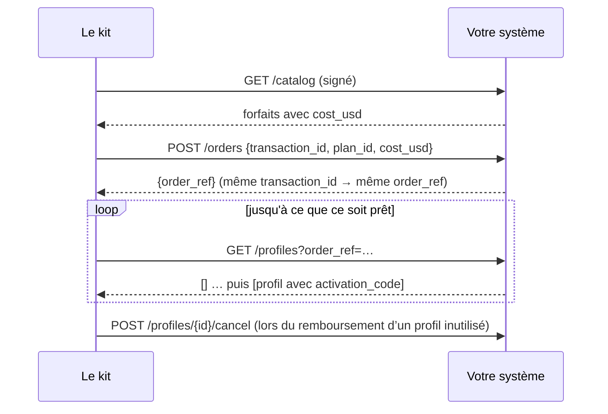

# Référence du SDK

Tout ce dont un opérateur eSIM existant a besoin pour mettre ses systèmes sur les rails AIMarket : les
paquets, l'interface fournisseur, le fournisseur HTTP pour des systèmes dans n'importe quel langage, le
nœud vendeur, les webhooks, le contrat `esim.*@v1` et le test de conformité.

Autres documents : [présentation](../../README.fr.md) · [prise en main](rails.md) · [intégrations](integrations.md) · [guide de l'opérateur](operator-guide.md) · [guide pour les agents](agent-guide.md)

## 1. Paquets

| Paquet | Quoi | Installation |
|---|---|---|
| `@aimarket/esim-rails` | Le SDK : nœud vendeur, fournisseurs, webhooks, schémas, `esim-rails check` | `npm i @aimarket/esim-rails`; local: `npm i ./rails` |
| `aimarket-hub` (PyPI) | `aimarket node` : le nœud de fédération qui vous référence sur les hubs | `pip install aimarket-hub==3.15.26`, ou l'image `node/` du kit |
| Schémas JSON | Le contrat, pour tout langage | `rails/spec/esim-v1/*.schema.json` |
| Images Docker | boutique, nœud vendeur, nœud de fédération | construites par `docker compose up --build` |

Node.js 20 ou plus récent. Le SDK est en ESM.

```js
import {
  createNode, ed25519Signer, buildPaywall, fileStore, createBaseReconciler, startReconciliation,          // the seller node
  httpSupplier, esimAccessSupplier, airaloSupplier, esimGoSupplier, createEsimAccessClient,   // suppliers
  createWebhooks, verifyWebhook,                                // your systems
  validate, checkSeller,                                        // the contract
  pricingFromEnv, parsePriceList, priceFor,                     // your prices
} from "@aimarket/esim-rails";
```

## 2. L'interface fournisseur

Un fournisseur, c'est d'où viennent les eSIM. La boutique et le nœud vendeur ne lui parlent que par
cinq méthodes.

| Méthode | Renvoie | Règles |
|---|---|---|
| `catalog()` | `Plan[]` | les forfaits que vous vendez, à votre coût |
| `order({ transactionId, planId, costUsd })` | `{ orderRef }` | idempotent par `transactionId` ; refusez quand `costUsd` n'est plus votre coût |
| `profiles({ orderRef })` ou `profiles({ profileId })` | `Profile[]` | `[]` tant que le profil est en préparation |
| `cancel({ profileId })` | `true` | profils inutilisés seulement |
| `balance()` | `{ usd }` ou `null` | `null` quand il n'y a pas de solde à surveiller |

```text
Plan     { id, name, countries: ["FR", …], kind?: "country" | "region" | "global", data_bytes, days,
           speed?, networks?, top_up?, unused_valid_days?, cost_usd }
Profile  { profileId, orderRef, activationCode, iccid?, qrCodeUrl?, installUrl?, apn?, expires?,
           state?, installed?, dataUsedBytes?, dataTotalBytes?, activated? }
```

Levez `SupplierError(code, message, { retryable })` : `retryable: true` veut dire « pas maintenant » (une
panne, une limite de débit) ; sinon « non » (un forfait inconnu, un prix changé, un solde vide). Un « non »
n'est jamais facturé à l'acheteur.

Un fournisseur dans votre propre code :

```js
import { SupplierError } from "@aimarket/esim-rails";

export const mySupplier = {
  async catalog() {
    return (await db.plans.active()).map((p) => ({
      id: p.sku, name: p.title, countries: p.countries, kind: p.region ? "region" : "country",
      data_bytes: p.gb * 1024 ** 3, days: p.days, cost_usd: p.cost }));
  },
  async order({ transactionId, planId, costUsd }) {
    const plan = await db.plans.get(planId);
    if (!plan || plan.cost !== costUsd) throw new SupplierError("price_changed", "the plan changed");
    const o = await db.orders.upsertByTransaction(transactionId, planId);   // the same id, the same order
    return { orderRef: o.id };
  },
  async profiles({ orderRef, profileId }) {
    const rows = orderRef ? await smdp.profilesOfOrder(orderRef) : [await smdp.profile(profileId)].filter(Boolean);
    return rows.map((r) => ({ profileId: r.id, orderRef: r.order, activationCode: r.lpa, iccid: r.iccid, state: r.state }));
  },
  async cancel({ profileId }) { await smdp.release(profileId); return true; },
  async balance() { return null; },                                       // your own stock: nothing to watch
};
```

Intégrés : `esimAccessSupplier(createEsimAccessClient({ accessCode, secretKey }))`, `airaloSupplier({ clientId, clientSecret })`,
`esimGoSupplier({ apiKey })` et `httpSupplier({ url, secret })` — configuration et réserves dans [intégrations](integrations.md).

## 3. Le fournisseur HTTP : votre système, tout langage

Lancez le kit avec `SUPPLIER=http`, `SUPPLIER_URL` et `SUPPLIER_SECRET_FILE`, et implémentez cinq
endpoints dans votre système. Le contrat complet est dans [rails/spec/supplier-http.md](../../rails/spec/supplier-http.md).

| Méthode et chemin | Corps | Réponse |
|---|---|---|
| `GET /catalog` | — | `{"plans": [Plan]}` |
| `POST /orders` | `{"transaction_id", "plan_id", "cost_usd"}` | `{"order_ref"}` |
| `GET /profiles?order_ref=…` ou `?profile_id=…` | — | `{"profiles": [Profile]}` (snake_case) |
| `POST /profiles/{profile_id}/cancel` | `{}` | `{"cancelled": true}` |
| `GET /balance` | — | `{"usd": 250.0}`, ou 404 |

Chaque requête porte `X-Kit-Timestamp` et `X-Kit-Signature: v1=<hex HMAC-SHA256(secret,
timestamp + "." + METHOD + " " + path + "." + body)>`. Refusez une mauvaise signature et tout ce qui
a plus de cinq minutes.



Un récepteur Python minimal (Flask), les deux endpoints qui comptent le plus :

```python
import hashlib, hmac, json, time
from flask import Flask, request, jsonify, abort

SECRET = open("/run/secrets/kit_supplier").read().strip().encode()
app = Flask(__name__)

@app.before_request
def signed():
    ts, sig = request.headers.get("X-Kit-Timestamp", "0"), request.headers.get("X-Kit-Signature", "")
    path = request.full_path.rstrip("?")
    msg = f"{ts}.{request.method} {path}.".encode() + request.get_data()
    want = "v1=" + hmac.new(SECRET, msg, hashlib.sha256).hexdigest()
    if abs(time.time() * 1000 - int(ts)) > 300_000 or not hmac.compare_digest(want, sig):
        abort(401)

@app.get("/catalog")
def catalog():
    return jsonify(plans=[{"id": p.sku, "name": p.title, "countries": p.countries, "kind": "country",
                           "data_bytes": p.bytes, "days": p.days, "cost_usd": float(p.cost)} for p in active_plans()])

@app.post("/orders")
def orders():
    body = request.get_json()
    plan = find_plan(body["plan_id"])
    if plan is None or float(plan.cost) != body["cost_usd"]:
        return jsonify(error="price_changed"), 409
    order = upsert_order(body["transaction_id"], plan)          # idempotent by transaction_id
    return jsonify(order_ref=order.ref)
```

La référence JavaScript avec les cinq endpoints : [rails/examples/operator-backend.mjs](../../rails/examples/operator-backend.mjs).

## 4. Le nœud vendeur

```js
const store = fileStore("/data/orders.json", fs);
const reconciler = createBaseReconciler({ rpcUrl: process.env.BASE_RPC || undefined });
let node;
const paywall = await buildPaywall({
  reconciler,
  cdpKeyFile: "/run/secrets/cdp_api_key.json", payTo: "0xYourBaseAddress", publicUrl: "https://esim.example.com/agents",
  priceOf: (offerId) => node.priceOf(offerId), onSettleFailure: (p) => node.settleFailed(p),
  onSettled: (p, result) => node.settled(p, result),
});
node = createNode({
  reconciler,
  supplier,                         // a supplier (section 2) or an eSIM Access client
  store,     // or your own {get, put, all}: order records, never codes
  secret: statusSecret,             // 16+ characters: the key of the buyers' status tokens
  signer: ed25519Signer(pem),       // your node's identity: signs every free answer
  publicUrl: "https://esim.example.com/agents",
  paywall,                          // buildPaywall(...) below, or null to quote without selling
  events,                           // createWebhooks(...) or { emit() {} }
  pricing: pricingFromEnv(process.env),   // MARGIN_PCT, MIN_MARGIN_USD and PRICES_FILE; or your own object, below
  sellerName: "My eSIM", productId: "esim-mine", demo: false,
});

const worker = startReconciliation(() => node.reconcile());
node.app.listen(9490);
```

Routes : `POST /quote` et `POST /status` (aussi `/quote/invoke`, `/status/invoke` pour les hubs), `POST /order`
(x402), `GET /listing.json`, `GET /healthz`. Les routes gratuites répondent à n'importe quelle page web (CORS) ;
la commande, non.

**Prix.** `pricing` vaut `{ marginPct, minMarginUsd, rules }`. Les règles viennent d'une grille de prix : `parsePriceList(text)` lit du CSV ou du JSON (les colonnes sont dans le [guide de l'opérateur](operator-guide.md), étape 5) et lève `PriceListError` avec le numéro de ligne. `priceFor(plan, pricing)` dit à quel prix un forfait se vend et quelle règle l'a fixé ; une règle `off` retire le forfait des offres. Sans règles, chaque forfait est calculé par la formule, 100 % et 1,00 $ par défaut.

**Remboursements.** `POST /refund` avec `{esim_tran_no, status_token}` annule une eSIM inutilisée (non installée, aucune donnée consommée ; sinon `409 in_use`) et rend une seule fois le prix de la commande à l'adresse qui a payé. `createNode({ refunder })` prend `await buildRefunder({ keyFile, cdpKeyFile, maxUsd, dailyMaxUsd, budgetStore: store })` : il signe un transfert EIP-3009 depuis le portefeuille de remboursement et le facilitateur le règle. Sans refunder, la réponse est `status: "due"`. La page des [cas réels](cases.md) montre un vrai remboursement avec ses transactions.

**Reçus.** Une commande livrée répond aussi avec `receipt` et `receipt_signature`, et un remboursement payé répond avec le sien : ce qu'un acheteur peut apporter à un hub comme preuve que le vendeur a livré. `receipt` vaut `{v: 1, kind, capability: "esim.order@v1", product_id, chain_id: 8453, …}`. Avec `kind: "delivery"` il ajoute `payer`, `pay_to`, `nonce` (le nonce EIP-3009 du paiement), `offer_id` et `at` ; avec `kind: "refund"`, `payer`, `refund_from`, `refund_nonce`, `delivery_nonce` et `at`. La signature est Ed25519, base64, sur `canonicalJson(receipt)`, faite par le `signer` du nœud : la clé que montrent `/healthz` et `/listing.json` et que `node.toml` publie en tant que `provider_pubkey`. Aucun reçu ne contient de secret de l'eSIM. Un remboursement enregistré comme `due` n'en a pas : il n'y a pas encore de transfert à montrer. Le côté du hub est dans les [cas réels](cases.md), section 11.4.

## 5. Webhooks

Renseignez `WEBHOOK_URL` et `WEBHOOK_SECRET_FILE` (16+ caractères), ou passez `createWebhooks({ url, secret })`.

| Événement | Quand |
|---|---|
| `order.created` | un acheteur a commencé une commande en boutique |
| `order.delivered` | payé et livré |
| `order.refund_due` | payé, mais le fournisseur a refusé : remboursez le payeur |
| `order.underpaid` | un paiement inférieur au prix est arrivé |
| `order.expired` | rien n'est arrivé en 24 heures |
| `order.settlement_pending` | paiement à rapprocher ; ne facturez pas à nouveau |
| `agent_order.delivered` | la commande d'un agent a été livrée |
| `agent_order.settlement_pending` | paiement à rapprocher ; ne facturez pas à nouveau |
| `agent_order.refunded` | l'eSIM inutilisée d'un agent a été annulée et le prix rendu (`transaction`) |
| `agent_order.refund_due` | l'eSIM inutilisée d'un agent a été annulée ; rendez vous-même le prix à `to` |

```http
POST /hooks/esim HTTP/1.1
Content-Type: application/json
X-Kit-Event: order.delivered
X-Kit-Timestamp: 1765432100000
X-Kit-Signature: v1=5d41402abc4b2a76b9719d911017c592…

{"id": "3f1c…", "type": "order.delivered", "created_at": "2026-10-14T10:46:24.000Z",
 "data": {"order_id": "Qh3…", "status": "delivered", "offer_id": "JP_5_30", "offer_name": "Japan 5GB 30Days",
          "price_usd": "6.40", "cost_usd": 3.2, "method": "tron",
          "payment": {"ref": "tron:…", "payer": "T…", "units": "6400042"}, "esim_tran_no": "26101410460022",
          "error": null, "created_at": "2026-10-14T10:45:58.000Z"}}
```

La signature couvre `timestamp + "." + body`. La livraison est au moins une fois (trois essais sur environ
une demi-minute) : dédoublonnez par `id`. Un événement ne porte jamais de code d'activation, de lien QR
ni de jeton de commande.

```js
import { verifyWebhook } from "@aimarket/esim-rails";
app.post("/hooks/esim", express.text({ type: "*/*" }), (req, res) => {
  const ok = verifyWebhook({ secret, timestamp: req.get("x-kit-timestamp"), signature: req.get("x-kit-signature"), body: req.body });
  if (!ok) return res.sendStatus(401);
  crm.record(JSON.parse(req.body));
  res.sendStatus(204);
});
```

```python
def kit_event_ok(secret: bytes, timestamp: str, signature: str, body: bytes) -> bool:
    want = "v1=" + hmac.new(secret, timestamp.encode() + b"." + body, hashlib.sha256).hexdigest()
    return abs(time.time() * 1000 - int(timestamp)) < 300_000 and hmac.compare_digest(want, signature)
```

## 6. Le contrat : esim.*@v1

| Capacité | Schéma d'entrée | Schéma de résultat |
|---|---|---|
| `esim.quote@v1` | `quote-input` | `quote-result` (avec `offer`) |
| `esim.order@v1` | `{offer_id}` + x402 | `delivery` |
| `esim.status@v1` | `status-input` | `status-result` |

Schémas : [rails/spec/esim-v1](../../rails/spec/esim-v1/). Les réponses gratuites sont `{"success": true, "result": …}`
avec `X-Provider-Signature` : Ed25519, base64, sur le JSON canonique de
`{capability_id, product_id, input_sha256, result}` (clés triées, sans espaces, non-ASCII tel quel ;
`input_sha256` est le SHA-256 en hex de l'entrée canonique). La commande répond `402` avec un en-tête x402 v2
`PAYMENT-REQUIRED` : schéma `exact`, réseau `eip155:8453`, USDC, le prix de l'offre sur 6 décimales,
votre adresse.

Validez dans vos propres tests : `import { validate } from "@aimarket/esim-rails"; validate("offer", o)`
renvoie `[]` ou la liste des problèmes.

## 7. Le test de conformité

Pointez-le vers n'importe quel nœud vendeur, celui du kit ou un que vous avez écrit :

```bash
npx esim-rails check https://esim.example.com/agents --country JP
```

Ce qu'il a affiché pour le nœud de démonstration :

```text
✓ listing.json — esim.quote@v1, esim.status@v1; order at https://modelmarket.dev/providers/esim/order
✓ esim.quote@v1 answer — 5 offers for JP, all valid
✓ cheapest first
✓ signature — Ed25519 over the request-bound canonical, key from listing.json
✓ bad input is a 400
✓ unknown eSIM is a 404 not_found
✓ unknown offer is a 400 before any price
⚠ x402 terms — a demo node: it sells nothing (demo_mode)
✓ CORS on the free routes

Conforms to esim.*@v1.
```

Il n'appelle que les routes gratuites et demande son prix à la commande ; il ne paie jamais.

## 8. Environnement

| Variable | Service | |
|---|---|---|
| `SUPPLIER` | store, rails | `esimaccess` (par défaut), `airalo`, `esimgo` ou `http` |
| `AIRALO_CLIENT_ID_FILE`, `AIRALO_CLIENT_SECRET_FILE`, `AIRALO_BASE_URL` | store, rails | Airalo Partner API |
| `ESIMGO_API_KEY_FILE`, `ESIMGO_BASE_URL` | store, rails | eSIM Go |
| `ESIMACCESS_ACCESS_CODE_FILE`, `ESIMACCESS_SECRET_KEY_FILE` | store, rails | clés eSIM Access |
| `SUPPLIER_URL`, `SUPPLIER_SECRET_FILE` | store, rails | votre système, pour `SUPPLIER=http` |
| `WEBHOOK_URL`, `WEBHOOK_SECRET_FILE` | store, rails | événements pour vos systèmes ; désactivés si non renseignés |
| `MARGIN_PCT`, `MIN_MARGIN_USD` | store, rails | prix = coût + marge |
| `PRICES_FILE` | store, rails | votre grille de prix par-dessus la formule, CSV ou JSON ; une grille illisible arrête le démarrage |
| `CATALOG_SNAPSHOT` | rails | le dernier catalogue, servi quand le fournisseur ne répond pas : jusqu'à six heures en vente, sans limite en mode démo (par défaut `/data/catalog-snapshot.json` ; la boutique garde le sien dans `DATA_DIR`) |
| `REFUND_KEY_FILE` | rails | facultatif : la clé du portefeuille d'où partent les remboursements, en USDC via le facilitateur (sans ETH) ; sans elle, les remboursements sont enregistrés comme dus |
| `REFUND_MAX_USD`, `REFUND_DAILY_MAX_USD` | rails | plafonds d'un remboursement et des remboursements d'une journée (50 chacun) |
| `PAY_TO_EVM`, `CDP_KEY_FILE` | rails | où paient les agents, et la clé du facilitateur |
| `PAY_TO_EVM`, `PAY_TO_TON`, `PAY_TO_TRON`, `PAY_TO_SOLANA`, `EVM_CHAINS` | store | où paient les gens |
| `DEMO_MODE` | store, rails | `1` : offres et pages, sans ventes |
| `PUBLIC_URL`, `PRODUCT_ID`, `SELLER_NAME` / `STORE_NAME` | les deux | votre identité |

## 9. Versions

`esim.*@v1` ne fait que grandir : de nouveaux champs facultatifs peuvent apparaître, les existants gardent
leur sens. Un changement qui casse un client devient `esim.*@v2`, publié à côté de v1. Le SDK suit
semver ; le contrat du fournisseur HTTP est en version 1.

Pour récupérer une livraison après perte de réponse, envoyez un en-tête privé aléatoire `X-Esim-Recovery` (32+ caractères base64url) dès la première requête. Conservez-le avec la signature du paiement et réutilisez les deux. Les données publiques de la chaîne ne suffisent pas. L’exemple génère et sauvegarde ce secret automatiquement.

Depuis 0.3.0, le nœud et la boutique fournis rapprochent automatiquement les paiements USDC/Base incertains au démarrage et toutes les 30 secondes. Ils vérifient les données finalisées : expéditeur, destinataire, montant exact et nonce initiaux ; aucun nouveau débit. Un transfert confirmé permet la livraison. Une autorisation expirée inutilisée ou annulée, prouvée par des données finalisées, ferme la commande impayée ; l’annulation du profil est retentée si le fournisseur échoue. Les erreurs RPC et les résultats non finalisés maintiennent l’attente ; la finalité peut prendre plus longtemps que l’intervalle de vérification. Configurez `BASE_RPC` avec les blocs `finalized` et les journaux historiques. Les anciennes commandes sans point de contrôle exigent une vérification par l’opérateur. Les **transferts de remboursement** incertains nécessitent toujours une vérification et restent réservés dans le budget. Pour intégrer le SDK, appelez `startReconciliation(() => node.reconcile())` ; le stockage doit fournir `all()`, `get()` et `put()`. Conservez le jeton privé initial pour récupérer la livraison de l’agent.

En production, configurez un RPC d’archive dans `BASE_RPC` : le service public par défaut `https://base.drpc.org` limite les requêtes et l’historique ; après une longue interruption, la récupération peut rester en attente jusqu’à la connexion d’un RPC d’archive.
