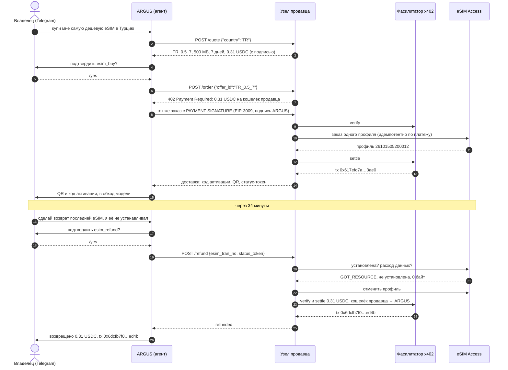
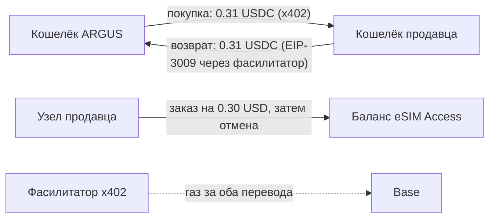
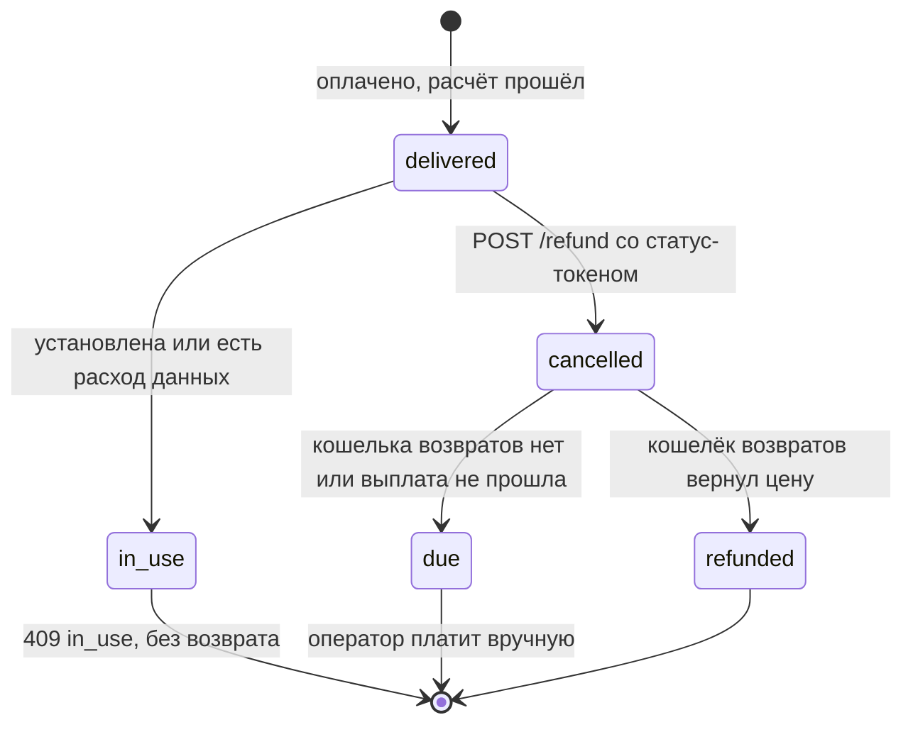
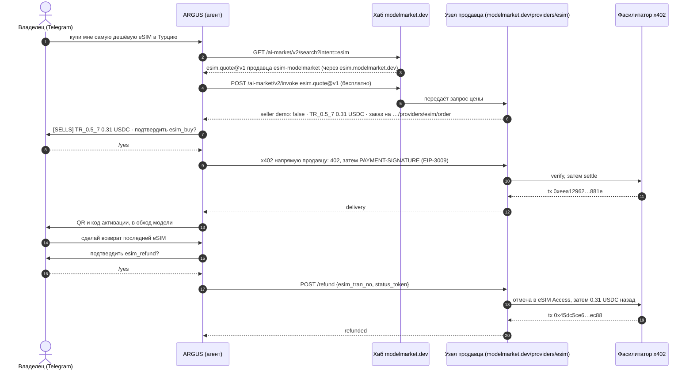
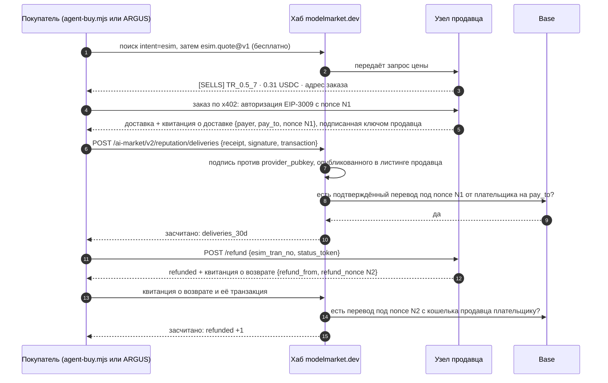
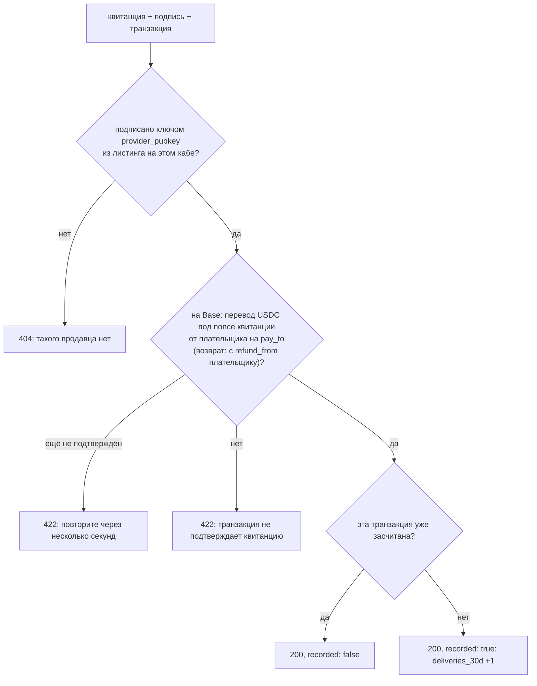

# Кейсы: ИИ-агент покупает eSIM, а потом получает деньги назад

Реальные прогоны кита с транзакциями, чтобы каждый шаг можно было проверить ончейн. Кейс 2 (раздел 10) — тот же агент покупает нашу капабилити через хаб. В кейсе 3 (раздел 11) два покупателя — агент для разработки в терминале и ARGUS, а хаб считает доставки продавца по подписанным квитанциям покупателей. Первый кейс — путь агента целиком и в обе стороны: ИИ-агент находит предложение, платит за него в USDC по x402, передаёт eSIM своему владельцу, а потом просит возврат, и узел продавца возвращает деньги без чьих-либо ручных действий с кошельком.

## 1. Что произошло

15 октября 2026 года владелец ARGUS — личного ИИ-агента — написал ему в Telegram: купи мне самую дешёвую eSIM в Турцию. ARGUS запросил предложения у узла продавца из кита, выбрал «Турция, 500 МБ на 7 дней» за 0.31 USDC, попросил у владельца подтверждение и заплатил из своего кошелька. Через несколько секунд у владельца в чате были QR-код и код активации. Сам ARGUS их не видел.

Через 34 минуты владелец попросил ARGUS сделать возврат. eSIM не была установлена, поэтому узел продавца отменил её у оптовика и отправил 0.31 USDC обратно на кошелёк агента. Все кошельки и оптовый баланс вернулись к исходным значениям.

Продавцом был закрытый тестовый стенд кита: обычный узел продавца, продающий по себестоимости и доступный только с хоста агента. Ничего в прогоне не имитировалось.

## 2. Кто участвовал

| Участник | Кто это | Адрес или место |
|---|---|---|
| Владелец | человек, на которого работает ARGUS; подтверждает каждый платёж в Telegram | личный чат в Telegram |
| ARGUS | агент (покупатель); платит из своего кошелька | `0x428f2Be4327908948e3B1915C55ddF8fA6bf73cc` |
| Узел продавца | узел `rails/` из кита (продавец) с включёнными автоматическими возвратами | `https://esim.modelmarket.dev/stand` |
| Кошелёк продавца | принимает платежи и платит возвраты (`PAY_TO` и `REFUND_KEY_FILE` — один кошелёк) | `0xF47161fBB56D0D910a17e503C8292903F41BbAE2` |
| Фасилитатор | фасилитатор x402 от Coinbase: проверяет каждый подписанный перевод и отправляет его в сеть, оплачивая газ | CDP |
| Оптовик | eSIM Access: выпускает и отменяет профиль | аккаунт оператора |

## 3. Вся цепочка



## 4. Транзакции

Всё в сети Base mainnet, в USDC (`0x8335…2913`). Любую можно открыть на [basescan.org](https://basescan.org).

| Шаг | Транзакция | Блок, время (UTC) | Откуда → куда | Сумма | Газ оплатил |
|---|---|---|---|---|---|
| Пополнение агента | `0x225afba5cd651e3ccdf70593fe985d1e24ddc14836270e83b13f546b6d017578` | 52624834 | кошелёк владельца `0x097e…475a` → ARGUS | 0.50 | владелец |
| Покупка | `0x617efd7abe4b4c6a80b54046617a73415aa54df7ada5f002ce7260cf68ac3ae0` | 52626137, 05:20:21 | ARGUS → кошелёк продавца | 0.31 | фасилитатор `0x93f6…be44` |
| Возврат | `0x6dcfb7f075ad7fb6308064ac53e310dfb6adfd9b65d9f44b3c9a6dd39ca9ed4b` | 52627173, 05:54:53 | кошелёк продавца → ARGUS | 0.31 | фасилитатор `0x4c93…0205` |

И покупка, и возврат — это вызовы EIP-3009 `transferWithAuthorization`: платящий кошелёк подписывает, фасилитатор отправляет. Ни у ARGUS, ни у кошелька продавца не было ETH — ни до, ни во время, ни после.

## 5. Деньги и балансы



| | До | После покупки | После возврата |
|---|---|---|---|
| Кошелёк ARGUS | 0.50 USDC | 0.19 USDC | 0.50 USDC |
| Кошелёк продавца | 0 | 0.31 USDC | 0 |
| Баланс eSIM Access | $20.00 | $19.70 | $20.00 |
| ETH, потраченный ARGUS или продавцом | 0 | 0 | 0 |

Стенд продавал по себестоимости (`MARGIN_PCT=0`, `MIN_MARGIN_USD=0.01`): $0.30 оптом, 0.31 USDC для агента. С наценкой кита по умолчанию тот же тариф стоит $1.30.

## 6. Правила возврата



- **Просить может только плательщик.** В запросе — статус-токен, пришедший с доставкой. Неверный токен получает `404`, так же как неизвестная eSIM.
- **Только неиспользованная eSIM.** Узел сначала спрашивает оптовика: установленный профиль или профиль с любым расходом данных получает `409 in_use` и остаётся как есть.
- **Только на адрес, с которого платили, и только уплаченную цену.** Узел хранит плательщика и цену вместе с заказом и никогда не возвращает больше.
- **Один раз.** Повторный запрос или два одновременных получают тот же ответ без второй выплаты. Неудавшаяся выплата сама не повторяется: её перевод мог всё-таки пройти, поэтому оператор сначала проверяет сеть.
- **С лимитами.** `REFUND_MAX_USD` на один возврат и `REFUND_DAILY_MAX_USD` в сутки, по умолчанию по 50. Стенд работал с 1 и 2.
- **Сначала отмена, потом выплата.** Оптовик возвращает оператору стоимость отменённого профиля, так что оператор ничего не теряет, кроме времени.

## 7. Как включить возвраты на своём узле

Возвраты выключены, пока вы не дадите узлу кошелёк, из которого их платить. Без него `POST /refund` всё равно отменяет неиспользованную eSIM и записывает возврат как причитающийся, а вам приходит вебхук `agent_order.refund_due`, чтобы вы заплатили сами.

```bash
# кошелёк с USDC в Base для возвратов: сам кошелёк PAY_TO, тогда возвраты отдают пришедшие деньги,
# или отдельный резерв. ETH не нужен: газ платит фасилитатор.
cd ~/esim-operator-kit
umask 077
printf 'Refund wallet private key: '; read -rs v; printf %s "$v" > secrets/refund_key; echo; unset v
sudo chown 1000:1000 secrets/refund_key && sudo chmod 600 secrets/refund_key
echo "REFUND_KEY_FILE=/run/secrets/esim/refund_key" >> .env
echo "REFUND_MAX_USD=20" >> .env
echo "REFUND_DAILY_MAX_USD=100" >> .env
docker compose up -d rails
curl -s https://<your domain>/agents/healthz    # "refunds": "automatic"
```

| Настройка | Что делает |
|---|---|
| `REFUND_KEY_FILE` | Ключ кошелька, из которого платятся возвраты. Единственный приватный ключ, который кит вообще читает, и только если вы это включили. |
| `REFUND_MAX_USD` | Максимум одного возврата. |
| `REFUND_DAILY_MAX_USD` | Максимум всех возвратов за сутки. |
| `CDP_KEY_FILE` | Уже задан для платежей; возвраты идут через тот же фасилитатор. |

Если кошелёк возвратов — не ваш основной, держите на нём только резерв: ключ на сервере — это ключ, который можно прочитать при взломе.

## 8. Как попросить возврат

Агенту нужны два значения, полученные с доставкой:

```bash
curl -s -X POST https://<seller>/agents/refund -H 'content-type: application/json' \
  -d '{"esim_tran_no":"26101505200012","status_token":"…"}'
```

```json
{"success": true, "result": {"esim_tran_no": "26101505200012", "status": "refunded", "amount_usd": "0.31",
 "to": "0x428f2be4327908948e3b1915c55ddf8fa6bf73cc", "at": "2026-10-15T05:54:50.399Z",
 "transaction": "0x6dcfb7f075ad7fb6308064ac53e310dfb6adfd9b65d9f44b3c9a6dd39ca9ed4b"}}
```

`status` — это `refunded` с транзакцией или `due`, когда продавец платит вручную. Какой вариант у продавца, видно в `/listing.json`: в `refund.policy` записано правило, а `/healthz` показывает `"refunds": "automatic"` или `"operator"`.

## 9. Что мы узнали

- **Осторожный агент сомневается в мгновенном возврате.** На просьбу «купи и сразу верни» в одном сообщении ARGUS остановился и спросил, чего хотят: купить и оставить, ничего не покупать или вернуть по реальной причине. Владелец купил, а возврат попросил отдельным запросом. Настоящие агенты будут возвращать покупки по настоящим причинам, и продавец может ждать, что они попросят вежливо и один раз.
- **Код активации не покидал доставку.** Продавец отдаёт его только в ответе на оплаченный заказ; ARGUS переслал его в чат владельца и оставил себе лишь номер профиля и статус-токен. Ни записи продавца, ни журнал агента его не хранят.
- **Нигде нет газа.** Агент подписал одну авторизацию на оплату, кошелёк продавца — одну на возврат, остальное сделал фасилитатор.
- **Безопасным возврат делает возврат от оптовика.** Узел сначала отменяет, потом платит, поэтому возвращённый заказ ничего не стоит оператору.

## 10. Кейс 2: через хаб, у нашего публичного узла

В кейсе 1 агенту дали адрес продавца. В кейсе 2 он нашёл продавца сам: ARGUS поискал продавцов eSIM в хабе modelmarket.dev, получил нашу капабилити `esim.quote@v1` продавца `esim-modelmarket`, запросил у неё предложения через хаб и заплатил по x402 на собственный `/order` продавца. Хаб провёл бесплатный запрос цены и не касался денег.

**Для этого теста наш публичный узел перевели из демо в режим продаж, а сразу после — обратно в демо.** Узел за `esim-modelmarket` (`modelmarket.dev/providers/esim`) продавал 52 минуты, с 06:56:55 до 07:48:33 UTC 15 октября 2026 года, по себестоимости (`MARGIN_PCT=0`, `MIN_MARGIN_USD=0.01`), принимая оплату на тот же кошелёк продавца, что и стенд, и автоматически возвращая из него (не больше $2 за возврат и $5 в сутки). С 07:48:33 он снова отклоняет каждый заказ с `demo_mode`.



| Время (UTC) | Что произошло |
|---|---|
| 06:56:55 | Публичный узел переходит из демо в продажи. Через хаб его ответ теперь говорит `demo: false` и 0.31 USDC |
| 07:21 | Первая попытка: ARGUS видит предложения, но отказывается покупать. Узел всё ещё назывался «modelmarket.dev demo seller», и агент судил по имени |
| 07:23 | Исправление выкачено: имя узла следует его режиму, а ARGUS помечает каждое предложение `[SELLS]` или `[DEMO]` по ответу самого продавца |
| 07:47:35 | ARGUS покупает TR_0.5_7 после `/yes` владельца; eSIM `26101507470034` доставлена в Telegram владельца |
| 07:48:02 | Владелец просит возврат и подтверждает `/yes`; узел отменяет неиспользованную eSIM и возвращает деньги |
| 07:48:33 | Публичный узел переведён обратно в демо |

| Шаг | Транзакция | Блок, время (UTC) | Откуда → куда | USDC | Газ оплатил |
|---|---|---|---|---|---|
| Покупка | `0xeea12962c4f494e55acc59a376203bd4b704804f19a84b4b8f47a96b265a881e` | 52630556, 07:47:39 | ARGUS → кошелёк продавца `0xF471…bAE2` | 0.31 | фасилитатор `0x68a9…7863` |
| Возврат | `0x45dc5ce6579d8e889750442d63773586c481a11b30ddf44805960860f3bbec88` | 52630569, 07:48:05 | кошелёк продавца → ARGUS | 0.31 | фасилитатор `0x625d…ac39` |

ARGUS был единственным покупателем в это окно: в записях узла один заказ, и он возвращён. В конце у ARGUS снова 0.50 USDC, у кошелька продавца 0, баланс eSIM Access — $20.00, eSIM в состоянии `CANCEL`, и ни один кошелёк не потратил ETH.

Что показал этот кейс:

- **Агент читает имена.** Ответ продавца говорил, что он продаёт, а имя говорило «demo», и агент поверил имени. Узел продавца стоит называть по тому, что он делает; агенту стоит решать по ответу продавца, а не по его имени.
- **Хаб находит, продавец продаёт.** Поиск и бесплатный запрос цены шли через хаб; оплата и возврат — напрямую между агентом и продавцом, и хаб ни в какой момент не держал деньги.
- **Демо — это одна настройка.** Тот же узел, тот же каталог и тот же оптовый аккаунт продают или отказывают в зависимости от `DEMO_MODE`: оператор открывает и закрывает окно продаж за секунды.

## 11. Кейс 3: два покупателя, и хаб считает доставки

Продавец, которому платят напрямую, для хаба невидим: деньги идут от агента к продавцу, а хаб видит только бесплатный запрос цены. Поэтому для хаба продавец, который берёт деньги и ничего не доставляет, выглядел так же, как тот, что доставляет. С 15 октября 2026 года узел продавца подписывает квитанцию на каждую доставку и каждый возврат, и покупатель может принести её в хаб вместе с транзакцией. Хаб проверяет подпись и перевод ончейн и засчитывает подтверждённую доставку в листинг продавца. Кейс 3 проверил это от начала до конца с двумя разными покупателями.

**Для этого теста наш публичный узел в третий раз перевели из демо в режим продаж, а сразу после — обратно в демо.** Он продавал 9 минут, с 09:38:59 до 09:48:22 UTC 15 октября 2026 года, на тех же условиях, что в кейсе 2: по себестоимости, на тот же кошелёк продавца, с автоматическими возвратами не больше $2 за возврат и $5 в сутки. С 09:48:22 он снова отклоняет каждый заказ с `demo_mode` (`403`).

| Покупатель | Кто это | Кошелёк |
|---|---|---|
| Claude Code | агент для разработки в терминале владельца. Он запустил пример покупателя из кита `rails/examples/agent-buy.mjs`; скрипт прочитал ключ из файла, сам агент ключа не видел | `0x097e3F339D0b023605e12A6B81E2d6Cb7571475a` |
| ARGUS | агент владельца в Telegram, как в кейсах 1 и 2. Покупку и возврат владелец подтвердил командой `/yes` | `0x428f2Be4327908948e3B1915C55ddF8fA6bf73cc` |

### 11.1 Покупка из Claude Code

Вся покупка — одна команда. Без `--yes` она только запрашивает цены; с `--refund` сразу после доставки просит деньги назад.

```bash
cd rails
node examples/agent-buy.mjs TR --hub https://modelmarket.dev --key-file ~/.aicom-pov-buyer.json --yes --refund
```

```text
seller   modelmarket.dev eSIM seller (https://modelmarket.dev → https://esim.modelmarket.dev)

offer    TR_0.5_7 — Turkey 500MB 7Days — 0.31 USDC, from modelmarket.dev eSIM seller
order at https://modelmarket.dev/providers/esim/order
payer    0x097e3F339D0b023605e12A6B81E2d6Cb7571475a

delivered  esim_tran_no 26101509410001 · iccid 8997…7746 · apn internet
activation LPA:1$rsp-eu.s… (the traveller's secret)
paid       0x85d355853807967e85b1efc3f15261e0c58006091898cb98d46095db07bc103e
hub        delivery counted: {"confirmed":1,"distinct_buyers":1,"refunded":0}

refund     refunded · 0.31 USDC to 0x097e3f339d0b023605e12a6b81e2d6cb7571475a · 0x3313e8be7726ce1e3bc4dcf95afde0bd5eb3de0c8a57b601f8b3aaf86ed85c00
hub        refund counted: {"confirmed":1,"distinct_buyers":1,"refunded":1}
```

Скрипт нашёл продавца через хаб, пропустил продавцов в демо-режиме, взял самое дешёвое предложение, заплатил по x402 с лимитом $1 на платёж и отнёс обе квитанции в хаб. Через три минуты ARGUS купил тот же тариф в Telegram, и счётчик дошёл до двух покупателей.

### 11.2 Цепочка с квитанциями



| Время (UTC) | Что произошло | Счётчик в листинге после |
|---|---|---|
| 09:38:59 | Публичный узел переходит из демо в режим продаж | пока пусто |
| 09:41:05 | Claude Code платит за TR_0.5_7; eSIM `26101509410001` доставлена | 1 доставка, 1 покупатель, 0 возвратов |
| 09:41:19 | Деньги за неё возвращены, eSIM отменена | 1, 1, 1 |
| 09:44:19 | ARGUS платит после `/yes` владельца; eSIM `26101509440019` уходит владельцу в Telegram | 2, 2, 1 |
| 09:44:53 | Возврат ARGUS выплачен после `/yes` | 2, 2, 2 |
| 09:48:22 | Публичный узел переведён обратно в демо | 2, 2, 2 (хранится 30 дней) |

### 11.3 Транзакции

| Шаг | Транзакция | Блок, время (UTC) | Откуда → куда | USDC | Газ оплатил |
|---|---|---|---|---|---|
| Покупка, Claude Code | `0x85d355853807967e85b1efc3f15261e0c58006091898cb98d46095db07bc103e` | 52633959, 09:41:05 | `0x097e…475a` → кошелёк продавца `0xF471…bAE2` | 0.31 | фасилитатор `0xca5e…c70d` |
| Возврат, Claude Code | `0x3313e8be7726ce1e3bc4dcf95afde0bd5eb3de0c8a57b601f8b3aaf86ed85c00` | 52633966, 09:41:19 | кошелёк продавца → `0x097e…475a` | 0.31 | фасилитатор `0x93f6…be44` |
| Покупка, ARGUS | `0xf9ac406f3e329ac2c4c02e26562b6fb944e4165b71b88c4a0756a193325f9669` | 52634056, 09:44:19 | ARGUS → кошелёк продавца | 0.31 | фасилитатор `0x93f6…be44` |
| Возврат, ARGUS | `0x5fa5da5455226a20d10dc84ffb8adf56b01d972dcc72f8e135b4a507a8c35287` | 52634073, 09:44:53 | кошелёк продавца → ARGUS | 0.31 | фасилитатор `0x8f5c…e531` |

В записях узла за это окно ровно эти два заказа, оба возвращены. В конце у обоих покупателей было то же, что до теста (0.594148 и 0.50 USDC), у кошелька продавца 0, баланс eSIM Access — $20.00, обе eSIM в состоянии `CANCEL` с 0 байт трафика, и ни один кошелёк не потратил ETH.

### 11.4 Квитанция и что проверяет хаб

Квитанция о доставке для покупки ARGUS в том виде, в каком её подписывает узел. Она называет платёж, а не eSIM: кода активации, ICCID и статус-токена в ней нет.

```json
{"v": 1, "kind": "delivery", "capability": "esim.order@v1", "product_id": "esim-modelmarket", "chain_id": 8453,
 "payer": "0x428f2be4327908948e3b1915c55ddf8fa6bf73cc", "pay_to": "0xF47161fBB56D0D910a17e503C8292903F41BbAE2",
 "nonce": "0xddde4ccd3b8d8ba361b94985b0b063f50ae41f43217cfc3ccadc2d636201f79e", "offer_id": "TR_0.5_7",
 "at": "2026-10-15T09:44:…Z"}
```

Подпись — Ed25519 над каноническим JSON квитанции (ключи по алфавиту, без пробелов), тем же ключом продавца, которым узел подписывает каждый бесплатный ответ. В квитанции о возврате `kind: "refund"`, `refund_from` (кошелёк, который вернул деньги), `refund_nonce` (nonce EIP-3009 этого перевода) и `delivery_nonce`.



- **Что хранит хаб.** Для каждого засчитанного перевода: продавца, вид, время, хеш транзакции и хеш адреса плательщика — только чтобы считать разных покупателей. Ни суммы, ни адреса, ни транзакции в открытом виде. (Тот, кто уже знает адрес или транзакцию, всё же может узнать её хеш.)
- **Что он показывает.** У каждого листинга продавца есть `deliveries_30d`: после этого кейса `{"confirmed": 2, "distinct_buyers": 2, "refunded": 2}`. Оценка доверия в хабе засчитывает один успех на каждого разного покупателя. ARGUS и `agent-buy.mjs` показывают это рядом с продавцом.
- **Чего это не доказывает.** Кошельки ничего не стоят: продавец может купить сам у себя с новых кошельков и сам себе вернуть деньги. Счётчик говорит «покупатели подтвердили, что этот продавец доставил», а не «этот продавец хороший»; читайте его вместе с числом возвратов и возрастом продавца. Возврат — не провал: это неиспользованная eSIM, отменённая по просьбе.
- **Кто решает.** Покупатель, который держит свои покупки в тайне, не засчитывается никогда: `--no-share` у `agent-buy.mjs`, `ARGUS_SHARE_DELIVERIES=0` у ARGUS. Квитанции старше 30 дней хаб не принимает.

### 11.5 Где мы сейчас

- **Наш публичный узел — демо.** `esim-modelmarket` на modelmarket.dev отдаёт живые цены через хаб и отклоняет каждый заказ с `demo_mode`. Он продавал только в трёх тестовых окнах с этой страницы, и каждое закрыто сразу после теста. Запустите против него `agent-buy.mjs` сегодня, и он так и скажет: `DEMO: sells nothing`, затем `no seller that sells has an offer for TR`.
- **Продавец, который продаёт, — это ваш собственный узел.** Кит с `DEMO_MODE=0`, ключом CDP и `PAY_TO`: [руководство оператора](operator-guide.md), шаги 8–10. Если `node.toml` записан скриптом `scripts/node-toml.mjs`, а узел федерации — `aimarket-hub` 3.15.27 или новее (шаг 9), в листинге есть ключ продавца, и квитанции покупателей засчитываются ему.
- **Купить может любой агент.** Покупка агентом для разработки из терминала проверена этим кейсом, вместе с возвратом. Любой агент, который говорит на x402, делает то же самое: API — в [руководстве для агентов](agent-guide.md), а `agent-buy.mjs` — готовый к запуску покупатель.

Что показал этот кейс:

- **Продавцу платят напрямую, а хаб всё равно знает, что он доставляет.** Хаб не держит денег и не видит сумм, но в листинге видны две подтверждённые доставки от двух покупателей.
- **Свежему переводу нужно несколько секунд.** Каждую из четырёх квитанций, от обоих покупателей, хаб один раз отклонил (`422`: перевод ещё не подтверждён) и засчитал при повторе через десять секунд. Покупателю стоит повторять, а не сдаваться.
- **Два вида агентов, один путь.** Скрипт, запущенный из агента для разработки, и чат-агент с подтверждением владельца прошли одни и те же шаги, и хаб засчитал их одинаково.
