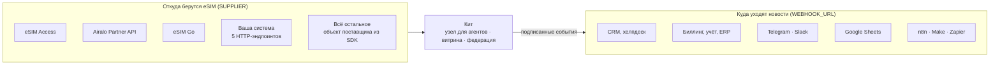
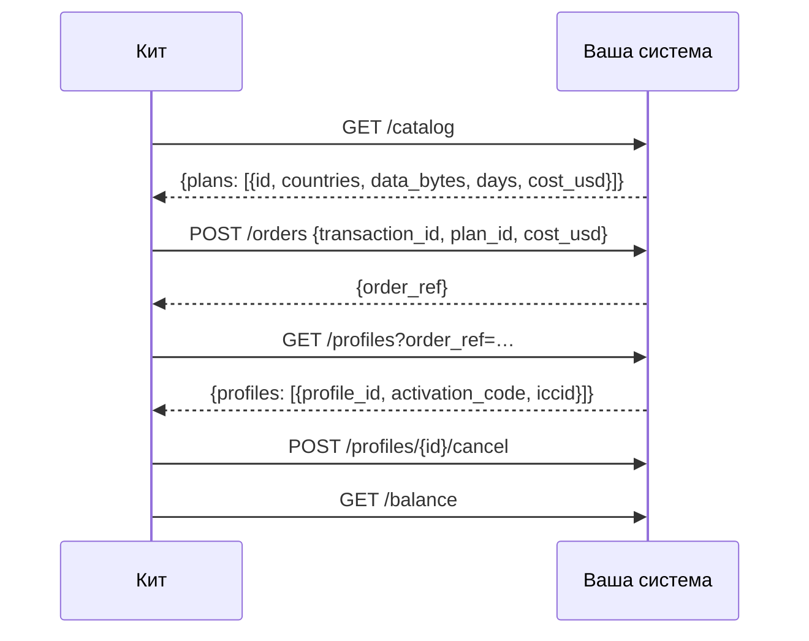
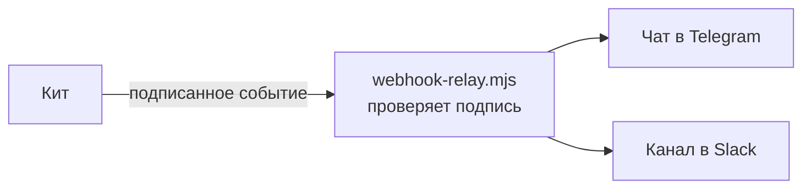

# Интеграции

Готовые связи между китом и системами, которые у eSIM-бизнеса уже есть: откуда берутся eSIM и
куда уходят новости о каждой продаже. У каждой записи указано, насколько она проверена.

Другие документы: [обзор](../../README.ru.md) · [онбординг и сценарии](rails.md) · [справочник SDK](sdk.md) · [гайд оператора](operator-guide.md)

## 1. Карта



| Интеграция | Вид | Настройка | Статус |
|---|---|---|---|
| eSIM Access | поставщик | `SUPPLIER=esimaccess` | ✅ вживую: настоящий заказ куплен, прочитан и отменён 2026-10-14 |
| Airalo Partner API | поставщик | `SUPPLIER=airalo` | 🟡 сделано по опубликованному справочнику API Airalo, проверено на его документированных ответах; на живом аккаунте Airalo ещё не запускалось |
| eSIM Go (API v2.5) | поставщик | `SUPPLIER=esimgo` | 🟡 сделано по опубликованному справочнику API eSIM Go, проверено на его документированных ответах; на живом аккаунте ещё не запускалось |
| Ваша система | поставщик | `SUPPLIER=http` | ✅ проверено от начала до конца на эталонном бэкенде `rails/examples/operator-backend.mjs` |
| Всё остальное | поставщик | интерфейс поставщика в SDK | ✅ интерфейс, который реализуют все четыре выше |
| CRM, биллинг, учёт | события | `WEBHOOK_URL` | ✅ с подписью, повторами, тестами |
| Telegram, Slack | события | `rails/examples/webhook-relay.mjs` | ✅ проверено |
| Google Sheets | события | `rails/examples/google-sheets.gs` | 🟡 приёмник на Apps Script, в CI не проверяется |
| n8n, Make, Zapier, HubSpot, Salesforce | события | их триггер по вебхуку | 📘 рецепт ниже; ставить ничего не нужно |

Прежде чем продавать через интеграцию с 🟡, загрузите свой каталог (`scripts/catalog.mjs`) и
сделайте один тестовый заказ с отменой (гайд оператора, раздел 10). Расскажите нам, что нашли:
issue на GitHub делает интеграцию ✅ для следующего оператора.

## 2. Поставщики

### 2.1 eSIM Access

По умолчанию. Положите AccessCode и SecretKey в `secrets/esimaccess_access_code` и
`secrets/esimaccess_secret_key`. [Гайд оператора](operator-guide.md) описывает аккаунт, пополнение
на $50 и тестовый заказ.

- Заказы идемпотентны на стороне самого eSIM Access (по `transactionId`).
- Заказ несёт себестоимость, по которой было сделано предложение; тариф с изменившейся ценой отклоняется, а не списывается.
- Неиспользованные профили автоматически отменяются и возвращаются на баланс, если платёж не удалось провести.

### 2.2 Airalo Partner API

Нужен партнёрский аккаунт Airalo, его client id и secret.

```bash
printf 'Client id: '; read -rs v; printf %s "$v" > secrets/airalo_client_id; echo
printf 'Client secret: '; read -rs v; printf %s "$v" > secrets/airalo_client_secret; echo
sudo chown 1000:1000 secrets/airalo_*
```

В `.env`:

```bash
SUPPLIER=airalo
AIRALO_CLIENT_ID_FILE=/run/secrets/esim/airalo_client_id
AIRALO_CLIENT_SECRET_FILE=/run/secrets/esim/airalo_client_secret
# AIRALO_BASE_URL=…   адрес песочницы от Airalo, пока тестируете
```

Что делает адаптер: один раз вызывает `POST /v2/token` и хранит токен (Airalo разрешает три запроса
токена в минуту); `GET /v2/packages` для каталога (только фиксированные планы: безлимитные пакеты и
пополнения в v1 не входят; `net_price` — ваша себестоимость); `POST /v2/orders` с номером транзакции
платежа в описании заказа; `GET /v2/sims/{iccid}` и `/usage` для статуса; `POST /v2/refund`, если
платёж не удалось провести.

Что знать до начала продаж:

- **У заказов Airalo нет ключа идемпотентности.** Адаптер помнит каждый заказ по платежу, пока процесс работает, а узел сохраняет номер заказа, прежде чем запрашивать профиль. Перезапуск в те секунды, что между ними, может оставить один оплаченный заказ без eSIM в ките: найдите его в консоли Airalo по описанию (номеру транзакции).
- **Возвраты проверяет Airalo** и зачисляет кредитами Airalo, а не деньгами.
- **Баланс перед заказом не проверяется:** держите аккаунт Airalo пополненным.

### 2.3 eSIM Go

Нужен аккаунт eSIM Go и его API-ключ (Account Settings → API Details).

```bash
printf 'API key: '; read -rs v; printf %s "$v" > secrets/esimgo_api_key; echo
sudo chown 1000:1000 secrets/esimgo_api_key
```

```bash
SUPPLIER=esimgo
ESIMGO_API_KEY_FILE=/run/secrets/esim/esimgo_api_key
```

Что делает адаптер: `GET /catalogue` постранично (`dataAmount` в МБ, `price` в валюте вашей
организации — она должна быть USD; безлимитные пакеты в v1 не входят); `POST /orders` с
`assign: true`, который возвращает для каждой eSIM ICCID, адрес SM-DP+ и matching id;
`GET /esims/{iccid}` и `/bundles` для статуса и расхода;
`DELETE /esims/{iccid}/bundles/{name}?refundToBalance=true`, если платёж не удалось провести.

Что знать до начала продаж:

- **Ключа идемпотентности нет** и у eSIM Go: та же защита и та же оговорка, что у Airalo.
- **Возврат на баланс у eSIM Go по умолчанию выключен:** попросите менеджера аккаунта включить его. Без этого отменённый пакет отзывается без возврата денег.
- **Баланс перед заказом не проверяется.**

### 2.4 Ваша система (HTTP)

Для платформы выдачи профилей, фронтенда SM-DP+, склада профилей в базе данных или поставщика,
которого кит не знает: реализуйте пять эндпоинтов на любом языке.



```bash
SUPPLIER=http
SUPPLIER_URL=https://ops.example.com/esim
SUPPLIER_SECRET_FILE=/run/secrets/esim/supplier_secret
```

Каждый запрос подписан (HMAC-SHA256 с отметкой времени). Контракт, с кодом проверки подписи на
Python и Go: [rails/spec/supplier-http.md](../../rails/spec/supplier-http.md). Рабочий образец, который
можно скопировать: [rails/examples/operator-backend.mjs](../../rails/examples/operator-backend.mjs).
Попробуйте его, прежде чем писать хоть строчку:

```bash
cd rails && SUPPLIER_SECRET=$(openssl rand -hex 24) node examples/operator-backend.mjs 9600
```

### 2.5 Всё остальное (SDK)

Сервис на Node.js может передать в `createNode()` любой объект с методами `catalog`, `order`,
`profiles`, `cancel` и `balance`. См. [справочник SDK](sdk.md), раздел 2.

## 3. Ваши бизнес-системы

Каждый заказ, у которого меняется статус, отправляется POST-запросом на `WEBHOOK_URL`, с подписью:

| Событие | Что обычно делают ваши системы |
|---|---|
| `order.created` | открывают лид или черновик счёта |
| `order.delivered` | проводят продажу: цена, себестоимость, способ, ссылка на платёж |
| `order.refund_due` | открывают задачу на возврат с адресом плательщика |
| `order.underpaid` | открывают задачу в поддержку |
| `order.expired` | закрывают лид |
| `agent_order.delivered` | проводят продажу агенту |
| `agent_order.cancelled` | отмечают отменённую продажу агенту |

```bash
WEBHOOK_URL=https://crm.example.com/hooks/esim
WEBHOOK_SECRET_FILE=/run/secrets/esim/webhook_secret      # 16+ символов, общий с получателем
```

Тела, заголовки и код для их проверки: [справочник SDK](sdk.md), раздел 5.

### 3.1 Telegram и Slack



1. Создайте бота в Telegram через @BotFather и запишите его токен; добавьте его в чат команды и запишите id чата. Для Slack создайте incoming webhook.
2. Запустите ретранслятор рядом с китом:

```bash
cd rails && WEBHOOK_SECRET=… TELEGRAM_BOT_TOKEN=… TELEGRAM_CHAT_ID=… SLACK_WEBHOOK_URL=… node examples/webhook-relay.mjs 9700
```

3. В `.env`: `WEBHOOK_URL=http://127.0.0.1:9700/hooks/esim`, и тот же секрет в `secrets/webhook_secret`.

Каждая продажа приходит строкой: «✅ Delivered Qh3…: Japan 5GB 30Days — $6.40, cost $3.20».

### 3.2 Google Sheets

1. В таблице Google: Расширения → Apps Script; вставьте [rails/examples/google-sheets.gs](../../rails/examples/google-sheets.gs) и задайте в нём `TOKEN`.
2. Разверните как веб-приложение (запуск от вашего имени, доступ: все); скопируйте адрес `/exec`.
3. `WEBHOOK_URL=<адрес /exec>?token=<TOKEN>`.

Каждое событие становится строкой; событие с уже записанным id пропускается. Apps Script не умеет
читать заголовки запроса, поэтому посторонних отсекает токен в адресе, а не подпись.

### 3.3 n8n, Make, Zapier

Все три запускают сценарий по входящему вебхуку:

1. Создайте сценарий с триггером-вебхуком (n8n: узел Webhook, POST; Make: Custom webhook; Zapier: Webhooks by Zapier → Catch Hook) и скопируйте его адрес в `WEBHOOK_URL`.
2. В n8n первым делом проверьте подпись в узле Code: посчитайте заново `v1=` + HMAC-SHA256(secret, `X-Kit-Timestamp` + "." + сырое тело) и сравните с `X-Kit-Signature`.
3. Ветвитесь по `type`: `order.delivered` → шаг вашей CRM или учёта; `order.refund_due` → задача.

### 3.4 HubSpot, Salesforce, любая CRM

Через n8n, Make или Zapier (выше) или через свой небольшой приёмник: на `order.created` создайте
сделку с `order_id` как внешним id; на `order.delivered` переведите её в выигранные с `price_usd`; на
`order.refund_due` создайте задачу. Убирайте дубли по `id` события.

## 4. Ваша витрина или приложение

Витрина кита вам не обязательна. Ваш сайт или приложение может вызывать ваш узел продавца как любой
агент: `POST /agents/quote`, затем `POST /agents/order` с платежом x402 — см.
[гайд для агентов](agent-guide.md). Или оставьте свою оплату и используйте кит только для агентов:
запустите его с вашим поставщиком, оставьте витрину в демо-режиме и анонсируйте узел в федерации.

## 5. Попросить интеграцию

Работаете с поставщиком или системой, которых здесь нет? Откройте issue на
[GitHub](https://github.com/alexar76/esim-operator-kit/issues) со ссылкой на их справочник API.
Адаптер поставщика — это около двухсот строк по интерфейсу из [справочника SDK](sdk.md).
