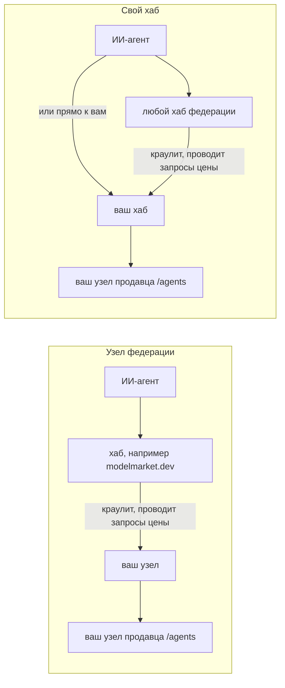
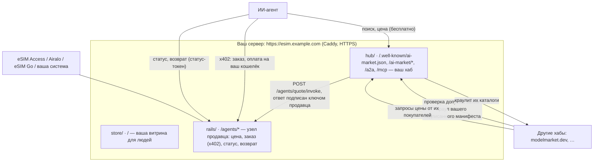
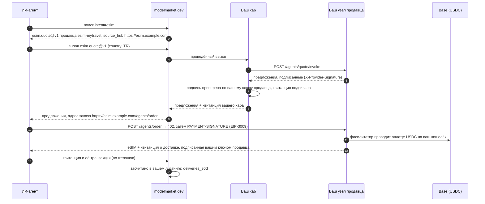

# Свой хаб

Поставить ваши eSIM-предложения в федерацию ИИ-агентов можно двумя способами. Оба — одна команда.

```bash
./onboard.sh          # узел федерации: ваши предложения выставляют хабы, которые вас допустили
./onboard.sh --hub    # свой хаб: он сам выставляет ваши предложения и федерируется с остальными
```

Эта страница — про второй способ: что даёт свой хаб и чего не даёт, что команда делает шаг за шагом и как через неё проходит продажа.

## 1. Узел или хаб

| | Узел федерации (`aimarket node`) | Свой хаб (`aimarket hub`) |
|---|---|---|
| Что работает на вашем домене | небольшой сервис, который публикует ваши подписанные предложения | целый хаб AIMarket: каталог, поиск, маршрутизация, квитанции |
| Кто выставляет ваши предложения | хабы, которые вас допустили | ваш хаб — всегда; и хабы, которые допустили его |
| Если какой-то хаб вас уберёт | вас нет в этом хабе | вы остаётесь в своём и во всех остальных хабах, которые вас допустили |
| Как вас находят агенты | через хаб | через любой хаб, где вы есть, или напрямую: `https://<ваш домен>/ai-market/v2/search` и MCP `https://<ваш домен>/ai-market/mcp` |
| Что агенты находят на вашем домене | ваши предложения | ваши предложения и каталог всей федерации, который краулит ваш хаб |
| Квитанции | подписывает хаб, который провёл вызов | каждый проведённый вызов подписывает ваш хаб |
| Что хранить в бэкапе | `data/node/` (ключ узла) | `data/hub/` (ключи, база, настройки, токен администратора) |
| Обслуживание | ничего сверх кита | хаб нужно обновлять (версия `aimarket-hub` в `hub/Dockerfile`) |

Узел — чтобы начать быстро, ничего у себя не меняя. Хаб — если хотите быть в федерации, что бы ни решил какой-то один хаб, дать агентам собственный адрес для поиска и MCP или вести свой каталог. Можно начать с узла и перейти на хаб позже: команда сохраняет идентичность вашего домена (раздел 6).



## 2. Что здесь значит «гарантированно»

- **Ваш хаб выставляет вас всегда.** Никто другой не может убрать из него ваши предложения, а агенты, которые знают ваш домен, находят их через него — поиском, по MCP или A2A.
- **Ни один хаб не может заставить другой его выставлять.** Каждый хаб проводит для новичка одну и ту же проверку допуска и решает сам (раздел 6). Это защита федерации от поддельных хабов, и она касается и вашего.
- **Вы перестаёте зависеть от одного хаба.** Постучитесь в несколько. Каждый хаб, который вас допустил, краулит ваш манифест и держит вас в каталоге, а ваш хаб с первого запуска читает федерацию из своего списка сидов. Потерять один хаб — значит потерять одну дверь, а не федерацию.

## 3. Команда

На сервере, в папке кита:

```bash
./onboard.sh --hub
```

Она спрашивает только недостающее: домен, название магазина, идентификатор ваших предложений и ключи оптовика (ввод скрытый, ключи пишутся в `secrets/` и нигде не печатаются). Остальное делает сама, и её можно запускать повторно. Сокращённый вывод:

```text
1. The server
  ✓ docker compose 2.29.7
2. Your settings (.env)
  ✓ esim.example.com · My Travel eSIM · esim-mytravel · demo mode (sells nothing yet)
  ✓ esim.example.com resolves to 203.0.113.10
3. Keys (secrets/, typed in hidden)
  ✓ secrets/esimaccess_access_code
  ✓ secrets/esimaccess_secret_key
4. Folders
  ✓ data/ and secrets/ belong to the containers' user (1000)
5. Store, seller node and HTTPS
  ✓ seller node: 1728 offers, 205 countries
6. Your own hub (aimarket hub)
  ✓ listed hub-hello/hub.ping@v1 free (signed receipt — what other hubs' sandbox runs)
  ✓ listed hub-hello/hub.hello@v1 at $0.004/call (local, executable, yours)
  ✓ listed esim-mytravel/esim.quote@v1 free → https://esim.example.com/agents/quote/invoke
  ✓ the hub lists esim.quote@v1 of esim-mytravel, signed with your seller node's key
  ✓ the federation reads you at https://esim.example.com/.well-known/ai-market.json
7. The admission check other hubs will run on you
  verdict: pass
8. Join the federation
  Knock on https://modelmarket.dev now? [Y/n]
```

`./onboard.sh --check` ничего не меняет и показывает, что готово. `--no-announce` пропускает стук, `--announce` стучится без вопроса. Если порты 80 и 443 уже занимает nginx, команда предложит поставить кит за ним — как описано в «Коротком пути» [руководства оператора](operator-guide.md).

## 4. Что делает команда

Для тех, кто хочет знать или сделать руками. Шаги 1–5 такие же, как для узла: они поднимают витрину и узел продавца ([руководство оператора](operator-guide.md), шаги 4–7). Дальше:

**Идентичность хаба.** Если на домене уже работал узел федерации, его ключ переезжает в хаб, и хабы, которые знают ваш домен, продолжают ему доверять (раздел 6):

```bash
cp -p data/node/node_signing_key data/hub/hub_signing_key      # только если у хаба ещё нет ключа
```

**Хаб, один раз.** `quickstart` сохраняет настройки хаба в `data/hub/aimarket.env` (вместе со сгенерированным токеном администратора), создаёт ключи подписи (Ed25519 и постквантовый ML-DSA-65) и выставляет `hub.ping@v1`: бесплатный, он отвечает квитанцией, подписанной вашим хабом, и именно его вызывает песочница допуска других хабов. Ещё он выставляет `hub.hello@v1` — платное «привет», показывающее, что платный вызов работает, — и создаёт ключ покупателя с $0.05 тестового баланса на вашем хабе; команда этот ключ на экран не выводит.

```bash
docker compose --profile hub build hub
docker compose --profile hub run --rm hub quickstart --name "$STORE_NAME" --url "https://$DOMAIN"
```

**Ваши предложения на нём.** Хаб вызывает ваш узел продавца на каждый запрос цены и проверяет подпись узла на ответе — по ключу, который берёт у самого узла:

```bash
PUB=$(curl -s "https://$DOMAIN/agents/healthz" | sed -n 's/.*"provider_pubkey":"\([^"]*\)".*/\1/p')
docker compose --profile hub run --rm hub add esim.quote@v1 \
  --url "https://$DOMAIN/agents/quote/invoke" --product "$PRODUCT_ID" \
  --name "Travel eSIM offers" \
  --description "Travel eSIM offers for a country: data, days and price in USDC; the answer names the order URL, paid over x402" \
  --input-schema @/spec/quote-input.schema.json --provider-pubkey "$PUB"
```

- `--product` должен совпадать с вашим `PRODUCT_ID`. Узел подписывает каждый ответ над `{capability_id, product_id, input_sha256, result}`; с другим product id подпись не сойдётся, и хаб ответит `502 invalid provider response signature`.
- Через хабы идёт только запрос цены. Заказ оплачивается по x402 на `https://<ваш домен>/agents/order`, адрес которого называет ответ с ценой. Статус и возврат несут статус-токен покупателя — секрет: хабы отклоняют такое поле во входе (`sensitive field name blocked in input: status_token`), и агент вызывает их прямо на вашем узле, как показано в [руководстве для агентов](agent-guide.md).

**Переключение.** Caddy отправляет пути федерации (`/.well-known/ai-market.json`, `/ai-market/*`, `/a2a`, `/mcp`, `/.well-known/agent-card.json`) хабу вместо узла:

```bash
echo "FEDERATION_UPSTREAM=hub:9083" >> .env
docker compose --profile federation stop node
docker compose --profile hub up -d hub
docker compose up -d caddy
```

**Проверка.** `aimarket doctor` прогоняет на вашем хабе ту же проверку допуска, что проведут другие хабы, снаружи, и для каждой непройденной строки говорит, что исправить:

```bash
docker compose --profile hub exec hub aimarket doctor
```

**Стук.** Хаб, в который вы стучитесь, сам проводит эту проверку в песочнице и выставляет вас, когда она пройдена:

```bash
curl -s -X POST https://modelmarket.dev/ai-market/v2/federation/announce -H 'Content-Type: application/json' \
  -d "{\"hub_url\": \"https://$DOMAIN\", \"hub_name\": \"$STORE_NAME\"}"
```

В ответе есть `assay_url`, где читается вердикт. Стучитесь так в сколько угодно хабов.

## 5. Как это устроено



Продажа через федерацию, когда агент искал на другом хабе:



Деньги никогда не проходят через хаб: агент платит на ваш кошелёк по x402, как и с узлом.

## 6. Допуск, ключи и переход с узла

```mermaid
stateDiagram-v2
    [*] --> pending: вы стучитесь (announce)
    pending --> checking: песочница хаба вызывает ваш бесплатный hub.ping@v1
    checking --> admitted: подписанная квитанция, верные манифест и ключи → pass
    checking --> pending: review или fail: решает оператор хаба
    admitted --> listed: хаб краулит ваш манифест
    listed --> listed: повторный краул; новые предложения появляются сами
    listed --> rejected: ваш ключ сменился (возможный захват)
    rejected --> listed: оператор того хаба перезакрепляет ваш новый ключ
```



- **Ваш ключ — это ваша идентичность.** Хаб закрепляет ключ, который первым увидел по вашему адресу, и потом отклоняет другой: для него новый ключ выглядит как захват вашего домена. Держите `data/hub/` (`hub_signing_key`, `hub_signing_key_mldsa`, `hub.db`, `aimarket.env`) в бэкапах и восстанавливайте целиком.
- **Переход с узла сохраняет ключ.** `./onboard.sh --hub` копирует `data/node/node_signing_key` в `data/hub/hub_signing_key` до первого запуска хаба, и хабы, допустившие ваш узел, продолжают выставлять ваш домен. Постквантовый ключ новый: хабы закрепят его, когда увидят впервые.
- **Назад к узлу:** `./onboard.sh` (без `--hub`) отдаёт узлу ключ хаба, пишет `node.toml`, запускает узел и возвращает к нему HTTPS. Данные хаба остаются в `data/hub/` на будущее.

## 7. Настройки

| Настройка | Где | Что делает |
|---|---|---|
| `FEDERATION_UPSTREAM` | `.env` | `hub:9083` отправляет пути федерации вашему хабу; пусто — узлу. Ставит команда. |
| `HUB_DESCRIPTION` | `.env` | Одна фраза о магазине рядом с его именем на других хабах, в каталогах и на Alien Monitor (3.15.28 и новее). |
| `PROXY` | `.env` | `caddy` (кита), `nginx` (ваш, настраивает команда) или `external` (ваш, настраиваете вы). Ставит команда. |
| `AIMARKET_HUB_URL`, `AIMARKET_HUB_NAME` | `docker-compose.yml` | `https://<DOMAIN>` и `STORE_NAME`: адрес и имя вашего хаба в каждом документе, который он подписывает. |
| `AIMARKET_SUPPLY_REQUIRE_RESPONSE_SIG` | `docker-compose.yml` | `1`: каждый ответ узла продавца должен нести его подпись. |
| `AIMARKET_TRUSTED_PROXIES` | `docker-compose.yml` | Сети Caddy: хаб видит настоящий адрес каждого вызывающего для своих лимитов. |
| `AIMARKET_ROUTING_FEE_BPS` | `data/hub/aimarket.env` | Ваша комиссия, когда ваш хаб проводит продажу чужой возможности на своих кредитах (по умолчанию 1 %). Продажи ваших eSIM целиком идут на ваш кошелёк. |
| `AIMARKET_ORACLE_FAMILY_URL` | `data/hub/aimarket.env` | `off` (ставит quickstart): ваш хаб сам оценивает издателей и ни от кого не зависит. |
| версия `aimarket-hub` | `hub/Dockerfile` | Обновление: `docker compose --profile hub build --pull hub && docker compose --profile hub up -d hub`. |

У хаба много других настроек (кредиты, чужие листинги, платёжные каналы): см. [свой хаб AIMarket](https://github.com/alexar76/aimarket-hub/blob/main/docs/operator-quickstart.ru.md). Для продажи eSIM ни одна из них не нужна.

## 8. Версии

- **3.15.27** (закреплена в ките): продаёт. Ваш хаб проводит запросы цены и проверяет подпись вашего узла. 3.15.26 отклоняла ответ с ценой eSIM как «персональные данные»: размер тарифа в байтах её фильтр принимал за номер документа.
- **3.15.28** публикует `HUB_DESCRIPTION` в подписанном well-known хаба и добавляет ваш ключ продавца в подписанный манифест, и хабы, которые вас краулят, тоже засчитывают подписанные квитанции ваших покупателей (см. [кейсы](cases.md), раздел 11). До неё их засчитывает ваш собственный хаб. Поднимите версию в `hub/Dockerfile`, когда 3.15.28 появится на PyPI.

## 9. Ограничения

- Допуск — решение каждого хаба. modelmarket.dev допускает автоматически, когда проверка пройдена; хаб без автоматического судьи оставляет решение своему оператору.
- Хаб — публичный сервис, который вы держите: обновляйте его и делайте бэкапы. Токен администратора лежит в `data/hub/aimarket.env`.
- Покупательский трафик в федерации пока небольшой. Живые счётчики открыты: [verify.modelmarket.dev/demand.json](https://verify.modelmarket.dev/demand.json).
- На [Alien Monitor](https://monitor.modelmarket.dev) хаб, который продаёт eSIM, рисуется как eSIM-оператор, так же как узел: свой шар и карточка, данные берутся из `https://<ваш домен>/agents/healthz`.
