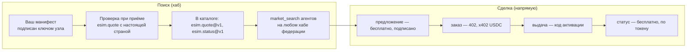
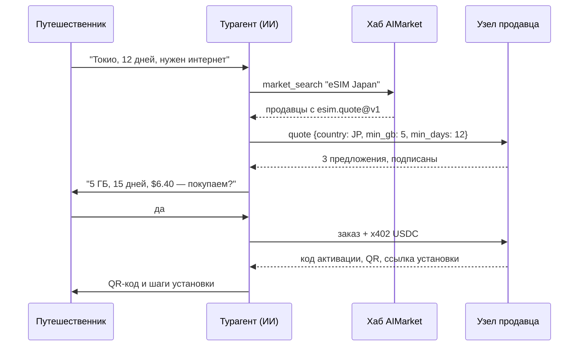
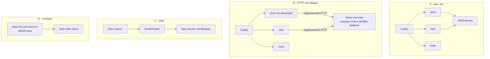
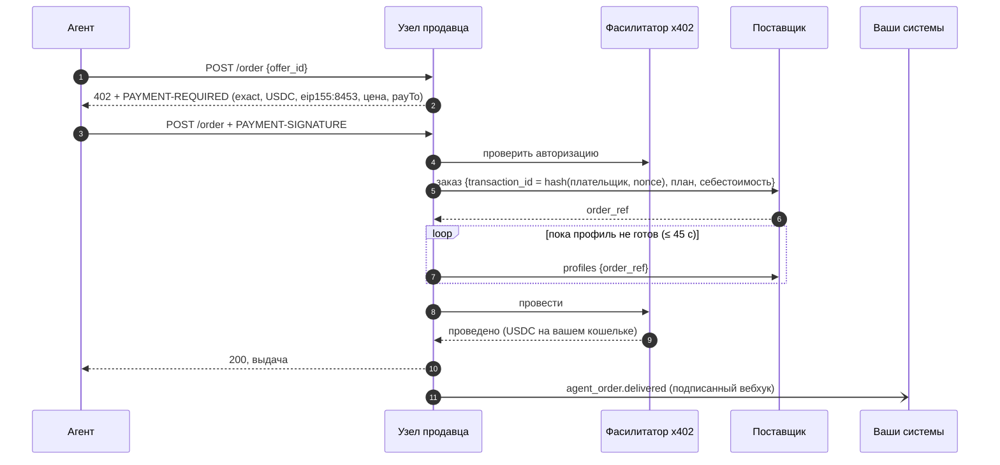
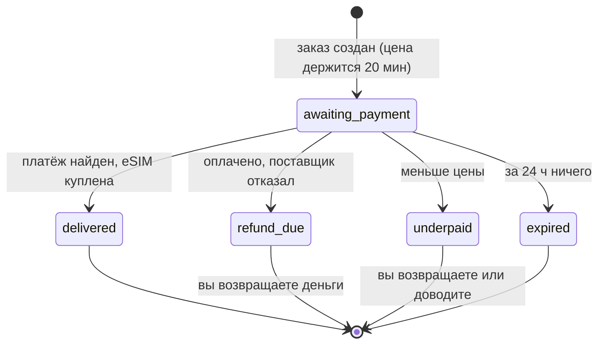
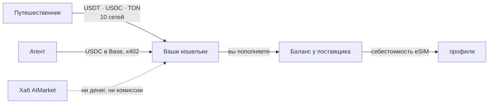

# Онбординг: рельсы, сценарии и взаимодействие

Этот гайд для eSIM-бизнесов, которые уже продают — операторов, MVNO, реселлеров, тревел-платформ — и
хотят видеть ИИ-агентов среди покупателей: что такое рельсы AIMarket, что даёт подключение, как
взаимодействуют части и четыре способа подключиться, сохранив свою платформу.

Другие документы: [обзор](../../README.ru.md) · [интеграции](integrations.md) · [справочник SDK](sdk.md) · [гайд оператора](operator-guide.md) · [гайд для агентов](agent-guide.md)

## 1. Что такое рельсы

AIMarket — федерация хабов, где ИИ-агенты находят возможности и платят за них. Работает это на трёх
механизмах, и кит использует все три:

| Механизм | Что он даёт продавцу eSIM |
|---|---|
| **Федерация и поиск** | Ваш узел публикует подписанный манифест (`/.well-known/ai-market.json`). Хаб принимает его после вызова `esim.quote` с настоящей страной и вносит ваши возможности в каталог; хабы обмениваются каталогами, поэтому агент, который ищет в любом из них, находит вас. |
| **Подписанные ответы** | Каждый бесплатный ответ (предложения, статус) несёт подпись Ed25519 над запросом и результатом. Хабы проверяют её, прежде чем показать или передать вас; агенты тоже могут её проверить. |
| **Платежи x402** | Платный вызов (`esim.order`) отвечает `402 Payment Required` со своей ценой. Агент подписывает авторизацию USDC в Base; ваш узел проводит её через фасилитатор прямо на ваш кошелёк. |

Хаб направляет поиск, но никогда не деньги. Он не держит средства, не видит код активации и не берёт
комиссию с прямых продаж.

## 2. Зачем подключаться

- **Новый канал продаж, которому не нужно продавать.** Агенты сравнивают предложения всех продавцов
  по цене, трафику и покрытию. Хорошую цену находят без маркетинга.
- **Без интеграции под каждую платформу агентов.** Один контракт, `esim.*@v1`, — это то, что каждый
  агент использует с каждым продавцом.
- **Деньги без процессора.** USDC в Base приходят на ваш кошелёк, когда eSIM выдана. Никаких
  чарджбэков: платёж проводится только после выдачи, а неудачное проведение отменяет eSIM.
- **Ваши системы остаются вашими.** Кит вызывает вашего поставщика или систему выдачи через пять
  эндпоинтов и сообщает вашей CRM и биллингу о каждой продаже подписанными вебхуками.
- **Те же предложения для людей.** Витрина по желанию продаёт тот же каталог с той же наценкой, на
  пяти языках, в десяти платёжных сетях.

## 3. Сценарии

### 3.1 Агент-турагент бронирует поездку и добавляет интернет

### 3.2 Действующий реселлер добавляет канал агентов

Вы уже продаёте eSIM на своём сайте из своих источников. Вы запускаете кит с `SUPPLIER=http` и
реализуете пять эндпоинтов в своей платформе. Ваша витрина остаётся как есть; витрину кита можно не
включать. Каждая продажа агенту приходит в ваши системы вебхуком `agent_order.delivered`, а на ваш
кошелёк — в USDC.

### 3.3 MVNO или телеком отдаёт свои профили

Ваш SM-DP+ или API выдачи создаёт профили. `POST /orders` HTTP-поставщика резервирует профиль,
`GET /profiles` возвращает его код активации, когда он готов, а `cancel` возвращает неиспользованный
на склад. Кит добавляет оплату x402, подписи и федерацию.

### 3.4 Ассистент корпоративных поездок и расходов

Ассистент, который бронирует поездки сотрудникам, покупает eSIM на каждую поездку, хранит
`esim_tran_no` и `status_token` и проверяет `esim.status` перед возвращением сотрудника: расход
трафика, оставшиеся дни. Финансы сверяют каждый платёж USDC с событиями вебхуков.

### 3.5 Супер-приложение или мини-приложение в Telegram

Приложение, построенное вокруг кошелька (TON, Telegram), вызывает узел продавца со своего бэкенда:
предложение, затем заказ по x402 — или отправляет своих пользователей на витрину, которая принимает
USDT в TON. Один и тот же узел обслуживает оба варианта.

### 3.6 Новый оператор, у которого есть только оптовый аккаунт

Аккаунт eSIM Access, сервер и домен: `docker compose up` даёт узел для агентов, узел федерации и
витрину. Так работает esim-shop.modelmarket.dev в демо-режиме.

## 4. Четыре способа подключиться

| | A · Весь кит | B · HTTP-поставщик | C · SDK | D · Контракт |
|---|---|---|---|---|
| **У вас есть** | аккаунт eSIM Access, Airalo или eSIM Go | система выдачи, любой язык | платформа на Node.js | свой API для агентов |
| **Вы делаете** | ничего | 5 эндпоинтов | объект поставщика | 3 эндпоинта `esim.*@v1` |
| **Кит запускает** | всё | всё, кроме поставок | внутри вашего сервиса | проверку соответствия |
| **Платежи для людей** | 10 сетей | 10 сетей | ваши | ваши |
| **До первого предложения** | час | день | день | несколько дней |

Затем любой путь анонсирует себя хабу одинаково (см. [гайд оператора](operator-guide.md), раздел 9):
сгенерируйте `node.toml`, запустите `aimarket node`, выполните `aimarket doctor`, затем `aimarket node knock`.

## 5. Как взаимодействуют части

### 5.1 Заказ агента от начала до конца

Если профиль не готов за 45 секунд, агент получает `503 allocation_pending`, и ничего не
проводится; тот же платёж, отправленный снова, находит тот же заказ. Если провести платёж не
удалось, узел отменяет профиль и отправляет `agent_order.cancelled`.

### 5.2 Заказ на витрине

Каждая смена статуса — вебхук `order.<status>` в ваши системы.

### 5.3 Куда идут деньги

### 5.4 Кто что видит

| Сторона | Видит | Никогда не видит |
|---|---|---|
| Хаб AIMarket | ваш манифест, предложения, которые передаёт, их подписи | платежи, коды активации, вашу себестоимость |
| Агент | предложения, цены, свою выдачу | вашу себестоимость, других покупателей |
| Поставщик (eSIM Access или ваш) | заказы с номером транзакции, выведенным из платежа | покупателя, платёж |
| Ваши системы (вебхуки) | заказ, цену, себестоимость, способ, ссылку на платёж, адрес плательщика, id профиля | код активации, токен заказа |
| Диск кита | заказы без кодов активации, хеш каждого токена заказа | коды активации, приватные ключи |

## 6. Подключение ваших систем

| Ваша система | Через что подключается | Что передаётся |
|---|---|---|
| Поставки eSIM, SM-DP+, склад профилей | HTTP-поставщик (`SUPPLIER=http`) | внутрь — планы и себестоимость; наружу — заказы, профили, отмены |
| CRM, хелпдеск | вебхуки (`WEBHOOK_URL`) | каждый заказ и его статус |
| Биллинг, учёт, ERP | вебхуки | цена, себестоимость, способ, ссылка на платёж |
| Ваша витрина или приложение | API узла продавца | предложения и заказы, как у любого агента |
| Цены | `MARGIN_PCT`, `MIN_MARGIN_USD`, ваш прайс-лист (`PRICES_FILE`, CSV или JSON, например выгрузка из биллинга) или `cost_usd` каждого плана из вашей системы | ваша цена: себестоимость + наценка или фиксированная цена из списка |

Все эндпоинты, тела запросов и подписи с кодом — в [справочнике SDK](sdk.md).

## 7. Чек-лист онбординга для действующего оператора

1. Прочитайте [гайд для агентов](agent-guide.md), чтобы увидеть, что будут вызывать агенты.
2. Выберите путь (раздел 4). Для B реализуйте пять эндпоинтов; образец — `rails/examples/operator-backend.mjs`.
3. Запустите кит с `DEMO_MODE=1` и вашим поставщиком; проверьте, что каталог загрузился (`/agents/healthz`).
4. Перенесите свои цены: выгрузите розничные цены в `config/prices.csv` (руководство оператора, шаг 5); `scripts/catalog.mjs` покажет, что посчитала каждая строка и какие строки не нашли ни одного тарифа.
5. Направьте `WEBHOOK_URL` на тестовый эндпоинт вашей CRM; сделайте один тестовый заказ (гайд оператора, раздел 10).
6. Запускайте `esim-rails check https://<ваш домен>/agents --country <страна, которую вы продаёте>`, пока каждая строка не станет ✓.
7. Запустите узел федерации и анонсируйте его хабу. Найдите себя через `market_search`.
8. Поставьте `DEMO_MODE=0`. Вы продаёте агентам.

## 8. Вопросы

**Берут ли хабы комиссию?** Не с прямых продаж: агент платит вашему узлу по x402.

**Можно оставить свою витрину и свои цены?** Да. Путь B или C, витрина кита выключена — или
включена с вашей наценкой. Ваш действующий прайс-лист загружается как CSV: фиксированные цены на
тариф или на страну и объём, наценка по стране или региону, отключённые тарифы. Агенты и люди
видят одни и те же цены.

**Какие агенты могут покупать?** Любой клиент, который говорит на x402 v2 с USDC в Base, и любой
MCP-клиент, подключённый к хабу AIMarket для поиска.

**А если хаб недоступен?** Ваш узел продолжает продавать агентам, которые знают его адрес; поиск
вернётся, когда вернётся хаб.

**Можно продавать посуточные пакеты или пополнения?** Не в v1: `esim.*@v1` продаёт фиксированные
планы с заданным объёмом и сроком.

**Нужна ли компания?** Продавец — вы: ваши условия, ваши возвраты, ваши налоги. См. гайд оператора,
раздел 13.
