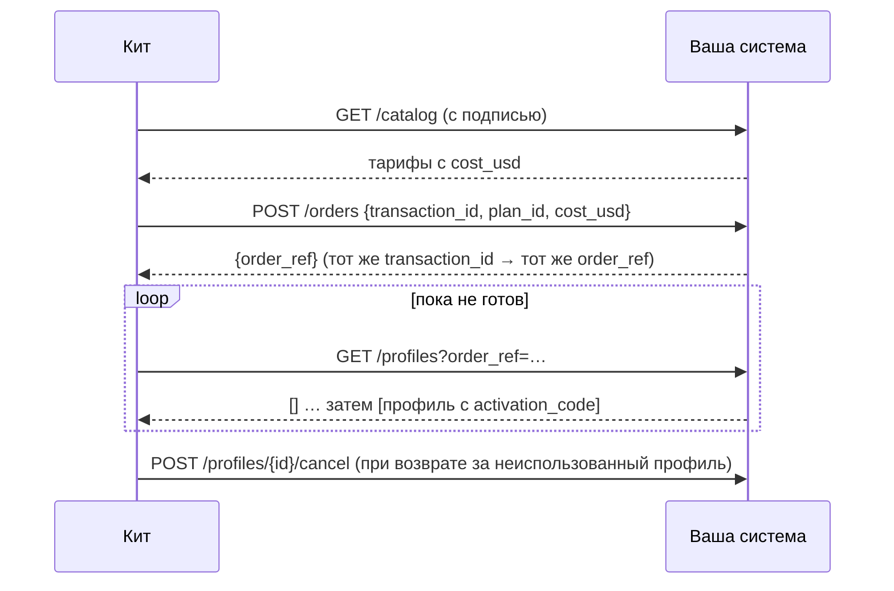

# Справочник SDK

Всё, что нужно действующему eSIM-оператору, чтобы поставить свои системы на рельсы AIMarket: пакеты,
интерфейс поставщика, HTTP-поставщик для систем на любом языке, узел продавца, вебхуки,
контракт `esim.*@v1` и проверка соответствия.

Другие документы: [обзор](../../README.ru.md) · [онбординг](rails.md) · [интеграции](integrations.md) · [гайд оператора](operator-guide.md) · [гайд для агентов](agent-guide.md)

## 1. Пакеты

| Пакет | Что это | Установка |
|---|---|---|
| `@aimarket/esim-rails` | SDK: узел продавца, поставщики, вебхуки, схемы, `esim-rails check` | `npm i @aimarket/esim-rails`; local: `npm i ./rails` |
| `aimarket-hub` (PyPI) | `aimarket node`: узел федерации, который вносит вас в каталоги хабов | `pip install aimarket-hub==3.15.26` или образ `node/` из кита |
| JSON-схемы | Контракт для любого языка | `rails/spec/esim-v1/*.schema.json` |
| Docker-образы | витрина, узел продавца, узел федерации | собираются `docker compose up --build` |

Node.js 20 или новее. SDK — ESM.

```js
import {
  createNode, ed25519Signer, buildPaywall, fileStore, createBaseReconciler, startReconciliation,          // the seller node
  httpSupplier, esimAccessSupplier, airaloSupplier, esimGoSupplier, createEsimAccessClient,   // suppliers
  createWebhooks, verifyWebhook,                                // your systems
  validate, checkSeller,                                        // the contract
  pricingFromEnv, parsePriceList, priceFor,                     // your prices
} from "@aimarket/esim-rails";
```

## 2. Интерфейс поставщика

Поставщик — это откуда берутся eSIM. Витрина и узел продавца общаются с ним только через пять
методов.

| Метод | Возвращает | Правила |
|---|---|---|
| `catalog()` | `Plan[]` | тарифы, которые вы продаёте, по вашей себестоимости |
| `order({ transactionId, planId, costUsd })` | `{ orderRef }` | идемпотентно по `transactionId`; отказ, если `costUsd` уже не ваша себестоимость |
| `profiles({ orderRef })` или `profiles({ profileId })` | `Profile[]` | `[]`, пока профиль создаётся |
| `cancel({ profileId })` | `true` | только неиспользованные профили |
| `balance()` | `{ usd }` или `null` | `null`, когда следить за балансом не нужно |

```text
Plan     { id, name, countries: ["FR", …], kind?: "country" | "region" | "global", data_bytes, days,
           speed?, networks?, top_up?, unused_valid_days?, cost_usd }
Profile  { profileId, orderRef, activationCode, iccid?, qrCodeUrl?, installUrl?, apn?, expires?,
           state?, installed?, dataUsedBytes?, dataTotalBytes?, activated? }
```

Бросайте `SupplierError(code, message, { retryable })`: `retryable: true` значит «не сейчас» (сбой,
лимит запросов); иначе — «нет» (неизвестный тариф, изменившаяся цена, пустой баланс). «Нет» никогда
не списывается с покупателя.

Поставщик в вашем собственном коде:

```js
import { SupplierError } from "@aimarket/esim-rails";

export const mySupplier = {
  async catalog() {
    return (await db.plans.active()).map((p) => ({
      id: p.sku, name: p.title, countries: p.countries, kind: p.region ? "region" : "country",
      data_bytes: p.gb * 1024 ** 3, days: p.days, cost_usd: p.cost }));
  },
  async order({ transactionId, planId, costUsd }) {
    const plan = await db.plans.get(planId);
    if (!plan || plan.cost !== costUsd) throw new SupplierError("price_changed", "the plan changed");
    const o = await db.orders.upsertByTransaction(transactionId, planId);   // the same id, the same order
    return { orderRef: o.id };
  },
  async profiles({ orderRef, profileId }) {
    const rows = orderRef ? await smdp.profilesOfOrder(orderRef) : [await smdp.profile(profileId)].filter(Boolean);
    return rows.map((r) => ({ profileId: r.id, orderRef: r.order, activationCode: r.lpa, iccid: r.iccid, state: r.state }));
  },
  async cancel({ profileId }) { await smdp.release(profileId); return true; },
  async balance() { return null; },                                       // your own stock: nothing to watch
};
```

Встроенные: `esimAccessSupplier(createEsimAccessClient({ accessCode, secretKey }))`, `airaloSupplier({ clientId, clientSecret })`,
`esimGoSupplier({ apiKey })` и `httpSupplier({ url, secret })` — настройка и оговорки в [интеграциях](integrations.md).

## 3. HTTP-поставщик: ваша система, любой язык

Запустите кит с `SUPPLIER=http`, `SUPPLIER_URL` и `SUPPLIER_SECRET_FILE` и реализуйте пять
эндпоинтов в своей системе. Полный контракт — в [rails/spec/supplier-http.md](../../rails/spec/supplier-http.md).

| Метод и путь | Тело | Ответ |
|---|---|---|
| `GET /catalog` | — | `{"plans": [Plan]}` |
| `POST /orders` | `{"transaction_id", "plan_id", "cost_usd"}` | `{"order_ref"}` |
| `GET /profiles?order_ref=…` или `?profile_id=…` | — | `{"profiles": [Profile]}` (snake_case) |
| `POST /profiles/{profile_id}/cancel` | `{}` | `{"cancelled": true}` |
| `GET /balance` | — | `{"usd": 250.0}` или 404 |

Каждый запрос несёт `X-Kit-Timestamp` и `X-Kit-Signature: v1=<hex HMAC-SHA256(secret,
timestamp + "." + METHOD + " " + path + "." + body)>`. Отклоняйте неверную подпись и всё, что
старше пяти минут.



Минимальный приёмник на Python (Flask), два самых важных эндпоинта:

```python
import hashlib, hmac, json, time
from flask import Flask, request, jsonify, abort

SECRET = open("/run/secrets/kit_supplier").read().strip().encode()
app = Flask(__name__)

@app.before_request
def signed():
    ts, sig = request.headers.get("X-Kit-Timestamp", "0"), request.headers.get("X-Kit-Signature", "")
    path = request.full_path.rstrip("?")
    msg = f"{ts}.{request.method} {path}.".encode() + request.get_data()
    want = "v1=" + hmac.new(SECRET, msg, hashlib.sha256).hexdigest()
    if abs(time.time() * 1000 - int(ts)) > 300_000 or not hmac.compare_digest(want, sig):
        abort(401)

@app.get("/catalog")
def catalog():
    return jsonify(plans=[{"id": p.sku, "name": p.title, "countries": p.countries, "kind": "country",
                           "data_bytes": p.bytes, "days": p.days, "cost_usd": float(p.cost)} for p in active_plans()])

@app.post("/orders")
def orders():
    body = request.get_json()
    plan = find_plan(body["plan_id"])
    if plan is None or float(plan.cost) != body["cost_usd"]:
        return jsonify(error="price_changed"), 409
    order = upsert_order(body["transaction_id"], plan)          # idempotent by transaction_id
    return jsonify(order_ref=order.ref)
```

Эталон на JavaScript со всеми пятью эндпоинтами: [rails/examples/operator-backend.mjs](../../rails/examples/operator-backend.mjs).

## 4. Узел продавца

```js
const store = fileStore("/data/orders.json", fs);
const reconciler = createBaseReconciler({ rpcUrl: process.env.BASE_RPC || undefined });
let node;
const paywall = await buildPaywall({
  reconciler,
  cdpKeyFile: "/run/secrets/cdp_api_key.json", payTo: "0xYourBaseAddress", publicUrl: "https://esim.example.com/agents",
  priceOf: (offerId) => node.priceOf(offerId), onSettleFailure: (p) => node.settleFailed(p),
  onSettled: (p, result) => node.settled(p, result),
});
node = createNode({
  reconciler,
  supplier,                         // a supplier (section 2) or an eSIM Access client
  store,     // or your own {get, put, all}: order records, never codes
  secret: statusSecret,             // 16+ characters: the key of the buyers' status tokens
  signer: ed25519Signer(pem),       // your node's identity: signs every free answer
  publicUrl: "https://esim.example.com/agents",
  paywall,                          // buildPaywall(...) below, or null to quote without selling
  events,                           // createWebhooks(...) or { emit() {} }
  pricing: pricingFromEnv(process.env),   // MARGIN_PCT, MIN_MARGIN_USD and PRICES_FILE; or your own object, below
  sellerName: "My eSIM", productId: "esim-mine", demo: false,
});

const worker = startReconciliation(() => node.reconcile());
node.app.listen(9490);
```

Маршруты: `POST /quote` и `POST /status` (а также `/quote/invoke`, `/status/invoke` для хабов), `POST /order`
(x402), `GET /listing.json`, `GET /healthz`. Бесплатные маршруты отвечают любой веб-странице (CORS);
заказ — нет.

**Цены.** `pricing` — это `{ marginPct, minMarginUsd, rules }`. Правила берутся из прайс-листа: `parsePriceList(text)` читает CSV или JSON (колонки — в [руководстве оператора](operator-guide.md), шаг 5) и бросает `PriceListError` с номером строки. `priceFor(plan, pricing)` говорит, за сколько продаётся тариф и какое правило назначило цену; правило с `off` убирает тариф из предложений. Без правил все тарифы считаются по формуле, по умолчанию 100 % и $1.00.

**Возвраты.** `POST /refund` с `{esim_tran_no, status_token}` отменяет неиспользованную eSIM (не установлена, нет расхода данных; иначе `409 in_use`) и один раз возвращает цену заказа на адрес плательщика. `createNode({ refunder })` принимает `await buildRefunder({ keyFile, cdpKeyFile, maxUsd, dailyMaxUsd, budgetStore: store })`: он подписывает перевод EIP-3009 из кошелька возвратов, а фасилитатор проводит его. Без refunder ответ — `status: "due"`. На странице [кейсов](cases.md) — реальный возврат с транзакциями.

**Квитанции.** Доставленный заказ отвечает ещё и `receipt` с `receipt_signature`, а выплаченный возврат — своей квитанцией: это то, что покупатель может принести в хаб как доказательство, что продавец доставил. `receipt` — это `{v: 1, kind, capability: "esim.order@v1", product_id, chain_id: 8453, …}`. При `kind: "delivery"` в нём ещё `payer`, `pay_to`, `nonce` (nonce EIP-3009 платежа), `offer_id` и `at`; при `kind: "refund"` — `payer`, `refund_from`, `refund_nonce`, `delivery_nonce` и `at`. Подпись — Ed25519, base64, над `canonicalJson(receipt)`, её ставит `signer` узла: тот ключ, что показывают `/healthz` и `/listing.json` и что `node.toml` публикует как `provider_pubkey`. Ни одна квитанция не содержит секретов eSIM. У возврата со статусом `due` квитанции нет: показывать пока нечего. Сторона хаба — в [кейсах](cases.md), раздел 11.4.

## 5. Вебхуки

Задайте `WEBHOOK_URL` и `WEBHOOK_SECRET_FILE` (16+ символов) или передайте `createWebhooks({ url, secret })`.

| Событие | Когда |
|---|---|
| `order.created` | покупатель начал заказ на витрине |
| `order.delivered` | оплачено и выдано |
| `order.refund_due` | оплачено, но поставщик отказал: верните деньги плательщику |
| `order.underpaid` | пришёл платёж меньше цены |
| `order.expired` | за 24 часа ничего не пришло |
| `order.settlement_pending` | результат оплаты требует сверки; не списывайте повторно |
| `agent_order.delivered` | заказ агента выдан |
| `agent_order.settlement_pending` | результат оплаты требует сверки; не списывайте повторно |
| `agent_order.refunded` | неиспользованная eSIM агента отменена, цена возвращена (`transaction`) |
| `agent_order.refund_due` | неиспользованная eSIM агента отменена; верните цену на `to` сами |

```http
POST /hooks/esim HTTP/1.1
Content-Type: application/json
X-Kit-Event: order.delivered
X-Kit-Timestamp: 1765432100000
X-Kit-Signature: v1=5d41402abc4b2a76b9719d911017c592…

{"id": "3f1c…", "type": "order.delivered", "created_at": "2026-10-14T10:46:24.000Z",
 "data": {"order_id": "Qh3…", "status": "delivered", "offer_id": "JP_5_30", "offer_name": "Japan 5GB 30Days",
          "price_usd": "6.40", "cost_usd": 3.2, "method": "tron",
          "payment": {"ref": "tron:…", "payer": "T…", "units": "6400042"}, "esim_tran_no": "26101410460022",
          "error": null, "created_at": "2026-10-14T10:45:58.000Z"}}
```

Подпись покрывает `timestamp + "." + body`. Доставка — минимум один раз (три попытки примерно за
полминуты): убирайте дубли по `id`. Событие никогда не несёт код активации, ссылку на QR или токен заказа.

```js
import { verifyWebhook } from "@aimarket/esim-rails";
app.post("/hooks/esim", express.text({ type: "*/*" }), (req, res) => {
  const ok = verifyWebhook({ secret, timestamp: req.get("x-kit-timestamp"), signature: req.get("x-kit-signature"), body: req.body });
  if (!ok) return res.sendStatus(401);
  crm.record(JSON.parse(req.body));
  res.sendStatus(204);
});
```

```python
def kit_event_ok(secret: bytes, timestamp: str, signature: str, body: bytes) -> bool:
    want = "v1=" + hmac.new(secret, timestamp.encode() + b"." + body, hashlib.sha256).hexdigest()
    return abs(time.time() * 1000 - int(timestamp)) < 300_000 and hmac.compare_digest(want, signature)
```

## 6. Контракт: esim.*@v1

| Возможность | Схема входа | Схема результата |
|---|---|---|
| `esim.quote@v1` | `quote-input` | `quote-result` (с `offer`) |
| `esim.order@v1` | `{offer_id}` + x402 | `delivery` |
| `esim.status@v1` | `status-input` | `status-result` |

Схемы: [rails/spec/esim-v1](../../rails/spec/esim-v1/). Бесплатные ответы — `{"success": true, "result": …}`
с `X-Provider-Signature`: Ed25519, base64, над каноническим JSON
`{capability_id, product_id, input_sha256, result}` (ключи отсортированы, без пробелов, не-ASCII как есть;
`input_sha256` — SHA-256 в hex от канонического входа). Заказ отвечает `402` с заголовком x402 v2
`PAYMENT-REQUIRED`: схема `exact`, сеть `eip155:8453`, USDC, цена предложения с 6 знаками, ваш адрес.

Проверяйте в своих тестах: `import { validate } from "@aimarket/esim-rails"; validate("offer", o)`
возвращает `[]` или список проблем.

## 7. Проверка соответствия

Направьте её на любой узел продавца — из кита или написанный вами:

```bash
npx esim-rails check https://esim.example.com/agents --country JP
```

Что она напечатала для демо-узла:

```text
✓ listing.json — esim.quote@v1, esim.status@v1; order at https://modelmarket.dev/providers/esim/order
✓ esim.quote@v1 answer — 5 offers for JP, all valid
✓ cheapest first
✓ signature — Ed25519 over the request-bound canonical, key from listing.json
✓ bad input is a 400
✓ unknown eSIM is a 404 not_found
✓ unknown offer is a 400 before any price
⚠ x402 terms — a demo node: it sells nothing (demo_mode)
✓ CORS on the free routes

Conforms to esim.*@v1.
```

Она вызывает только бесплатные маршруты и спрашивает у заказа его цену; она никогда не платит.

## 8. Окружение

| Переменная | Сервис | |
|---|---|---|
| `SUPPLIER` | store, rails | `esimaccess` (по умолчанию), `airalo`, `esimgo` или `http` |
| `AIRALO_CLIENT_ID_FILE`, `AIRALO_CLIENT_SECRET_FILE`, `AIRALO_BASE_URL` | store, rails | Airalo Partner API |
| `ESIMGO_API_KEY_FILE`, `ESIMGO_BASE_URL` | store, rails | eSIM Go |
| `ESIMACCESS_ACCESS_CODE_FILE`, `ESIMACCESS_SECRET_KEY_FILE` | store, rails | ключи eSIM Access |
| `SUPPLIER_URL`, `SUPPLIER_SECRET_FILE` | store, rails | ваша система, для `SUPPLIER=http` |
| `WEBHOOK_URL`, `WEBHOOK_SECRET_FILE` | store, rails | события для ваших систем; выключены, если не заданы |
| `MARGIN_PCT`, `MIN_MARGIN_USD` | store, rails | цена = себестоимость + наценка |
| `PRICES_FILE` | store, rails | ваш прайс-лист поверх формулы, CSV или JSON; список, который не читается, останавливает запуск |
| `CATALOG_SNAPSHOT` | rails | последний каталог, который отдаётся, когда поставщик не отвечает: до шести часов при продажах, без ограничения в демо-режиме (по умолчанию `/data/catalog-snapshot.json`; витрина хранит свой в `DATA_DIR`) |
| `REFUND_KEY_FILE` | rails | необязательно: ключ кошелька, из которого платятся возвраты, в USDC через фасилитатор (ETH не нужен); без него возвраты записываются как причитающиеся |
| `REFUND_MAX_USD`, `REFUND_DAILY_MAX_USD` | rails | лимиты на один возврат и на возвраты за сутки (по 50) |
| `PAY_TO_EVM`, `CDP_KEY_FILE` | rails | куда платят агенты, и ключ фасилитатора |
| `PAY_TO_EVM`, `PAY_TO_TON`, `PAY_TO_TRON`, `PAY_TO_SOLANA`, `EVM_CHAINS` | store | куда платят люди |
| `DEMO_MODE` | store, rails | `1`: предложения и страницы, без продаж |
| `PUBLIC_URL`, `PRODUCT_ID`, `SELLER_NAME` / `STORE_NAME` | оба | ваша идентичность |

## 9. Версии

`esim.*@v1` только растёт: могут появиться новые необязательные поля, существующие сохраняют смысл.
Изменение, которое ломает клиента, становится `esim.*@v2` и публикуется рядом с v1. SDK следует semver;
контракт HTTP-поставщика — версия 1.

Для восстановления после потери ответа отправляйте приватный случайный заголовок `X-Esim-Recovery` (32+ символа base64url) с первого запроса заказа. Сохраните его вместе с подписью платежа и повторяйте оба значения. Одних публичных данных блокчейна для получения eSIM недостаточно. Пример создаёт и сохраняет этот секрет автоматически.

Начиная с 0.3.0, готовые узел и магазин автоматически сверяют неопределённые оплаты USDC/Base при запуске и каждые 30 секунд. Они проверяют финализированные данные сети: исходного отправителя, получателя, точную сумму и nonce авторизации; повторного списания нет. Подтверждённый перевод открывает выдачу. Если финализированные данные доказывают, что авторизация истекла неиспользованной или отменена, неоплаченный заказ закрывается; отмена профиля повторяется при сбое поставщика. Ошибки RPC и нефинализированные результаты оставляют заказ в ожидании; финализация может занимать больше интервала проверки. Задайте `BASE_RPC` с поддержкой блоков `finalized` и исторических логов. Старые заказы без сохранённой точки сверки требуют проверки оператором. Неопределённые **переводы возвратов** также требуют проверки оператором и остаются зарезервированными в лимите возвратов. При встраивании SDK вызовите `startReconciliation(() => node.reconcile())`; своё хранилище должно поддерживать `all()`, `get()` и `put()`. Для получения заказа агентом сохраните исходный приватный токен восстановления.

Для продаж укажите архивный RPC в `BASE_RPC`: публичный адрес по умолчанию `https://base.drpc.org` ограничивает частоту запросов и глубину истории, поэтому после долгого простоя сверка может оставаться в ожидании до подключения архивного RPC.
