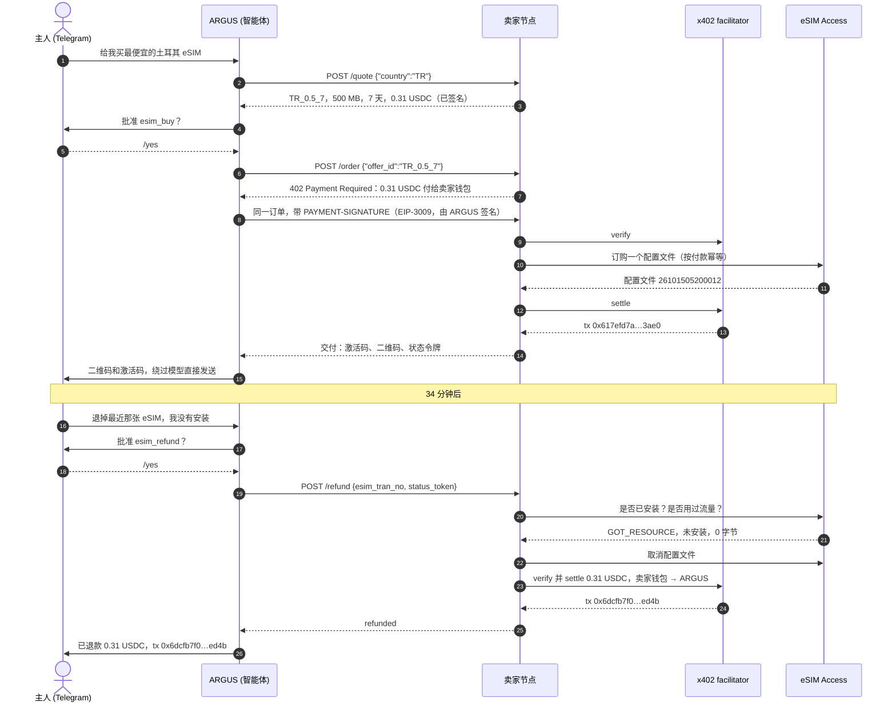
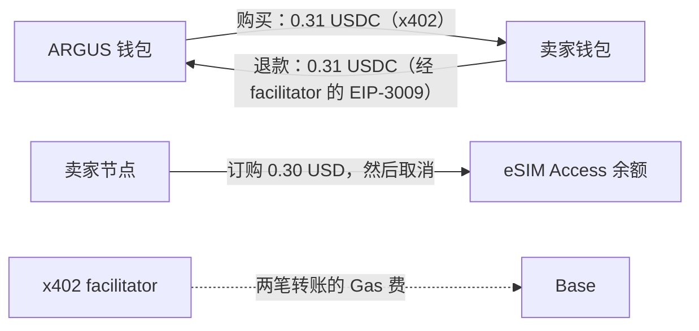
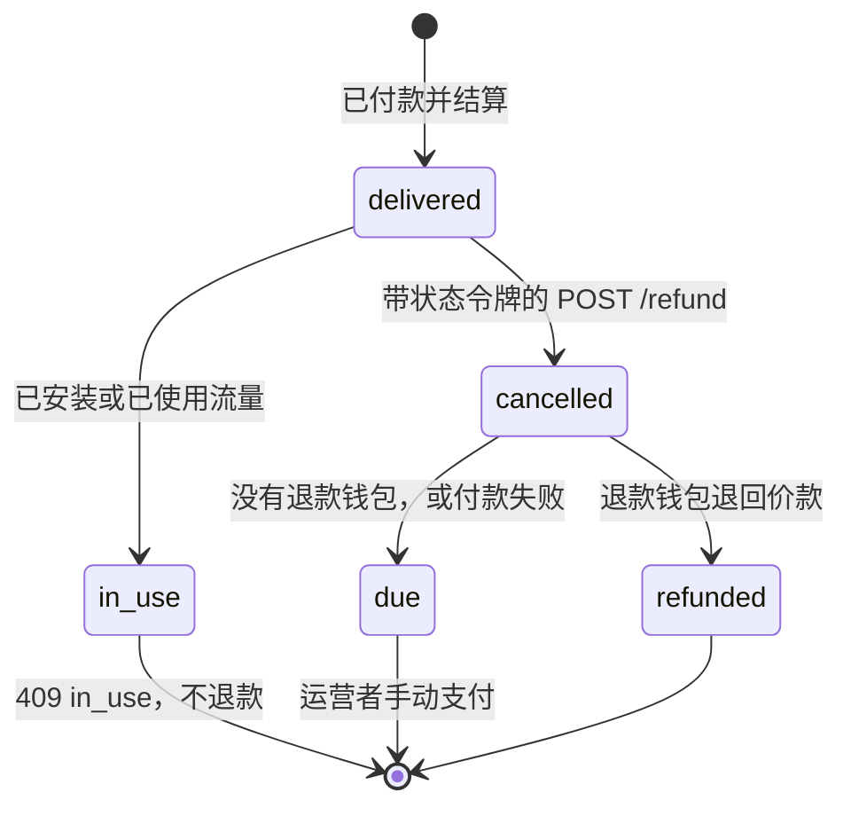
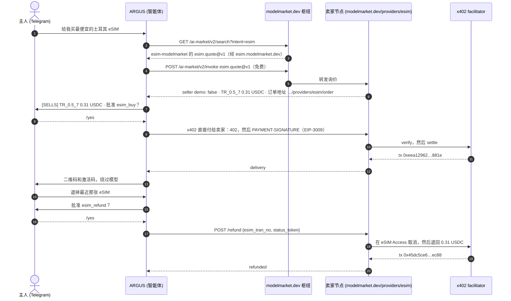
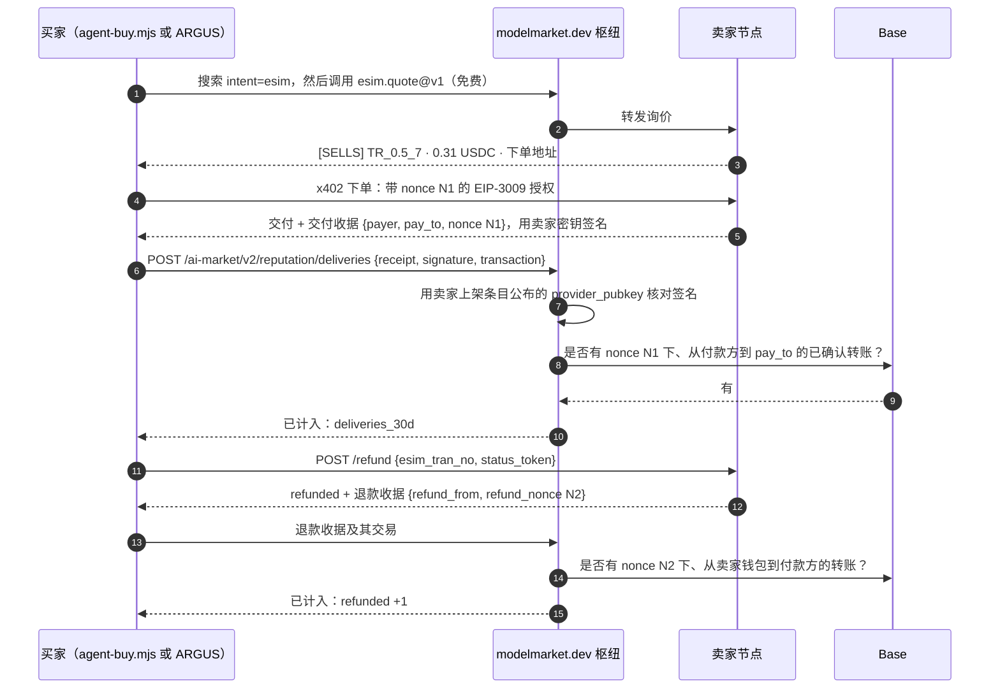
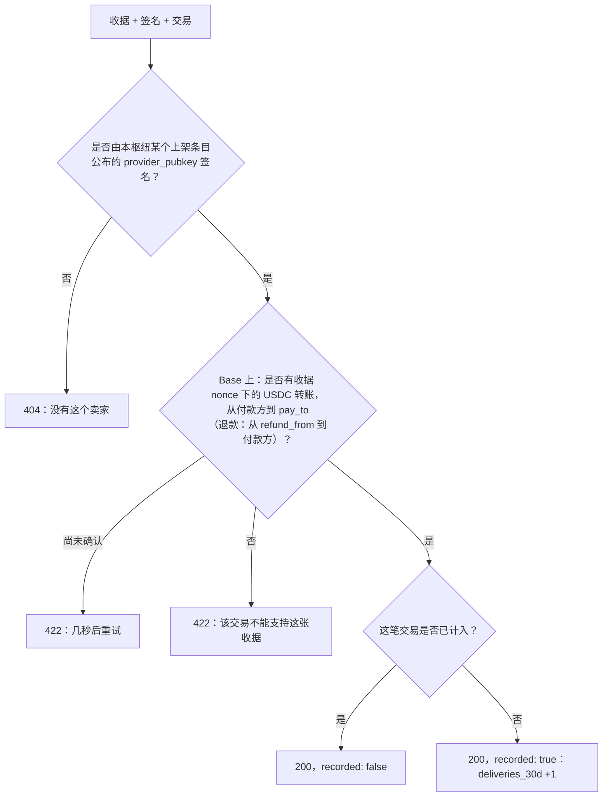

# 案例：AI 智能体购买 eSIM，随后拿回退款

套件的真实运行记录，附带交易哈希，每一步都可以在链上核对。案例 2（第 10 节）是同一个智能体通过枢纽购买我们的能力。案例 3（第 11 节）有两个买家——终端里的编程智能体和 ARGUS，枢纽依据买家带来的签名收据统计卖家的交付。第一个案例是智能体路径的完整往返：AI 智能体找到报价，通过 x402 用 USDC 付款，把 eSIM 交给主人，之后申请退款，卖家节点把钱退回，整个过程无人手动操作钱包。

## 1. 发生了什么

2026 年 10 月 15 日，个人 AI 智能体 ARGUS 的主人在 Telegram 里对它说：给我买最便宜的土耳其 eSIM。ARGUS 向套件的卖家节点询价，选中“土耳其 500 MB 7 天”，价格 0.31 USDC，请主人批准后用自己的钱包付款。几秒钟后，主人在聊天里收到了二维码和激活码。ARGUS 本身从未看到它们。

34 分钟后，主人让 ARGUS 申请退款。eSIM 尚未安装，于是卖家节点在批发商处取消了它，并把 0.31 USDC 退回智能体的钱包。所有钱包和批发余额都回到了起点。

卖家是套件的私有测试台：一个普通的卖家节点，按成本价销售，只允许智能体所在主机访问。整个过程没有任何模拟。

## 2. 参与方

| 参与方 | 是什么 | 地址或位置 |
|---|---|---|
| 主人 | ARGUS 为之工作的人；在 Telegram 中批准每一笔付款 | 私人 Telegram 聊天 |
| ARGUS | 智能体（买家）；用自己的钱包付款 | `0x428f2Be4327908948e3B1915C55ddF8fA6bf73cc` |
| 卖家节点 | 套件的 `rails/` 节点（卖家），已开启自动退款 | `https://esim.modelmarket.dev/stand` |
| 卖家钱包 | 收款并支付退款（`PAY_TO` 和 `REFUND_KEY_FILE` 是同一个钱包） | `0xF47161fBB56D0D910a17e503C8292903F41BbAE2` |
| facilitator | Coinbase 的 x402 facilitator：验证每笔已签名的转账并上链，支付 Gas 费 | CDP |
| 批发商 | eSIM Access：签发和取消配置文件 | 运营者的账户 |

## 3. 完整链路



## 4. 交易

全部在 Base 主网上，使用 USDC（`0x8335…2913`）。可在 [basescan.org](https://basescan.org) 查看任意一笔。

| 步骤 | 交易 | 区块，时间（UTC） | 从 → 到 | 金额 | Gas 费支付方 |
|---|---|---|---|---|---|
| 给智能体充值 | `0x225afba5cd651e3ccdf70593fe985d1e24ddc14836270e83b13f546b6d017578` | 52624834 | 主人的钱包 `0x097e…475a` → ARGUS | 0.50 | 主人 |
| 购买 | `0x617efd7abe4b4c6a80b54046617a73415aa54df7ada5f002ce7260cf68ac3ae0` | 52626137，05:20:21 | ARGUS → 卖家钱包 | 0.31 | facilitator `0x93f6…be44` |
| 退款 | `0x6dcfb7f075ad7fb6308064ac53e310dfb6adfd9b65d9f44b3c9a6dd39ca9ed4b` | 52627173，05:54:53 | 卖家钱包 → ARGUS | 0.31 | facilitator `0x4c93…0205` |

购买和退款都是 EIP-3009 `transferWithAuthorization` 调用：付款钱包签名，facilitator 提交上链。ARGUS 和卖家钱包在整个过程中都没有持有任何 ETH。

## 5. 资金与余额



| | 之前 | 购买后 | 退款后 |
|---|---|---|---|
| ARGUS 钱包 | 0.50 USDC | 0.19 USDC | 0.50 USDC |
| 卖家钱包 | 0 | 0.31 USDC | 0 |
| eSIM Access 余额 | 20.00 美元 | 19.70 美元 | 20.00 美元 |
| ARGUS 或卖家花费的 ETH | 0 | 0 | 0 |

测试台按成本价销售（`MARGIN_PCT=0`，`MIN_MARGIN_USD=0.01`）：批发价 0.30 美元，向智能体收取 0.31 USDC。按套件默认加价，同一套餐售价为 1.30 美元。

## 6. 退款规则



- **只有付款方可以申请。** 请求携带交付时附带的状态令牌。令牌错误返回 `404`，与未知 eSIM 相同。
- **只限未使用的 eSIM。** 节点先询问批发商：已安装或已产生任何流量的配置文件返回 `409 in_use`，保持原状。
- **只退回付款地址，只退所付价款。** 节点在订单中保存付款方和价格，绝不多退。
- **只退一次。** 重复请求或并发的两个请求得到相同的回答，不会二次付款。失败的付款不会自动重试：转账可能已经上链，运营者应先查链。
- **有上限。** 每笔退款 `REFUND_MAX_USD`，每天 `REFUND_DAILY_MAX_USD`，默认各为 50。测试台使用 1 和 2。
- **先取消，再付款。** 批发商会把取消的配置文件费用退回运营者，因此运营者除了时间什么都不损失。

## 7. 为你的节点开启退款

在你给节点一个用于退款的钱包之前，退款是关闭的。没有它时，`POST /refund` 仍会取消未使用的 eSIM 并把退款记为待付，你会收到 `agent_order.refund_due` webhook，自行支付。

```bash
# 一个在 Base 上持有 USDC 的退款钱包：PAY_TO 本身的钱包（退回收到的钱），或单独的备用金。
# 不需要 ETH：Gas 费由 facilitator 支付。
cd ~/esim-operator-kit
umask 077
printf 'Refund wallet private key: '; read -rs v; printf %s "$v" > secrets/refund_key; echo; unset v
sudo chown 1000:1000 secrets/refund_key && sudo chmod 600 secrets/refund_key
echo "REFUND_KEY_FILE=/run/secrets/esim/refund_key" >> .env
echo "REFUND_MAX_USD=20" >> .env
echo "REFUND_DAILY_MAX_USD=100" >> .env
docker compose up -d rails
curl -s https://<your domain>/agents/healthz    # "refunds": "automatic"
```

| 设置 | 作用 |
|---|---|
| `REFUND_KEY_FILE` | 支付退款的钱包私钥。这是套件唯一会读取的私钥，而且只在你开启时读取。 |
| `REFUND_MAX_USD` | 单笔退款上限。 |
| `REFUND_DAILY_MAX_USD` | 每天所有退款的总上限。 |
| `CDP_KEY_FILE` | 付款时已经设置；退款走同一个 facilitator。 |

如果退款钱包不是你的主钱包，只在其中放备用金：服务器上的私钥，一旦被入侵就可能被读取。

## 8. 申请退款

智能体需要交付时拿到的两个值：

```bash
curl -s -X POST https://<seller>/agents/refund -H 'content-type: application/json' \
  -d '{"esim_tran_no":"26101505200012","status_token":"…"}'
```

```json
{"success": true, "result": {"esim_tran_no": "26101505200012", "status": "refunded", "amount_usd": "0.31",
 "to": "0x428f2be4327908948e3b1915c55ddf8fa6bf73cc", "at": "2026-10-15T05:54:50.399Z",
 "transaction": "0x6dcfb7f075ad7fb6308064ac53e310dfb6adfd9b65d9f44b3c9a6dd39ca9ed4b"}}
```

`status` 为 `refunded` 时附带交易哈希；为 `due` 时由卖家手动支付。`/listing.json` 会说明是哪一种：其 `refund.policy` 写明规则，`/healthz` 显示 `"refunds": "automatic"` 或 `"operator"`。

## 9. 我们学到了什么

- **谨慎的智能体会质疑立即退款。** 当在一条消息里被要求“买下并立刻退款”时，ARGUS 停下来询问真实意图：买下保留、什么都不买，还是因真实原因退款。主人先购买，再单独申请退款。真实的智能体会因真实原因退款，卖家可以预期它们会礼貌地、只申请一次。
- **激活码从未离开交付。** 卖家只在已付款订单的回答中发送激活码；ARGUS 将它转发到主人的聊天，自己只保留配置文件编号和状态令牌。卖家的记录和智能体的账本都不保存它。
- **全程无需 Gas 费。** 智能体签了一个付款授权，卖家钱包签了一个退款授权，其余由 facilitator 完成。
- **批发商的退款让退款变得安全。** 节点先取消再付款，因此退款的订单不会让运营者损失任何费用。

## 10. 案例 2：经枢纽，从我们的公开节点购买

在案例 1 中，智能体被告知了卖家地址。在案例 2 中，它自己找到了卖家：ARGUS 在 modelmarket.dev 枢纽中搜索 eSIM 卖家，找到我们 `esim-modelmarket` 的能力 `esim.quote@v1`，经枢纽向它询价，然后通过 x402 直接付款到卖家自己的 `/order`。枢纽只转发了免费的询价，从未接触资金。

**为了这次测试，我们的公开节点从演示模式切换为销售模式，测试结束后立即切回演示模式。** `esim-modelmarket` 背后的节点（`modelmarket.dev/providers/esim`）在 2026 年 10 月 15 日 06:56:55 至 07:48:33 UTC 之间销售了 52 分钟，按成本价（`MARGIN_PCT=0`，`MIN_MARGIN_USD=0.01`），收款进入与测试台相同的卖家钱包，并从中自动退款（每笔最多 2 美元，每天最多 5 美元）。自 07:48:33 起，它再次以 `demo_mode` 拒绝每一笔订单。



| 时间（UTC） | 发生了什么 |
|---|---|
| 06:56:55 | 公开节点从演示切换为销售。经枢纽的报价显示 `demo: false` 和 0.31 USDC |
| 07:21 | 第一次尝试：ARGUS 看到了报价，但拒绝购买。节点名称仍是“modelmarket.dev demo seller”，智能体按名称做了判断 |
| 07:23 | 修复上线：节点名称随模式变化，ARGUS 根据卖家自己的回答为每个报价标注 `[SELLS]` 或 `[DEMO]` |
| 07:47:35 | 主人 `/yes` 后 ARGUS 购买 TR_0.5_7；eSIM `26101507470034` 送达主人的 Telegram |
| 07:48:02 | 主人申请退款并以 `/yes` 批准；节点取消未使用的 eSIM 并退款 |
| 07:48:33 | 公开节点切回演示模式 |

| 步骤 | 交易 | 区块，时间（UTC） | 从 → 到 | USDC | Gas 费支付方 |
|---|---|---|---|---|---|
| 购买 | `0xeea12962c4f494e55acc59a376203bd4b704804f19a84b4b8f47a96b265a881e` | 52630556，07:47:39 | ARGUS → 卖家钱包 `0xF471…bAE2` | 0.31 | facilitator `0x68a9…7863` |
| 退款 | `0x45dc5ce6579d8e889750442d63773586c481a11b30ddf44805960860f3bbec88` | 52630569，07:48:05 | 卖家钱包 → ARGUS | 0.31 | facilitator `0x625d…ac39` |

ARGUS 是这一窗口期内唯一的买家：节点记录中只有一笔订单，且已退款。最终 ARGUS 重新持有 0.50 USDC，卖家钱包为 0，eSIM Access 余额为 20.00 美元，eSIM 处于 `CANCEL` 状态，没有任何钱包花费 ETH。

这个案例说明了：

- **智能体会读名称。** 卖家的报价表明它在销售，但名称写着“demo”，智能体相信了名称。卖家节点应按其实际行为命名；智能体应依据卖家的回答而不是名称做决定。
- **枢纽负责发现，卖家负责销售。** 发现和免费询价经过枢纽；付款和退款直接在智能体与卖家之间进行，枢纽在任何时候都没有持有资金。
- **演示只是一个设置。** 同一个节点、同一个目录、同一个批发账户，是否销售取决于 `DEMO_MODE`：运营者可以在几秒内开启和关闭销售窗口。

## 11. 案例 3：两个买家，枢纽统计交付

直接收款的卖家对枢纽来说是不可见的：钱从智能体直接流向卖家，枢纽只看到免费的询价。因此在枢纽看来，收了钱却什么都不交付的卖家，和真正交付的卖家看起来一模一样。从 2026 年 10 月 15 日起，卖家节点为每一次交付和每一次退款签发收据，买家可以把收据连同交易一起带到枢纽。枢纽在链上核对签名和转账，然后在卖家的上架条目上记一次已确认交付。案例 3 用两个不同的买家端到端地测试了这一点。

**为了这次测试，我们的公开节点第三次从演示模式切换为销售模式，测试结束后立即切回演示模式。** 它在 2026 年 10 月 15 日 09:38:59 至 09:48:22 UTC 之间销售了 9 分钟，条件与案例 2 相同：按成本价，收款进入同一个卖家钱包，自动退款每笔最多 2 美元、每天最多 5 美元。自 09:48:22 起，它再次以 `demo_mode`（`403`）拒绝所有订单。

| 买家 | 是什么 | 钱包 |
|---|---|---|
| Claude Code | 主人终端里的编程智能体。它运行了套件自带的示例买家 `rails/examples/agent-buy.mjs`；脚本从密钥文件读取私钥，智能体本身从未看到它 | `0x097e3F339D0b023605e12A6B81E2d6Cb7571475a` |
| ARGUS | 主人在 Telegram 中的智能体，与案例 1、2 相同。购买和退款都由主人用 `/yes` 批准 | `0x428f2Be4327908948e3B1915C55ddF8fA6bf73cc` |

### 11.1 从 Claude Code 购买

整个购买只需一条命令。不加 `--yes` 时只询价；加上 `--refund` 会在交付后立即申请退款。

```bash
cd rails
node examples/agent-buy.mjs TR --hub https://modelmarket.dev --key-file ~/.aicom-pov-buyer.json --yes --refund
```

```text
seller   modelmarket.dev eSIM seller (https://modelmarket.dev → https://esim.modelmarket.dev)

offer    TR_0.5_7 — Turkey 500MB 7Days — 0.31 USDC, from modelmarket.dev eSIM seller
order at https://modelmarket.dev/providers/esim/order
payer    0x097e3F339D0b023605e12A6B81E2d6Cb7571475a

delivered  esim_tran_no 26101509410001 · iccid 8997…7746 · apn internet
activation LPA:1$rsp-eu.s… (the traveller's secret)
paid       0x85d355853807967e85b1efc3f15261e0c58006091898cb98d46095db07bc103e
hub        delivery counted: {"confirmed":1,"distinct_buyers":1,"refunded":0}

refund     refunded · 0.31 USDC to 0x097e3f339d0b023605e12a6b81e2d6cb7571475a · 0x3313e8be7726ce1e3bc4dcf95afde0bd5eb3de0c8a57b601f8b3aaf86ed85c00
hub        refund counted: {"confirmed":1,"distinct_buyers":1,"refunded":1}
```

脚本经枢纽找到卖家，跳过演示模式的卖家，选中最便宜的报价，通过 x402 付款（每笔上限 1 美元），并把两张收据都带到了枢纽。三分钟后，ARGUS 在 Telegram 中购买了同一套餐，计数达到两个买家。

### 11.2 带收据的完整链路



| 时间（UTC） | 发生了什么 | 之后上架条目上的计数 |
|---|---|---|
| 09:38:59 | 公开节点从演示切换为销售 | 尚无 |
| 09:41:05 | Claude Code 为 TR_0.5_7 付款；eSIM `26101509410001` 交付 | 1 次交付，1 个买家，0 次退款 |
| 09:41:19 | 其款项退回，eSIM 被取消 | 1, 1, 1 |
| 09:44:19 | ARGUS 在主人 `/yes` 后付款；eSIM `26101509440019` 发到主人的 Telegram | 2, 2, 1 |
| 09:44:53 | ARGUS 的退款在 `/yes` 后支付 | 2, 2, 2 |
| 09:48:22 | 公开节点切回演示模式 | 2, 2, 2（保留 30 天） |

### 11.3 交易

| 步骤 | 交易 | 区块，时间（UTC） | 从 → 到 | USDC | Gas 费支付方 |
|---|---|---|---|---|---|
| 购买，Claude Code | `0x85d355853807967e85b1efc3f15261e0c58006091898cb98d46095db07bc103e` | 52633959，09:41:05 | `0x097e…475a` → 卖家钱包 `0xF471…bAE2` | 0.31 | facilitator `0xca5e…c70d` |
| 退款，Claude Code | `0x3313e8be7726ce1e3bc4dcf95afde0bd5eb3de0c8a57b601f8b3aaf86ed85c00` | 52633966，09:41:19 | 卖家钱包 → `0x097e…475a` | 0.31 | facilitator `0x93f6…be44` |
| 购买，ARGUS | `0xf9ac406f3e329ac2c4c02e26562b6fb944e4165b71b88c4a0756a193325f9669` | 52634056，09:44:19 | ARGUS → 卖家钱包 | 0.31 | facilitator `0x93f6…be44` |
| 退款，ARGUS | `0x5fa5da5455226a20d10dc84ffb8adf56b01d972dcc72f8e135b4a507a8c35287` | 52634073，09:44:53 | 卖家钱包 → ARGUS | 0.31 | facilitator `0x8f5c…e531` |

节点记录中这一窗口期恰好只有这两笔订单，都已退款。最终两个买家的余额与测试前相同（0.594148 和 0.50 USDC），卖家钱包为 0，eSIM Access 余额为 20.00 美元，两张 eSIM 都处于 `CANCEL` 状态且流量用量为 0 字节，没有任何钱包花费 ETH。

### 11.4 收据，以及枢纽核对什么

下面是 ARGUS 这次购买的交付收据，即节点签名时的样子。它指向的是付款，而不是 eSIM：里面没有激活码、ICCID 或状态令牌。

```json
{"v": 1, "kind": "delivery", "capability": "esim.order@v1", "product_id": "esim-modelmarket", "chain_id": 8453,
 "payer": "0x428f2be4327908948e3b1915c55ddf8fa6bf73cc", "pay_to": "0xF47161fBB56D0D910a17e503C8292903F41BbAE2",
 "nonce": "0xddde4ccd3b8d8ba361b94985b0b063f50ae41f43217cfc3ccadc2d636201f79e", "offer_id": "TR_0.5_7",
 "at": "2026-10-15T09:44:…Z"}
```

签名是对收据规范 JSON（键排序、无空格）的 Ed25519 签名，所用的卖家密钥与签署每个免费回答的密钥相同。退款收据带有 `kind: "refund"`、`refund_from`（退款的钱包）、`refund_nonce`（该笔转账的 EIP-3009 nonce）和 `delivery_nonce`。



- **枢纽保存什么。** 每笔计入的转账只保存：卖家、类型、时间、交易的哈希，以及付款方地址的哈希（仅用于统计不同买家）。不保存明文金额、地址或交易。（已经知道某个地址或交易的人，仍然可以认出它的哈希。）
- **枢纽展示什么。** 卖家的每个上架条目都带有 `deliveries_30d`：本案例之后为 `{"confirmed": 2, "distinct_buyers": 2, "refunded": 2}`。枢纽的信任分对每个不同买家计一次成功。ARGUS 和 `agent-buy.mjs` 会在卖家旁边显示它。
- **它不能证明什么。** 钱包没有成本：卖家可以用新钱包向自己购买，再给自己退款。计数的含义是“买家确认这个卖家交付了”，而不是“这个卖家可靠”；请结合退款次数和卖家的上线时长一起看。退款并不代表失败：它是一张应要求取消的未使用 eSIM。
- **由谁决定。** 选择不公开购买记录的买家永远不会被计入：`agent-buy.mjs` 用 `--no-share`，ARGUS 用 `ARGUS_SHARE_DELIVERIES=0`。超过 30 天的收据会被拒绝。

### 11.5 目前的状态

- **我们的公开节点是演示节点。** modelmarket.dev 上的 `esim-modelmarket` 经枢纽提供实时价格，并以 `demo_mode` 拒绝所有订单。它只在本页的三个测试窗口内销售过，每个窗口测试后立即关闭。今天用 `agent-buy.mjs` 访问它，会看到：`DEMO: sells nothing`，然后是 `no seller that sells has an offer for TR`。
- **真正销售的卖家是你自己的节点。** 使用 `DEMO_MODE=0`、CDP 密钥和 `PAY_TO` 的套件：见[运营者指南](operator-guide.md)第 8 至 10 步。用 `scripts/node-toml.mjs` 生成 `node.toml`，并使用 `aimarket-hub` 3.15.27 或更高版本的联邦节点（第 9 步），上架条目就会带上卖家密钥，买家的收据就会计入这个卖家。
- **任何智能体都可以购买。** 本案例已验证从终端中的编程智能体购买，包括退款。任何支持 x402 的智能体都可以做到：API 见[智能体指南](agent-guide.md)，`agent-buy.mjs` 是一个可以直接运行的买家。

这个案例说明了：

- **卖家直接收款，枢纽依然知道它会交付。** 枢纽不持有资金，也看不到金额，但上架条目上显示了两个买家确认的两次交付。
- **新的转账需要几秒钟。** 来自两个买家的全部四张收据都被拒绝过一次（`422`：转账尚未确认），十秒后重试时被计入。买家应当重试，而不是放弃。
- **两种智能体，同一条路径。** 从编程智能体启动的脚本，和经主人批准的聊天智能体，走了相同的步骤，枢纽也以相同的方式计入。
