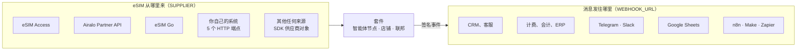
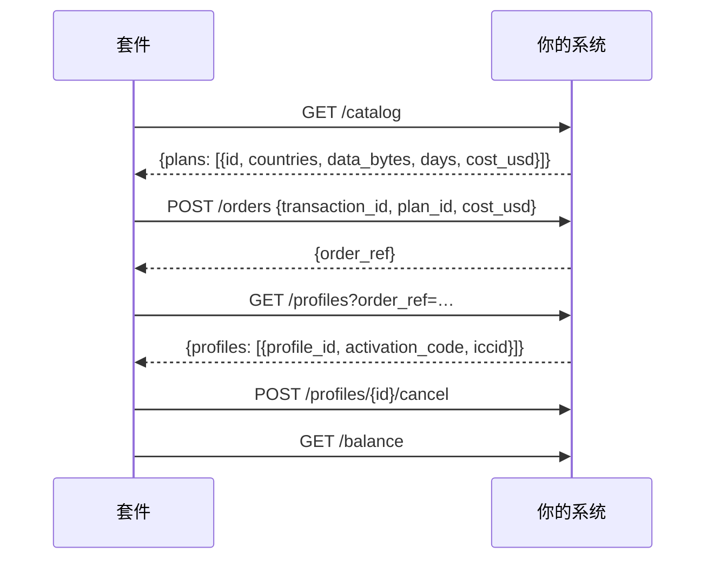
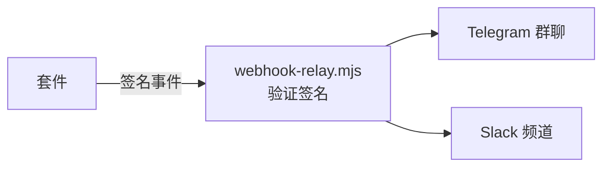

# 集成

套件与 eSIM 企业已有系统之间的现成连接：eSIM 从哪里来，以及每笔销售的消息发往哪里。每项都注明了测试程度。

其他文档：[概览](../../README.zh.md) · [接入指南与使用场景](rails.md) · [SDK 参考](sdk.md) · [运营者指南](operator-guide.md)

## 1. 全景图



| 集成 | 类型 | 设置 | 状态 |
|---|---|---|---|
| eSIM Access | 供应商 | `SUPPLIER=esimaccess` | ✅ 已实测：2026-10-14 真实订单完成购买、读取与取消 |
| Airalo Partner API | 供应商 | `SUPPLIER=airalo` | 🟡 按 Airalo 公开的 API 参考实现，并用其文档示例响应测试；尚未在真实 Airalo 账户上运行 |
| eSIM Go（API v2.5） | 供应商 | `SUPPLIER=esimgo` | 🟡 按 eSIM Go 公开的 API 参考实现，并用其文档示例响应测试；尚未在真实账户上运行 |
| 你自己的系统 | 供应商 | `SUPPLIER=http` | ✅ 用参考后端 `rails/examples/operator-backend.mjs` 做了端到端测试 |
| 其他任何来源 | 供应商 | SDK 的供应商接口 | ✅ 以上四者实现的就是这个接口 |
| CRM、计费、会计 | 事件 | `WEBHOOK_URL` | ✅ 签名、重试、已测试 |
| Telegram、Slack | 事件 | `rails/examples/webhook-relay.mjs` | ✅ 已测试 |
| Google Sheets | 事件 | `rails/examples/google-sheets.gs` | 🟡 Apps Script 接收端，CI 中未测试 |
| n8n、Make、Zapier、HubSpot、Salesforce | 事件 | 它们的 webhook 触发器 | 📘 见下方配方；无需安装 |

在通过 🟡 集成销售之前，先加载你的目录（`scripts/catalog.mjs`），并做一次测试订单后取消（运营者指南第 10 节）。
把你的发现告诉我们：在 GitHub 上提一个 issue，就能让下一位运营者看到 ✅。

## 2. 供应商

### 2.1 eSIM Access

默认选项。把 AccessCode 和 SecretKey 放进 `secrets/esimaccess_access_code` 和
`secrets/esimaccess_secret_key`。[运营者指南](operator-guide.md)介绍了账户、50 美元充值和测试订单。

- 订单在 eSIM Access 一侧就是幂等的（按 `transactionId`）。
- 订单携带报价时的成本；价格已变动的套餐会被拒绝，而不是被扣款。
- 付款结算失败时，未使用的配置文件会自动取消并退回你的余额。

### 2.2 Airalo Partner API

你需要一个 Airalo 合作伙伴账户及其 client id 和 secret。

```bash
printf 'Client id: '; read -rs v; printf %s "$v" > secrets/airalo_client_id; echo
printf 'Client secret: '; read -rs v; printf %s "$v" > secrets/airalo_client_secret; echo
sudo chown 1000:1000 secrets/airalo_*
```

在 `.env` 中：

```bash
SUPPLIER=airalo
AIRALO_CLIENT_ID_FILE=/run/secrets/esim/airalo_client_id
AIRALO_CLIENT_SECRET_FILE=/run/secrets/esim/airalo_client_secret
# AIRALO_BASE_URL=…   测试期间使用 Airalo 提供的沙盒地址
```

适配器的做法：调用一次 `POST /v2/token` 并缓存令牌（Airalo 每分钟只允许三次令牌请求）；用 `GET /v2/packages`
获取目录（仅固定套餐：不限量套餐和充值包不在 v1 范围内；`net_price` 即你的成本）；用 `POST /v2/orders` 下单，
把付款的交易号作为订单描述；用 `GET /v2/sims/{iccid}` 和 `/usage` 查询状态；付款结算失败时调用 `POST /v2/refund`。

销售前须知：

- **Airalo 订单没有幂等键。** 进程运行期间，适配器按付款记住每个订单，节点也会在获取配置文件前保存订单引用。如果恰好在这两步之间的几秒内重启，可能留下一个已付款但套件中没有 eSIM 的订单：请在 Airalo 控制台按描述（交易号）找到它。
- **退款由 Airalo 审核**，并以 Airalo 余额而非现金返还。
- **下单前不检查余额：** 请保持 Airalo 账户有余额。

### 2.3 eSIM Go

你需要一个 eSIM Go 账户及其 API 密钥（Account Settings → API Details）。

```bash
printf 'API key: '; read -rs v; printf %s "$v" > secrets/esimgo_api_key; echo
sudo chown 1000:1000 secrets/esimgo_api_key
```

```bash
SUPPLIER=esimgo
ESIMGO_API_KEY_FILE=/run/secrets/esim/esimgo_api_key
```

适配器的做法：逐页调用 `GET /catalogue`（`dataAmount` 单位为 MB，`price` 为你组织的币种——必须是美元；不限量
套餐不在 v1 范围内）；用 `assign: true` 调用 `POST /orders`，返回每张 eSIM 的 ICCID、SM-DP+ 地址和 matching id；
用 `GET /esims/{iccid}` 和 `/bundles` 查询状态和用量；付款结算失败时调用
`DELETE /esims/{iccid}/bundles/{name}?refundToBalance=true`。

销售前须知：

- **eSIM Go 同样没有幂等键：** 保护措施与注意事项同 Airalo。
- **eSIM Go 默认关闭退回余额：** 请让你的客户经理开启。否则，取消的套餐会被撤销但不退款。
- **下单前不检查余额。**

### 2.4 你自己的系统（HTTP）

适用于配置文件发放平台、SM-DP+ 前端、数据库中的配置文件库存，或套件不认识的供应商：用任意语言实现五个端点。



```bash
SUPPLIER=http
SUPPLIER_URL=https://ops.example.com/esim
SUPPLIER_SECRET_FILE=/run/secrets/esim/supplier_secret
```

每个请求都带签名（带时间戳的 HMAC-SHA256）。契约及验证签名的 Python 和 Go 代码：
[rails/spec/supplier-http.md](../../rails/spec/supplier-http.md)。可直接参考的可运行示例：
[rails/examples/operator-backend.mjs](../../rails/examples/operator-backend.mjs)。动手写代码前先试一下：

```bash
cd rails && SUPPLIER_SECRET=$(openssl rand -hex 24) node examples/operator-backend.mjs 9600
```

### 2.5 其他任何来源（SDK）

Node.js 服务可以把任何带有 `catalog`、`order`、`profiles`、`cancel` 和 `balance` 的对象传给
`createNode()`。见 [SDK 参考](sdk.md)第 2 节。

## 3. 你的业务系统

每个状态发生变化的订单都会以签名 POST 请求发送到 `WEBHOOK_URL`：

| 事件 | 你的系统通常会 |
|---|---|
| `order.created` | 创建线索或发票草稿 |
| `order.delivered` | 记录销售：价格、成本、付款方式、付款引用 |
| `order.refund_due` | 带上付款方地址，创建退款任务 |
| `order.underpaid` | 创建客服任务 |
| `order.expired` | 关闭线索 |
| `agent_order.delivered` | 记录一笔智能体销售 |
| `agent_order.cancelled` | 记录一笔被取消的智能体销售 |

```bash
WEBHOOK_URL=https://crm.example.com/hooks/esim
WEBHOOK_SECRET_FILE=/run/secrets/esim/webhook_secret      # 16 个字符以上，与接收方共享
```

请求体、请求头及验证代码：[SDK 参考](sdk.md)第 5 节。

### 3.1 Telegram 和 Slack



1. 通过 @BotFather 创建 Telegram 机器人并记下令牌；把它加入团队群聊并记下 chat id。Slack 则创建一个 incoming webhook。
2. 在套件旁运行转发器：

```bash
cd rails && WEBHOOK_SECRET=… TELEGRAM_BOT_TOKEN=… TELEGRAM_CHAT_ID=… SLACK_WEBHOOK_URL=… node examples/webhook-relay.mjs 9700
```

3. 在 `.env` 中设置 `WEBHOOK_URL=http://127.0.0.1:9700/hooks/esim`，并把同一密钥放进 `secrets/webhook_secret`。

每笔销售显示为一行：“✅ Delivered Qh3…: Japan 5GB 30Days — $6.40, cost $3.20”。

### 3.2 Google Sheets

1. 在 Google 表格中：扩展程序 → Apps Script；粘贴 [rails/examples/google-sheets.gs](../../rails/examples/google-sheets.gs) 并设置其中的 `TOKEN`。
2. 部署为 Web 应用（以你的身份执行，访问权限：任何人）；复制 `/exec` 地址。
3. `WEBHOOK_URL=<该 /exec 地址>?token=<TOKEN>`。

每个事件成为一行；重复的事件 id 会被跳过。Apps Script 无法读取请求头，所以拦住陌生人的是 URL 中的令牌，而不是签名。

### 3.3 n8n、Make、Zapier

三者都可以由传入的 webhook 启动工作流：

1. 创建带 webhook 触发器的工作流（n8n：Webhook 节点，POST；Make：Custom webhook；Zapier：Webhooks by Zapier → Catch Hook），并把它的地址填入 `WEBHOOK_URL`。
2. 在 n8n 中，先用 Code 节点验证签名：重新计算 `v1=` + HMAC-SHA256(secret, `X-Kit-Timestamp` + "." + 原始请求体)，并与 `X-Kit-Signature` 比较。
3. 按 `type` 分支：`order.delivered` → 你的 CRM 或会计步骤；`order.refund_due` → 一项任务。

### 3.4 HubSpot、Salesforce 及任意 CRM

通过 n8n、Make 或 Zapier（见上），或你自己的小型接收端：收到 `order.created` 时创建交易，以 `order_id`
作为外部 id；收到 `order.delivered` 时把它标为赢单并写入 `price_usd`；收到 `order.refund_due` 时创建任务。
按事件 `id` 去重。

## 4. 你自己的店铺或应用

你不一定需要套件的店铺。你的网站或应用可以像任何智能体一样调用你的卖家节点：先 `POST /agents/quote`，
再带 x402 付款 `POST /agents/order`——见[智能体指南](agent-guide.md)。或者保留你自己的结账流程，只把套件用于
智能体：用你的供应商运行套件，让店铺保持演示模式，并向联邦发布节点公告。

## 5. 申请新的集成

你使用的供应商或系统不在这里？请在 [GitHub](https://github.com/alexar76/esim-operator-kit/issues)
提一个 issue，附上其 API 参考。按照 [SDK 参考](sdk.md)中的接口，一个供应商适配器大约两百行代码。
