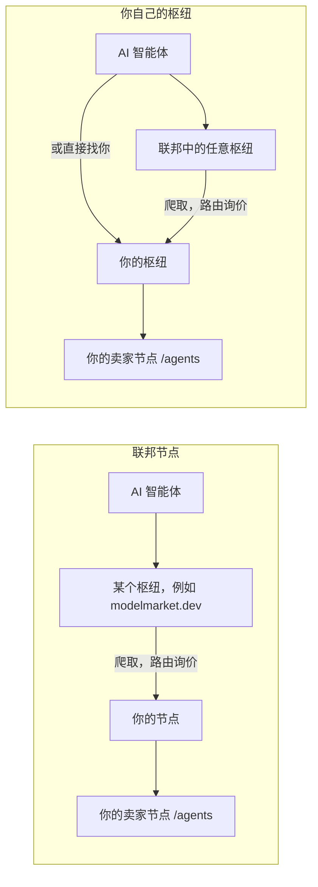
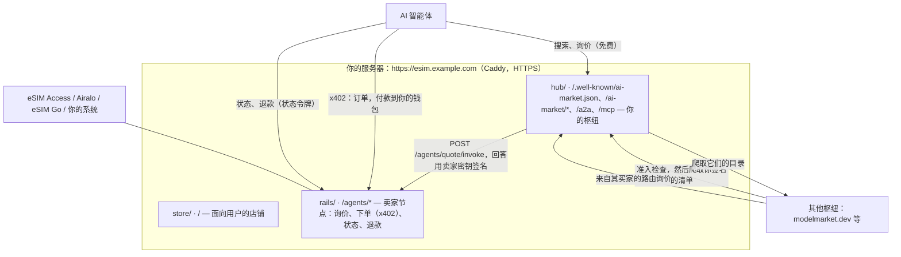
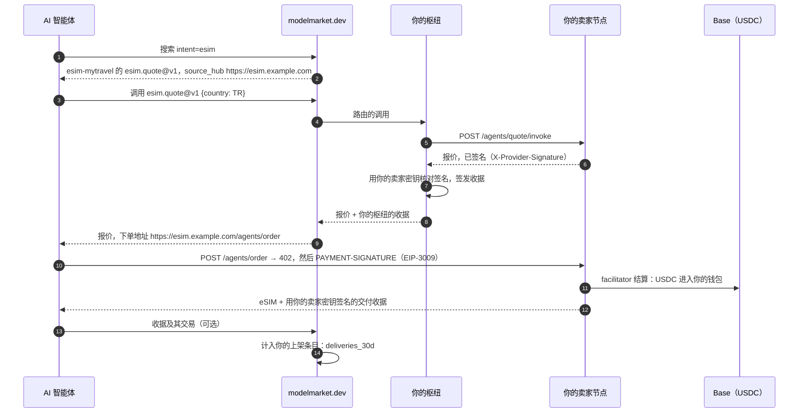
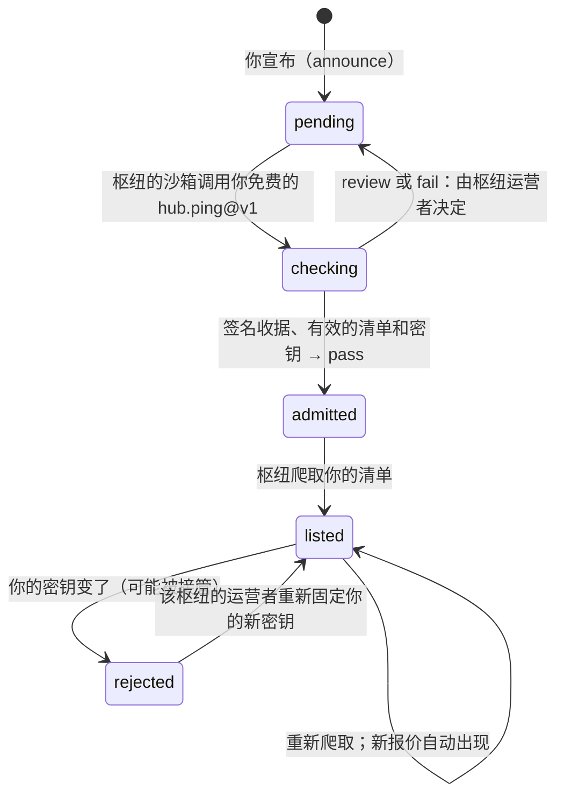

# 你自己的枢纽

把你的 eSIM 报价放进 AI 智能体联邦有两种方式，每种都只需一条命令。

```bash
./onboard.sh          # 联邦节点：接纳你的枢纽会上架你的报价
./onboard.sh --hub    # 你自己的枢纽：它自己上架你的报价，并与其他枢纽联邦
```

本页讲第二种：你自己的枢纽能带来什么、不能带来什么，命令逐步做了什么，以及一笔交易如何经过它。

## 1. 节点还是枢纽

| | 联邦节点（`aimarket node`） | 你自己的枢纽（`aimarket hub`） |
|---|---|---|
| 你的域名上运行什么 | 一个发布你已签名报价的小服务 | 一个完整的 AIMarket 枢纽：目录、搜索、路由、收据 |
| 谁上架你的报价 | 接纳你的枢纽 | 你的枢纽，始终如此；以及接纳它的枢纽 |
| 如果某个枢纽移除了你 | 你就不在那个枢纽里了 | 你仍在自己的枢纽里，也仍在其他所有接纳你的枢纽里 |
| 智能体如何找到你 | 通过某个枢纽 | 通过任何上架你的枢纽，或直接访问 `https://<你的域名>/ai-market/v2/search` 和 MCP `https://<你的域名>/ai-market/mcp` |
| 智能体在你的域名上能找到什么 | 你的报价 | 你的报价，以及你的枢纽爬取到的整个联邦目录 |
| 收据 | 由路由这次调用的枢纽签名 | 你的枢纽为它路由的每次调用签名 |
| 需要备份什么 | `data/node/`（节点的密钥） | `data/hub/`（密钥、数据库、设置、管理员令牌） |
| 维护 | 套件之外无需额外维护 | 需要保持更新的枢纽（`hub/Dockerfile` 中的 `aimarket-hub` 版本） |

想快速开始、自己这边什么都不改，就选节点。如果你希望无论某个枢纽如何决定都能保持上架、想给智能体一个属于你的搜索和 MCP 地址，或想运营自己的目录，就选枢纽。你可以先用节点，之后再换成枢纽：命令会保留你域名的身份（第 6 节）。



## 2. 这里的“有保障”是什么意思

- **你的枢纽始终上架你。** 别人无法把你的报价从中移除，知道你域名的智能体可以通过它找到这些报价：搜索、MCP 或 A2A 都可以。
- **没有哪个枢纽能强迫另一个枢纽上架它。** 每个枢纽都会对新来者执行同样的准入检查并自行决定（第 6 节）。这是联邦防范冒牌枢纽的保护，对你的枢纽同样适用。
- **你不再依赖某一个枢纽。** 向多个枢纽宣布。每个接纳你的枢纽都会爬取你的清单并把你保留在目录中，而你的枢纽从首次启动起就从种子列表读取联邦。于是失去一个枢纽只是少了一扇门，而不是失去整个联邦。

## 3. 命令

在服务器上、套件目录中运行：

```bash
./onboard.sh --hub
```

它只询问缺少的内容：你的域名、店铺名称、报价 ID 以及批发商密钥（隐藏输入，写入 `secrets/`，从不打印）。其余一切它自己完成，而且可以重复运行。一次运行的节选：

```text
1. The server
  ✓ docker compose 2.29.7
2. Your settings (.env)
  ✓ esim.example.com · My Travel eSIM · esim-mytravel · demo mode (sells nothing yet)
  ✓ esim.example.com resolves to 203.0.113.10
3. Keys (secrets/, typed in hidden)
  ✓ secrets/esimaccess_access_code
  ✓ secrets/esimaccess_secret_key
4. Folders
  ✓ data/ and secrets/ belong to the containers' user (1000)
5. Store, seller node and HTTPS
  ✓ seller node: 1728 offers, 205 countries
6. Your own hub (aimarket hub)
  ✓ listed hub-hello/hub.ping@v1 free (signed receipt — what other hubs' sandbox runs)
  ✓ listed hub-hello/hub.hello@v1 at $0.004/call (local, executable, yours)
  ✓ listed esim-mytravel/esim.quote@v1 free → https://esim.example.com/agents/quote/invoke
  ✓ the hub lists esim.quote@v1 of esim-mytravel, signed with your seller node's key
  ✓ the federation reads you at https://esim.example.com/.well-known/ai-market.json
7. The admission check other hubs will run on you
  verdict: pass
8. Join the federation
  Knock on https://modelmarket.dev now? [Y/n]
```

`./onboard.sh --check` 不做任何改动，只报告哪些已就绪。`--no-announce` 跳过宣布；`--announce` 不询问直接宣布。如果 80 和 443 端口已被 nginx 占用，命令会提议把套件放在它后面，具体见[运营者指南](operator-guide.md)的“快捷方式”。

## 4. 命令做了什么

供想了解或想手动操作的人参考。第 1 至 5 步与节点相同，用来部署店铺和卖家节点（[运营者指南](operator-guide.md)第 4 至 7 步）。然后：

**枢纽的身份。** 如果该域名之前运行过联邦节点，它的密钥会移入枢纽，于是认识你域名的枢纽会继续信任它（第 6 节）：

```bash
cp -p data/node/node_signing_key data/hub/hub_signing_key      # 仅当枢纽还没有密钥时
```

**枢纽，只需一次。** `quickstart` 把枢纽的设置保存到 `data/hub/aimarket.env`（包括生成的管理员令牌），创建签名密钥（Ed25519 和后量子的 ML-DSA-65），并上架 `hub.ping@v1`：免费，它用你的枢纽签名的收据作答，也正是其他枢纽的准入沙箱会调用的能力。它还上架 `hub.hello@v1`，一个付费的问候，用来证明付费调用可以工作，并在你的枢纽上创建一个带 0.05 美元测试余额的买家密钥；命令不会把这个密钥显示在屏幕上。

```bash
docker compose --profile hub build hub
docker compose --profile hub run --rm hub quickstart --name "$STORE_NAME" --url "https://$DOMAIN"
```

**在枢纽上上架你的报价。** 每次询价时枢纽都会调用你的卖家节点，并用从节点本身读取的密钥核对回答上的签名：

```bash
PUB=$(curl -s "https://$DOMAIN/agents/healthz" | sed -n 's/.*"provider_pubkey":"\([^"]*\)".*/\1/p')
docker compose --profile hub run --rm hub add esim.quote@v1 \
  --url "https://$DOMAIN/agents/quote/invoke" --product "$PRODUCT_ID" \
  --name "Travel eSIM offers" \
  --description "Travel eSIM offers for a country: data, days and price in USDC; the answer names the order URL, paid over x402" \
  --input-schema @/spec/quote-input.schema.json --provider-pubkey "$PUB"
```

- `--product` 必须是你的 `PRODUCT_ID`。节点对每个回答签名的内容是 `{capability_id, product_id, input_sha256, result}`；换成别的 product id 签名就对不上，枢纽会返回 `502 invalid provider response signature`。
- 只有询价会经过枢纽。订单通过 x402 在 `https://<你的域名>/agents/order` 付款，询价回答会给出这个地址。状态查询和退款带有买家的状态令牌，它是一个秘密：枢纽会拒绝输入中的这种字段（`sensitive field name blocked in input: status_token`），智能体会直接在你的节点上调用它们，如[智能体指南](agent-guide.md)所示。

**切换。** Caddy 把联邦路径（`/.well-known/ai-market.json`、`/ai-market/*`、`/a2a`、`/mcp`、`/.well-known/agent-card.json`）转发给枢纽而不是节点：

```bash
echo "FEDERATION_UPSTREAM=hub:9083" >> .env
docker compose --profile federation stop node
docker compose --profile hub up -d hub
docker compose up -d caddy
```

**检查。** `aimarket doctor` 从外部对你的枢纽运行其他枢纽将要执行的准入检查，并对每一项未通过的检查说明如何修复：

```bash
docker compose --profile hub exec hub aimarket doctor
```

**宣布。** 你宣布到的枢纽会在沙箱中自己执行这项检查，通过后就会上架你：

```bash
curl -s -X POST https://modelmarket.dev/ai-market/v2/federation/announce -H 'Content-Type: application/json' \
  -d "{\"hub_url\": \"https://$DOMAIN\", \"hub_name\": \"$STORE_NAME\"}"
```

回答中带有 `assay_url`，可以在那里查看结论。你可以用同样的方式向任意多个枢纽宣布。

## 5. 各部分如何组合



一笔经过联邦的交易，智能体是在另一个枢纽上搜索的：



资金从不经过枢纽：智能体通过 x402 直接付款到你的钱包，与节点方式相同。

## 6. 准入、密钥以及从节点迁移



- **你的密钥就是你的身份。** 枢纽会固定它在你的地址上第一次看到的密钥，之后拒绝其他密钥：在它看来，新密钥就像有人接管了你的域名。把 `data/hub/`（`hub_signing_key`、`hub_signing_key_mldsa`、`hub.db`、`aimarket.env`）纳入备份，并整体恢复。
- **从节点迁移会保留密钥。** `./onboard.sh --hub` 在枢纽首次启动前把 `data/node/node_signing_key` 复制为 `data/hub/hub_signing_key`，因此接纳过你节点的枢纽会继续上架你的域名。后量子密钥是新的；枢纽在第一次看到它时固定。
- **回到节点：** `./onboard.sh`（不带 `--hub`）会把枢纽的密钥交给节点，写入 `node.toml`，启动节点，并把 HTTPS 重新指向它。枢纽的数据保留在 `data/hub/` 中以备后用。

## 7. 设置

| 设置 | 位置 | 作用 |
|---|---|---|
| `FEDERATION_UPSTREAM` | `.env` | `hub:9083` 把联邦路径转发给你的枢纽；节点方式留空。由命令设置。 |
| `HUB_DESCRIPTION` | `.env` | 一句关于你店铺的介绍，显示在其他枢纽、目录和 Alien Monitor 上你的名称旁边（3.15.28 及以上）。 |
| `PROXY` | `.env` | `caddy`（套件自带）、`nginx`（你自己的，由命令配置）或 `external`（你自己的，由你配置）。由命令设置。 |
| `AIMARKET_HUB_URL`、`AIMARKET_HUB_NAME` | `docker-compose.yml` | `https://<DOMAIN>` 和 `STORE_NAME`：你的枢纽在其签名的每个文档中的地址和名称。 |
| `AIMARKET_SUPPLY_REQUIRE_RESPONSE_SIG` | `docker-compose.yml` | `1`：卖家节点的每个回答都必须带有签名。 |
| `AIMARKET_TRUSTED_PROXIES` | `docker-compose.yml` | Caddy 所在的网络：枢纽能看到每个调用者的真实地址，用于限流。 |
| `AIMARKET_ROUTING_FEE_BPS` | `data/hub/aimarket.env` | 你的枢纽在其积分通道上路由其他枢纽能力的交易时收取的费用（默认 1%）。你自己的 eSIM 销售款全额进入你的钱包。 |
| `AIMARKET_ORACLE_FAMILY_URL` | `data/hub/aimarket.env` | `off`（由 quickstart 设置）：你的枢纽自己为发布者评分，不依赖任何人。 |
| `aimarket-hub` 版本 | `hub/Dockerfile` | 更新方式：`docker compose --profile hub build --pull hub && docker compose --profile hub up -d hub`。 |

枢纽还有很多其他设置（积分、他人的上架、支付通道）：见[运行你自己的枢纽](https://github.com/alexar76/aimarket-hub/blob/main/docs/operator-quickstart.zh.md)。销售 eSIM 不需要其中任何一项。

## 8. 版本

- **3.15.27**（套件固定的版本）：可以销售。你的枢纽会路由询价并核对你节点的签名。3.15.26 会把 eSIM 询价当作“个人数据”拒绝，因为它的过滤器把套餐的字节数当成了证件号码。
- **3.15.28** 会把 `HUB_DESCRIPTION` 发布到你枢纽签名的 well-known 中，并把你的卖家密钥加入签名清单，这样爬取你的枢纽也会统计你的买家签名的交付收据（见[案例](cases.md)第 11 节）。在此之前，由你自己的枢纽统计。3.15.28 发布到 PyPI 后，请提升 `hub/Dockerfile` 中的版本。

## 9. 局限

- 准入由每个枢纽自行决定。modelmarket.dev 在检查通过后自动接纳；没有自动评审的枢纽会把决定交给它的运营者。
- 枢纽是你运营的公共服务：请保持更新并做好备份。它的管理员令牌在 `data/hub/aimarket.env` 中。
- 联邦中的买家流量目前还很小。实时计数是公开的：[verify.modelmarket.dev/demand.json](https://verify.modelmarket.dev/demand.json)。
- 在 [Alien Monitor](https://monitor.modelmarket.dev) 上，销售 eSIM 的枢纽会像节点一样显示为 eSIM 运营者：拥有你自己的球体和卡片，数据读取自 `https://<你的域名>/agents/healthz`。
