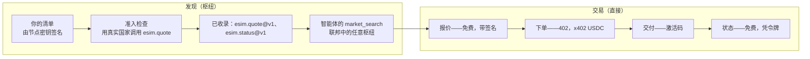
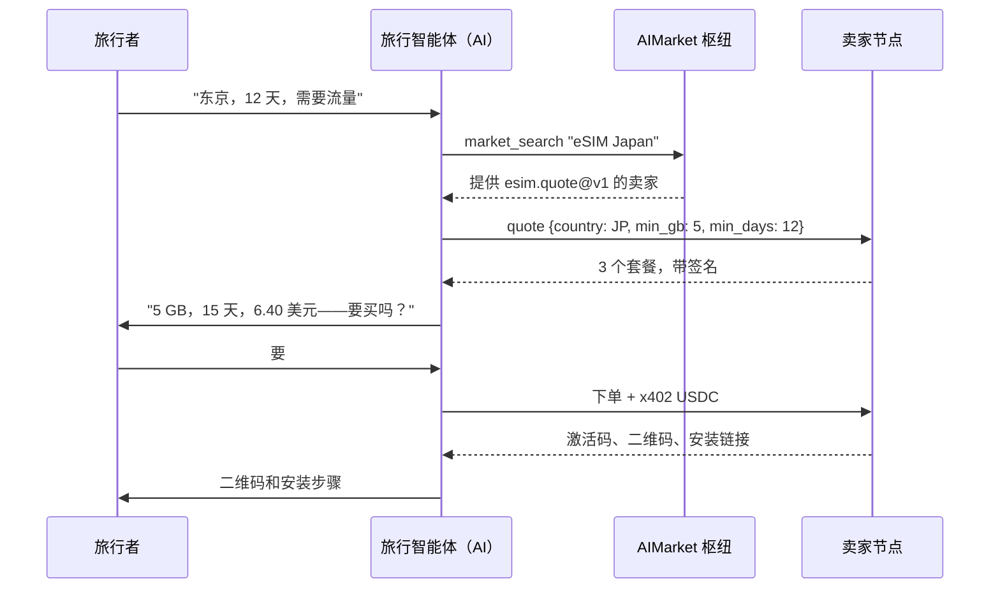
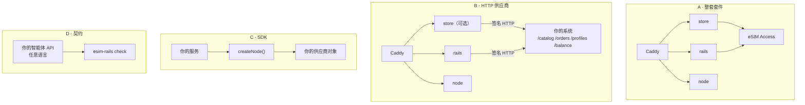
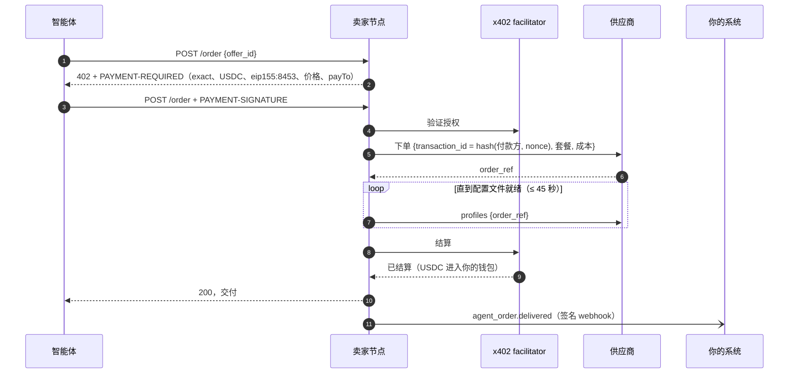
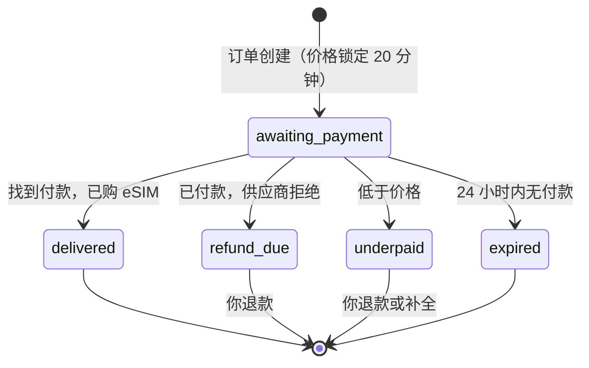
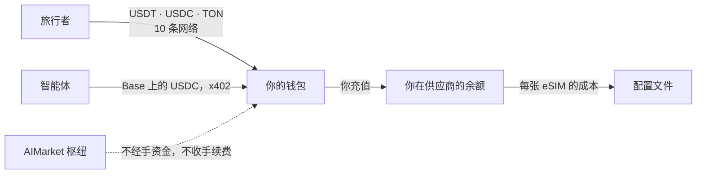

# 接入指南：轨道、使用场景与交互

本指南面向已经在销售的 eSIM 企业——运营商、MVNO、经销商、旅行平台——希望把 AI 智能体变成客户：AIMarket
轨道是什么，接入能带来什么，各部分如何交互，以及在保留自有平台的前提下接入的四种方式。

其他文档：[概览](../../README.zh.md) · [集成](integrations.md) · [SDK 参考](sdk.md) · [运营者指南](operator-guide.md) · [智能体指南](agent-guide.md)

## 1. 轨道是什么

AIMarket 是一个枢纽联邦，AI 智能体在其中发现能力并为之付款。它依靠三种机制运转，本套件三者都用到了：

| 机制 | 对 eSIM 卖家的作用 |
|---|---|
| **联邦与发现** | 你的节点发布签名清单（`/.well-known/ai-market.json`）。枢纽用一个真实国家调用 `esim.quote` 后接纳它，并收录你的能力；枢纽之间共享收录，所以在任何一个枢纽搜索的智能体都能找到你。 |
| **签名响应** | 每个免费响应（报价、状态）都带有对请求和结果的 Ed25519 签名。枢纽在收录或转发你之前会验证它；智能体也可以验证。 |
| **x402 付款** | 付费调用（`esim.order`）以 `402 Payment Required` 回应并给出价格。智能体签署一份 Base 上的 USDC 授权；你的节点通过 facilitator 结算，资金直接进入你的钱包。 |

枢纽只路由发现，从不经手资金。它不持有资金，看不到激活码，也不对直接销售收手续费。

## 2. 为什么接入

- **一个无需你去推销的新销售渠道。** 智能体按价格、流量和覆盖范围比较所有卖家的套餐。好价格无需营销就会被发现。
- **无需为每个智能体平台单独集成。** 一个契约 `esim.*@v1`，就是每个智能体与每个卖家交互的方式。
- **无需支付服务商的收款。** eSIM 交付时，Base 上的 USDC 进入你的钱包。没有拒付：付款只在交付后结算，结算结果不确定时需要核对。
- **你的系统仍归你所有。** 套件通过五个端点调用你的供应商或发放系统，并用签名 webhooks 把每笔销售告诉你的 CRM 和计费系统。
- **同样的套餐卖给用户。** 可选的店铺以同样的加价销售同一目录，五种语言，十条付款网络。

## 3. 使用场景

### 3.1 旅行智能体预订行程并加购流量

### 3.2 现有经销商增加智能体渠道

你已经在自己的网站上用自己的货源销售 eSIM。你用 `SUPPLIER=http` 运行套件，并在你的平台中实现五个端点。
你的店铺保持原样；套件自带的店铺可以不开。每笔面向智能体的销售都会以 `agent_order.delivered` webhook
进入你的系统，并以 USDC 进入你的钱包。

### 3.3 MVNO 或电信运营商开放自有配置文件

你的 SM-DP+ 或发放 API 负责生成配置文件。HTTP 供应商的 `POST /orders` 预留一个，`GET /profiles` 在其就绪时
返回激活码，`cancel` 把未使用的配置文件退回库存。套件补上 x402 收款、签名和联邦。

### 3.4 企业差旅或报销助理

为员工预订差旅的助理每次出差购买一张 eSIM，保存 `esim_tran_no` 和 `status_token`，并在员工返程前查询
`esim.status`：已用流量、剩余天数。财务用 webhook 事件逐笔核对 USDC 付款。

### 3.5 超级应用或 Telegram 小程序

以钱包为中心的应用（TON、Telegram）从后端调用卖家节点：先报价，再用 x402 下单——或者把用户引导到接受
TON 上 USDT 的店铺。同一个节点同时服务两种方式。

### 3.6 只有批发账户的新运营商

一个 eSIM Access 账户、一台服务器和一个域名：`docker compose up` 就能得到智能体节点、联邦节点和店铺。
esim-shop.modelmarket.dev 就是这样以演示模式运行的。

## 4. 四种接入方式

| | A · 整套套件 | B · HTTP 供应商 | C · SDK | D · 契约 |
|---|---|---|---|---|
| **你拥有** | eSIM Access、Airalo 或 eSIM Go 账户 | 配置文件发放系统，任意语言 | Node.js 平台 | 自己的智能体 API |
| **你要构建** | 无 | 5 个端点 | 一个供应商对象 | `esim.*@v1` 的 3 个端点 |
| **套件运行** | 全部 | 除货源外的全部 | 在你的服务内部 | 一致性检查 |
| **面向用户的付款** | 10 条网络 | 10 条网络 | 你自己的 | 你自己的 |
| **到首个报价** | 一小时 | 一天 | 一天 | 几天 |

之后每条路径都以同样方式向枢纽发布公告（见[运营者指南](operator-guide.md)第 9 节）：生成 `node.toml`，
启动 `aimarket node`，运行 `aimarket doctor`，再运行 `aimarket node knock`。

## 5. 各部分如何交互

### 5.1 智能体订单全流程

如果 45 秒内配置文件未就绪，智能体会收到 `503 allocation_pending`，不会结算任何款项；再次发送同一笔付款会
找到同一个订单。结算结果不确定时，节点保留配置文件并发送 `agent_order.settlement_pending`。后台任务会根据 Base 已最终确认的数据核对原付款，然后交付或取消。

### 5.2 店铺订单

每次状态变化都是一条发往你系统的 `order.<status>` webhook。

### 5.3 资金流向

### 5.4 谁能看到什么

| 参与方 | 能看到 | 永远看不到 |
|---|---|---|
| AIMarket 枢纽 | 你的清单、它转发的报价及其签名 | 付款、激活码、你的成本 |
| 智能体 | 套餐、价格、它自己的交付 | 你的成本、其他买家 |
| 供应商（eSIM Access 或你自己的） | 带有由付款推导出的交易号的订单 | 买家、付款 |
| 你的系统（webhooks） | 订单、价格、成本、付款方式、付款引用、付款方地址、配置文件 id | 激活码、订单令牌 |
| 套件的磁盘 | 不含激活码的订单、每个订单令牌的哈希 | 激活码、私钥 |

## 6. 接入你的系统

| 你的系统 | 接入方式 | 传递内容 |
|---|---|---|
| eSIM 货源、SM-DP+、配置文件库存 | HTTP 供应商（`SUPPLIER=http`） | 输入套餐和成本；输出订单、配置文件、取消 |
| CRM、客服系统 | webhooks（`WEBHOOK_URL`） | 每个订单及其状态 |
| 计费、会计、ERP | webhooks | 价格、成本、付款方式、付款引用 |
| 你自己的店铺或应用 | 卖家节点的 API | 报价和订单，与任何智能体一样 |
| 定价 | `MARGIN_PCT`、`MIN_MARGIN_USD`、你的价目表（`PRICES_FILE`，CSV 或 JSON，例如从计费系统导出），或你系统中每个套餐的 `cost_usd` | 你的价格：成本 + 加价，或价目表中的固定价格 |

[SDK 参考](sdk.md)中有每个端点、请求体和签名，并附代码。

## 7. 现有运营商的接入清单

1. 阅读[智能体指南](agent-guide.md)，了解智能体会调用什么。
2. 选择一条路径（第 4 节）。如选 B，实现五个端点；`rails/examples/operator-backend.mjs` 可作参考。
3. 用 `DEMO_MODE=1` 和你的供应商运行套件；确认目录已加载（`/agents/healthz`）。
4. 带上你的价格：把零售价导出到 `config/prices.csv`（运营者指南第 5 步）；`scripts/catalog.mjs` 会显示每一行定了哪些价，以及哪些行没有选中任何套餐。
5. 把 `WEBHOOK_URL` 指向你 CRM 的测试端点；做一次测试订单（运营者指南第 10 节）。
6. 运行 `esim-rails check https://<你的域名>/agents --country <你销售的国家>`，直到每一行都是 ✓。
7. 启动联邦节点并向枢纽发布公告。用 `market_search` 搜索你自己。
8. 设置 `DEMO_MODE=0`。你开始向智能体销售了。

## 8. 常见问题

**枢纽收手续费吗？** 直接销售不收：智能体通过 x402 直接付款给你的节点。

**我能保留自己的店铺和价格吗？** 可以。选路径 B 或 C，关闭套件的店铺，或者开启并使用你的加价。你现有的价目表以 CSV 导入：按套餐或按国家和流量的固定价格、按国家或地区的加价、停售的套餐。智能体和人看到的是同样的价格。

**哪些智能体能购买？** 任何支持 x402 v2、使用 Base 上 USDC 的客户端，以及任何接入 AIMarket 枢纽进行发现的 MCP 客户端。

**枢纽宕机怎么办？** 你的节点继续向知道其 URL 的智能体销售；枢纽恢复后，发现功能随之恢复。

**能卖按天计费的套餐或充值吗？** v1 不支持：`esim.*@v1` 销售固定流量和固定天数的套餐。

**需要公司吗？** 卖家是你：你的条款、你的退款、你的税务。见运营者指南第 13 节。

## 选择接入路径

| 你的身份 | 入口 | 完成标准 |
|---|---|---|
| 旅行者 | 商店 | 付款后获得完整激活码/二维码，并可通过订单私密链接再次访问。 |
| 外部 AI 智能体 | [智能体指南](agent-guide.md) | 发现 → 报价 → 直接 x402 购买 → 保存交付结果和状态令牌 → 直接查询状态。`agent-buy.mjs --yes --output ./delivery.json` 保存私密文件。 |
| 新经销商 | 完整套件 + 自有批发账户 | 先验证演示目录，再配置支付并完成购买。Stripe 用于商店；智能体直接通过 Base 上的 x402 USDC 付款。 |
| 已有后端的运营商 | HTTP 供应商（五个端点）、JavaScript SDK 或公共协议 | 每个交易 ID 只开通一次，能查询用量并取消未使用的配置文件。保留自有基础设施和批发合同。 |
| 独立 hub 所有者 | [自建 hub](own-hub.md)，`./onboard.sh --hub` | 拥有独立身份、密钥和目录，其他 hub 可以发现报价。单独的卖家节点并不等于独立 hub。 |

软件可免费部署和使用。主机、批发库存、支付处理和网络费用由运营商承担。联邦是潜在销售渠道，不保证买家或收入。MCP 帮助智能体发现和调用工具，不能替代开通服务或支付。

`./onboard.sh --check` 只读检查配置、必需密钥文件和运行中的卖家服务，不执行付款，也不证明已获联邦准入。再次运行时，不指定 `--hub`/`--node` 会保留已有模式。只有报价通过 hub 发布；包含私密令牌的状态和退款请求直接发送给卖家。

EVM 代币转账要求付款钱包签名，将交易哈希与订单绑定；此方式不支持交易所提现。银行卡付款需要浏览器存储，以保留从 Stripe 返回后的订单访问权限。请保存私密订单链接。

从 0.3.0 起，内置节点和商店会在启动时及每 30 秒自动核对结果不明的 USDC/Base 付款。系统核对已最终确认的链上数据，包括原发送方、接收方、准确金额和授权 nonce，绝不重复扣款。确认到账后开放交付；若最终确认的数据证明授权到期未使用或已取消，则关闭未付款订单，并在供应商失败时重试取消配置文件。RPC 错误或尚未最终确认的结果保持等待；最终确认可能超过查询间隔。可通过 `BASE_RPC` 配置支持 `finalized` 区块和历史日志的 Base RPC。没有保存核对检查点的旧订单仍需运营商核查。结果不明的**退款转账**仍需人工核查，并继续占用退款预算。嵌入 SDK 时调用 `startReconciliation(() => node.reconcile())`；自定义存储需实现 `all()`、`get()`、`put()`。智能体必须保留原私密恢复令牌才能找回交付内容。

2026-10-15 的修复仅在当前源码中，尚未发布到 npm 或部署。请从本 checkout 安装 `./rails` 进行验证。Paywall 必须提供 `onSettleFailure` 和 `onSettled`，详见修正后的 [SDK 示例](sdk.md)。

生产环境应在 `BASE_RPC` 配置归档 RPC。默认公共端点 `https://base.drpc.org` 限制请求频率和历史深度，长时间停机后可能需要接入归档 RPC 才能完成核对。
