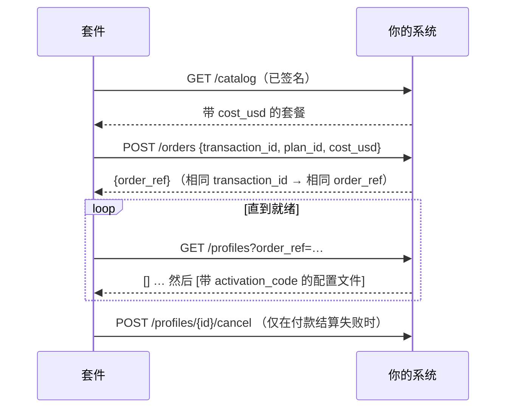

# SDK 参考

现有 eSIM 运营商把自己的系统接入 AIMarket 轨道所需的一切：软件包、供应商接口、适用于任意语言系统的 HTTP
供应商、卖家节点、webhooks、`esim.*@v1` 契约和一致性检查。

其他文档：[概览](../../README.zh.md) · [接入指南](rails.md) · [集成](integrations.md) · [运营者指南](operator-guide.md) · [智能体指南](agent-guide.md)

## 1. 软件包

| 软件包 | 内容 | 安装 |
|---|---|---|
| `@aimarket/esim-rails` | SDK：卖家节点、供应商、webhooks、schema、`esim-rails check` | 发布后用 `npm i @aimarket/esim-rails`；在此之前从本仓库的克隆中 `npm i ./rails` |
| `aimarket-hub`（PyPI） | `aimarket node`：把你收录到各枢纽的联邦节点 | `pip install aimarket-hub==3.15.26`，或套件的 `node/` 镜像 |
| JSON Schema | 面向任意语言的契约 | `rails/spec/esim-v1/*.schema.json` |
| Docker 镜像 | 店铺、卖家节点、联邦节点 | 由 `docker compose up --build` 构建 |

Node.js 20 或更高版本。SDK 为 ESM。

```js
import {
  createNode, ed25519Signer, buildPaywall, fileStore,          // the seller node
  httpSupplier, esimAccessSupplier, airaloSupplier, esimGoSupplier, createEsimAccessClient,   // suppliers
  createWebhooks, verifyWebhook,                                // your systems
  validate, checkSeller,                                        // the contract
  pricingFromEnv, parsePriceList, priceFor,                     // your prices
} from "@aimarket/esim-rails";
```

## 2. 供应商接口

供应商就是 eSIM 的来源。店铺和卖家节点只通过五个方法与它交互。

| 方法 | 返回 | 规则 |
|---|---|---|
| `catalog()` | `Plan[]` | 你销售的套餐，按你的成本 |
| `order({ transactionId, planId, costUsd })` | `{ orderRef }` | 按 `transactionId` 幂等；当 `costUsd` 已不是你的成本时拒绝 |
| `profiles({ orderRef })` 或 `profiles({ profileId })` | `Profile[]` | 配置文件生成期间返回 `[]` |
| `cancel({ profileId })` | `true` | 仅限未使用的配置文件 |
| `balance()` | `{ usd }` 或 `null` | 无需监控余额时返回 `null` |

```text
Plan     { id, name, countries: ["FR", …], kind?: "country" | "region" | "global", data_bytes, days,
           speed?, networks?, top_up?, unused_valid_days?, cost_usd }
Profile  { profileId, orderRef, activationCode, iccid?, qrCodeUrl?, installUrl?, apn?, expires?,
           state?, installed?, dataUsedBytes?, dataTotalBytes?, activated? }
```

抛出 `SupplierError(code, message, { retryable })`：`retryable: true` 表示“暂时不行”（故障、频率限制）；
否则表示“不行”（未知套餐、价格变动、余额不足）。“不行”永远不会向买家扣款。

在你自己代码中的供应商：

```js
import { SupplierError } from "@aimarket/esim-rails";

export const mySupplier = {
  async catalog() {
    return (await db.plans.active()).map((p) => ({
      id: p.sku, name: p.title, countries: p.countries, kind: p.region ? "region" : "country",
      data_bytes: p.gb * 1024 ** 3, days: p.days, cost_usd: p.cost }));
  },
  async order({ transactionId, planId, costUsd }) {
    const plan = await db.plans.get(planId);
    if (!plan || plan.cost !== costUsd) throw new SupplierError("price_changed", "the plan changed");
    const o = await db.orders.upsertByTransaction(transactionId, planId);   // the same id, the same order
    return { orderRef: o.id };
  },
  async profiles({ orderRef, profileId }) {
    const rows = orderRef ? await smdp.profilesOfOrder(orderRef) : [await smdp.profile(profileId)].filter(Boolean);
    return rows.map((r) => ({ profileId: r.id, orderRef: r.order, activationCode: r.lpa, iccid: r.iccid, state: r.state }));
  },
  async cancel({ profileId }) { await smdp.release(profileId); return true; },
  async balance() { return null; },                                       // your own stock: nothing to watch
};
```

内置：`esimAccessSupplier(createEsimAccessClient({ accessCode, secretKey }))`、`airaloSupplier({ clientId, clientSecret })`、
`esimGoSupplier({ apiKey })` 和 `httpSupplier({ url, secret })`——配置与注意事项见[集成](integrations.md)。

## 3. HTTP 供应商：你的系统，任意语言

用 `SUPPLIER=http`、`SUPPLIER_URL` 和 `SUPPLIER_SECRET_FILE` 运行套件，并在你的系统中实现五个端点。
完整契约见 [rails/spec/supplier-http.md](../../rails/spec/supplier-http.md)。

| 方法与路径 | 请求体 | 响应 |
|---|---|---|
| `GET /catalog` | — | `{"plans": [Plan]}` |
| `POST /orders` | `{"transaction_id", "plan_id", "cost_usd"}` | `{"order_ref"}` |
| `GET /profiles?order_ref=…` 或 `?profile_id=…` | — | `{"profiles": [Profile]}`（snake_case） |
| `POST /profiles/{profile_id}/cancel` | `{}` | `{"cancelled": true}` |
| `GET /balance` | — | `{"usd": 250.0}`，或 404 |

每个请求都带有 `X-Kit-Timestamp` 和 `X-Kit-Signature: v1=<hex HMAC-SHA256(secret,
timestamp + "." + METHOD + " " + path + "." + body)>`。拒绝签名错误以及超过五分钟的请求。



一个最小的 Python 接收端（Flask），包含最重要的两个端点：

```python
import hashlib, hmac, json, time
from flask import Flask, request, jsonify, abort

SECRET = open("/run/secrets/kit_supplier").read().strip().encode()
app = Flask(__name__)

@app.before_request
def signed():
    ts, sig = request.headers.get("X-Kit-Timestamp", "0"), request.headers.get("X-Kit-Signature", "")
    path = request.full_path.rstrip("?")
    msg = f"{ts}.{request.method} {path}.".encode() + request.get_data()
    want = "v1=" + hmac.new(SECRET, msg, hashlib.sha256).hexdigest()
    if abs(time.time() * 1000 - int(ts)) > 300_000 or not hmac.compare_digest(want, sig):
        abort(401)

@app.get("/catalog")
def catalog():
    return jsonify(plans=[{"id": p.sku, "name": p.title, "countries": p.countries, "kind": "country",
                           "data_bytes": p.bytes, "days": p.days, "cost_usd": float(p.cost)} for p in active_plans()])

@app.post("/orders")
def orders():
    body = request.get_json()
    plan = find_plan(body["plan_id"])
    if plan is None or float(plan.cost) != body["cost_usd"]:
        return jsonify(error="price_changed"), 409
    order = upsert_order(body["transaction_id"], plan)          # idempotent by transaction_id
    return jsonify(order_ref=order.ref)
```

包含全部五个端点的 JavaScript 参考实现：[rails/examples/operator-backend.mjs](../../rails/examples/operator-backend.mjs)。

## 4. 卖家节点

```js
const node = createNode({
  supplier,                         // a supplier (section 2) or an eSIM Access client
  store: fileStore("/data/orders.json", fs),     // or your own {get, put}: order records, never codes
  secret: statusSecret,             // 16+ characters: the key of the buyers' status tokens
  signer: ed25519Signer(pem),       // your node's identity: signs every free answer
  publicUrl: "https://esim.example.com/agents",
  paywall,                          // buildPaywall(...) below, or null to quote without selling
  events,                           // createWebhooks(...) or { emit() {} }
  pricing: pricingFromEnv(process.env),   // MARGIN_PCT, MIN_MARGIN_USD and PRICES_FILE; or your own object, below
  sellerName: "My eSIM", productId: "esim-mine", demo: false,
});
const paywall = await buildPaywall({
  cdpKeyFile: "/run/secrets/cdp_api_key.json", payTo: "0xYourBaseAddress", publicUrl: "https://esim.example.com/agents",
  priceOf: (offerId) => node.priceOf(offerId), onSettleFailure: (p) => node.settleFailed(p),
});
node.app.listen(9490);
```

路由：`POST /quote` 和 `POST /status`（另有供枢纽使用的 `/quote/invoke`、`/status/invoke`）、`POST /order`
（x402）、`GET /listing.json`、`GET /healthz`。免费路由允许任意网页调用（CORS）；下单路由不允许。

**价格。** `pricing` 是 `{ marginPct, minMarginUsd, rules }`。规则来自价目表：`parsePriceList(text)` 读取 CSV 或 JSON（各列见[运营者指南](operator-guide.md)第 5 步），出错时抛出带行号的 `PriceListError`。`priceFor(plan, pricing)` 给出套餐的售价以及定价的规则；`off` 规则会把该套餐从报价中去掉。没有规则时，所有套餐按公式定价，默认 100% 和 1.00 美元。

**退款。** 带 `{esim_tran_no, status_token}` 的 `POST /refund` 会取消未使用的 eSIM（未安装、无流量；否则返回 `409 in_use`），并把订单价款一次性退回付款地址。`createNode({ refunder })` 接受 `await buildRefunder({ keyFile, cdpKeyFile, maxUsd, dailyMaxUsd })`：它从退款钱包签署 EIP-3009 转账，由 facilitator 结算。没有 refunder 时回答为 `status: "due"`。[案例](cases.md)页面有一次带交易记录的真实退款。

**收据。** 已交付的订单还会返回 `receipt` 和 `receipt_signature`，已支付的退款也会返回自己的收据：这是买家可以交给枢纽、证明卖家已交付的凭据。`receipt` 为 `{v: 1, kind, capability: "esim.order@v1", product_id, chain_id: 8453, …}`。`kind: "delivery"` 时另含 `payer`、`pay_to`、`nonce`（付款的 EIP-3009 nonce）、`offer_id` 和 `at`；`kind: "refund"` 时另含 `payer`、`refund_from`、`refund_nonce`、`delivery_nonce` 和 `at`。签名是对 `canonicalJson(receipt)` 的 Ed25519 签名（base64），由节点的 `signer` 生成：即 `/healthz` 和 `/listing.json` 显示、`node.toml` 以 `provider_pubkey` 公布的那个密钥。收据中不含任何 eSIM 秘密。记为 `due` 的退款没有收据：还没有可出示的转账。枢纽一侧见[案例](cases.md)第 11.4 节。

## 5. Webhooks

设置 `WEBHOOK_URL` 和 `WEBHOOK_SECRET_FILE`（16 个字符以上），或传入 `createWebhooks({ url, secret })`。

| 事件 | 何时 |
|---|---|
| `order.created` | 买家在店铺发起订单 |
| `order.delivered` | 已付款并交付 |
| `order.refund_due` | 已付款但供应商拒绝：请退款给付款方 |
| `order.underpaid` | 收到低于价格的付款 |
| `order.expired` | 24 小时内未收到付款 |
| `order.awaiting_payment` | 签名付款结算失败；订单重新开放 |
| `agent_order.delivered` | 智能体的订单已交付 |
| `agent_order.cancelled` | 智能体的付款结算失败；eSIM 已取消 |
| `agent_order.refunded` | 智能体未使用的 eSIM 已取消，价款已退回（`transaction`） |
| `agent_order.refund_due` | 智能体未使用的 eSIM 已取消；请自行把价款退给 `to` |

```http
POST /hooks/esim HTTP/1.1
Content-Type: application/json
X-Kit-Event: order.delivered
X-Kit-Timestamp: 1765432100000
X-Kit-Signature: v1=5d41402abc4b2a76b9719d911017c592…

{"id": "3f1c…", "type": "order.delivered", "created_at": "2026-10-14T10:46:24.000Z",
 "data": {"order_id": "Qh3…", "status": "delivered", "offer_id": "JP_5_30", "offer_name": "Japan 5GB 30Days",
          "price_usd": "6.40", "cost_usd": 3.2, "method": "tron",
          "payment": {"ref": "tron:…", "payer": "T…", "units": "6400042"}, "esim_tran_no": "26101410460022",
          "error": null, "created_at": "2026-10-14T10:45:58.000Z"}}
```

签名覆盖 `timestamp + "." + body`。投递至少一次（约半分钟内尝试三次）：按 `id` 去重。事件中永远不包含激活码、
二维码链接或订单令牌。

```js
import { verifyWebhook } from "@aimarket/esim-rails";
app.post("/hooks/esim", express.text({ type: "*/*" }), (req, res) => {
  const ok = verifyWebhook({ secret, timestamp: req.get("x-kit-timestamp"), signature: req.get("x-kit-signature"), body: req.body });
  if (!ok) return res.sendStatus(401);
  crm.record(JSON.parse(req.body));
  res.sendStatus(204);
});
```

```python
def kit_event_ok(secret: bytes, timestamp: str, signature: str, body: bytes) -> bool:
    want = "v1=" + hmac.new(secret, timestamp.encode() + b"." + body, hashlib.sha256).hexdigest()
    return abs(time.time() * 1000 - int(timestamp)) < 300_000 and hmac.compare_digest(want, signature)
```

## 6. 契约：esim.*@v1

| 能力 | 输入 schema | 结果 schema |
|---|---|---|
| `esim.quote@v1` | `quote-input` | `quote-result`（含 `offer`） |
| `esim.order@v1` | `{offer_id}` + x402 | `delivery` |
| `esim.status@v1` | `status-input` | `status-result` |

Schema：[rails/spec/esim-v1](../../rails/spec/esim-v1/)。免费响应为 `{"success": true, "result": …}`，
带 `X-Provider-Signature`：对 `{capability_id, product_id, input_sha256, result}` 的规范 JSON 所做的
Ed25519 签名，base64 编码（按键排序、无空格、非 ASCII 原样保留；`input_sha256` 是规范输入的十六进制
SHA-256）。下单以 `402` 回应，并带 x402 v2 `PAYMENT-REQUIRED` 头：方案 `exact`、网络 `eip155:8453`、
USDC、6 位小数的套餐价格、你的地址。

在你自己的测试中验证：`import { validate } from "@aimarket/esim-rails"; validate("offer", o)`
返回 `[]` 或问题列表。

## 7. 一致性检查

把它指向任意卖家节点，无论是套件的还是你自己编写的：

```bash
npx esim-rails check https://esim.example.com/agents --country JP
```

它对演示节点的输出：

```text
✓ listing.json — esim.quote@v1, esim.status@v1; order at https://modelmarket.dev/providers/esim/order
✓ esim.quote@v1 answer — 5 offers for JP, all valid
✓ cheapest first
✓ signature — Ed25519 over the request-bound canonical, key from listing.json
✓ bad input is a 400
✓ unknown eSIM is a 404 not_found
✓ unknown offer is a 400 before any price
⚠ x402 terms — a demo node: it sells nothing (demo_mode)
✓ CORS on the free routes

Conforms to esim.*@v1.
```

它只调用免费路由，并向下单路由询问价格；它从不付款。

## 8. 环境变量

| 变量 | 服务 | |
|---|---|---|
| `SUPPLIER` | store、rails | `esimaccess`（默认）、`airalo`、`esimgo` 或 `http` |
| `AIRALO_CLIENT_ID_FILE`、`AIRALO_CLIENT_SECRET_FILE`、`AIRALO_BASE_URL` | store、rails | Airalo Partner API |
| `ESIMGO_API_KEY_FILE`、`ESIMGO_BASE_URL` | store、rails | eSIM Go |
| `ESIMACCESS_ACCESS_CODE_FILE`、`ESIMACCESS_SECRET_KEY_FILE` | store、rails | eSIM Access 密钥 |
| `SUPPLIER_URL`、`SUPPLIER_SECRET_FILE` | store、rails | 你的系统，用于 `SUPPLIER=http` |
| `WEBHOOK_URL`、`WEBHOOK_SECRET_FILE` | store、rails | 发往你系统的事件；未设置时关闭 |
| `MARGIN_PCT`、`MIN_MARGIN_USD` | store、rails | 价格 = 成本 + 加价 |
| `PRICES_FILE` | store、rails | 覆盖公式的价目表，CSV 或 JSON；无法读取的价目表会让启动失败 |
| `CATALOG_SNAPSHOT` | rails | 供应商不响应时提供的最近一次目录：销售时最多六小时，演示模式下不限时长（默认 `/data/catalog-snapshot.json`；店铺在 `DATA_DIR` 中保存自己的一份） |
| `REFUND_KEY_FILE` | rails | 可选：支付退款的钱包私钥，经 facilitator 以 USDC 支付（无需 ETH）；未设置时退款记为待付 |
| `REFUND_MAX_USD`、`REFUND_DAILY_MAX_USD` | rails | 单笔退款和每日退款的上限（各 50） |
| `PAY_TO_EVM`、`CDP_KEY_FILE` | rails | 智能体付款地址，以及 facilitator 密钥 |
| `PAY_TO_EVM`、`PAY_TO_TON`、`PAY_TO_TRON`、`PAY_TO_SOLANA`、`EVM_CHAINS` | store | 用户付款地址 |
| `DEMO_MODE` | store、rails | `1`：提供报价和页面，不销售 |
| `PUBLIC_URL`、`PRODUCT_ID`、`SELLER_NAME` / `STORE_NAME` | 两者 | 你的身份 |

## 9. 版本

`esim.*@v1` 只增不改：可能出现新的可选字段，已有字段保持含义不变。会破坏客户端的变更将成为 `esim.*@v2`，
与 v1 并列发布。SDK 遵循 semver；HTTP 供应商契约为第 1 版。
